# Page: Overview

# Overview

<details>
<summary>Relevant source files</summary>

The following files were used as context for generating this wiki page:

- [README.md](README.md)
- [docs/classification.md](docs/classification.md)
- [docs/completion.md](docs/completion.md)
- [docs/segmentation.md](docs/segmentation.md)
- [docs/unsupervised.md](docs/unsupervised.md)
- [tensorflow/data/seg_shapenet.py](tensorflow/data/seg_shapenet.py)

</details>


This document provides a comprehensive introduction to the O-CNN repository, explaining the octree-based convolutional neural network system for 3D deep learning. It covers the core architecture, supported tasks, framework integrations, and data processing pipeline.

For detailed installation instructions, see [Installation and Setup](#2). For specific task implementations, see [Tasks and Applications](#5). For framework-specific usage, see [Framework Integration](#4).

## What is O-CNN

O-CNN (Octree-based Convolutional Neural Networks) is a deep learning framework specifically designed for efficient 3D shape analysis. Unlike traditional approaches that work with voxel grids or point clouds directly, O-CNN uses octree data structures to hierarchically represent 3D shapes, enabling memory-efficient processing of high-resolution 3D data.

The system implements several key innovations:
- **Octree-based convolution**: Specialized convolution operations that work directly on octree nodes
- **Hierarchical processing**: Multi-resolution analysis through octree levels
- **Adaptive representation**: Support for both regular and adaptive octrees
- **Multi-framework support**: Implementations across Caffe, TensorFlow, and PyTorch

**Sources:** [README.md:1-79]()

## System Architecture

The O-CNN system consists of three main layers: a core C++ octree library, framework-specific bindings, and task-specific implementations.

### Core System Components

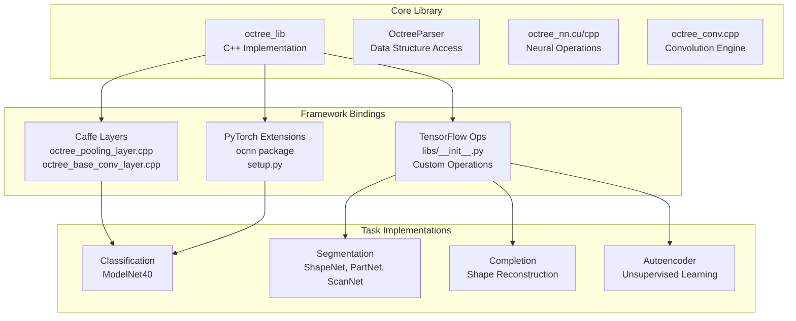

The core `octree_lib` provides fundamental data structures and operations, ensuring consistency across all framework integrations. Each framework has dedicated bindings while sharing the same underlying octree operations.

**Sources:** [README.md:1-79](), [docs/classification.md:1-207]()

### Data Processing Pipeline

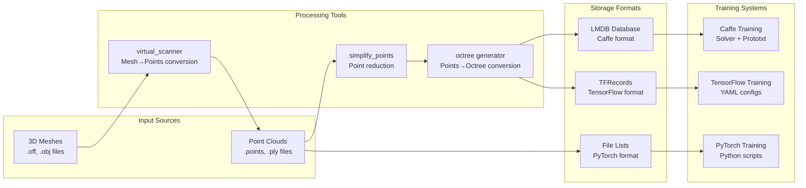

The system handles the complete workflow from raw 3D data to training-ready formats across multiple frameworks. Tools like `virtual_scanner` and `simplify_points` process raw meshes, while format-specific converters prepare data for each framework.

**Sources:** [docs/classification.md:12-44](), [tensorflow/data/seg_shapenet.py:27-134]()

## Supported Tasks

O-CNN supports four primary 3D learning tasks, each with specialized implementations and pre-configured datasets:

| Task | Primary Datasets | Frameworks | Key Features |
|------|------------------|------------|--------------|
| **Classification** | ModelNet40 | Caffe, TensorFlow, PyTorch | Object category recognition, voting strategies |
| **Segmentation** | ShapeNet, PartNet, ScanNet | TensorFlow, PyTorch | Part-level and scene-level segmentation |
| **Completion** | Custom completion dataset | TensorFlow | Shape reconstruction with skip connections |
| **Unsupervised Learning** | ShapeNetCore.v1 | TensorFlow | Self-supervised pretraining, instance discrimination |

### Classification Pipeline
The classification system processes 3D objects from ModelNet40 dataset through the following stages:
1. Mesh conversion using `virtual_scanner`
2. Point cloud simplification with `simplify_points`
3. Octree generation and database creation
4. Training with framework-specific networks (LeNet, ResNet, HRNet architectures)

### Segmentation Pipeline  
Segmentation tasks support both shape parts (ShapeNet, PartNet) and scene parsing (ScanNet):
- **Shape Segmentation**: Uses HRNet architecture for fine-grained part segmentation
- **Scene Segmentation**: Processes large-scale indoor scenes with UNet-like structures
- **Multi-scale Processing**: Leverages octree hierarchy for efficient scene analysis

**Sources:** [README.md:34-44](), [docs/classification.md:1-207](), [docs/segmentation.md:48-98](), [docs/unsupervised.md:1-100]()

## Framework Integration

O-CNN provides native support for three major deep learning frameworks, each with distinct advantages:

### Framework Comparison

| Framework | Implementation | Primary Use Cases | Key Components |
|-----------|---------------|-------------------|-----------------|
| **Caffe** | Custom layers | Research prototyping | `octree_pooling_layer.cpp`, `octree_base_conv_layer.cpp` |
| **TensorFlow** | Custom operators | Production deployment | `libs/__init__.py`, YAML configuration system |
| **PyTorch** | Extension modules | Modern research | `ocnn` package, `setup.py` installation |

### TensorFlow Integration
The TensorFlow implementation offers the most comprehensive feature set:
- Custom operators built through `build.py` → `libocnn.so`
- YAML-based configuration system for experiments
- Support for all task types including completion and unsupervised learning
- HRNet and UNet architectures for advanced applications

### PyTorch Integration
The PyTorch implementation focuses on modern deep learning workflows:
- Native extension through `setup.py` → `ocnn.nn` module
- Direct Python integration with standard PyTorch patterns
- ResNet architectures and standard classification/segmentation pipelines
- File list-based data loading for flexibility

**Sources:** [README.md:49-74](), [docs/classification.md:76-207]()

## Data Formats and Conversion

The system uses a standardized data processing pipeline that converts between multiple formats:

```mermaid
graph TD
    subgraph "Input Formats"
        OFF["OFF files<br/>Triangle meshes"]
        OBJ["OBJ files<br/>3D models"]
        PLY["PLY files<br/>Point clouds with normals"]
    end
    
    subgraph "Intermediate Processing"
        VirtScan["virtual_scanner<br/>Mesh sampling"]
        PointsFormat["POINTS format<br/>Simplified point clouds"]
        OctreeFormat["OCTREE format<br/>Hierarchical structure"]
    end
    
    subgraph "Training Formats"
        CaffeLMDB["LMDB<br/>convert_octree_data"]
        TensorFlowTFR["TFRecords<br/>convert_tfrecords.py"]
        PyTorchFiles["File Lists<br/>generate_points_filelist"]
    end
    
    OFF --> VirtScan
    OBJ --> VirtScan
    PLY --> PointsFormat
    VirtScan --> PointsFormat
    PointsFormat --> OctreeFormat
    
    OctreeFormat --> CaffeLMDB
    OctreeFormat --> TensorFlowTFR
    PointsFormat --> PyTorchFiles
```

Key conversion tools:
- `virtual_scanner`: Converts meshes to dense point clouds with normal vectors
- `simplify_points`: Reduces point density while preserving shape details
- `octree`: Generates hierarchical octree representations from point clouds
- `convert_octree_data`: Creates LMDB databases for Caffe training
- `convert_tfrecords.py`: Generates TFRecords for TensorFlow workflows

**Sources:** [tensorflow/data/seg_shapenet.py:36-86](), [docs/classification.md:12-44]()

## Performance and Benchmarks

O-CNN achieves state-of-the-art performance across multiple 3D learning benchmarks:

| Task | Dataset | Performance | Framework |
|------|---------|-------------|-----------|
| Classification | ModelNet40 | 89.6% accuracy (92.4% with ResNet) | All frameworks |
| Segmentation | PartNet | 58.4 mIoU | TensorFlow + HRNet |
| Scene Segmentation | ScanNet | 76.2 mIoU | PyTorch + UNet |
| Unsupervised | Various | SOTA on multiple benchmarks | TensorFlow |

The octree representation provides significant memory efficiency compared to voxel grids while maintaining high-resolution details. The hierarchical structure enables multi-scale processing that scales well to large scenes and complex shapes.

**Sources:** [README.md:50-74](), [docs/segmentation.md:52-56]()

---

# Page: Installation and Setup

# Installation and Setup

<details>
<summary>Relevant source files</summary>

The following files were used as context for generating this wiki page:

- [docs/installation.md](docs/installation.md)
- [octree/CMakeLists.txt](octree/CMakeLists.txt)
- [pytorch/setup.py](pytorch/setup.py)

</details>


This document covers the complete installation process for O-CNN, including building the core octree library and setting up integrations with major deep learning frameworks. The installation consists of two main phases: building the foundational octree library with its command-line tools, and then compiling framework-specific bindings for TensorFlow, PyTorch, or Caffe.

For information about using the installed system for specific tasks, see [Tasks and Applications](#5). For details about the core octree data structures being built, see [Core Architecture](#3).

## System Requirements

O-CNN supports multiple platforms and framework configurations with the following requirements:

| Component | Requirements |
|-----------|-------------|
| **Operating System** | Ubuntu 16.04/18.04, Windows 10 x64 |
| **Build Tools** | CMake 3.12.3+, Git |
| **CUDA** | CUDA 8.0+ (Caffe), CUDA 10.1+ (TensorFlow), CUDA 10.2+ (PyTorch) |
| **Python** | Python 3.x via Anaconda (recommended) |
| **Compiler** | GCC 4.8+ (Linux), MSVC (Windows) |

Sources: [docs/installation.md:63-66](), [docs/installation.md:30-32](), [octree/CMakeLists.txt:1]()

## Installation Process Overview

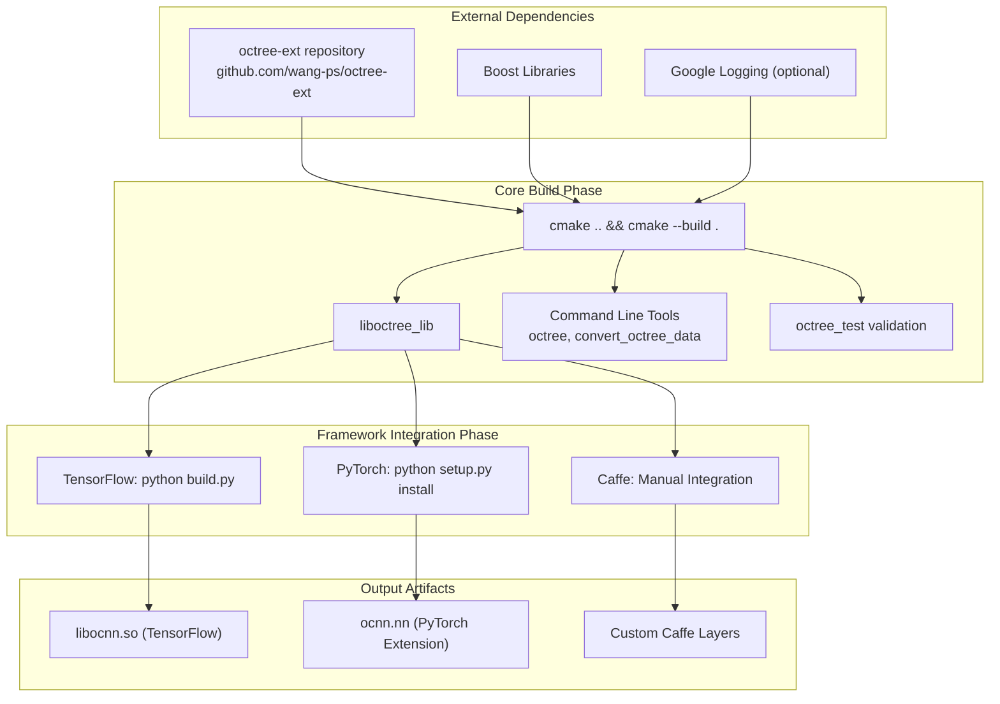

Sources: [docs/installation.md:10-25](), [docs/installation.md:75-79](), [pytorch/setup.py:16-38]()

## Core Octree Library Installation

The octree library forms the foundation for all framework integrations and must be built first.

### Step 1: Clone External Dependencies

```bash
cd octree/external
git clone --recursive https://github.com/wang-ps/octree-ext.git
```

The external dependencies include essential libraries used throughout the codebase:

| Library | Purpose | CMake Option |
|---------|---------|--------------|
| **miniball** | Bounding sphere computation | `USE_MINIBALL` |
| **happly** | PLY file I/O | Always included |
| **nanoflann** | K-nearest neighbor search | Always included |
| **rply** | Advanced PLY processing | `USE_RPLY` |
| **glog** | Logging framework | `USE_GLOG` |
| **googletest** | Unit testing | Always included |

Sources: [octree/CMakeLists.txt:47-52](), [octree/CMakeLists.txt:94-98](), [docs/installation.md:12]()

### Step 2: Configure and Build

```bash
cd octree
mkdir build && cd build
cmake .. && cmake --build . --config Release
```

The CMake configuration supports several important options defined in [octree/CMakeLists.txt:3-13]():

```bash
# Common configuration options
cmake .. -DUSE_CUDA=ON -DKEY64=ON -DUSE_OPENMP=ON
```

| Option | Default | Description |
|--------|---------|-------------|
| `USE_CUDA` | ON | Enable CUDA acceleration |
| `KEY64` | OFF | Support deeper octrees with 64-bit keys |
| `USE_OPENMP` | OFF | Enable OpenMP parallelization |
| `ABI` | OFF | CXX11_ABI compatibility mode |

Sources: [octree/CMakeLists.txt:3-13](), [docs/installation.md:13-15]()

### Step 3: Add Tools to System Path

After successful compilation, add the built executables to your system path:

**Windows:**
```cmd
set PATH=the\absolute\path\octree\build\Release;%PATH%
```

**Linux:**
```bash
export PATH=`pwd`:$PATH
```

The build process generates several command-line tools in [octree/CMakeLists.txt:137-147]():

- `octree` - Main octree construction tool (from `build_octree.cpp`)
- `convert_octree_data` - Data format conversion utility
- `simplify_points` - Point cloud simplification
- `virtual_scanner` - Mesh to point cloud conversion

Sources: [docs/installation.md:17-25](), [octree/CMakeLists.txt:137-147]()

## Framework-Specific Installation

### TensorFlow Integration

The TensorFlow integration creates custom operators for octree processing.

#### Prerequisites
```bash
conda create -n tf-1.14.0 tensorflow-gpu==1.14.0
conda activate tf-1.14.0
conda install -c conda-forge yacs tqdm
```

#### Build Process
```bash
cd tensorflow/libs
python build.py
```

The build script compiles custom TensorFlow operations and produces `libocnn.so` containing octree-specific operators.

**Build Dependencies:**
- CUDA 10.1+
- TensorFlow headers and libraries
- Compatible GCC version (4.8 for pip/docker installations)

Sources: [docs/installation.md:63-84]()

### PyTorch Integration

The PyTorch integration uses `torch.utils.cpp_extension` to create native extensions.

#### Environment Setup
```bash
conda create --name pytorch-1.7.0 python=3.7
conda activate pytorch-1.7.0
conda install pytorch==1.7.0 torchvision==0.8.0 cudatoolkit=10.2 -c pytorch
pip install -r requirements.txt
```

#### Build and Install
```bash
python setup.py install --build_octree
```

The `--build_octree` flag triggers automatic building of the core octree library through [pytorch/setup.py:36-38]():

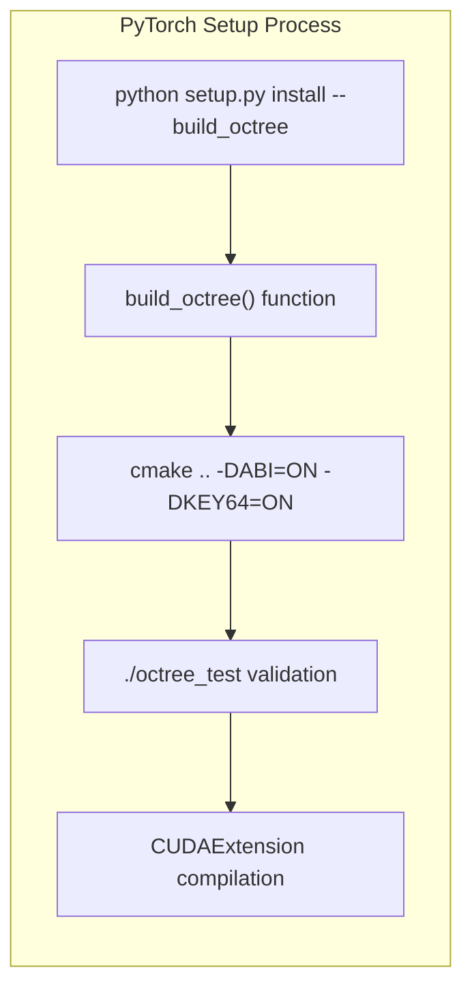

The setup process creates the `ocnn.nn` extension module by compiling sources from [pytorch/setup.py:41-44]():

Sources: [docs/installation.md:87-116](), [pytorch/setup.py:16-38](), [pytorch/setup.py:45-64]()

#### Verification
```bash
python -W ignore test/test_all.py -v
```

### Caffe Integration

Caffe integration requires manual code integration with the official Caffe repository.

#### Prerequisites
- CUDA 8.0 and cuDNN 6.0
- Specific Caffe revision `6bfc5ca`

#### Integration Steps
1. **Clone Caffe:**
   ```bash
   git clone https://github.com/BVLC/caffe.git caffe-official
   cd caffe-official && git checkout 6bfc5ca
   ```

2. **Override with O-CNN Code:**
   Copy contents from the `caffe` directory into `caffe-official` to override the standard Caffe implementation.

3. **Build:**
   Follow standard Caffe build instructions to generate:
   - `caffe` executable
   - `convert_octree_data` utility
   - `feature_pooling` tool

The Caffe integration provides custom layers for octree-based operations but sacrifices some performance for improved readability and memory efficiency compared to the original research implementation.

Sources: [docs/installation.md:28-51]()

## Build Configuration Details

### CMake Build System

The core build system uses CMake with multiple configuration options:

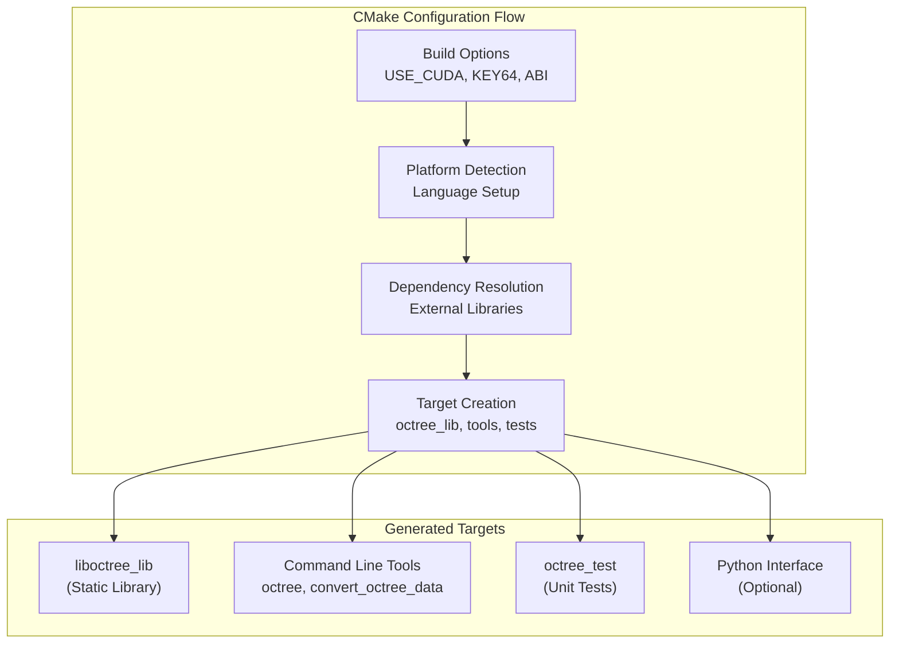

Key configuration decisions made in [octree/CMakeLists.txt:16-44]():

- **Language Selection:** CUDA support enables GPU acceleration
- **C++ Standard:** C++11 with position-independent code
- **ABI Compatibility:** Configurable for different library versions

Sources: [octree/CMakeLists.txt:16-44](), [octree/CMakeLists.txt:127-164]()

### Library Dependencies

The build system manages several categories of dependencies:

| Category | Libraries | Integration Method |
|----------|-----------|-------------------|
| **Core** | miniball, happly, nanoflann | Header-only inclusion |
| **Optional** | glog, rply | Conditional compilation |
| **Testing** | googletest | Git submodule |
| **Framework** | TensorFlow, PyTorch, Caffe | External linking |

Sources: [octree/CMakeLists.txt:46-98](), [octree/CMakeLists.txt:156-164]()

## Verification and Testing

### Core Library Testing
```bash
cd octree/build
./octree_test
```

The test suite validates core octree operations and data structure integrity.

### Framework-Specific Testing

**TensorFlow:**
Verify through TensorFlow import and basic operations.

**PyTorch:**
```bash
python -W ignore test/test_all.py -v
```

**Caffe:**
Test through model training workflows using provided prototxt configurations.

Sources: [pytorch/setup.py:30-33](), [docs/installation.md:113-116]()

## Common Installation Issues

### Version Compatibility
- **TensorFlow:** Requires specific GCC versions when installed via pip
- **PyTorch:** CUDA toolkit version must match PyTorch's CUDA version
- **Caffe:** Strict dependency on CUDA 8.0 and cuDNN 6.0

### Build Failures
- Missing external dependencies: Ensure `octree-ext` is properly cloned
- CUDA compilation errors: Verify CUDA toolkit installation and PATH configuration
- ABI compatibility issues: Use `-DABI=ON` for older library versions

### Performance Notes
The current implementation prioritizes code maintainability over raw performance, resulting in approximately 10% slower execution compared to the original research code, while being more memory-efficient.

Sources: [docs/installation.md:47-51](), [docs/installation.md:81-84]()

---

# Page: Core Architecture

# Core Architecture

<details>
<summary>Relevant source files</summary>

The following files were used as context for generating this wiki page:

- [octree/octree/octree.cpp](octree/octree/octree.cpp)
- [octree/octree/octree_nn.cpp](octree/octree/octree_nn.cpp)
- [octree/octree/octree_nn.cu](octree/octree/octree_nn.cu)
- [octree/octree/octree_nn.h](octree/octree/octree_nn.h)
- [octree/octree/octree_parser.cpp](octree/octree/octree_parser.cpp)
- [octree/octree/octree_parser.h](octree/octree/octree_parser.h)
- [octree/test/test_util.cpp](octree/test/test_util.cpp)
- [octree/tools/chamfer_distance.cpp](octree/tools/chamfer_distance.cpp)
- [octree/tools/octree_bbox.cpp](octree/tools/octree_bbox.cpp)

</details>


This document explains the fundamental data structures and neural network operations that form the foundation of the O-CNN system. The core architecture provides the essential octree data structures, specialized neural network operations for processing octree data, and unified interfaces for accessing octree properties across CPU and GPU execution contexts.

For information about framework-specific integrations (TensorFlow, PyTorch, Caffe), see [Framework Integration](#4). For details about octree construction and point cloud processing, see [Point Cloud Processing](#3.3).

## System Overview

The O-CNN core architecture is built around three primary components: the octree data structure itself, specialized neural network operations that can process octree data efficiently, and a unified parser interface that provides consistent access to octree properties.

### Core Architecture Components

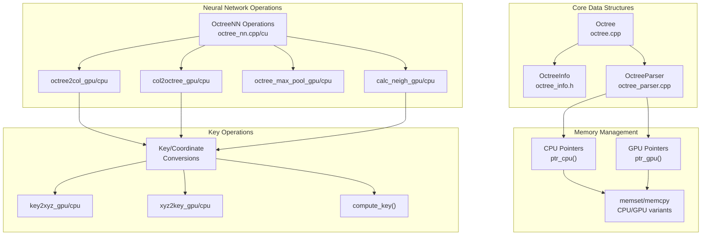

Sources: [octree/octree/octree.cpp:1-1569](), [octree/octree/octree_nn.h:1-255](), [octree/octree/octree_parser.h:1-86]()

## Fundamental Data Structures

### Octree Class

The `Octree` class serves as the primary container for octree data and provides methods for building, serializing, and manipulating octree structures.

| Component | Purpose | Key Methods |
|-----------|---------|-------------|
| `buffer_` | Raw octree data storage | `resize_octree()`, `get_binary_string()` |
| `keys_` | Spatial keys for each level | `sort_keys()`, `unique_key()` |
| `children_` | Child node relationships | `build_structure()` |
| `avg_normals_`, `avg_features_` | Averaged node properties | `calc_signal()` |

The octree building process follows this workflow:

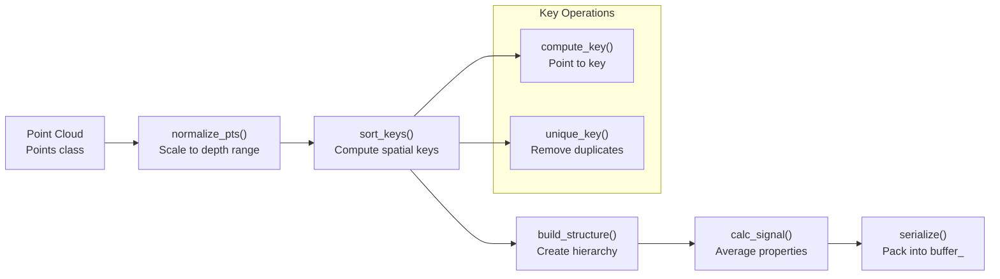

Sources: [octree/octree/octree.cpp:74-121](), [octree/octree/octree.cpp:172-203](), [octree/octree/octree.cpp:205-283]()

### OctreeParser Interface

The `OctreeParser` class provides a unified interface for accessing octree data across different execution contexts, supporting both CPU and GPU memory layouts.

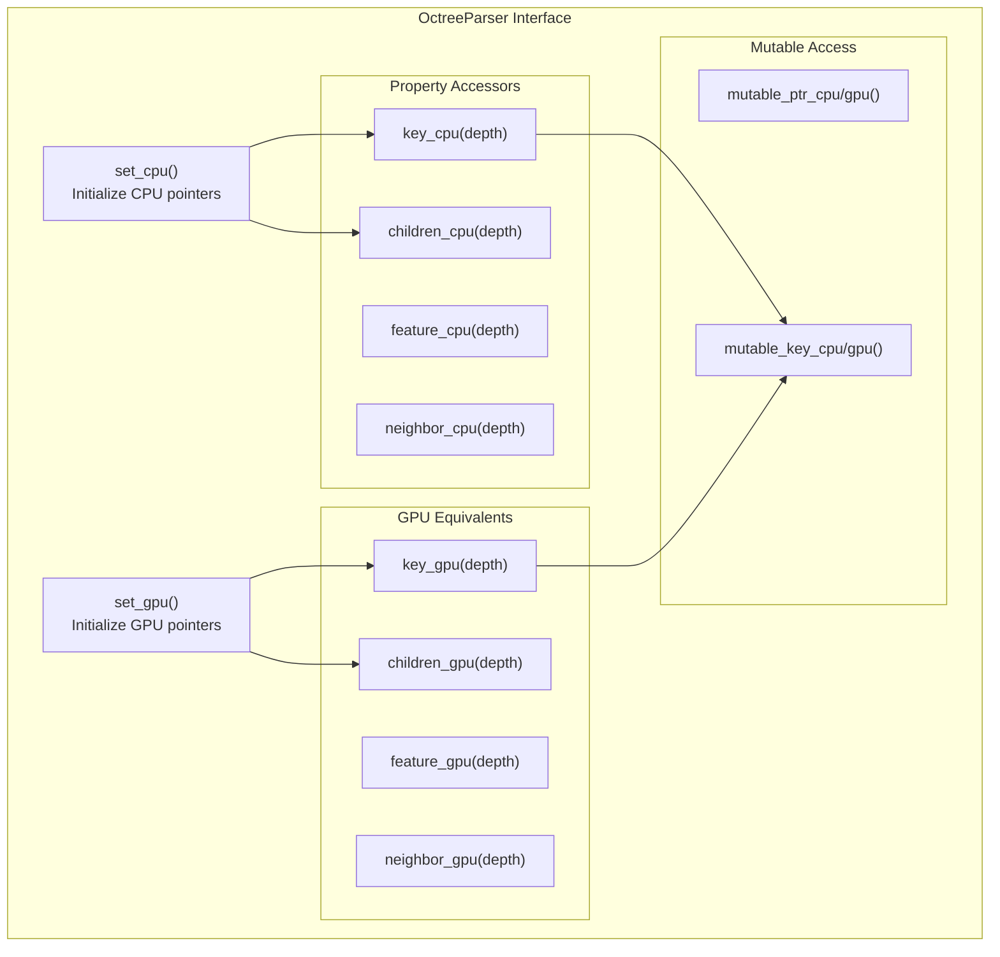

Sources: [octree/octree/octree_parser.cpp:8-91](), [octree/octree/octree_parser.h:13-83]()

## Neural Network Operations

### Core Convolution Operations

The heart of octree-based CNNs lies in the `octree2col` and `col2octree` operations, which enable efficient convolution by transforming octree data into a format suitable for standard matrix operations.

#### octree2col Operation

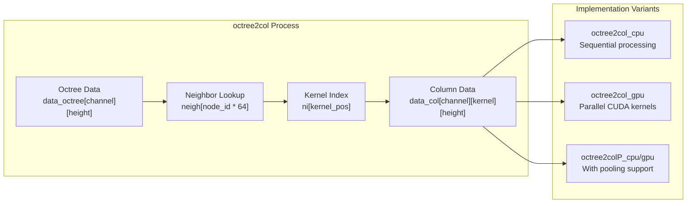

The `octree2col_kernel` implementation processes each thread in parallel:

| Parameter | Purpose | Range |
|-----------|---------|-------|
| `height` | Current octree level height | `[0, node_count]` |
| `kernel_sdim` | Kernel spatial dimension | Typically 27 for 3³ kernel |
| `stride` | Convolution stride | 1 or 2 |
| `neigh` | Neighborhood lookup table | 64 entries per node |
| `ni` | Kernel index mapping | Maps kernel positions to neighbor indices |

Sources: [octree/octree/octree_nn.cu:109-159](), [octree/octree/octree_nn.cpp:188-241]()

#### Neighborhood Calculation

The `NeighHelper` singleton manages kernel patterns and neighborhood relationships:

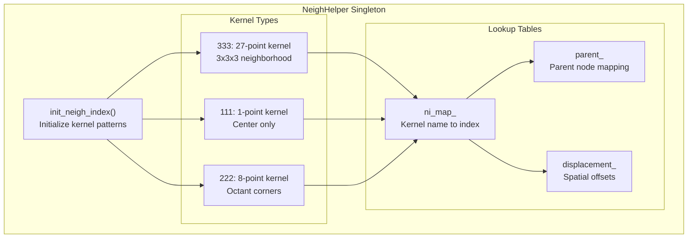

Sources: [octree/octree/octree_nn.cpp:6-108](), [octree/octree/octree_nn.h:15-47]()

### Pooling Operations

Octree-specific pooling operations maintain the hierarchical structure while downsampling features:

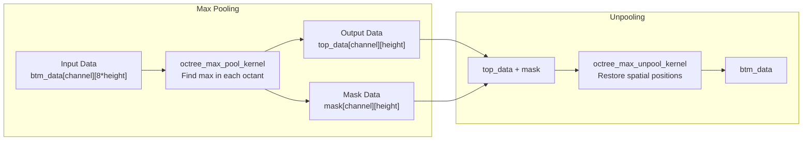

The pooling operations exploit the octree's natural 8-to-1 hierarchy where each parent node corresponds to exactly 8 children nodes.

Sources: [octree/octree/octree_nn.cu:257-327](), [octree/octree/octree_nn.cpp:301-354]()

## Key and Coordinate Systems

### Spatial Key Encoding

The system uses a sophisticated key encoding scheme to map 3D coordinates to linear indices that preserve spatial locality:

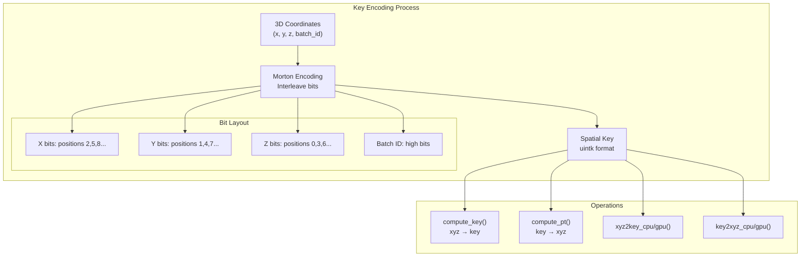

The key encoding ensures that spatially adjacent octree nodes have similar key values, enabling efficient neighbor lookup and spatial operations.

Sources: [octree/octree/octree_nn.cpp:551-575](), [octree/octree/octree_nn.cu:593-649]()

## Memory Management and Device Abstraction

The architecture provides consistent interfaces across CPU and GPU execution contexts through template-based memory operations:

| Operation | CPU Version | GPU Version | Purpose |
|-----------|-------------|-------------|---------|
| Memory Set | `memset_cpu<T>()` | `memset_gpu<T>()` | Initialize arrays |
| Memory Copy | `memcpy_cpu<T>()` | `memcpy_gpu<T>()` | Transfer data |
| Padding | `pad_forward_cpu<T>()` | `pad_forward_gpu<T>()` | Handle sparse data |
| Gather/Scatter | `align_forward_gpu<T>()` | `octree_gather_gpu<T>()` | Reorder data |

The GPU implementations use CUDA kernels with thread-level parallelism, while CPU versions provide sequential fallbacks for debugging and smaller datasets.

Sources: [octree/octree/octree_nn.cu:38-106](), [octree/octree/octree_nn.cpp:143-185](), [octree/octree/octree_nn.h:56-78]()

---

# Page: Octree Data Structure

# Octree Data Structure

<details>
<summary>Relevant source files</summary>

The following files were used as context for generating this wiki page:

- [octree/octree/octree.cpp](octree/octree/octree.cpp)
- [octree/octree/octree_parser.cpp](octree/octree/octree_parser.cpp)
- [octree/octree/octree_parser.h](octree/octree/octree_parser.h)
- [octree/test/test_util.cpp](octree/test/test_util.cpp)
- [octree/tools/chamfer_distance.cpp](octree/tools/chamfer_distance.cpp)
- [octree/tools/octree_bbox.cpp](octree/tools/octree_bbox.cpp)

</details>


This document covers the core octree data structure implementation in O-CNN, including construction, serialization, and property management. The octree serves as the fundamental spatial indexing mechanism that enables efficient 3D convolutional neural network operations on irregular 3D data.

For information about neural network operations on octrees, see [Neural Network Operations](#3.2). For point cloud processing and conversion to octrees, see [Point Cloud Processing](#3.3).

## Overview

The octree data structure in O-CNN provides a hierarchical spatial subdivision of 3D space that enables efficient storage and processing of sparse 3D data. The implementation consists of two primary classes: `Octree` for construction and modification, and `OctreeParser` for read-only access to serialized octree data.

## Core Classes and Architecture

### Class Hierarchy

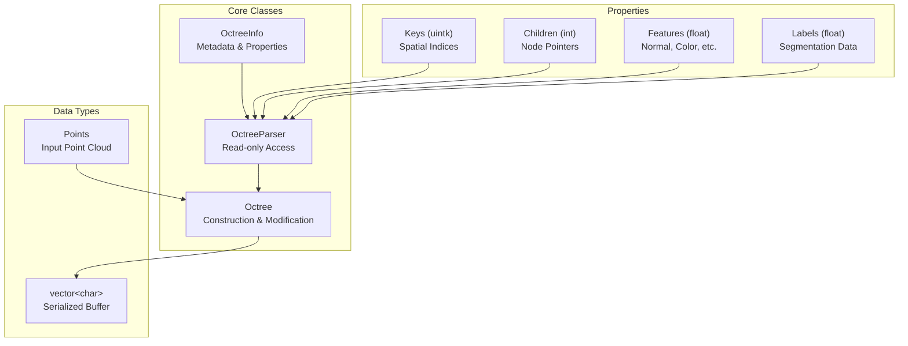

**Sources:** [octree/octree/octree_parser.h:13-83](), [octree/octree/octree.cpp:1-120]()

### Node Types and Representation

The octree uses a hierarchical node system with three distinct node types:

| Node Type | Value | Description |
|-----------|-------|-------------|
| `kLeaf` | -1 | Empty leaf node with no data |
| `kNonEmptyLeaf` | -2 | Leaf node containing point data |
| `kInternelNode` | ≥0 | Internal node with child pointer |

**Sources:** [octree/octree/octree_parser.h:16](), [octree/octree/octree_parser.cpp:23-28]()

## Octree Construction Process

### Build Pipeline

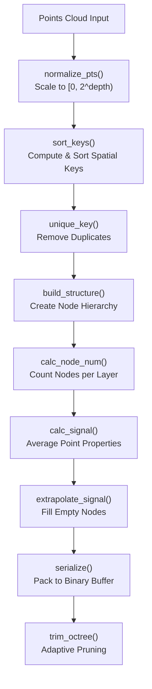

**Sources:** [octree/octree/octree.cpp:74-121]()

### Key Encoding System

The octree uses Morton codes (Z-order curve) for spatial indexing. Each node's position is encoded as a `uintk` value that preserves spatial locality:

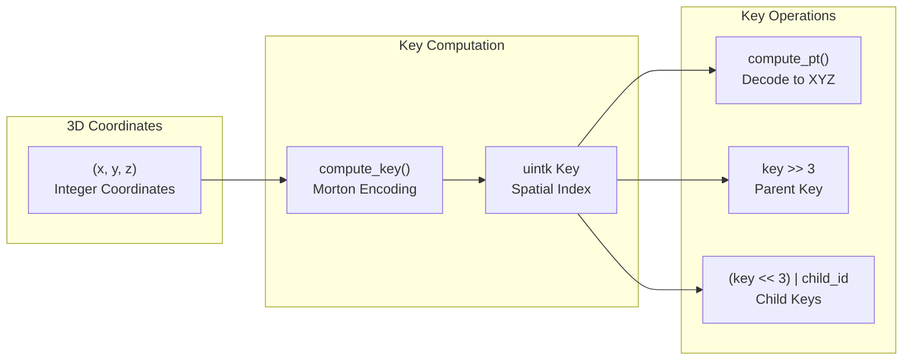

**Sources:** [octree/octree/octree.cpp:172-203](), [octree/octree/octree.cpp:227-283]()

## Data Organization and Storage

### Memory Layout

The octree stores data in multiple arrays organized by depth level:

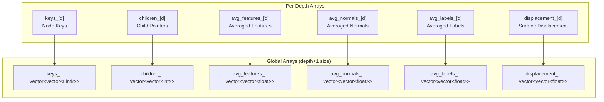

**Sources:** [octree/octree/octree.cpp:123-153]()

### Serialization Format

The octree serializes all data into a contiguous binary buffer for efficient storage and network transfer:

| Component | Data Type | Description |
|-----------|-----------|-------------|
| `OctreeInfo` | Header | Metadata, dimensions, property flags |
| Keys | `uintk[]` | Spatial indices for all nodes |
| Children | `int[]` | Child pointers for all nodes |
| Features | `float[]` | Concatenated feature vectors |
| Labels | `float[]` | Segmentation labels |
| Split Labels | `float[]` | Subdivision indicators |

**Sources:** [octree/octree/octree.cpp:907-945]()

## Property Management

### Signal Averaging

The octree computes averaged properties at each level by aggregating point data:

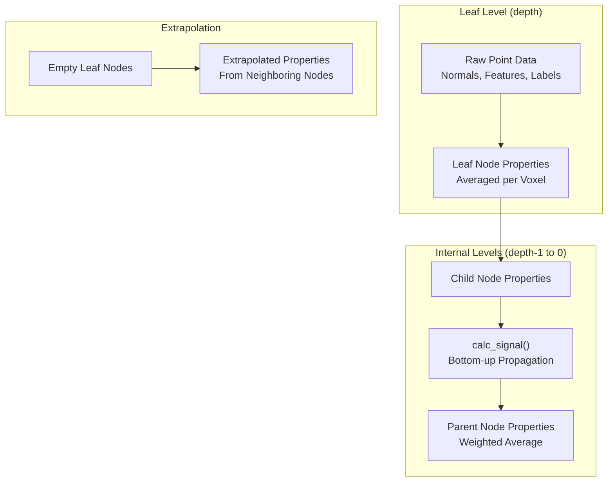

**Sources:** [octree/octree/octree.cpp:311-451](), [octree/octree/octree.cpp:454-664](), [octree/octree/octree.cpp:666-806]()

### Displacement Computation

For surface reconstruction, the octree computes displacement values that encode distance to the actual surface:

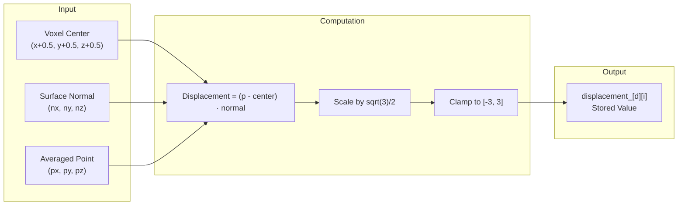

**Sources:** [octree/octree/octree.cpp:403-451](), [octree/octree/octree.cpp:586-605]()

## OctreeParser Interface

### Read-Only Access

The `OctreeParser` class provides efficient read-only access to serialized octree data without requiring full reconstruction:

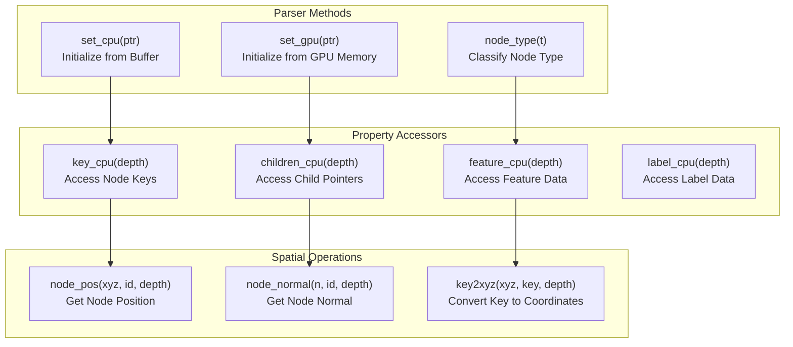

**Sources:** [octree/octree/octree_parser.h:30-64](), [octree/octree/octree_parser.cpp:8-92](), [octree/octree/octree_parser.cpp:95-168]()

### Node Position Computation

The parser computes 3D positions from keys and optionally applies displacement for surface reconstruction:

**Sources:** [octree/octree/octree_parser.cpp:95-124]()

## File I/O Operations

### Binary Format

The octree supports direct binary serialization for efficient storage:

| Operation | Method | Description |
|-----------|--------|-------------|
| Read | `read_octree(filename)` | Load from binary file |
| Write | `write_octree(filename)` | Save to binary file |
| Buffer | `get_binary_string()` | Export as string |
| Memory | `set_octree(data, size)` | Load from memory |

**Sources:** [octree/octree/octree.cpp:41-72]()

### Legacy Format Support

The implementation includes legacy format support for backward compatibility with older octree files:

**Sources:** [octree/octree/octree.cpp:808-868]()

## Adaptive Octree Features

### Error-Based Pruning

For adaptive octrees, the system computes error metrics and prunes nodes that don't contribute significantly to surface representation:

```mermaid
graph TD
    subgraph "Error Computation"
        NormalError["normal_err_[d][i]<br/>Normal Deviation"]
        DistanceError["distance_err_[d][i]<br/>Surface Distance Error"]
        Thresholds["threshold_normal<br/>threshold_distance"]
    end
    
    subgraph "Pruning Decision"
        DropTypes["kDrop, kDropChildren, kKeep"]
        TrimData["trim_data()<br/>Remove Pruned Nodes"]
        UpdateCounts["calc_node_num()<br/>Update Node Counts"]
    end
    
    subgraph "Quality Control"
        MinNodes["Ensure Minimum Nodes<br/>Per Layer"]
        MaxError["Keep Node with<br/>Maximum Error"]
    end
    
    NormalError --> DropTypes
    DistanceError --> DropTypes
    Thresholds --> DropTypes
    DropTypes --> TrimData
    TrimData --> UpdateCounts
    DropTypes --> MinNodes
    MinNodes --> MaxError
```

**Sources:** [octree/octree/octree.cpp:1004-1127]()

---

# Page: Neural Network Operations

# Neural Network Operations

<details>
<summary>Relevant source files</summary>

The following files were used as context for generating this wiki page:

- [octree/octree/octree_nn.cpp](octree/octree/octree_nn.cpp)
- [octree/octree/octree_nn.cu](octree/octree/octree_nn.cu)
- [octree/octree/octree_nn.h](octree/octree/octree_nn.h)

</details>


This document explains the core neural network operations that enable convolutional neural networks (CNNs) to process octree data structures. These operations transform the hierarchical octree representation into formats compatible with standard CNN computations while preserving spatial relationships.

For information about the octree data structure itself, see [Octree Data Structure](#3.1). For framework-specific implementations of these operations, see [Framework Integration](#4).

## Core Transformation Operations

The fundamental challenge in octree-based CNNs is transforming the sparse, hierarchical octree structure into dense matrix formats that can be processed by standard convolution operations. The system accomplishes this through a family of `octree2col` and `col2octree` operations.

### octree2col and col2octree

The `octree2col` operation transforms octree data into column format for efficient convolution processing, similar to the classical `im2col` operation for images. The `col2octree` operation performs the reverse transformation.

```mermaid
graph LR
    subgraph "Octree Data"
        OD["data_octree<br/>[C x H]"]
    end
    
    subgraph "Convolution Workspace"
        CD["data_col<br/>[C x K x H_col]"]
        CONV["Standard<br/>Convolution"]
    end
    
    subgraph "Neighborhood Info"
        NH["neigh[]<br/>Neighbor indices"]
        NI["ni[]<br/>Kernel offsets"]
    end
    
    OD -->|"octree2col_gpu<br/>octree2col_cpu"| CD
    CD --> CONV
    NH --> CD
    NI --> CD
    CONV -->|"col2octree_gpu<br/>col2octree_cpu"| OD
```

The core functions handle different scenarios:
- **Standard convolution**: `octree2col_gpu`/`octree2col_cpu` and `col2octree_gpu`/`col2octree_cpu`
- **Pooling convolution**: `octree2colP_gpu`/`octree2colP_cpu` and `col2octreeP_gpu`/`col2octreeP_cpu`

Sources: [octree/octree/octree_nn.h:80-120](), [octree/octree/octree_nn.cu:110-175](), [octree/octree/octree_nn.cpp:188-298]()

### Neighborhood Index Management

The `NeighHelper` singleton class manages kernel neighborhood information for different convolution kernel sizes. It precomputes neighbor indices for various kernel configurations to optimize runtime performance.

```mermaid
graph TB
    subgraph "NeighHelper Singleton"
        NH[NeighHelper]
        NIM["ni_map_<br/>kernel_type → index"]
        NI["ni_[]<br/>Precomputed indices"]
        PAR["parent_[]<br/>Parent relationships"]
        DIS["displacement_[]<br/>Child displacements"]
        BIL["bilinear_[]<br/>Interpolation table"]
    end
    
    subgraph "Supported Kernels"
        K333["3x3x3 (27 neighbors)"]
        K111["1x1x1 (1 neighbor)"]
        K222["2x2x2 (8 neighbors)"]
        K311["3x1x1 (3 neighbors)"]
        KOTHER["Other combinations"]
    end
    
    NH --> NIM
    NH --> NI
    NH --> PAR
    NH --> DIS
    NH --> BIL
    
    K333 --> NI
    K111 --> NI
    K222 --> NI
    K311 --> NI
    KOTHER --> NI
```

Sources: [octree/octree/octree_nn.h:15-47](), [octree/octree/octree_nn.cpp:6-108]()

## Pooling Operations

Octree neural networks support several pooling strategies designed to work with the hierarchical structure while maintaining spatial coherence.

### Max Pooling

Max pooling in octrees operates on groups of 8 child nodes, selecting the maximum value and recording its position for later unpooling.

```mermaid
graph LR
    subgraph "Input Layer"
        BTM["btm_data<br/>[C x 8H]<br/>8 children per parent"]
    end
    
    subgraph "Max Pool Operation"
        MAXOP["octree_max_pool_gpu<br/>octree_max_pool_cpu"]
        MASK["mask[C x H]<br/>Winner indices"]
    end
    
    subgraph "Output Layer"  
        TOP["top_data<br/>[C x H]<br/>Pooled values"]
    end
    
    subgraph "Unpooling"
        UNPOOL["octree_max_unpool_gpu<br/>octree_max_unpool_cpu"]
        RESULT["Reconstructed<br/>[C x 8H]"]
    end
    
    BTM --> MAXOP
    MAXOP --> TOP
    MAXOP --> MASK
    TOP --> UNPOOL
    MASK --> UNPOOL
    UNPOOL --> RESULT
```

### Mask-based Pooling

Mask pooling uses precomputed indices to select specific values, useful for handling irregular octree structures.

Sources: [octree/octree/octree_nn.h:122-139](), [octree/octree/octree_nn.cu:258-327](), [octree/octree/octree_nn.cpp:301-354]()

## Spatial Operations

### Key Generation and Coordinate Conversion

The system uses Morton encoding (Z-order curve) to convert between 3D coordinates and linear keys for efficient spatial indexing and neighbor finding.

```mermaid
graph TB
    subgraph "Coordinate Representations"
        XYZ["xyz coordinates<br/>(x,y,z,batch_id)"]
        KEY["Morton keys<br/>Z-order encoded"]
        COORD["Float coordinates<br/>Normalized positions"]
    end
    
    subgraph "Conversion Functions"
        X2K["xyz2key_gpu<br/>xyz2key_cpu"]
        K2X["key2xyz_gpu<br/>key2xyz_cpu"]
        X2C["xyz2coord_gpu<br/>xyz2coord_cpu"]
        C2X["coord2xyz_gpu<br/>coord2xyz_cpu"]
    end
    
    XYZ -->|X2K| KEY
    KEY -->|K2X| XYZ
    XYZ -->|X2C| COORD
    COORD -->|C2X| XYZ
```

### Neighborhood Calculation

Neighborhood relationships are computed differently for sparse octrees versus full octrees:

```mermaid
graph LR
    subgraph "Sparse Octree"
        SPARSE["Adaptive Structure"]
        CALC_SPARSE["calc_neigh_cpu<br/>calc_neigh_gpu<br/>(children-based)"]
    end
    
    subgraph "Full Octree"
        FULL["Complete Structure"]  
        CALC_FULL["calc_neigh_cpu<br/>calc_neigh_gpu<br/>(depth-based)"]
    end
    
    subgraph "Output"
        NEIGH["neigh[]<br/>Neighbor indices<br/>64 per node"]
    end
    
    SPARSE --> CALC_SPARSE
    FULL --> CALC_FULL
    CALC_SPARSE --> NEIGH
    CALC_FULL --> NEIGH
```

Sources: [octree/octree/octree_nn.h:142-147](), [octree/octree/octree_nn.cu:331-413](), [octree/octree/octree_nn.cpp:357-424]()

## Memory and Utility Operations

### Memory Management

The system provides unified memory operations that work across CPU and GPU:

| Operation | CPU Function | GPU Function | Purpose |
|-----------|--------------|--------------|---------|
| Memory set | `memset_cpu` | `memset_gpu` | Initialize arrays |
| Memory copy | `memcpy_cpu` | `memcpy_gpu` | Copy data between arrays |
| Sequence generation | `sequence_cpu` | `sequence_gpu` | Generate sequential indices |

### Padding and Alignment

Padding operations handle boundary conditions and sparse data:

```mermaid
graph LR
    subgraph "Sparse Data"
        SPARSE_X["X[Hx]<br/>Sparse input"]
        LABEL["label[]<br/>Index mapping"]
    end
    
    subgraph "Padding Operations"
        PAD_FWD["pad_forward_gpu<br/>pad_forward_cpu"]
        PAD_BWD["pad_backward_gpu<br/>pad_backward_cpu"]
    end
    
    subgraph "Dense Data"
        DENSE_Y["Y[Hy]<br/>Dense output"]
    end
    
    SPARSE_X --> PAD_FWD
    LABEL --> PAD_FWD
    PAD_FWD --> DENSE_Y
    DENSE_Y --> PAD_BWD
    PAD_BWD --> SPARSE_X
```

Sources: [octree/octree/octree_nn.h:56-77](), [octree/octree/octree_nn.cu:46-106](), [octree/octree/octree_nn.cpp:144-185]()

## GPU vs CPU Implementation Strategy

The system provides dual implementations for all core operations:

```mermaid
graph TB
    subgraph "Operation Interface"
        API["Unified API"]
    end
    
    subgraph "CPU Implementation"
        CPU_IMPL["octree_nn.cpp"]
        CPU_LOOP["Sequential loops"]
        CPU_OMP["OpenMP parallelization"]
    end
    
    subgraph "GPU Implementation"
        GPU_IMPL["octree_nn.cu"]
        GPU_KERNEL["CUDA kernels"]
        GPU_THREAD["Massive parallelization"]
        GPU_ATOMIC["Atomic operations"]
    end
    
    subgraph "Performance Considerations"
        CPU_PERF["Good for small data<br/>Lower memory overhead"]
        GPU_PERF["Optimal for large data<br/>High throughput"]
    end
    
    API --> CPU_IMPL
    API --> GPU_IMPL
    CPU_IMPL --> CPU_LOOP
    CPU_IMPL --> CPU_OMP
    GPU_IMPL --> GPU_KERNEL
    GPU_IMPL --> GPU_THREAD
    GPU_IMPL --> GPU_ATOMIC
    
    CPU_IMPL --> CPU_PERF
    GPU_IMPL --> GPU_PERF
```

### Key GPU Optimizations

- **Thread allocation**: `CUDA_KERNEL_LOOP` macro distributes work across GPU threads
- **Atomic operations**: `caffe_gpu_atomic_add` handles concurrent writes in `col2octree` operations
- **Memory coalescing**: Data layouts optimized for GPU memory access patterns
- **Kernel fusion**: Multiple operations combined in single kernel launches

Sources: [octree/octree/octree_nn.cu:1-926](), [octree/octree/octree_nn.cpp:1-743](), [octree/octree/octree_nn.h:50-254]()

---

# Page: Point Cloud Processing

# Point Cloud Processing

<details>
<summary>Relevant source files</summary>

The following files were used as context for generating this wiki page:

- [octree/octree/octree_conv.cpp](octree/octree/octree_conv.cpp)
- [octree/octree/octree_conv.h](octree/octree/octree_conv.h)
- [octree/octree/octree_info.h](octree/octree/octree_info.h)
- [octree/octree/points_parser.cpp](octree/octree/points_parser.cpp)
- [octree/octree/points_parser.h](octree/octree/points_parser.h)

</details>


This page covers the core point cloud manipulation, transformation, and preprocessing capabilities in the O-CNN system. The point cloud processing module provides essential functionality for loading, transforming, and preparing 3D point data before conversion to octree representations. For neural network operations on octrees, see [Neural Network Operations](#3.2). For complete data processing pipelines from datasets to training-ready formats, see [Data Processing Pipeline](#6).

## Core Data Structure

The point cloud processing system centers around the `PointsParser` class, which provides a unified interface for accessing and manipulating point cloud data with multiple properties.

### PointsParser Architecture

```mermaid
classDiagram
    class PointsParser {
        -char* metadata_
        -PointsInfo* info_
        -bool const_ptr_
        +set(void* ptr)
        +set(void* ptr, PointsInfo* ptsinfo)
        +points() float*
        +normal() float*
        +feature() float*
        +label() float*
        +mutable_points() float*
        +mutable_normal() float*
        +mutable_feature() float*
        +mutable_label() float*
        +translate(float* center)
        +scale(float* s)
        +rotate(float angle, float* axis)
        +transform(float* matrix)
        +normalize()
        +add_noise(float std_pt, float std_nm)
        +clip(float* bbmin, float* bbmax)
        +orient_normal(string axis)
    }
    
    class PointsInfo {
        +kPoint PropType
        +kNormal PropType
        +kFeature PropType
        +kLabel PropType
        +pt_num() int
        +channel(PropType) int
        +ptr_dis(PropType) int
        +has_property(PropType) bool
    }
    
    PointsParser --> PointsInfo : "manages metadata"
    PointsParser --> "float* arrays" : "accesses property data"
```

The `PointsParser` acts as a smart pointer wrapper around raw point cloud data, providing type-safe access to different point properties and transformation operations.

**Sources:** [octree/octree/points_parser.h:11-58](), [octree/octree/points_parser.cpp:10-26]()

### Point Cloud Properties

Point clouds in O-CNN can contain multiple types of data stored as separate property arrays:

| Property Type | PointsInfo Constant | Description | Channels |
|---------------|-------------------|-------------|----------|
| Points | `kPoint` | 3D coordinates (x, y, z) | 3 |
| Normals | `kNormal` | Surface normal vectors | 3 |
| Features | `kFeature` | Additional attributes (color, etc.) | Variable |
| Labels | `kLabel` | Classification or segmentation labels | Variable |

The `PointsInfo` metadata tracks which properties are present and their memory layout:

```mermaid
graph LR
    subgraph "Point Cloud Memory Layout"
        M["metadata_"]
        PI["PointsInfo"]
        PD["Points Data<br/>(3 * pt_num floats)"]
        ND["Normal Data<br/>(3 * pt_num floats)"]
        FD["Feature Data<br/>(channels * pt_num floats)"]
        LD["Label Data<br/>(channels * pt_num floats)"]
    end
    
    M --> PI
    PI --> PD
    PI --> ND
    PI --> FD
    PI --> LD
    
    PI --> |"ptr_dis(kPoint)"| PD
    PI --> |"ptr_dis(kNormal)"| ND
    PI --> |"ptr_dis(kFeature)"| FD
    PI --> |"ptr_dis(kLabel)"| LD
```

**Sources:** [octree/octree/points_parser.h:22-32](), [octree/octree/points_parser.cpp:29-40]()

## Transformation Operations

The `PointsParser` provides a comprehensive set of geometric transformation and data manipulation operations:

### Geometric Transformations

#### Translation and Scaling
```mermaid
graph TB
    subgraph "Geometric Operations"
        T["translate(center)"]
        US["uniform_scale(s)"]
        S["scale(s[3])"]
        D["displace(dis)"]
    end
    
    subgraph "Implementation Details"
        T --> TI["for each point:<br/>pt[i] += center[i]"]
        US --> USI["for each coordinate:<br/>pt[i] *= s"]
        S --> SI["for each point:<br/>pt[i] *= s[i]<br/>normal[i] *= 1/s[i]"]
        D --> DI["for each point:<br/>pt[i] += normal[i] * dis"]
    end
```

**Translation** moves all points by a constant offset, while **scaling** operations resize the point cloud. Non-uniform scaling requires special handling of normals to maintain geometric correctness.

**Sources:** [octree/octree/points_parser.cpp:42-101]()

#### Rotation and General Transformations
```mermaid
graph TB
    subgraph "Rotation Methods"
        R1["rotate(angle, axis)"]
        R2["rotate(angles[3])"]
        TR["transform(matrix)"]
    end
    
    subgraph "Matrix Operations"
        R1 --> RM1["rotation_matrix(rot, angle, axis)"]
        R2 --> RM2["rotation_matrix(rot, angles)"]
        TR --> TM["Direct 3x3 matrix multiplication"]
    end
    
    subgraph "Applied To"
        RM1 --> AP["Points: matrix_prod(rot, points)"]
        RM2 --> AP
        TM --> AP
        RM1 --> AN["Normals: matrix_prod(rot, normals)"]
        RM2 --> AN
        TM --> ANI["Normals: inverse_transpose_3x3"]
    end
```

**Sources:** [octree/octree/points_parser.cpp:103-151]()

### Data Augmentation and Preprocessing

#### Noise Addition and Clipping
```mermaid
flowchart TD
    subgraph "Data Augmentation"
        AN["add_noise(std_pt, std_nm)"]
        CL["clip(bbmin, bbmax)"]
        NO["normalize()"]
        ON["orient_normal(axis)"]
    end
    
    subgraph "Noise Implementation"
        AN --> RNG["std::normal_distribution"]
        RNG --> PNoise["Point noise: pt[i] += noise"]
        RNG --> NNoise["Normal noise: nm[i] += noise<br/>then normalize"]
    end
    
    subgraph "Clipping Implementation"
        CL --> BB["Check bbox bounds"]
        BB --> KEEP["Keep points inside bbox"]
        BB --> DEG["Handle degenerate case:<br/>keep at least 1 point"]
    end
    
    subgraph "Normalization"
        NO --> BS["bounding_sphere(radius, center)"]
        BS --> CT["translate(-center)"]
        CT --> SC["uniform_scale(1/radius)"]
    end
```

The `clip` operation is particularly important as it handles edge cases where no points fall within the specified bounding box by keeping at least one point to avoid degenerate cases.

**Sources:** [octree/octree/points_parser.cpp:153-226](), [octree/octree/points_parser.cpp:197-259]()

## Integration with Octree Processing

Point cloud data serves as input to the octree generation process, where the `PointsParser` provides the interface for accessing preprocessed point data:

```mermaid
graph LR
    subgraph "Point Cloud Processing"
        RAW["Raw Point Data"]
        PP["PointsParser"]
        TRANS["Transformations"]
        NORM["Normalization"]
    end
    
    subgraph "Octree Generation"
        OG["Octree Generation"]
        ON["Octree Nodes"]
        OCT["OctreeParser"]
    end
    
    subgraph "Neural Operations"
        CONV["Octree Convolution"]
        O2C["octree2col"]
        GEMM["GEMM Operations"]
    end
    
    RAW --> PP
    PP --> TRANS
    TRANS --> NORM
    NORM --> OG
    OG --> ON
    ON --> OCT
    OCT --> CONV
    CONV --> O2C
    O2C --> GEMM
```

The point cloud processing creates the foundation for octree-based neural network operations by ensuring point data is properly formatted, normalized, and augmented before conversion to hierarchical octree representations.

**Sources:** [octree/octree/octree_conv.h:66](), [octree/octree/octree_conv.cpp:125-139]()

## Memory Management and Data Access

The `PointsParser` supports both const and mutable access patterns:

```mermaid
graph TB
    subgraph "Memory Access Patterns"
        CP["const_ptr_ = true"]
        MP["const_ptr_ = false"]
    end
    
    subgraph "Read-Only Access"
        CP --> RP["ptr(PropType)"]
        RP --> RD["Read-only data access"]
    end
    
    subgraph "Mutable Access"
        MP --> WP["mutable_ptr(PropType)"]
        WP --> WD["Read-write data access"]
        WD --> MOD["In-place modifications"]
    end
    
    subgraph "Property Accessors"
        RD --> ACC["points(), normal(),<br/>feature(), label()"]
        MOD --> MACC["mutable_points(), mutable_normal(),<br/>mutable_feature(), mutable_label()"]
    end
```

This design allows efficient in-place transformations while maintaining memory safety through the const/mutable access distinction.

**Sources:** [octree/octree/points_parser.cpp:10-23](), [octree/octree/points_parser.h:22-32]()

---

# Page: Framework Integration

# Framework Integration

<details>
<summary>Relevant source files</summary>

The following files were used as context for generating this wiki page:

- [caffe/docker/gpu/Dockerfile](caffe/docker/gpu/Dockerfile)
- [caffe/experiments/aocnn_m40_5.prototxt](caffe/experiments/aocnn_m40_5.prototxt)
- [caffe/experiments/aocnn_m40_5_solver.prototxt](caffe/experiments/aocnn_m40_5_solver.prototxt)
- [caffe/experiments/dataset/README.md](caffe/experiments/dataset/README.md)
- [caffe/experiments/ocnn_m40_5.prototxt](caffe/experiments/ocnn_m40_5.prototxt)
- [caffe/experiments/ocnn_m40_6.prototxt](caffe/experiments/ocnn_m40_6.prototxt)
- [caffe/experiments/ocnn_m40_6_solver.prototxt](caffe/experiments/ocnn_m40_6_solver.prototxt)
- [octree/external/readme.md](octree/external/readme.md)
- [pytorch/ocnn/__init__.py](pytorch/ocnn/__init__.py)
- [pytorch/ocnn/octree_pool.py](pytorch/ocnn/octree_pool.py)
- [pytorch/ocnn/segnet.py](pytorch/ocnn/segnet.py)
- [pytorch/projects/classification.py](pytorch/projects/classification.py)
- [tensorflow/libs/__init__.py](tensorflow/libs/__init__.py)
- [tensorflow/script/dataset/README.md](tensorflow/script/dataset/README.md)
- [tensorflow/script/network_factory.py](tensorflow/script/network_factory.py)
- [tensorflow/script/network_segnet.py](tensorflow/script/network_segnet.py)
- [tensorflow/script/run_seg_shapenet.py](tensorflow/script/run_seg_shapenet.py)

</details>


This document covers how O-CNN integrates with major deep learning frameworks including TensorFlow, PyTorch, and Caffe. It explains the build processes, API structures, and usage patterns for each framework integration.

For specific task implementations using these frameworks, see [Tasks and Applications](#5). For details on the underlying octree operations, see [Core Architecture](#3).

## Overview

O-CNN provides native integrations with three major deep learning frameworks, each offering different trade-offs in terms of performance, ease of use, and experimental flexibility. The integration architecture follows a common pattern where a shared C++ octree library provides the core functionality, while framework-specific bindings expose these operations through each framework's native APIs.

### Framework Integration Architecture

```mermaid
graph TB
    subgraph "Core C++ Library"
        OctreeLib["octree_lib<br/>Core Operations"]
        OctreeNN["octree_nn.cu/cpp<br/>Neural Operations"]
        OctreeConv["octree_conv.cpp<br/>Convolution Engine"]
    end
    
    subgraph "Framework Bindings"
        TFOps["tensorflow/libs/__init__.py<br/>TensorFlow Custom Ops"]
        PyTorchExt["pytorch/ocnn/__init__.py<br/>PyTorch Extensions"]
        CaffeLayers["caffe/layers/<br/>Custom Caffe Layers"]
    end
    
    subgraph "High-Level APIs"
        TFNetworks["tensorflow/script/network_*.py<br/>TF Network Definitions"]
        PyTorchNets["pytorch/ocnn/resnet.py<br/>pytorch/ocnn/unet.py<br/>PyTorch Models"]
        CaffeProto["caffe/experiments/*.prototxt<br/>Caffe Network Definitions"]
    end
    
    subgraph "Task Implementations"
        TFTasks["tensorflow/script/run_*.py<br/>TF Training Scripts"]
        PyTorchTasks["pytorch/projects/*.py<br/>PyTorch Projects"]
        CaffeSolvers["caffe/experiments/*_solver.prototxt<br/>Caffe Solvers"]
    end
    
    OctreeLib --> TFOps
    OctreeLib --> PyTorchExt  
    OctreeLib --> CaffeLayers
    
    TFOps --> TFNetworks
    PyTorchExt --> PyTorchNets
    CaffeLayers --> CaffeProto
    
    TFNetworks --> TFTasks
    PyTorchNets --> PyTorchTasks
    CaffeProto --> CaffeSolvers
```

Sources: [tensorflow/libs/__init__.py:1-21](), [pytorch/ocnn/__init__.py:1-43](), [caffe/experiments/ocnn_m40_5.prototxt:1-280]()

### Build and Integration Flow

```mermaid
graph LR
    subgraph "Dependencies"
        CUDA["CUDA Toolkit"]
        CMAKE["CMake 3.16+"]
        TF_HEADERS["TensorFlow Headers"]
        TORCH_HEADERS["PyTorch Headers"]
    end
    
    subgraph "Core Build"
        OCTREE_EXT["octree-ext<br/>External Dependencies"]
        OCTREE_BUILD["octree_lib Build<br/>CMakeLists.txt"]
    end
    
    subgraph "Framework Builds"
        TF_BUILD["TensorFlow Ops<br/>build.py → libocnn.so"]
        TORCH_BUILD["PyTorch Extension<br/>setup.py → ocnn package"]
        CAFFE_BUILD["Caffe Integration<br/>Docker Build"]
    end
    
    subgraph "Outputs"
        TF_LIB["libocnn.so<br/>TensorFlow Custom Ops"]
        TORCH_PKG["ocnn Package<br/>PyTorch Extensions"]
        CAFFE_BIN["Caffe Executable<br/>With Octree Layers"]
    end
    
    CUDA --> OCTREE_BUILD
    CMAKE --> OCTREE_BUILD
    OCTREE_EXT --> OCTREE_BUILD
    
    OCTREE_BUILD --> TF_BUILD
    OCTREE_BUILD --> TORCH_BUILD
    OCTREE_BUILD --> CAFFE_BUILD
    
    TF_HEADERS --> TF_BUILD
    TORCH_HEADERS --> TORCH_BUILD
    
    TF_BUILD --> TF_LIB
    TORCH_BUILD --> TORCH_PKG
    CAFFE_BUILD --> CAFFE_BIN
```

Sources: [octree/external/readme.md:1-8](), [caffe/docker/gpu/Dockerfile:60-83]()

## API Layer Mapping

Each framework provides access to the same underlying octree operations through framework-specific APIs that follow the conventions and patterns of that framework.

### Operation Mapping Across Frameworks

| Core Operation | TensorFlow API | PyTorch API | Caffe Layer |
|----------------|----------------|-------------|-------------|
| Octree Convolution | `octree_conv_fast()` | `OctreeConv` | `OctreeConv` |
| Octree Pooling | `octree_max_pool()` | `OctreeMaxPool` | `OctreePooling` |
| Points to Octree | `points2octree()` | `points2octree()` | N/A (preprocessing) |
| Octree to Column | `octree2col()` | `octree2col()` | Internal |
| Octree Property | `octree_property()` | `octree_property()` | `OctreeProperty` |

Sources: [tensorflow/libs/__init__.py:22-62](), [pytorch/ocnn/__init__.py:4-26](), [caffe/experiments/ocnn_m40_5.prototxt:40-60]()

### Key Type Management

The framework integrations handle different octree key types (32-bit vs 64-bit) to support different octree depths:

```mermaid
graph TB
    subgraph "Key Type Selection"
        ENV_VAR["OCTREE_KEY Environment Variable"]
        KEY_CHECK{{"Key == '64'?"}}
        KEY32["32-bit Keys<br/>tf_uintk = tf.uint32<br/>Max Depth < 8"]
        KEY64["64-bit Keys<br/>tf_uintk = tf.uint64<br/>Max Depth >= 8"]
    end
    
    subgraph "Framework Impact"
        TF_TYPES["TensorFlow Types<br/>tf_uintk, tf_uints, tf_intk"]
        OPERATIONS["Octree Operations<br/>octree_encode_key<br/>octree_decode_key"]
    end
    
    ENV_VAR --> KEY_CHECK
    KEY_CHECK -->|Yes| KEY64
    KEY_CHECK -->|No| KEY32
    KEY32 --> TF_TYPES
    KEY64 --> TF_TYPES
    TF_TYPES --> OPERATIONS
```

Sources: [tensorflow/libs/__init__.py:5-17]()

## Framework-Specific Features

### TensorFlow Integration Features

The TensorFlow integration provides both memory-optimized and speed-optimized implementations of key operations:

**Gradient Registration**: Custom gradient functions enable backpropagation through octree operations
```python
@ops.RegisterGradient('OctreeConv')
def _OctreeConvGrad(op, grad):
    # Custom gradient computation for octree convolution
```

**Dual Implementation Paths**:
- `octree_conv_fast()`: Matrix multiplication approach for speed
- `octree_conv_memory()`: Direct convolution for memory efficiency

**Bilinear Interpolation Variants**: Multiple implementations (`octree_bilinear_v1`, `octree_bilinear_v2`, `octree_bilinear_v3`) with different performance characteristics

Sources: [tensorflow/libs/__init__.py:137-142](), [tensorflow/libs/__init__.py:195-226](), [tensorflow/libs/__init__.py:314-448]()

### PyTorch Integration Features

The PyTorch integration follows PyTorch conventions with autograd support and modular design:

**Autograd Functions**: Custom autograd functions for automatic differentiation
```python
class OctreeMaxPoolFunction(Function):
    @staticmethod
    def forward(ctx, data_in, octree, depth):
        # Forward pass implementation
    
    @staticmethod
    def backward(ctx, grad_in, mask_grad):
        # Backward pass implementation
```

**Module Hierarchy**: Object-oriented design with base classes and specialized modules
- `OctreePoolBase`: Base class for pooling operations
- `OctreeMaxPool`, `OctreeAvgPool`: Specialized pooling implementations
- `OctreeConvBnRelu`: Composite modules combining operations

**Transform Pipeline**: Data transformation system for preprocessing
- `TransformCompose`: Composition of multiple transformations
- `Points2Octree`: Point cloud to octree conversion
- `NormalizePoints`: Point cloud normalization

Sources: [pytorch/ocnn/octree_pool.py:7-23](), [pytorch/ocnn/octree_pool.py:70-88](), [pytorch/ocnn/__init__.py:14-16]()

### Caffe Integration Features

The Caffe integration extends Caffe with custom octree layers that integrate seamlessly with existing Caffe workflows:

**Custom Layer Types**:
- `OctreeDataBase`: Data input layer for octree data
- `OctreeConv`: Octree convolution layer
- `OctreePooling`: Octree pooling layer  
- `Octree2FullVoxel`: Conversion from octree to full voxel representation

**Prototxt Configuration**: Network definitions using Caffe's prototxt format with octree-specific parameters
```protobuf
layer {
  name: "conv1"
  type: "OctreeConv"
  bottom: "data"
  top: "conv1"
  octree_param {
    curr_depth: 5
  }
}
```

**Docker-based Setup**: Containerized build environment ensuring reproducible Caffe integration

Sources: [caffe/experiments/ocnn_m40_5.prototxt:40-65](), [caffe/experiments/aocnn_m40_5.prototxt:1-37](), [caffe/docker/gpu/Dockerfile:71-83]()

## Usage Patterns

### Network Factory Pattern

Both TensorFlow and PyTorch implementations use factory patterns to create different network architectures:

```mermaid
graph TB
    subgraph "TensorFlow Factory"
        TF_FACTORY["network_factory.py<br/>cls_network(), seg_network()"]
        TF_OCNN["network_ocnn"]
        TF_RESNET["network_resnet"] 
        TF_HRNET["HRNet"]
        TF_UNET["network_unet"]
    end
    
    subgraph "PyTorch Factory"
        TORCH_MODELS["ocnn Package Models"]
        TORCH_LENET["LeNet"]
        TORCH_RESNET["ResNet"]
        TORCH_SEGNET["SegNet"]
        TORCH_UNET["UNet"]
    end
    
    TF_FACTORY --> TF_OCNN
    TF_FACTORY --> TF_RESNET
    TF_FACTORY --> TF_HRNET
    TF_FACTORY --> TF_UNET
    
    TORCH_MODELS --> TORCH_LENET
    TORCH_MODELS --> TORCH_RESNET  
    TORCH_MODELS --> TORCH_SEGNET
    TORCH_MODELS --> TORCH_UNET
```

Sources: [tensorflow/script/network_factory.py:8-28](), [pytorch/ocnn/__init__.py:36-42]()

### Task Implementation Patterns

Each framework follows consistent patterns for implementing specific tasks:

**TensorFlow Task Pattern**:
1. Configuration parsing via YAML files
2. Dataset factory for data loading  
3. Network factory for model creation
4. Compute graph definition class
5. TFSolver for training coordination

**PyTorch Task Pattern**:
1. Solver base class inheritance
2. Model definition via `get_model()`
3. Dataset definition via `get_dataset()`
4. Training/testing step definitions
5. Main function orchestration

**Caffe Task Pattern**:
1. Prototxt network definition
2. Solver prototxt configuration
3. Docker containerized execution
4. LMDB data format

Sources: [tensorflow/script/run_seg_shapenet.py:29-60](), [pytorch/projects/classification.py:7-46](), [caffe/experiments/aocnn_m40_5_solver.prototxt:1-32]()

## Performance Considerations

### Memory vs Speed Trade-offs

The framework integrations provide different approaches to balance memory usage and computational speed:

| Framework | Memory Optimization | Speed Optimization | Use Case |
|-----------|-------------------|-------------------|----------|
| TensorFlow | `octree_conv_memory()` | `octree_conv_fast()` | Configurable per layer |
| PyTorch | Gradient checkpointing | Native autograd | Automatic optimization |
| Caffe | Layer-specific optimization | GPU memory pools | Fixed at compile time |

### Framework Selection Guidelines

**Choose TensorFlow when**:
- Need fine-grained control over memory/speed trade-offs
- Working with large-scale distributed training
- Require production deployment capabilities

**Choose PyTorch when**:
- Rapid prototyping and research
- Dynamic graph requirements
- Pythonic API preferences

**Choose Caffe when**:
- Legacy system integration
- Minimalist deployment requirements  
- Proven stability for specific tasks

Sources: [tensorflow/libs/__init__.py:194-261](), [pytorch/ocnn/octree_pool.py:1-116](), [caffe/experiments/README.md:1-4]()

---

# Page: TensorFlow Integration

# TensorFlow Integration

<details>
<summary>Relevant source files</summary>

The following files were used as context for generating this wiki page:

- [octree/external/readme.md](octree/external/readme.md)
- [tensorflow/libs/__init__.py](tensorflow/libs/__init__.py)
- [tensorflow/libs/build.py](tensorflow/libs/build.py)
- [tensorflow/libs/octree_samples.cc](tensorflow/libs/octree_samples.cc)
- [tensorflow/libs/points2octree_op.cc](tensorflow/libs/points2octree_op.cc)
- [tensorflow/libs/transform_octree_op.cc](tensorflow/libs/transform_octree_op.cc)
- [tensorflow/libs/transform_points_op.cc](tensorflow/libs/transform_points_op.cc)
- [tensorflow/script/network_factory.py](tensorflow/script/network_factory.py)
- [tensorflow/script/network_segnet.py](tensorflow/script/network_segnet.py)
- [tensorflow/script/run_seg_shapenet.py](tensorflow/script/run_seg_shapenet.py)

</details>


## Purpose and Scope

The TensorFlow integration provides custom operators and Python bindings that enable octree-based neural network operations within TensorFlow. This integration allows researchers to leverage TensorFlow's automatic differentiation and distributed training capabilities while using the specialized octree data structures and algorithms implemented in the core C++ library.

For information about PyTorch integration, see [PyTorch Integration](#4.2). For details about the underlying octree operations, see [Neural Network Operations](#3.2).

## Build System and Custom Operator Compilation

The TensorFlow integration uses a custom build system that compiles C++ and CUDA source files into a shared library (`libocnn.so`) containing TensorFlow custom operators.

### Build Process Overview

```mermaid
graph TB
    subgraph "Build Dependencies"
        CUDA["CUDA Toolkit"]
        CMAKE["CMake 3.16+"]
        TF_HEADERS["TensorFlow Headers"]
        OCTREE_LIB["octree_lib"]
    end
    
    subgraph "Build Process"
        BUILD_PY["build.py"]
        MAKEFILE["Generated Makefile"]
        COMPILE["C++/CUDA Compilation"]
        LINK["Shared Library Linking"]
    end
    
    subgraph "Output"
        LIBOCNN["libocnn.so"]
        PYTHON_API["Python API"]
    end
    
    CUDA --> BUILD_PY
    CMAKE --> BUILD_PY
    TF_HEADERS --> BUILD_PY
    OCTREE_LIB --> BUILD_PY
    
    BUILD_PY --> MAKEFILE
    MAKEFILE --> COMPILE
    COMPILE --> LINK
    LINK --> LIBOCNN
    LIBOCNN --> PYTHON_API
```

The build script [tensorflow/libs/build.py:1-167]() handles the complete compilation pipeline:

1. **Dependency Setup**: Configures TensorFlow compilation flags and CUDA paths
2. **Octree Library Build**: Compiles the core octree library with appropriate ABI settings
3. **Makefile Generation**: Creates a dynamic makefile based on source files
4. **Custom Operator Compilation**: Compiles C++ and CUDA source files into object files
5. **Library Linking**: Links all object files into `libocnn.so`

Sources: [tensorflow/libs/build.py:1-167]()

### Key Build Configuration

| Component | Configuration | Purpose |
|-----------|--------------|---------|
| ABI Compatibility | `_GLIBCXX_USE_CXX11_ABI` detection | Ensures compatibility with TensorFlow |
| 64-bit Keys | `KEY64` flag | Enables larger octree structures |
| CUDA Support | NVCC compilation | GPU acceleration for operations |
| TensorFlow Flags | `TF_CFLAGS`, `TF_LFLAGS` | Integration with TensorFlow framework |

Sources: [tensorflow/libs/build.py:53-77]()

## Custom Operations Library

The TensorFlow integration exposes over 50 custom operations through the `libocnn.so` shared library. These operations are loaded and registered in the Python API.

### Core Operation Categories

```mermaid
graph TB
    subgraph "Point Cloud Operations"
        TRANSFORM["transform_points"]
        NORMALIZE["normalize_points"]
        BOUNDING["bounding_sphere"]
        POINTS_NEW["points_new"]
        POINTS_PROP["points_property"]
    end
    
    subgraph "Octree Construction"
        POINTS2OCT["points2octree"]
        OCT_NEW["octree_new"]
        OCT_UPDATE["octree_update"]
        OCT_BATCH["octree_batch"]
    end
    
    subgraph "Octree Properties"
        OCT_PROP["octree_property"]
        OCT_SEARCH["octree_search"]
        OCT_KEY2XYZ["octree_key2xyz"]
        OCT_XYZ2KEY["octree_xyz2key"]
    end
    
    subgraph "Neural Operations"
        OCT2COL["octree2col"]
        COL2OCT["col2octree"]
        OCT_CONV["_octree_conv"]
        OCT_POOL["_octree_max_pool"]
    end
    
    subgraph "Data Transformation"
        OCT_PAD["octree_pad"]
        OCT_DEPAD["octree_depad"]
        OCT_ALIGN["octree_align"]
        OCT_MASK["octree_mask"]
    end
```

Sources: [tensorflow/libs/__init__.py:22-61]()

### Operation Registration and Gradient Support

The integration defines custom gradients for differentiable operations:

```mermaid
graph LR
    subgraph "Forward Operations"
        OCTREE_PAD["octree_pad"]
        OCTREE2COL["octree2col"]
        OCTREE_CONV["_octree_conv"]
        OCTREE_POOL["_octree_max_pool"]
    end
    
    subgraph "Gradient Operations"
        PAD_GRAD["octree_depad"]
        COL_GRAD["col2octree"]
        CONV_GRAD["_octree_conv_grad"]
        POOL_GRAD["_octree_max_unpool"]
    end
    
    OCTREE_PAD --> PAD_GRAD
    OCTREE2COL --> COL_GRAD
    OCTREE_CONV --> CONV_GRAD
    OCTREE_POOL --> POOL_GRAD
```

Key gradient registrations include:
- `@ops.RegisterGradient('OctreePad')` - Padding/depadding operations [tensorflow/libs/__init__.py:90-99]()
- `@ops.RegisterGradient('OctreeConv')` - Convolution backpropagation [tensorflow/libs/__init__.py:137-142]()
- `@ops.RegisterGradient('OctreeMaxPool')` - Max pooling gradients [tensorflow/libs/__init__.py:116-120]()

Sources: [tensorflow/libs/__init__.py:90-169]()

## Python API Design

The Python API provides high-level functions that wrap the low-level custom operators, handling common parameter patterns and data flow.

### API Architecture

```mermaid
graph TB
    subgraph "Low-Level Operators"
        LIBOCNN["libocnn.so operations"]
        _OCT_CONV["_octree_conv"]
        _OCT_POOL["_octree_max_pool"]
        _OCT_DECONV["_octree_deconv"]
    end
    
    subgraph "High-Level API"
        OCT_CONV_FAST["octree_conv_fast()"]
        OCT_CONV_MEM["octree_conv_memory()"]
        OCT_POOL_HL["octree_max_pool()"]
        OCT_DECONV_FAST["octree_deconv_fast()"]
    end
    
    subgraph "Utility Functions"
        OCT_SIGNAL["octree_signal()"]
        OCT_BILINEAR["octree_bilinear()"]
        OCT_GLOBAL_POOL["octree_global_pool()"]
    end
    
    LIBOCNN --> _OCT_CONV
    LIBOCNN --> _OCT_POOL
    LIBOCNN --> _OCT_DECONV
    
    _OCT_CONV --> OCT_CONV_FAST
    _OCT_CONV --> OCT_CONV_MEM
    _OCT_POOL --> OCT_POOL_HL
    _OCT_DECONV --> OCT_DECONV_FAST
    
    OCT_CONV_FAST --> OCT_SIGNAL
    OCT_POOL_HL --> OCT_BILINEAR
    OCT_SIGNAL --> OCT_GLOBAL_POOL
```

### Key API Functions

| Function | Purpose | Implementation |
|----------|---------|----------------|
| `octree_conv_fast()` | Memory-efficient convolution | Uses `octree2col` + matrix multiplication |
| `octree_conv_memory()` | Direct convolution | Uses `_octree_conv` operator |
| `octree_max_pool()` | Max pooling with padding | Combines pooling + padding operations |
| `octree_bilinear()` | Trilinear interpolation | Supports multiple precision levels |

Sources: [tensorflow/libs/__init__.py:194-466]()

### Convolution Implementation Comparison

The API provides two convolution implementations with different memory/speed tradeoffs:

**Fast Implementation** [tensorflow/libs/__init__.py:195-210]():
```
data → octree2col → reshape → matmul → reshape → octree_pad
```

**Memory Implementation** [tensorflow/libs/__init__.py:213-225]():
```
data → _octree_conv → octree_pad
```

Sources: [tensorflow/libs/__init__.py:194-261]()

## Network Integration Patterns

The TensorFlow integration supports multiple network architectures through the network factory system and specialized layer implementations.

### Network Factory Architecture

```mermaid
graph TB
    subgraph "Network Factory"
        CLS_NETWORK["cls_network()"]
        SEG_NETWORK["seg_network()"]
    end
    
    subgraph "Classification Networks"
        OCNN_CLS["network_ocnn"]
        RESNET_CLS["network_resnet"]
        HRNET_CLS["HRNet.network_cls"]
    end
    
    subgraph "Segmentation Networks"
        UNET_SEG["network_unet"]
        SEGNET_SEG["network_segnet"]
        HRNET_SEG["HRNet.network_seg"]
    end
    
    CLS_NETWORK --> OCNN_CLS
    CLS_NETWORK --> RESNET_CLS
    CLS_NETWORK --> HRNET_CLS
    
    SEG_NETWORK --> UNET_SEG
    SEG_NETWORK --> SEGNET_SEG
    SEG_NETWORK --> HRNET_SEG
```

The factory pattern allows dynamic network selection based on configuration flags [tensorflow/script/network_factory.py:8-28]().

Sources: [tensorflow/script/network_factory.py:1-31]()

### Example Network Implementation

The SegNet implementation demonstrates typical usage patterns:

```mermaid
graph TB
    subgraph "Input Processing"
        OCTREE_IN["octree input"]
        SIGNAL["octree_property('feature')"]
        RESHAPE["tf.reshape to [1,C,H,1]"]
    end
    
    subgraph "Encoder Path"
        CONV_D6["octree_conv_bn_relu(d=6)"]
        POOL_D6["octree_max_pool(d=6)"]
        CONV_D5["octree_conv_bn_relu(d=5)"]
        POOL_D5["octree_max_pool(d=5)"]
        CONV_D3["octree_conv_bn_relu(d=3)"]
    end
    
    subgraph "Decoder Path"
        DECONV_D2["octree_conv_bn_relu(d=2)"]
        UNPOOL_D3["octree_max_unpool(d=3)"]
        DECONV_D3["octree_conv_bn_relu(d=3)"]
        UNPOOL_D6["octree_max_unpool(d=6)"]
    end
    
    OCTREE_IN --> SIGNAL
    SIGNAL --> RESHAPE
    RESHAPE --> CONV_D6
    CONV_D6 --> POOL_D6
    POOL_D6 --> CONV_D5
    CONV_D5 --> POOL_D5
    POOL_D5 --> CONV_D3
    CONV_D3 --> DECONV_D2
    DECONV_D2 --> UNPOOL_D3
    UNPOOL_D3 --> DECONV_D3
    DECONV_D3 --> UNPOOL_D6
```

Key implementation details from [tensorflow/script/network_segnet.py:5-33]():
- Encoder preserves max pooling indices for unpooling
- Channel dimensions follow `2^(9-d)` pattern
- Final output uses `predict_module` for classification

Sources: [tensorflow/script/network_segnet.py:1-34]()

### Data Flow in Training Pipeline

```mermaid
graph LR
    subgraph "Data Pipeline"
        DATASET["DatasetFactory"]
        BATCH["batch[octree, points]"]
        POINTS_INFO["get_point_info()"]
    end
    
    subgraph "Network Processing"
        SEG_NET["seg_network()"]
        LOGITS["output logits"]
    end
    
    subgraph "Loss Computation"
        LOSS_FN["loss_functions_seg()"]
        IOU["tf_IoU_per_shape()"]
    end
    
    DATASET --> BATCH
    BATCH --> POINTS_INFO
    POINTS_INFO --> SEG_NET
    SEG_NET --> LOGITS
    LOGITS --> LOSS_FN
    LOGITS --> IOU
```

The training pipeline in [tensorflow/script/run_seg_shapenet.py:29-52]() demonstrates:
- Point cloud property extraction using `points_property()`
- Conditional masking for training acceleration
- Integration with TensorFlow's automatic differentiation

Sources: [tensorflow/script/run_seg_shapenet.py:1-61]()

---

# Page: PyTorch Integration

# PyTorch Integration

<details>
<summary>Relevant source files</summary>

The following files were used as context for generating this wiki page:

- [pytorch/cpp/octree2col.cpp](pytorch/cpp/octree2col.cpp)
- [pytorch/cpp/octree_batch.cpp](pytorch/cpp/octree_batch.cpp)
- [pytorch/cpp/octree_conv.cpp](pytorch/cpp/octree_conv.cpp)
- [pytorch/cpp/octree_key.cpp](pytorch/cpp/octree_key.cpp)
- [pytorch/cpp/octree_pad.cpp](pytorch/cpp/octree_pad.cpp)
- [pytorch/cpp/octree_pool.cpp](pytorch/cpp/octree_pool.cpp)
- [pytorch/cpp/octree_property.cpp](pytorch/cpp/octree_property.cpp)
- [pytorch/cpp/octree_samples.cpp](pytorch/cpp/octree_samples.cpp)
- [pytorch/cpp/point2octree.cpp](pytorch/cpp/point2octree.cpp)
- [pytorch/cpp/transform_points.cpp](pytorch/cpp/transform_points.cpp)
- [pytorch/ocnn/__init__.py](pytorch/ocnn/__init__.py)
- [pytorch/ocnn/octree_pool.py](pytorch/ocnn/octree_pool.py)
- [pytorch/ocnn/segnet.py](pytorch/ocnn/segnet.py)
- [pytorch/projects/classification.py](pytorch/projects/classification.py)

</details>


This document covers the PyTorch integration for O-CNN, which provides native PyTorch tensor operations for octree-based neural networks. The integration consists of C++ extensions that wrap the core octree library and a Python package that provides PyTorch modules and functions.

For TensorFlow integration, see [TensorFlow Integration](#4.1). For the core octree operations that underlie all framework integrations, see [Core Architecture](#3).

## Architecture Overview

The PyTorch integration follows a layered architecture that bridges the core C++ octree library with PyTorch's tensor system:

```mermaid
graph TB
    subgraph "Python Layer (ocnn package)"
        INIT["__init__.py<br/>API Exports"]
        MODS["modules.py<br/>High-level Modules"]
        NETS["Network Architectures<br/>LeNet, ResNet, SegNet, UNet"]
        POOL["octree_pool.py<br/>Pooling Operations"]
        TRANS["transforms.py<br/>Data Transforms"]
    end
    
    subgraph "C++ Extension Layer"
        PYBIND["PyBind11 Bindings<br/>ocnn.h"]
        OCTKEY["octree_key.cpp<br/>Key Operations"]
        OCTPROP["octree_property.cpp<br/>Property Access"]
        OCT2COL["octree2col.cpp<br/>Im2Col Transform"]
        OCTCONV["octree_conv.cpp<br/>Convolution Ops"]
        OCTPOOL["octree_pool.cpp<br/>Pooling Ops"]
        OCTPAD["octree_pad.cpp<br/>Padding Ops"]
        PTS2OCT["point2octree.cpp<br/>Point Conversion"]
        TRANSPTS["transform_points.cpp<br/>Point Transforms"]
        BATCH["octree_batch.cpp<br/>Batching"]
    end
    
    subgraph "Core Octree Library"
        CORE["octree_lib<br/>C++ Implementation"]
        PARSER["OctreeParser<br/>Data Access"]
        NN["octree_nn.cu/cpp<br/>CUDA Operations"]
    end
    
    subgraph "PyTorch Framework"
        TORCH["torch.Tensor"]
        AUTOGRAD["torch.autograd.Function"]
        MODULE["torch.nn.Module"]
    end
    
    INIT --> MODS
    INIT --> NETS
    INIT --> POOL
    INIT --> TRANS
    
    MODS --> PYBIND
    POOL --> PYBIND
    NETS --> MODS
    
    PYBIND --> OCTKEY
    PYBIND --> OCTPROP
    PYBIND --> OCT2COL
    PYBIND --> OCTCONV
    PYBIND --> OCTPOOL
    PYBIND --> OCTPAD
    PYBIND --> PTS2OCT
    PYBIND --> TRANSPTS
    PYBIND --> BATCH
    
    OCTKEY --> CORE
    OCTPROP --> PARSER
    OCT2COL --> NN
    OCTCONV --> NN
    
    POOL --> AUTOGRAD
    MODS --> MODULE
    PYBIND --> TORCH
```

Sources: [pytorch/cpp/octree_key.cpp:1-127](), [pytorch/cpp/octree_property.cpp:1-344](), [pytorch/ocnn/__init__.py:1-43](), [pytorch/ocnn/octree_pool.py:1-116]()

## C++ Extension Layer

The C++ extension layer provides the core tensor operations that bridge PyTorch tensors with the octree library. Each operation is implemented as a function that accepts and returns PyTorch tensors.

### Key Operations

The key management system handles the spatial indexing fundamental to octree operations:

| Function | Purpose | Input Types | Output Types |
|----------|---------|-------------|--------------|
| `octree_encode_key` | Encode xyz coordinates to 64-bit keys | `Tensor(int16)` | `Tensor(int64)` |
| `octree_decode_key` | Decode 64-bit keys to xyz coordinates | `Tensor(int64)` | `Tensor(int16)` |
| `octree_xyz2key` | Convert xyz to Morton keys at depth | `Tensor(int64), int` | `Tensor(int64)` |
| `octree_key2xyz` | Convert Morton keys to xyz at depth | `Tensor(int64), int` | `Tensor(int64)` |
| `octree_search_key` | Binary search for keys in octree | `Tensor, Tensor, int` | `Tensor(int32)` |

Sources: [pytorch/cpp/octree_key.cpp:11-126]()

### Property Access

The property system provides read/write access to octree data structures:

```mermaid
graph LR
    subgraph "Property Types"
        KEY["key<br/>Node Identifiers"]
        XYZ["xyz<br/>Spatial Coordinates"] 
        CHILD["child<br/>Child Pointers"]
        NEIGH["neigh<br/>Neighbor Indices"]
        FEAT["feature<br/>Node Features"]
        LABEL["label<br/>Ground Truth"]
    end
    
    subgraph "Access Functions"
        GET["octree_property()<br/>Read Property"]
        SET["octree_set_property()<br/>Write Property"]
    end
    
    subgraph "Implementation"
        GPU["octree_property_gpu()"]
        CPU["octree_property_cpu()"]
    end
    
    KEY --> GET
    XYZ --> GET
    CHILD --> GET
    NEIGH --> GET
    FEAT --> GET
    FEAT --> SET
    LABEL --> GET
    
    GET --> GPU
    GET --> CPU
    SET --> GPU
```

Sources: [pytorch/cpp/octree_property.cpp:11-344]()

### Convolution Operations

The convolution system implements octree-specific convolution through the `octree2col` transformation:

```mermaid
graph TB
    subgraph "Forward Path"
        IN["Input Features<br/>[1, C_in, H, 1]"]
        O2C["octree2col()<br/>Im2Col Transform"]
        COL["Column Matrix<br/>[C_in, K, H_out]"]
        GEMM["GEMM Operation<br/>Matrix Multiplication"]
        OUT["Output Features<br/>[1, C_out, H_out, 1]"]
    end
    
    subgraph "Backward Path"
        GRAD_OUT["Gradient Output"]
        GRAD_W["Weight Gradients"]
        GRAD_IN["Input Gradients"]
        C2O["col2octree()<br/>Inverse Transform"]
    end
    
    subgraph "Implementation Classes"
        BASE["OctreeBaseConv<float><br/>Base Class"]
        CONV["OctreeConvOp<br/>Forward Conv"]
        DECONV["OctreeDeconvOp<br/>Transpose Conv"]
        GRAD["OctreeConvGradOp<br/>Gradient Computation"]
    end
    
    IN --> O2C
    O2C --> COL
    COL --> GEMM
    GEMM --> OUT
    
    GRAD_OUT --> GRAD_W
    GRAD_OUT --> C2O
    C2O --> GRAD_IN
    
    BASE --> CONV
    BASE --> DECONV
    BASE --> GRAD
```

Sources: [pytorch/cpp/octree2col.cpp:1-238](), [pytorch/cpp/octree_conv.cpp:1-283]()

## Python Package Structure

The `ocnn` package provides a PyTorch-native interface organized into several layers:

### Low-Level Operations

Direct tensor operations exposed from C++ extensions:

```python
# Core octree operations
from ocnn.nn import octree_property, octree_set_property, points2octree
from ocnn.nn import octree_conv, octree_deconv, octree2col, col2octree
from ocnn.nn import octree_max_pool, octree_max_unpool, octree_pad, octree_depad
```

Sources: [pytorch/ocnn/__init__.py:4-12]()

### PyTorch Module Wrappers

High-level `nn.Module` classes that integrate with PyTorch's autograd system:

| Module Class | Purpose | Key Methods |
|--------------|---------|-------------|
| `OctreeConv` | Octree convolution layer | `forward(data, octree)` |
| `OctreeMaxPool` | Max pooling with indices | `forward(data, octree)` |
| `OctreeMaxUnpool` | Unpooling from indices | `forward(data, mask, octree)` |
| `OctreeConvBnRelu` | Conv + BatchNorm + ReLU | `forward(data, octree)` |
| `OctreeResBlock` | Residual block | `forward(data, octree)` |

Sources: [pytorch/ocnn/__init__.py:18-34]()

### Autograd Integration

PyTorch autograd functions handle gradient computation:

```mermaid
graph LR
    subgraph "Function Classes"
        MAXPOOL["OctreeMaxPoolFunction<br/>Max Pooling"]
        UNPOOL["OctreeMaxUnpoolFunction<br/>Unpooling"]
        MASKPOOL["OctreeMaskPoolFunction<br/>Mask Pooling"]
    end
    
    subgraph "Autograd Methods"
        FWD["forward(ctx, inputs)<br/>Forward Pass"]
        BWD["backward(ctx, grad_outputs)<br/>Backward Pass"]
    end
    
    subgraph "Context Management"
        CTX["ctx.save_for_backward()<br/>Save Tensors"]
        DEPTH["ctx.depth<br/>Save Scalars"]
    end
    
    MAXPOOL --> FWD
    MAXPOOL --> BWD
    UNPOOL --> FWD
    UNPOOL --> BWD
    
    FWD --> CTX
    FWD --> DEPTH
    BWD --> CTX
```

Sources: [pytorch/ocnn/octree_pool.py:7-66]()

## Network Architectures

The package includes complete network implementations for common 3D learning tasks:

### Classification Networks

```mermaid
graph TB
    subgraph "LeNet Architecture"
        LENET_IN["Input Octree"]
        LENET_CONV["OctreeConv Layers"]
        LENET_POOL["OctreeMaxPool"]
        LENET_FC["Fully Connected"]
        LENET_OUT["Class Logits"]
    end
    
    subgraph "ResNet Architecture"
        RESNET_IN["Input Octree"]
        RESNET_STEM["Stem Convolution"]
        RESNET_BLOCKS["OctreeResBlock × N"]
        RESNET_GLOBAL["Global Pooling"]
        RESNET_FC["Classification Head"]
        RESNET_OUT["Class Logits"]
    end
    
    LENET_IN --> LENET_CONV
    LENET_CONV --> LENET_POOL
    LENET_POOL --> LENET_FC
    LENET_FC --> LENET_OUT
    
    RESNET_IN --> RESNET_STEM
    RESNET_STEM --> RESNET_BLOCKS
    RESNET_BLOCKS --> RESNET_GLOBAL
    RESNET_GLOBAL --> RESNET_FC
    RESNET_FC --> RESNET_OUT
```

Sources: [pytorch/ocnn/__init__.py:37-38](), [pytorch/projects/classification.py:8-16]()

### Segmentation Networks

The SegNet architecture implements encoder-decoder structure for point-wise prediction:

```mermaid
graph TB
    subgraph "SegNet Encoder-Decoder"
        SEGNET_IN["Input Octree + Points"]
        SEGNET_ENC["Encoder Path<br/>OctreeConvBnRelu + MaxPool"]
        SEGNET_DEC["Decoder Path<br/>OctreeDeconv + MaxUnpool"]
        SEGNET_INTERP["OctreeInterp<br/>Octree to Points"]
        SEGNET_HEAD["Classification Header<br/>Conv1x1BnRelu"]
        SEGNET_OUT["Point Logits"]
    end
    
    SEGNET_IN --> SEGNET_ENC
    SEGNET_ENC --> SEGNET_DEC
    SEGNET_DEC --> SEGNET_INTERP
    SEGNET_INTERP --> SEGNET_HEAD
    SEGNET_HEAD --> SEGNET_OUT
```

Sources: [pytorch/ocnn/segnet.py:5-57]()

## Build and Installation

The PyTorch extension uses `setuptools` with C++ compilation:

### Build Configuration

The extension compiles C++ source files against PyTorch and CUDA libraries:

```python
# Key build components (conceptual)
sources = [
    "cpp/octree_key.cpp",
    "cpp/octree_property.cpp", 
    "cpp/octree_conv.cpp",
    "cpp/octree_pool.cpp"
    # ... other cpp files
]
```

The build process:
1. Compiles C++ extensions with PyTorch headers
2. Links against octree_lib static library
3. Creates Python package with native extensions
4. Installs as `ocnn` package

Sources: [pytorch/cpp/octree_key.cpp:1-5](), [pytorch/cpp/octree_property.cpp:1-7]()

## Usage Patterns

### Basic Workflow

A typical PyTorch training workflow with O-CNN:

```python
# From classification example
import ocnn
import torch

# Data loading with transforms
transform = ocnn.TransformCompose(flags)
dataset = Dataset(flags.location, flags.filelist, transform)
dataloader = torch.utils.data.DataLoader(dataset, collate_fn=ocnn.collate_octrees)

# Model definition
model = ocnn.ResNet(depth=5, channel=4, nout=40, resblock_num=3)

# Training step
for batch in dataloader:
    octree, label = batch['octree'].cuda(), batch['label'].cuda()
    logits = model(octree)
    loss = torch.nn.functional.nll_loss(
        torch.nn.functional.log_softmax(logits, dim=1), label)
```

Sources: [pytorch/projects/classification.py:18-28]()

### Memory Management

The integration handles GPU memory efficiently:
- Tensors maintain device placement (CPU/GPU) 
- Operations automatically dispatch to appropriate implementations
- Temporary workspace allocation is managed internally

### Integration with PyTorch Ecosystem

The O-CNN PyTorch integration supports:
- Automatic differentiation through `torch.autograd`
- DataParallel and DistributedDataParallel training
- Mixed precision training with `torch.cuda.amp`
- TorchScript compilation for deployment
- Integration with PyTorch Lightning

Sources: [pytorch/cpp/octree_conv.cpp:30-45](), [pytorch/ocnn/octree_pool.py:7-23]()

---

# Page: Caffe Integration

# Caffe Integration

<details>
<summary>Relevant source files</summary>

The following files were used as context for generating this wiki page:

- [caffe/docker/gpu/Dockerfile](caffe/docker/gpu/Dockerfile)
- [caffe/experiments/aocnn_m40_5.prototxt](caffe/experiments/aocnn_m40_5.prototxt)
- [caffe/experiments/aocnn_m40_5_solver.prototxt](caffe/experiments/aocnn_m40_5_solver.prototxt)
- [caffe/experiments/dataset/README.md](caffe/experiments/dataset/README.md)
- [caffe/experiments/ocnn_m40_5.prototxt](caffe/experiments/ocnn_m40_5.prototxt)
- [caffe/experiments/ocnn_m40_6.prototxt](caffe/experiments/ocnn_m40_6.prototxt)
- [caffe/experiments/ocnn_m40_6_solver.prototxt](caffe/experiments/ocnn_m40_6_solver.prototxt)
- [caffe/src/caffe/layers/octree_base_conv_layer.cpp](caffe/src/caffe/layers/octree_base_conv_layer.cpp)
- [caffe/src/caffe/layers/octree_pooling_layer.cpp](caffe/src/caffe/layers/octree_pooling_layer.cpp)
- [caffe/src/caffe/layers/octree_set_feature_layer.cpp](caffe/src/caffe/layers/octree_set_feature_layer.cpp)
- [caffe/src/caffe/layers/octree_tile_layer.cpp](caffe/src/caffe/layers/octree_tile_layer.cpp)
- [tensorflow/script/dataset/README.md](tensorflow/script/dataset/README.md)

</details>


This page covers the Caffe framework integration for O-CNN, which provides custom layers and experimental configurations for octree-based deep learning. The Caffe integration includes specialized layer implementations for octree operations, pre-configured network architectures for 3D classification tasks, and Docker-based deployment tools.

For TensorFlow integration details, see [TensorFlow Integration](#4.1). For PyTorch integration, see [PyTorch Integration](#4.2). For general framework comparison and selection guidance, see [Framework Integration](#4).

## Architecture Overview

The Caffe integration implements octree-specific layers that extend the standard Caffe framework with spatial data structure operations. These layers work together to enable efficient 3D convolutions and pooling on octree-encoded data.

```mermaid
graph TB
    subgraph "Caffe Layer Hierarchy"
        BaseLayer["caffe::Layer<Dtype>"]
        OctreeBaseConv["OctreeBaseConvLayer<Dtype>"]
        OctreeConv["OctreeConvLayer"]
        OctreeDeconv["OctreeDeconvLayer"]
        OctreePooling["OctreePoolingLayer<Dtype>"]
        OctreeSetFeature["OctreeSetFeatureLayer<Dtype>"]
        OctreeTile["OctreeTileLayer<Dtype>"]
        OctreeDataBase["OctreeDataBaseLayer"]
        OctreeProperty["OctreePropertyLayer"]
        Octree2FullVoxel["Octree2FullVoxelLayer"]
    end
    
    subgraph "Core Operations"
        octree2col["octree2col_cpu/gpu"]
        col2octree["col2octree_cpu/gpu"]
        pad_forward["pad_forward_cpu/gpu"]
        pad_backward["pad_backward_cpu/gpu"]
    end
    
    BaseLayer --> OctreeBaseConv
    BaseLayer --> OctreePooling
    BaseLayer --> OctreeSetFeature
    BaseLayer --> OctreeTile
    BaseLayer --> OctreeDataBase
    BaseLayer --> OctreeProperty
    BaseLayer --> Octree2FullVoxel
    
    OctreeBaseConv --> OctreeConv
    OctreeBaseConv --> OctreeDeconv
    
    OctreeBaseConv --> octree2col
    OctreeBaseConv --> col2octree
    OctreePooling --> pad_forward
    OctreePooling --> pad_backward
```

Sources: [caffe/src/caffe/layers/octree_base_conv_layer.cpp:1-457](), [caffe/src/caffe/layers/octree_pooling_layer.cpp:1-136](), [caffe/src/caffe/layers/octree_set_feature_layer.cpp:1-98](), [caffe/src/caffe/layers/octree_tile_layer.cpp:1-128]()

## Core Layer Implementations

### OctreeBaseConvLayer

The `OctreeBaseConvLayer` class serves as the foundation for octree convolution operations, implementing both CPU and GPU execution paths with optimized memory management.

| Component | Purpose | Key Methods |
|-----------|---------|-------------|
| **Weight Management** | Handles convolution kernels and bias terms | `LayerSetUp()`, parameter initialization |
| **Workspace Management** | Manages memory buffers for intermediate computations | `workspace_`, `result_buffer_`, `data_buffer_` |
| **GEMM Operations** | Matrix multiplication implementations | `forward_cpu_gemm()`, `backward_cpu_gemm()`, `weight_cpu_gemm()` |
| **Octree Transformations** | Data layout conversions | `octree2col_cpu/gpu()`, `col2octree_cpu/gpu()` |

The layer supports kernel sizes up to 3×3×3 and implements stride-2 operations for hierarchical processing across octree levels.

```mermaid
graph LR
    subgraph "Convolution Pipeline"
        InputData["bottom[0]<br/>Input Features"]
        Octree["bottom[1]<br/>Octree Structure"]
        octree2col["octree2col_*()<br/>Data Transformation"]
        Workspace["workspace_<br/>Column Matrix"]
        GEMM["caffe_*_gemm()<br/>Matrix Multiplication"]
        Result["result_buffer_<br/>Convolution Output"]
        OutputData["top[0]<br/>Output Features"]
    end
    
    InputData --> octree2col
    Octree --> octree2col
    octree2col --> Workspace
    Workspace --> GEMM
    GEMM --> Result
    Result --> OutputData
```

Sources: [caffe/src/caffe/layers/octree_base_conv_layer.cpp:18-221](), [caffe/src/caffe/layers/octree_base_conv_layer.cpp:224-316]()

### OctreePoolingLayer

The `OctreePoolingLayer` implements max pooling operations that reduce data across octree hierarchical levels, performing 8-to-1 reduction by selecting maximum values from each group of 8 child nodes.

```mermaid
graph TB
    subgraph "Pooling Operation Flow"
        BottomData["bottom[0]<br/>Input Features<br/>Shape: [1, C, N, 1]"]
        Reshape["Reshape Validation<br/>Check octree node count"]
        MaxPool["Max Pooling<br/>8:1 reduction per channel"]
        MaxIdx["max_idx_<br/>Store winning indices"]
        PadForward["pad_forward_cpu()<br/>Expand to full octree"]
        TopData["top[0]<br/>Output Features<br/>Shape: [1, C, N/8, 1]"]
    end
    
    BottomData --> Reshape
    Reshape --> MaxPool
    MaxPool --> MaxIdx
    MaxPool --> PadForward
    PadForward --> TopData
```

The pooling operation maintains spatial relationships within the octree structure while reducing the feature resolution by one octree level (depth decreases by 1).

Sources: [caffe/src/caffe/layers/octree_pooling_layer.cpp:21-61](), [caffe/src/caffe/layers/octree_pooling_layer.cpp:63-97]()

## Network Configurations

### Standard O-CNN Architecture

The standard O-CNN configuration implements a hierarchical CNN that processes octree data from fine to coarse resolution levels.

| Layer Type | Input Depth | Output Channels | Kernel Size | Purpose |
|------------|-------------|-----------------|-------------|---------|
| `OctreeConv` | 5 | 16 | 3×3×3 | Initial feature extraction |
| `OctreePooling` | 5→4 | - | - | Spatial downsampling |
| `OctreeConv` | 4 | 32 | 3×3×3 | Mid-level features |
| `OctreePooling` | 4→3 | - | - | Further downsampling |
| `OctreeConv` | 3 | 64 | 3×3×3 | High-level features |
| `Octree2FullVoxel` | 2 | - | - | Convert to dense representation |
| `InnerProduct` | - | 128 | - | Classification head |

```mermaid
graph LR
    subgraph "Network Data Flow"
        OctreeData["OctreeDataBase<br/>curr_depth: 5<br/>signal_channel: 3"]
        Conv1["OctreeConv<br/>num_output: 16<br/>kernel_size: 3"]
        Pool1["OctreePooling<br/>5→4"]
        Conv2["OctreeConv<br/>num_output: 32<br/>kernel_size: 3"]
        Pool2["OctreePooling<br/>4→3"]
        Conv3["OctreeConv<br/>num_output: 64<br/>kernel_size: 3"]
        Pool3["OctreePooling<br/>3→2"]
        Oct2Vox["Octree2FullVoxel<br/>batch_size: 32"]
        FC1["InnerProduct<br/>num_output: 128"]
        FC2["InnerProduct<br/>num_output: 40"]
    end
    
    OctreeData --> Conv1
    Conv1 --> Pool1
    Pool1 --> Conv2
    Conv2 --> Pool2
    Pool2 --> Conv3
    Conv3 --> Pool3
    Pool3 --> Oct2Vox
    Oct2Vox --> FC1
    FC1 --> FC2
```

Sources: [caffe/experiments/ocnn_m40_5.prototxt:1-280](), [caffe/experiments/ocnn_m40_6.prototxt:1-328]()

### Adaptive O-CNN Architecture

The adaptive O-CNN (AO-CNN) implements multi-scale feature fusion by processing different octree depth levels in parallel and combining their outputs.

```mermaid
graph TB
    subgraph "Multi-Scale Processing"
        Data2["OctLData2<br/>depth: 5"]
        Property1["OctreeProperty<br/>depth: 4"]
        Data1["OctLData1<br/>depth: 4"]
        
        Conv1["OctConv1<br/>16 channels<br/>depth: 4"]
        Conv2["OctConv2<br/>16 channels<br/>depth: 5"]
        
        Pool1["OctPool1<br/>5→4"]
        Eltwise["Eltwise<br/>operation: MAX"]
        
        Conv3["OctConv3<br/>32 channels<br/>depth: 4"]
    end
    
    Data2 --> Conv2
    Data2 --> Property1
    Property1 --> Data1
    Data1 --> Conv1
    Conv2 --> Pool1
    Conv1 --> Eltwise
    Pool1 --> Eltwise
    Eltwise --> Conv3
```

The adaptive architecture enables processing of both fine-grained (depth 5) and coarse-grained (depth 4) features simultaneously, improving classification accuracy through multi-scale feature integration.

Sources: [caffe/experiments/aocnn_m40_5.prototxt:1-340]()

## Build and Deployment

### Docker Environment

The Caffe integration provides a complete Docker environment that includes all dependencies and build configurations for GPU-accelerated training.

| Component | Version/Commit | Purpose |
|-----------|----------------|---------|
| **Base Image** | `nvidia/cuda:8.0-cudnn6-devel-ubuntu16.04` | CUDA runtime environment |
| **Caffe** | `6bfc5ca8f7c2a4b7de09dfe7a01cf9d3470d22b3` | Caffe framework |
| **O-CNN** | Latest from Microsoft/O-CNN | Octree extensions |
| **CMake** | 3.16.2 | Build system |
| **NCCL** | `286916a1a37ca1fe8cd43e280f5c42ec29569fc5` | Multi-GPU support |

```mermaid
graph TB
    subgraph "Build Process"
        BaseImage["nvidia/cuda:8.0-cudnn6-devel"]
        Dependencies["Dependencies<br/>boost, eigen3, opencv<br/>protobuf, lmdb, leveldb"]
        CMake["CMake 3.16.2<br/>Build System"]
        NCCL["NCCL Multi-GPU<br/>Support"]
        
        OcnnBuild["O-CNN Build<br/>octree/build"]
        CaffeBuild["Caffe Build<br/>caffe/build"]
        
        Tools["Command Line Tools<br/>caffe, convert_octree_data"]
        PyCaffe["Python Interface<br/>pycaffe"]
    end
    
    BaseImage --> Dependencies
    Dependencies --> CMake
    Dependencies --> NCCL
    CMake --> OcnnBuild
    OcnnBuild --> CaffeBuild
    CaffeBuild --> Tools
    CaffeBuild --> PyCaffe
```

Sources: [caffe/docker/gpu/Dockerfile:1-93]()

### Training Configuration

Training configurations are specified through Caffe solver files that define learning parameters and training schedules.

```mermaid
graph LR
    subgraph "Training Pipeline"
        Dataset["LMDB Dataset<br/>m40_5_2_12_train_lmdb"]
        Solver["Solver Configuration<br/>base_lr: 0.1<br/>momentum: 0.9<br/>weight_decay: 0.0005"]
        Network["Network Definition<br/>*.prototxt"]
        Training["Training Loop<br/>max_iter: 160000<br/>test_interval: 2000"]
        Snapshots["Model Snapshots<br/>models/ocnn_m40_*"]
    end
    
    Dataset --> Training
    Solver --> Training
    Network --> Training
    Training --> Snapshots
```

The solver implements step-based learning rate decay with gamma=0.1 every 40,000 iterations, providing stable convergence over approximately 40 epochs.

Sources: [caffe/experiments/ocnn_m40_5_solver.prototxt:1-32](), [caffe/experiments/aocnn_m40_5_solver.prototxt:1-32]()

## Usage Patterns

### Data Loading

The `OctreeDataBase` layer handles loading of octree data from LMDB databases, automatically parsing octree structures and associated labels.

```cpp
// Example layer configuration in prototxt
layer {
  name: "data"
  type: "OctreeDataBase"
  top: "data"
  top: "label"
  data_param {
    source: "dataset/m40_5_2_12_train_lmdb"
    batch_size: 32
    backend: LMDB
  }
  octree_param {
    curr_depth: 5
    signal_channel: 3
  }
}
```

### Custom Layer Integration

Custom octree layers integrate seamlessly with standard Caffe layers like `BatchNorm`, `Scale`, `ReLU`, and `InnerProduct`, enabling hybrid network architectures.

```mermaid
graph LR
    subgraph "Layer Integration Pattern"
        OctreeOp["Octree Operation<br/>OctreeConv/OctreePooling"]
        BatchNorm["BatchNorm<br/>Normalization"]
        Scale["Scale<br/>Learnable Parameters"]
        ReLU["ReLU<br/>Activation"]
        StandardOp["Standard Caffe Layer<br/>InnerProduct/Dropout"]
    end
    
    OctreeOp --> BatchNorm
    BatchNorm --> Scale
    Scale --> ReLU
    ReLU --> StandardOp
```

This integration pattern allows octree-specific operations to be combined with standard deep learning components for flexible network design.

Sources: [caffe/experiments/ocnn_m40_5.prototxt:40-280](), [caffe/experiments/aocnn_m40_5.prototxt:38-340]()

---

# Page: Tasks and Applications

# Tasks and Applications

<details>
<summary>Relevant source files</summary>

The following files were used as context for generating this wiki page:

- [README.md](README.md)
- [docs/classification.md](docs/classification.md)
- [docs/completion.md](docs/completion.md)
- [docs/segmentation.md](docs/segmentation.md)
- [docs/unsupervised.md](docs/unsupervised.md)
- [tensorflow/data/cls_modelnet.py](tensorflow/data/cls_modelnet.py)
- [tensorflow/data/seg_shapenet.py](tensorflow/data/seg_shapenet.py)
- [tensorflow/script/configs/cls_hrnet.yaml](tensorflow/script/configs/cls_hrnet.yaml)
- [tensorflow/script/feature.py](tensorflow/script/feature.py)
- [tensorflow/script/run_cls_cmd.py](tensorflow/script/run_cls_cmd.py)
- [tensorflow/script/run_cls_finetune.py](tensorflow/script/run_cls_finetune.py)
- [tensorflow/script/run_linear_cls.py](tensorflow/script/run_linear_cls.py)
- [tensorflow/script/run_linear_cls_cmd.py](tensorflow/script/run_linear_cls_cmd.py)

</details>


This document provides an overview of the main 3D learning tasks and applications supported by the O-CNN framework. It covers the specific implementations, datasets, and code components for each task type, along with their relationships to the underlying octree-based CNN architecture.

For detailed information about the core octree data structures and neural operations that enable these tasks, see [Core Architecture](#3). For framework-specific implementation details, see [Framework Integration](#4). For data preprocessing pipelines, see [Data Processing Pipeline](#6).

## Supported Task Categories

The O-CNN framework supports several categories of 3D learning tasks, each with multiple dataset implementations and framework variations. The tasks are designed to leverage the hierarchical nature of octree representations for efficient 3D processing.

```mermaid
graph TB
    subgraph "Classification Tasks"
        CLS_M40["ModelNet40 Classification<br/>40 object categories"]
        CLS_RETRIEVAL["Shape Retrieval<br/>Feature-based matching"]
    end
    
    subgraph "Segmentation Tasks"
        SEG_SHAPENET["ShapeNet Part Segmentation<br/>16 categories, part-level"]
        SEG_PARTNET["PartNet Segmentation<br/>Fine-grained parts"]
        SEG_SCANNET["ScanNet Scene Segmentation<br/>Indoor scene understanding"]
    end
    
    subgraph "Generation Tasks"
        GEN_COMPLETION["Shape Completion<br/>Incomplete → Complete"]
        GEN_AE["Autoencoder<br/>Compression & Reconstruction"]
        GEN_IMG2SHAPE["Image2Shape<br/>2D → 3D Generation"]
    end
    
    subgraph "Unsupervised Learning"
        UNSUP_PRETRAIN["Multiresolution Instance Discrimination<br/>Self-supervised pretraining"]
        UNSUP_FINETUNE["Transfer Learning<br/>Pretrained → Task-specific"]
    end
    
    CLS_M40 --> UNSUP_FINETUNE
    SEG_SHAPENET --> UNSUP_FINETUNE
    SEG_PARTNET --> UNSUP_FINETUNE
    UNSUP_PRETRAIN --> UNSUP_FINETUNE
```

**Sources:** [README.md:34-44](), [docs/classification.md:1-10](), [docs/segmentation.md:1-10](), [docs/completion.md:1-10](), [docs/unsupervised.md:1-10]()

## Classification Implementation Pipeline

The classification tasks demonstrate the basic O-CNN workflow from mesh input to trained models. The implementation spans multiple frameworks with shared data preprocessing.

```mermaid
graph LR
    subgraph "Data Sources"
        M40_MESH["ModelNet40 Meshes<br/>.off files"]
        M40_POINTS["Point Clouds<br/>.points files"]
    end
    
    subgraph "Preprocessing Tools"
        VIRTUAL_SCANNER["virtual_scanner<br/>Mesh → Points"]
        SIMPLIFY_POINTS["simplify_points<br/>Density reduction"]
        OCTREE_GEN["octree<br/>Points → Octree"]
    end
    
    subgraph "Data Conversion Scripts"
        CLS_MODELNET["cls_modelnet.py<br/>ModelNet40 pipeline"]
        CONVERT_TF["convert_tfrecords.py<br/>TensorFlow format"]
        CONVERT_CAFFE["convert_octree_data<br/>Caffe LMDB format"]
    end
    
    subgraph "Training Frameworks"
        CAFFE_CLS["Caffe<br/>ocnn_m40_5.prototxt"]
        TF_CLS["TensorFlow<br/>run_cls.py + cls_hrnet.yaml"]
        PYTORCH_CLS["PyTorch<br/>classification.py"]
    end
    
    M40_MESH --> VIRTUAL_SCANNER
    VIRTUAL_SCANNER --> M40_POINTS
    M40_POINTS --> SIMPLIFY_POINTS
    SIMPLIFY_POINTS --> OCTREE_GEN
    
    OCTREE_GEN --> CLS_MODELNET
    CLS_MODELNET --> CONVERT_TF
    CLS_MODELNET --> CONVERT_CAFFE
    
    CONVERT_TF --> TF_CLS
    CONVERT_CAFFE --> CAFFE_CLS
    M40_POINTS --> PYTORCH_CLS
```

**Sources:** [tensorflow/data/cls_modelnet.py:36-49](), [docs/classification.md:7-56](), [docs/classification.md:76-139](), [docs/classification.md:156-207]()

### ModelNet40 Classification Implementation

The ModelNet40 classification task is implemented across all three frameworks with consistent preprocessing but different network architectures:

| Framework | Network Architecture | Configuration File | Accuracy |
|-----------|---------------------|-------------------|----------|
| Caffe | O-CNN (LeNet-style) | `ocnn_m40_5_solver.prototxt` | 89.6% |
| TensorFlow | HRNet | `cls_hrnet.yaml` | 92.4% |
| PyTorch | ResNet | `cls_m40.yaml` | Various |

The TensorFlow implementation in [tensorflow/script/configs/cls_hrnet.yaml:1-55]() shows the configuration for the HRNet-based classifier, including data augmentation parameters and training hyperparameters.

**Sources:** [docs/classification.md:47-55](), [docs/classification.md:115-138](), [docs/classification.md:193-206](), [tensorflow/script/configs/cls_hrnet.yaml:1-55]()

## Segmentation Task Implementations

Segmentation tasks require more complex architectures and dataset handling due to the need for dense prediction at the point level.

```mermaid
graph TB
    subgraph "ShapeNet Part Segmentation"
        SN_DOWNLOAD["seg_shapenet.py<br/>download_and_unzip()"]
        SN_CONVERT["txt_to_ply()<br/>Format conversion"]
        SN_POINTS["ply_to_points()<br/>Point extraction"]
        SN_TFRECORDS["points_to_tfrecords()<br/>Database creation"]
        SN_TRAIN["run_seg_shapenet_cmd.py<br/>HRNet training"]
    end
    
    subgraph "PartNet Fine-grained Segmentation"
        PN_DATA["seg_partnet.py<br/>Data preprocessing"]
        PN_TRAIN["run_seg_partnet_cmd.py<br/>Multi-category training"]
        PN_RESULTS["IoU: 58.4<br/>vs PointNet: 35.6"]
    end
    
    subgraph "ScanNet Scene Segmentation"
        SC_SCENES["scannet.py<br/>Indoor scene data"]
        SC_UNET["UNet Architecture<br/>Scene understanding"]
        SC_BENCHMARK["ScanNet Benchmark<br/>76.2 mIoU"]
    end
    
    SN_DOWNLOAD --> SN_CONVERT
    SN_CONVERT --> SN_POINTS
    SN_POINTS --> SN_TFRECORDS
    SN_TFRECORDS --> SN_TRAIN
    
    PN_DATA --> PN_TRAIN
    PN_TRAIN --> PN_RESULTS
```

**Sources:** [tensorflow/data/seg_shapenet.py:27-134](), [docs/segmentation.md:48-79](), [docs/segmentation.md:82-98](), [README.md:50-54]()

### PartNet Segmentation Pipeline

The PartNet segmentation implementation demonstrates fine-grained part segmentation with significant performance improvements over existing methods. The preprocessing pipeline in [tensorflow/data/seg_shapenet.py:87-129]() handles the conversion from the original annotation format to TensorFlow records.

The segmentation results show substantial improvements:
- **O-CNN (HRNet)**: 58.4 IoU
- **PointNet**: 35.6 IoU  
- **PointNet++**: 42.5 IoU
- **SpiderCNN**: 37.0 IoU
- **PointCNN**: 46.5 IoU

**Sources:** [docs/segmentation.md:48-79](), [tensorflow/data/seg_shapenet.py:87-129](), [README.md:66-69]()

## Unsupervised Learning and Transfer

The unsupervised learning framework enables pretraining on large unlabeled datasets and transfer to downstream tasks.

```mermaid
graph TB
    subgraph "Pretraining Phase"
        SHAPENET_DATA["ShapeNetCore.v1<br/>Large-scale 3D shapes"]
        MIDNET_PREPROCESS["midnet_data.py<br/>shapenet_create_tfrecords"]
        MID_HRNET["run_mid.py<br/>mid_hrnet_d6.yaml"]
        PRETRAINED_WEIGHTS["Pretrained Checkpoint<br/>iter_800000.ckpt"]
    end
    
    subgraph "Feature Extraction"
        FEATURE_EXTRACTOR["feature.py<br/>cls_features() / seg_features()"]
        FC1_FEATURES["fc1 features<br/>Classification backbone"]
        FC2_FEATURES["fc2 features<br/>L2-normalized embeddings"]
        SEG_FEATURES["Segmentation features<br/>Dense predictions"]
    end
    
    subgraph "Transfer Learning"
        FINETUNE_CLS["run_cls_cmd.py<br/>--mode finetune"]
        LINEAR_CLS["run_linear_cls_cmd.py<br/>Fixed backbone"]
        FINETUNE_SEG["run_seg_shapenet_cmd.py<br/>--mode finetune"]
    end
    
    SHAPENET_DATA --> MIDNET_PREPROCESS
    MIDNET_PREPROCESS --> MID_HRNET
    MID_HRNET --> PRETRAINED_WEIGHTS
    
    PRETRAINED_WEIGHTS --> FEATURE_EXTRACTOR
    FEATURE_EXTRACTOR --> FC1_FEATURES
    FEATURE_EXTRACTOR --> FC2_FEATURES
    FEATURE_EXTRACTOR --> SEG_FEATURES
    
    PRETRAINED_WEIGHTS --> FINETUNE_CLS
    PRETRAINED_WEIGHTS --> LINEAR_CLS
    PRETRAINED_WEIGHTS --> FINETUNE_SEG
```

**Sources:** [docs/unsupervised.md:3-24](), [tensorflow/script/feature.py:52-86](), [tensorflow/script/run_linear_cls_cmd.py:1-121](), [tensorflow/script/run_cls_cmd.py:1-54]()

### Linear Classification Protocol

The linear classification protocol in [tensorflow/script/run_linear_cls_cmd.py:33-119]() implements the standard evaluation for unsupervised representations. It extracts features using [tensorflow/script/feature.py:52-62]() and trains only a linear classifier on top of frozen backbone features.

The training pipeline supports different data ratios for few-shot learning experiments:

| Data Ratio | Training Samples | Learning Rate Multiplier |
|------------|------------------|-------------------------|
| 1% | 116 | 4x |
| 2% | 214 | 4x |
| 5% | 511 | 2x |
| 10% | 1000 | 2x |
| 20% | 1980 | 1x |
| 50% | 4931 | 1x |
| 100% | 9842 | 1x |

**Sources:** [tensorflow/script/run_linear_cls_cmd.py:23-26](), [tensorflow/script/feature.py:52-62]()

## Shape Completion and Generation

Shape completion tasks focus on reconstructing complete 3D shapes from partial or noisy input using encoder-decoder architectures with skip connections.

```mermaid
graph LR
    subgraph "Input Data"
        PARTIAL_SCANS["Partial Scans<br/>12k test samples"]
        NOISY_INPUT["Noisy Point Clouds<br/>Incomplete geometry"]
    end
    
    subgraph "Completion Pipeline"
        COMPLETION_DATA["completion.py<br/>generate_dataset()"]
        UNET_SKIP["U-Net + Skip Connections<br/>Output-guided refinement"]
        PURE_AE["Pure Autoencoder<br/>No skip connections"]
    end
    
    subgraph "Training Configs"
        TRAIN_CONFIG["completion_train.yaml<br/>Training parameters"]
        TEST_CONFIG["completion_test.yaml<br/>Evaluation setup"]
    end
    
    subgraph "Output Formats"
        OCTREE_OUT["Octree Results<br/>.octree format"]
        POINTS_OUT["Point Clouds<br/>.points/.ply format"]
    end
    
    PARTIAL_SCANS --> COMPLETION_DATA
    NOISY_INPUT --> COMPLETION_DATA
    
    COMPLETION_DATA --> UNET_SKIP
    COMPLETION_DATA --> PURE_AE
    
    TRAIN_CONFIG --> UNET_SKIP
    TEST_CONFIG --> UNET_SKIP
    
    UNET_SKIP --> OCTREE_OUT
    PURE_AE --> OCTREE_OUT
    
    OCTREE_OUT --> POINTS_OUT
```

**Sources:** [docs/completion.md:10-61]()

The completion framework implements output-guided skip connections as described in the CVPR 2020 workshop paper. The architecture can be configured with or without skip connections using the `MODEL.skip_connections` parameter in the training configuration.

**Sources:** [docs/completion.md:20-31]()

## Task Performance Summary

The following table summarizes the performance achievements across different tasks and datasets:

| Task | Dataset | Architecture | Performance Metric | Score |
|------|---------|--------------|-------------------|-------|
| Classification | ModelNet40 | O-CNN (Caffe) | Accuracy | 89.6% |
| Classification | ModelNet40 | HRNet (TensorFlow) | Accuracy | 92.4% |
| Part Segmentation | ShapeNet | HRNet | mIoU | Various |
| Part Segmentation | PartNet | HRNet | mIoU | 58.4% |
| Scene Segmentation | ScanNet | UNet | mIoU | 76.2% |
| Shape Completion | Custom Dataset | UNet + Skip | Visual Quality | SOTA |

The unsupervised pretraining provides consistent improvements across downstream tasks, with the PartNet segmentation showing a +2.4 mIoU improvement (58.4 → 60.8) when using pretrained weights compared to random initialization.

**Sources:** [README.md:50-73](), [docs/classification.md:51](), [docs/classification.md:134-135](), [docs/segmentation.md:52-55](), [docs/unsupervised.md:80-82]()

---

# Page: 3D Object Classification

# 3D Object Classification

<details>
<summary>Relevant source files</summary>

The following files were used as context for generating this wiki page:

- [pytorch/ocnn/__init__.py](pytorch/ocnn/__init__.py)
- [pytorch/ocnn/octree_pool.py](pytorch/ocnn/octree_pool.py)
- [pytorch/ocnn/segnet.py](pytorch/ocnn/segnet.py)
- [pytorch/projects/classification.py](pytorch/projects/classification.py)
- [tensorflow/data/cls_modelnet.py](tensorflow/data/cls_modelnet.py)
- [tensorflow/script/configs/cls_hrnet.yaml](tensorflow/script/configs/cls_hrnet.yaml)
- [tensorflow/script/configs/cls_octree.yaml](tensorflow/script/configs/cls_octree.yaml)
- [tensorflow/script/configs/cls_octree_test.yaml](tensorflow/script/configs/cls_octree_test.yaml)
- [tensorflow/script/configs/cls_points.yaml](tensorflow/script/configs/cls_points.yaml)
- [tensorflow/script/feature.py](tensorflow/script/feature.py)
- [tensorflow/script/run_cls_cmd.py](tensorflow/script/run_cls_cmd.py)
- [tensorflow/script/run_cls_finetune.py](tensorflow/script/run_cls_finetune.py)
- [tensorflow/script/run_linear_cls.py](tensorflow/script/run_linear_cls.py)
- [tensorflow/script/run_linear_cls_cmd.py](tensorflow/script/run_linear_cls_cmd.py)

</details>


This page covers 3D object classification using octree-based CNNs in the O-CNN system. The classification task involves training neural networks to predict object categories from 3D shape data, primarily using the ModelNet40 dataset. The system supports multiple frameworks (TensorFlow, PyTorch, Caffe) and various model architectures optimized for octree representations.

For 3D segmentation tasks, see [3D Segmentation](#5.2). For shape completion and generation, see [Shape Completion and Generation](#5.3).

## Classification Data Pipeline

The 3D classification workflow transforms raw 3D meshes into training-ready formats through a multi-stage pipeline:

```mermaid
graph LR
    subgraph "ModelNet40 Processing"
        download_m40["download_m40()"]
        clean_off["clean_off_file()"]
        convert_mesh["m40_convert_mesh_to_points()"]
        simplify["m40_simplify_points()"]
        transform["m40_transform_points()"]
        convert_octree["m40_convert_points_to_octree()"]
    end
    
    subgraph "Output Generation"
        gen_points["m40_generate_points_tfrecords()"]
        gen_octree["m40_generate_octree_tfrecords()"]
        gen_ratios["m40_generate_points_tfrecords_ratios()"]
    end
    
    subgraph "Training Data"
        points_tfrecords["m40_train_points.tfrecords"]
        octree_tfrecords["m40_5_2_12_train_octree.tfrecords"]
        ratio_tfrecords["m40_y_0.01_train_points.tfrecords"]
    end
    
    download_m40 --> clean_off
    clean_off --> convert_mesh
    convert_mesh --> simplify
    simplify --> transform
    transform --> convert_octree
    
    convert_mesh --> gen_points
    convert_octree --> gen_octree
    transform --> gen_ratios
    
    gen_points --> points_tfrecords
    gen_octree --> octree_tfrecords
    gen_ratios --> ratio_tfrecords
```

Sources: [tensorflow/data/cls_modelnet.py:36-299]()

## Framework-Specific Implementation Architecture

The classification system provides unified interfaces across different deep learning frameworks while maintaining framework-specific optimizations:

```mermaid
graph TB
    subgraph "PyTorch Implementation"
        ClsSolver["ClsSolver"]
        LeNet_PT["ocnn.LeNet"]
        ResNet_PT["ocnn.ResNet"] 
        TransformCompose["ocnn.TransformCompose"]
        collate_octrees["ocnn.collate_octrees"]
    end
    
    subgraph "TensorFlow Implementation"
        DatasetFactory["DatasetFactory"]
        HRNet_TF["HRNet"]
        ComputeGraph["ComputeGraph"]
        TFSolver["TFSolver"]
        ClsTFSolver["ClsTFSolver"]
    end
    
    subgraph "Configuration System"
        cls_points_yaml["cls_points.yaml"]
        cls_octree_yaml["cls_octree.yaml"]
        cls_hrnet_yaml["cls_hrnet.yaml"]
        cls_octree_test_yaml["cls_octree_test.yaml"]
    end
    
    subgraph "Training Scripts"
        classification_py["classification.py"]
        run_cls_py["run_cls.py"]
        run_cls_finetune_py["run_cls_finetune.py"]
        run_cls_cmd_py["run_cls_cmd.py"]
    end
    
    ClsSolver --> LeNet_PT
    ClsSolver --> ResNet_PT
    ClsSolver --> TransformCompose
    
    DatasetFactory --> HRNet_TF
    ComputeGraph --> TFSolver
    TFSolver --> ClsTFSolver
    
    cls_points_yaml --> run_cls_py
    cls_octree_yaml --> run_cls_py
    cls_hrnet_yaml --> run_cls_cmd_py
    cls_octree_test_yaml --> run_cls_py
    
    classification_py --> ClsSolver
    run_cls_py --> ComputeGraph
```

Sources: [pytorch/projects/classification.py:1-46](), [tensorflow/script/run_cls_finetune.py:1-68](), [tensorflow/script/run_cls_cmd.py:1-54]()

## Model Architectures and Data Types

The system supports multiple model architectures with different input data representations:

| Architecture | Framework | Input Type | Configuration | Model Class |
|-------------|-----------|------------|---------------|-------------|
| ResNet | PyTorch | Points/Octree | `resblock_num: 3` | `ocnn.ResNet` |
| ResNet | TensorFlow | Points | `cls_points.yaml` | `resnet` |
| LeNet | PyTorch | Points/Octree | `depth: 5` | `ocnn.LeNet` |
| O-CNN | TensorFlow | Octree | `cls_octree.yaml` | `ocnn` |
| HRNet | TensorFlow | Points | `cls_hrnet.yaml` | `hrnet` |

Sources: [pytorch/projects/classification.py:8-16](), [tensorflow/script/configs/cls_points.yaml:40-46](), [tensorflow/script/configs/cls_octree.yaml:27-32](), [tensorflow/script/configs/cls_hrnet.yaml:42-51]()

## PyTorch Classification Implementation

The PyTorch implementation centers around the `ClsSolver` class that handles training and evaluation:

```mermaid
graph LR
    subgraph "ClsSolver Methods"
        get_model["get_model()"]
        get_dataset["get_dataset()"]
        train_step["train_step()"]
        test_step["test_step()"]
    end
    
    subgraph "Model Selection"
        lenet_check["flags.name == 'lenet'"]
        resnet_check["flags.name == 'resnet'"]
        LeNet["ocnn.LeNet(depth, channel, nout)"]
        ResNet["ocnn.ResNet(depth, channel, nout, resblock_num)"]
    end
    
    subgraph "Data Processing"
        TransformCompose_cls["ocnn.TransformCompose(flags)"]
        Dataset_cls["Dataset(location, filelist, transform)"]
        collate_octrees_cls["ocnn.collate_octrees"]
    end
    
    subgraph "Loss Computation"
        log_softmax["torch.nn.functional.log_softmax"]
        nll_loss["torch.nn.functional.nll_loss"]
        argmax["torch.argmax"]
    end
    
    get_model --> lenet_check
    get_model --> resnet_check
    lenet_check --> LeNet
    resnet_check --> ResNet
    
    get_dataset --> TransformCompose_cls
    get_dataset --> Dataset_cls
    get_dataset --> collate_octrees_cls
    
    train_step --> log_softmax
    train_step --> nll_loss
    test_step --> argmax
```

Sources: [pytorch/projects/classification.py:7-37]()

## TensorFlow Training Pipeline

The TensorFlow implementation provides multiple training modes and optimization strategies:

```mermaid
graph TB
    subgraph "Training Modes"
        randinit["Random Initialization"]
        finetune["Fine-tuning"]
        finetune_head["Header-only Fine-tuning"]
        linear_cls["Linear Classification"]
    end
    
    subgraph "Optimizers"
        FinetuneOptimizer["FinetuneOptimizer"]
        FC2Optimizer["FC2Optimizer"]
        backbone_vars["get_variables_with_name('ocnn')"]
        header_vars["get_variables_with_name('fc2')"]
    end
    
    subgraph "Data Ratios"
        ratio_001["0.01 ratio"]
        ratio_002["0.02 ratio"]
        ratio_100["1.00 ratio"]
        m40_generate_ratios["m40_generate_points_tfrecords_ratios()"]
    end
    
    subgraph "Feature Extraction"
        feature_py["feature.py"]
        cls_features["cls_features()"]
        seg_features["seg_features()"]
        run_linear_cls["run_linear_cls.py"]
    end
    
    randinit --> run_cls_py
    finetune --> FinetuneOptimizer
    finetune_head --> FC2Optimizer
    
    FinetuneOptimizer --> backbone_vars
    FinetuneOptimizer --> header_vars
    FC2Optimizer --> header_vars
    
    m40_generate_ratios --> ratio_001
    m40_generate_ratios --> ratio_002
    m40_generate_ratios --> ratio_100
    
    feature_py --> cls_features
    feature_py --> seg_features
    cls_features --> run_linear_cls
```

Sources: [tensorflow/script/run_cls_finetune.py:9-67](), [tensorflow/script/run_linear_cls_cmd.py:28-120](), [tensorflow/script/feature.py:52-88]()

## Configuration Examples

### Points-based ResNet Configuration
```yaml
# cls_points.yaml
MODEL:
  name: resnet
  channel: 3
  nout: 40
  depth: 5
  resblock_num: 3

DATA:
  train:
    dtype: points
    distort: True
    depth: 5
    batch_size: 32
    location: dataset/ModelNet40/m40_train_points.tfrecords
```

### Octree-based O-CNN Configuration
```yaml
# cls_octree.yaml  
MODEL:
  name: ocnn
  channel: 3
  nout: 40
  depth: 5

DATA:
  train:
    dtype: octree
    depth: 5
    batch_size: 32
    location: dataset/ModelNet40/m40_5_2_12_train_octree.tfrecords
```

Sources: [tensorflow/script/configs/cls_points.yaml:40-49](), [tensorflow/script/configs/cls_octree.yaml:27-36]()

## Training Execution

The system provides automated training scripts that handle multiple data ratios and training configurations:

| Script | Purpose | Key Parameters |
|--------|---------|----------------|
| `run_cls_cmd.py` | Batch training across ratios | `ratios = [0.01, 0.02, 0.05, 0.10, 0.20, 0.50, 1.00]` |
| `run_linear_cls_cmd.py` | Linear probe evaluation | `train_nums = [116, 214, 511, 1000, 1980, 4931, 9842]` |
| `classification.py` | PyTorch single experiment | `ClsSolver.main(FLAGS, ClsSolver)` |

The training process automatically adjusts hyperparameters based on data size, with smaller datasets receiving longer training with higher learning rate multipliers.

Sources: [tensorflow/script/run_cls_cmd.py:24-53](), [tensorflow/script/run_linear_cls_cmd.py:22-119](), [pytorch/projects/classification.py:40-46]()

---

# Page: 3D Segmentation

# 3D Segmentation

<details>
<summary>Relevant source files</summary>

The following files were used as context for generating this wiki page:

- [.gitignore](.gitignore)
- [docs/citation.md](docs/citation.md)
- [docs/scannet.md](docs/scannet.md)
- [pytorch/projects/configs/seg_scannet.yaml](pytorch/projects/configs/seg_scannet.yaml)
- [pytorch/projects/configs/seg_scannet_d8.yaml](pytorch/projects/configs/seg_scannet_d8.yaml)
- [pytorch/projects/configs/seg_scannet_eval.yaml](pytorch/projects/configs/seg_scannet_eval.yaml)
- [pytorch/projects/tools/scannet.py](pytorch/projects/tools/scannet.py)
- [tensorflow/data/midnet_data.py](tensorflow/data/midnet_data.py)
- [tensorflow/script/configs/mid_hrnet_d6.yaml](tensorflow/script/configs/mid_hrnet_d6.yaml)
- [tensorflow/script/configs/seg_hrnet_shapenet_pts.yaml](tensorflow/script/configs/seg_hrnet_shapenet_pts.yaml)
- [tensorflow/script/mid_loss.py](tensorflow/script/mid_loss.py)
- [tensorflow/script/run_mid.py](tensorflow/script/run_mid.py)
- [tensorflow/script/run_seg_partnet_cmd.py](tensorflow/script/run_seg_partnet_cmd.py)
- [tensorflow/script/run_seg_partnet_finetune.py](tensorflow/script/run_seg_partnet_finetune.py)
- [tensorflow/script/run_seg_shapenet_cmd.py](tensorflow/script/run_seg_shapenet_cmd.py)
- [tensorflow/script/run_seg_shapenet_finetune.py](tensorflow/script/run_seg_shapenet_finetune.py)

</details>


This section covers the 3D segmentation capabilities of O-CNN, which enable per-point semantic classification of 3D shapes and scenes. The system supports three main segmentation tasks: scene segmentation of indoor environments (ScanNet), object part segmentation (ShapeNet), and fine-grained part segmentation (PartNet). For 3D object classification tasks, see [3D Object Classification](#5.1). For shape completion and generation, see [Shape Completion and Generation](#5.3).

## Segmentation Task Types

O-CNN supports three distinct types of 3D segmentation tasks, each with different characteristics and applications:

```mermaid
graph TB
    subgraph "Scene Segmentation"
        ScanNet["ScanNet Indoor Scenes"]
        ScanNet --> SC21["21 Semantic Classes"]
        SC21 --> SCEx["wall, floor, chair, table, etc."]
    end
    
    subgraph "Object Part Segmentation" 
        ShapeNet["ShapeNet Objects"]
        ShapeNet --> SP16["16 Object Categories"]
        SP16 --> SPEx["airplane → wing, body, engine, tail"]
    end
    
    subgraph "Fine-grained Part Segmentation"
        PartNet["PartNet Objects"]
        PartNet --> FP17["17 Object Categories"]
        FP17 --> FPEx["chair → back, seat, arm, leg, etc."]
    end
    
    subgraph "Pretraining Strategy"
        MID["Multiresolution Instance Discrimination"]
        MID --> MemBank["Memory Bank Updates"]
        MID --> FineTune["Fine-tuning Target Tasks"]
    end
    
    MID --> ShapeNet
    MID --> PartNet
```

**Scene Segmentation** processes complete indoor environments, classifying each point into semantic categories like walls, furniture, and fixtures. **Object Part Segmentation** divides individual 3D objects into their constituent parts. **Fine-grained Part Segmentation** provides more detailed part decomposition with hierarchical part relationships.

Sources: [pytorch/projects/tools/scannet.py:21-30](), [tensorflow/script/run_seg_shapenet_cmd.py:28-36](), [tensorflow/script/run_seg_partnet_cmd.py:31-45]()

## Network Architectures

Different segmentation tasks employ specialized neural network architectures optimized for their specific requirements:

### U-Net for Scene Segmentation

```mermaid
graph TB
    subgraph "UNet Architecture"
        Input["Input Octree depth=9"]
        Encoder["Encoder Path"]
        Decoder["Decoder Path"] 
        Skip["Skip Connections"]
        Output["21-class Output"]
        
        Input --> Encoder
        Encoder --> Decoder
        Encoder --> Skip
        Skip --> Decoder
        Decoder --> Output
    end
    
    subgraph "ScanNet Configuration"
        Config["seg_scannet.yaml"]
        ModelName["name: unet"]
        Channel["channel: 7"]
        Depth["depth: 9"]
        Classes["nout: 21"]
        
        Config --> ModelName
        Config --> Channel  
        Config --> Depth
        Config --> Classes
    end
    
    Config --> Input
```

The U-Net architecture handles the varying scales and complex spatial relationships in indoor scenes, using skip connections to preserve fine-grained spatial details during upsampling.

Sources: [pytorch/projects/configs/seg_scannet.yaml:59-67](), [pytorch/projects/configs/seg_scannet_eval.yaml:31-37]()

### HRNet for Part Segmentation

```mermaid
graph TB
    subgraph "HRNet Architecture"
        HRInput["Input Points/Octree"]
        MultiRes["Multi-Resolution Streams"]
        Exchange["Cross-Resolution Exchange"]
        Aggregate["Feature Aggregation"]
        SegHead["Segmentation Header"]
        
        HRInput --> MultiRes
        MultiRes --> Exchange
        Exchange --> Aggregate
        Aggregate --> SegHead
    end
    
    subgraph "Training Modes"
        Randinit["Random Initialization"]
        Finetune["Fine-tuning Mode"]
        FC2["Header-only Training"]
        MIDPretrain["MID Pretraining"]
        
        MIDPretrain --> Finetune
        MIDPretrain --> FC2
    end
    
    subgraph "Optimizer Configuration"
        BackboneLR["Backbone: 0.1x LR"]
        HeaderLR["Header: 1.0x LR"]
    end
    
    Finetune --> BackboneLR
    Finetune --> HeaderLR
```

HRNet maintains high-resolution representations throughout the network, making it effective for precise part boundary detection. The architecture supports different training modes with specialized optimizers for transfer learning scenarios.

Sources: [tensorflow/script/run_seg_partnet_finetune.py:13-32](), [tensorflow/script/configs/seg_hrnet_shapenet_pts.yaml:49-57]()

## Data Processing Pipeline

The segmentation pipeline transforms raw 3D data through several stages to create training-ready datasets:

```mermaid
graph LR
    subgraph "Input Data"
        Mesh[".ply/.off Meshes"]
        PointCloud[".points Files"]
        Labels["Ground Truth Labels"]
    end
    
    subgraph "Processing Tools"
        VirtualScanner["virtual_scanner"]
        SimplifyPoints["simplify_points"] 
        OctreeGen["points2octree"]
        Chunking["generate_chunks"]
    end
    
    subgraph "Data Formats"
        TFRecords["TFRecords"]
        LMDB["LMDB"]
        FileList["File Lists"]
    end
    
    subgraph "Augmentations"
        Rotation["Random Rotation"]
        Scaling["Random Scaling"]
        Jitter["Point Jitter"]
        Dropout["Point Dropout"]
    end
    
    Mesh --> VirtualScanner
    VirtualScanner --> PointCloud
    PointCloud --> SimplifyPoints
    SimplifyPoints --> OctreeGen
    PointCloud --> Chunking
    
    OctreeGen --> TFRecords
    OctreeGen --> LMDB
    PointCloud --> FileList
    
    TFRecords --> Augmentations
    LMDB --> Augmentations
    FileList --> Augmentations
```

The pipeline supports different data formats for each framework integration, with consistent preprocessing steps across all segmentation tasks.

Sources: [pytorch/projects/tools/scannet.py:110-136](), [tensorflow/data/midnet_data.py:105-164]()

## ScanNet Scene Segmentation

ScanNet segmentation processes indoor scene point clouds to classify each point into one of 21 semantic categories:

| Class ID | Semantic Label | Class ID | Semantic Label |
|----------|----------------|----------|----------------|
| 0 | wall | 11 | counter |
| 1 | floor | 12 | desk |
| 2 | cabinet | 14 | curtain |
| 3 | bed | 16 | refrigerator |
| 4 | chair | 24 | shower curtain |
| 5 | sofa | 28 | toilet |
| 6 | table | 33 | sink |
| 7 | door | 34 | bathtub |
| 8 | window | 36 | otherfurniture |
| 9 | bookshelf | 39 | (unlabeled) |
| 10 | picture | | |

### Scene Processing Workflow

```mermaid
graph TB
    subgraph "Data Preparation"
        RawPLY["Raw .ply Files"]
        ProcessScanNet["process_scannet()"]
        ChunkGen["generate_chunks()"]
        Chunks["10x10x10m Chunks"]
    end
    
    subgraph "Training Pipeline"
        TrainConfig["seg_scannet.yaml"]
        UNetModel["UNet Model"]
        BatchSize["batch_size: 4"]
        Epochs["max_epoch: 600"]
    end
    
    subgraph "Evaluation"
        EvalConfig["seg_scannet_eval.yaml"]
        Inference["Per-point Predictions"]
        Aggregation["Chunk Aggregation"]
        FinalSeg["Final Segmentation"]
    end
    
    RawPLY --> ProcessScanNet
    ProcessScanNet --> ChunkGen
    ChunkGen --> Chunks
    
    Chunks --> TrainConfig
    TrainConfig --> UNetModel
    UNetModel --> BatchSize
    UNetModel --> Epochs
    
    UNetModel --> EvalConfig
    EvalConfig --> Inference
    Inference --> Aggregation
    Aggregation --> FinalSeg
```

The system processes large indoor scenes by dividing them into manageable chunks, training on these chunks, and then aggregating predictions back to complete scenes.

Sources: [pytorch/projects/tools/scannet.py:138-171](), [docs/scannet.md:20-52]()

## Part Segmentation with Transfer Learning

Part segmentation tasks leverage unsupervised pretraining through Multiresolution Instance Discrimination (MID) for improved performance:

### MID Pretraining Architecture

```mermaid
graph TB
    subgraph "MID Training Components"
        ShapeMemory["Shape Memory Bank"]
        PointMemory["Point Memory Bank"] 
        ShapeLoss["ShapeLoss"]
        PointLoss["PointLoss"]
        MemoryUpdate["Memory Updates"]
    end
    
    subgraph "Loss Functions"
        ShapeDisc["Shape-level Discrimination"]
        PointDisc["Point-level Discrimination"]
        L2Reg["L2 Regularization"]
        TotalLoss["Combined Loss"]
    end
    
    subgraph "Update Mechanism"
        Momentum["Momentum: 0.5"]
        Sigma["Temperature: 0.1"]
        InstNum["inst_num: 57449"]
        SegNum["seg_num: 100"]
    end
    
    ShapeMemory --> ShapeLoss
    PointMemory --> PointLoss
    ShapeLoss --> ShapeDisc
    PointLoss --> PointDisc
    
    ShapeDisc --> TotalLoss
    PointDisc --> TotalLoss
    L2Reg --> TotalLoss
    
    TotalLoss --> MemoryUpdate
    Momentum --> MemoryUpdate
    Sigma --> MemoryUpdate
```

The MID framework learns shape and point-level representations through contrastive learning, using memory banks to maintain feature representations across training iterations.

Sources: [tensorflow/script/mid_loss.py:4-124](), [tensorflow/script/configs/mid_hrnet_d6.yaml:44-50]()

### Fine-tuning Strategy

```mermaid
graph LR
    subgraph "Pretraining Phase"
        MIDModel["MID Pretrained Model"]
        Checkpoint["iter_800000.ckpt"]
    end
    
    subgraph "Fine-tuning Modes"
        FinetuneOpt["FinetuneOptimizer"]
        FC2Opt["FC2Optimizer"]
    end
    
    subgraph "Learning Rate Schedule"
        BackboneLR["Backbone: 0.1x LR"]
        HeaderLR["Segmentation Header: 1.0x LR"]
    end
    
    subgraph "Variable Restoration"
        RestoreVars["get_variables_with_name('ocnn')"]
        ExcludeVars["without='predict_6/conv2'"]
    end
    
    MIDModel --> Checkpoint
    Checkpoint --> FinetuneOpt
    Checkpoint --> FC2Opt
    
    FinetuneOpt --> BackboneLR
    FinetuneOpt --> HeaderLR
    FC2Opt --> HeaderLR
    
    Checkpoint --> RestoreVars
    RestoreVars --> ExcludeVars
```

The fine-tuning process selectively updates different parts of the network with different learning rates, preserving learned representations while adapting to specific segmentation tasks.

Sources: [tensorflow/script/run_seg_partnet_finetune.py:50-60](), [tensorflow/script/run_seg_shapenet_finetune.py:43-56]()

## Multi-Dataset Training Pipeline

The segmentation system supports automated training across multiple datasets with different data ratios and hyperparameters:

```mermaid
graph TB
    subgraph "PartNet Categories"
        PartNetCats["17 Categories"]
        Bed["Bed: 15 parts"]
        Chair["Chair: 39 parts"] 
        Table["Table: 51 parts"]
        Lamp["Lamp: 41 parts"]
    end
    
    subgraph "Training Configuration"
        DataRatios["[0.01, 0.02, 0.05, 0.10, 0.20, 0.50, 1.00]"]
        MaxIters["Adaptive max_iter"]
        TestIters["Adaptive test_iter"]
        BatchSize["batch_size: 32"]
    end
    
    subgraph "Automated Execution"
        CommandGen["Command Generation"]
        BatchExec["Batch Execution"]
        ResultAgg["Result Aggregation"]
        SummaryCSV["summaries.csv"]
    end
    
    PartNetCats --> DataRatios
    DataRatios --> MaxIters
    MaxIters --> CommandGen
    CommandGen --> BatchExec
    BatchExec --> ResultAgg
    ResultAgg --> SummaryCSV
```

The system automatically generates training commands for different data ratios and object categories, enabling comprehensive evaluation across varying data availability scenarios.

Sources: [tensorflow/script/run_seg_partnet_cmd.py:46-96](), [tensorflow/script/run_seg_shapenet_cmd.py:47-99]()

## Framework-Specific Implementation

### TensorFlow Implementation

The TensorFlow implementation provides the most complete segmentation pipeline with support for all three segmentation tasks:

| Component | File | Key Classes/Functions |
|-----------|------|--------------------|
| Base Solver | `run_seg_partnet.py` | `PartNetSolver`, `ComputeGraphSeg` |
| Fine-tuning | `run_seg_partnet_finetune.py` | `FinetuneOptimizer`, `FC2Optimizer` |
| MID Training | `run_mid.py` | `MidTFSolver`, `compute_graph` |
| Loss Functions | `mid_loss.py` | `ShapeLoss`, `PointLoss` |

### PyTorch Implementation

The PyTorch implementation focuses on ScanNet scene segmentation with U-Net architecture:

| Configuration | Purpose | Key Parameters |
|---------------|---------|----------------|
| `seg_scannet.yaml` | Training | `depth: 9`, `batch_size: 4`, `max_epoch: 600` |
| `seg_scannet_eval.yaml` | Evaluation | `run: evaluate`, `batch_size: 1` |
| `seg_scannet_d8.yaml` | Lower Resolution | `depth: 8` for faster training |

The PyTorch implementation includes specialized data loading and evaluation tools optimized for large-scale scene processing.

Sources: [pytorch/projects/configs/seg_scannet.yaml:1-73](), [pytorch/projects/tools/scannet.py:188-233]()

---

# Page: Shape Completion and Generation

# Shape Completion and Generation

<details>
<summary>Relevant source files</summary>

The following files were used as context for generating this wiki page:

- [docs/autoencoder.md](docs/autoencoder.md)
- [tensorflow/data/completion.py](tensorflow/data/completion.py)
- [tensorflow/script/configs/ae_resnet.yaml](tensorflow/script/configs/ae_resnet.yaml)
- [tensorflow/script/configs/ae_resnet_decode.yaml](tensorflow/script/configs/ae_resnet_decode.yaml)
- [tensorflow/script/configs/ae_resnet_test.yaml](tensorflow/script/configs/ae_resnet_test.yaml)
- [tensorflow/script/configs/completion_test.yaml](tensorflow/script/configs/completion_test.yaml)
- [tensorflow/script/configs/completion_train.yaml](tensorflow/script/configs/completion_train.yaml)
- [tensorflow/script/run_completion.py](tensorflow/script/run_completion.py)

</details>


This page covers the shape completion and generation capabilities of O-CNN, including autoencoder architectures for learning 3D shape representations and completion pipelines for reconstructing partial 3D shapes. Shape completion takes partial observations (e.g., from depth scans) and reconstructs complete 3D objects, while shape generation involves learning latent representations that can synthesize new shapes.

For general 3D classification tasks, see [3D Object Classification](#5.1). For shape and scene segmentation, see [3D Segmentation](#5.2).

## System Overview

The shape completion and generation system consists of three main components: data preparation pipelines that convert 3D meshes to training-ready formats, encoder-decoder networks that learn shape representations, and inference workflows that reconstruct complete shapes from partial inputs.

**Shape Completion and Generation Architecture**
```mermaid
graph TB
    subgraph "Data Sources"
        PLY["PLY Meshes<br/>from ShapeNet"]
        SCANS["Partial Scans<br/>1200 test scans"]
    end
    
    subgraph "Data Pipeline"
        DP["completion.py<br/>download_point_clouds()"]
        PLY2PTS["ply2points<br/>convert_ply_to_points()"]
        PTS2TFR["convert_tfrecords.py<br/>generate_points_tfrecords()"]
    end
    
    subgraph "TensorFlow Training"
        TRAINDATA["completion_train_points.tfrecords"]
        TESTDATA["completion_test_scans_points.tfrecords"]
        DS["PointDataset<br/>NormalizePoints"]
        NET["CompletionResnet<br/>octree_encoder/decoder"]
    end
    
    subgraph "Network Modes"
        COMPLETION["Shape Completion<br/>run_completion.py"]
        AUTOENCODER["Autoencoder<br/>run_ae.py"]
    end
    
    subgraph "Output Generation"
        OCTOUT["Output Octrees<br/>decode_shape()"]
        PLY_OUT["PLY Output<br/>octree2points"]
    end
    
    PLY --> DP
    DP --> PLY2PTS
    PLY2PTS --> PTS2TFR
    PTS2TFR --> TRAINDATA
    PTS2TFR --> TESTDATA
    
    TRAINDATA --> DS
    TESTDATA --> DS
    DS --> NET
    NET --> COMPLETION
    NET --> AUTOENCODER
    
    COMPLETION --> OCTOUT
    AUTOENCODER --> OCTOUT
    OCTOUT --> PLY_OUT
    
    SCANS --> TESTDATA
```

Sources: [tensorflow/data/completion.py:1-198](), [tensorflow/script/run_completion.py:1-139](), [docs/autoencoder.md:1-62]()

## Data Pipeline

The data preparation pipeline transforms raw 3D meshes into training-ready octree representations. The system supports both complete shapes for autoencoder training and partial scans for completion tasks.

**Data Processing Flow**
```mermaid
graph LR
    subgraph "Input Formats"
        MESHES["3D Meshes<br/>PLY format"]
        PARTIAL["Partial Scans<br/>test.scans.ply"]
    end
    
    subgraph "Conversion Tools"
        PLY2PTS_TOOL["ply2points<br/>CLI Tool"]
        PTS2PLY_TOOL["points2ply<br/>CLI Tool"]
        OCT2PTS_TOOL["octree2points<br/>CLI Tool"]
    end
    
    subgraph "Intermediate Formats"
        POINTS["Point Clouds<br/>.points format"]
        OCTREES["Octree Format<br/>.octree format"]
    end
    
    subgraph "Training Data"
        TRAIN_TFR["completion_train_points.tfrecords"]
        TEST_TFR["completion_test_points.tfrecords"]
        SCAN_TFR["completion_test_scans_points.tfrecords"]
    end
    
    MESHES --> PLY2PTS_TOOL
    PLY2PTS_TOOL --> POINTS
    POINTS --> PTS2PLY_TOOL
    POINTS --> TRAIN_TFR
    POINTS --> TEST_TFR
    PARTIAL --> SCAN_TFR
    
    OCTREES --> OCT2PTS_TOOL
    OCT2PTS_TOOL --> POINTS
```

The data pipeline includes several key processing functions:

| Function | Purpose | Input | Output |
|----------|---------|-------|--------|
| `download_point_clouds()` | Downloads completion dataset | URL | ZIP archive |
| `convert_ply_to_points()` | Converts PLY to points format | PLY files | .points files |
| `generate_points_tfrecords()` | Creates TensorFlow records | .points files | .tfrecords |
| `rename_output_octree()` | Organizes inference output | Generated octrees | Renamed octrees |
| `convert_octree_to_points()` | Converts octrees to visualization format | .octree files | PLY/points files |

Sources: [tensorflow/data/completion.py:19-140](), [tensorflow/data/completion.py:164-194]()

## Network Architectures

The system implements two main architectural patterns: shape completion networks that reconstruct complete shapes from partial inputs, and autoencoders that learn compact shape representations for generation tasks.

**Network Architecture Components**
```mermaid
graph TB
    subgraph "Input Processing"
        POINTS_IN["Point Cloud Input"]
        NORM["NormalizePoints<br/>normalize_points()"]
        PTS2OCT["points2octree<br/>PointDataset"]
    end
    
    subgraph "Completion Network"
        SCAN_GEN["octree_scan<br/>gen_scan_axis()"]
        ENCODER["CompletionResnet<br/>octree_encoder()"]
        DECODER["octree_decoder()<br/>skip_connections"]
    end
    
    subgraph "Autoencoder Network"
        AE_ENC["ResNet Encoder<br/>channel: 4, depth: 6"]
        LATENT["Hidden Code<br/>nout: 32 (2048 dims)"]
        AE_DEC["ResNet Decoder<br/>decode_shape()"]
    end
    
    subgraph "Loss Functions"
        RECON_LOSS["Reconstruction Loss<br/>L2 distance"]
        REG_LOSS["Regularization<br/>l2_regularizer()"]
    end
    
    POINTS_IN --> NORM
    NORM --> PTS2OCT
    PTS2OCT --> SCAN_GEN
    SCAN_GEN --> ENCODER
    ENCODER --> DECODER
    
    PTS2OCT --> AE_ENC
    AE_ENC --> LATENT
    LATENT --> AE_DEC
    
    DECODER --> RECON_LOSS
    AE_DEC --> RECON_LOSS
    ENCODER --> REG_LOSS
    AE_ENC --> REG_LOSS
```

### Completion Architecture

The completion network uses a ResNet-based encoder-decoder with skip connections. Key configuration parameters:

| Parameter | Value | Description |
|-----------|-------|-------------|
| `depth` | 6 | Octree depth for hierarchical processing |
| `channel` | 4 | Input channel count (coordinates + features) |
| `skip_connections` | True | Enables feature reuse between encoder/decoder |
| `batch_size` | 16 | Training batch size |
| `node_dis` | True | Enables node displacement features |

### Autoencoder Architecture  

The autoencoder compresses 3D shapes into fixed-size latent codes:

| Parameter | Value | Description |
|-----------|-------|-------------|
| `nout` | 32 | Hidden code channels (4×4×4×32 = 2048 dims) |
| `depth` | 6 | Maximum octree resolution |
| `channel` | 4 | Point feature dimensions |

Sources: [tensorflow/script/run_completion.py:80-98](), [tensorflow/script/configs/completion_train.yaml:1-48](), [tensorflow/script/configs/ae_resnet.yaml:1-41]()

## Training Workflows

The training process varies between completion and autoencoder tasks, with different data handling and loss computation strategies.

**Training Process Flow**
```mermaid
graph TB
    subgraph "Data Loading"
        TFR["TFRecords Input<br/>completion_train_points.tfrecords"]
        DATASET["PointDataset<br/>parse_example()"]
        BATCH["octree_batch<br/>merge_octrees()"]
    end
    
    subgraph "Data Augmentation"
        CAMERA["Camera Path<br/>gen_scan_axis()"]
        PERTURB["Axis Perturbation<br/>random noise ±0.2"]
        SCAN_OP["octree_scan<br/>partial view generation"]
    end
    
    subgraph "Forward Pass"
        ENCODER_FWD["network.octree_encoder<br/>feature extraction"]
        DECODER_FWD["network.octree_decoder<br/>shape reconstruction"]
        LOSS_COMP["Loss Computation<br/>L2 + regularization"]
    end
    
    subgraph "Optimization"
        SOLVER["CompletionSolver<br/>TFSolver inheritance"]
        OPTIMIZER["Adam/SGD<br/>step_size: (80000,)"]
        CHECKPOINT["Model Checkpointing<br/>ckpt_num: 20"]
    end
    
    TFR --> DATASET
    DATASET --> BATCH
    BATCH --> CAMERA
    CAMERA --> PERTURB
    PERTURB --> SCAN_OP
    
    SCAN_OP --> ENCODER_FWD
    ENCODER_FWD --> DECODER_FWD
    DECODER_FWD --> LOSS_COMP
    
    LOSS_COMP --> SOLVER
    SOLVER --> OPTIMIZER
    OPTIMIZER --> CHECKPOINT
```

### Training Configuration

Key training parameters from the configuration files:

| Setting | Completion | Autoencoder | Description |
|---------|------------|-------------|-------------|
| `max_iter` | 320000 | 320000 | Maximum training iterations |
| `test_every_iter` | 2000 | 2000 | Validation frequency |
| `step_size` | (80000,) | (80000,) | Learning rate decay schedule |
| `weight_decay` | 0.0005 | 0.0005 | L2 regularization strength |
| `batch_size` | 16 | 16 | Training batch size |

### Loss Function Components

The total loss combines reconstruction and regularization terms:

```
total_loss = reconstruction_loss + regularization_loss
```

Where:
- `reconstruction_loss`: Multi-scale L2 distance between predicted and target octrees
- `regularization_loss`: L2 weight decay via `l2_regularizer('ocnn', weight_decay)`

Sources: [tensorflow/script/run_completion.py:84-97](), [tensorflow/script/configs/completion_train.yaml:1-48](), [tensorflow/script/configs/ae_resnet.yaml:1-41]()

## Inference and Testing

The inference pipeline supports both shape completion from partial scans and shape generation from learned latent codes.

**Inference Pipeline**
```mermaid
graph TB
    subgraph "Input Processing"
        TEST_DATA["Test TFRecords<br/>completion_test_scans_points.tfrecords"]
        NORM_TEST["NormalizePoints<br/>radius: 64.0, center: (64,64,64)"]
        OCT_IN["Input Octree<br/>octree_in"]
    end
    
    subgraph "Model Loading"
        CKPT["Checkpoint<br/>iter_320000.ckpt"]
        SAVER["tf.train.Saver<br/>model restoration"]
        SESSION["tf.Session<br/>GPU configuration"]
    end
    
    subgraph "Forward Pass"
        ENC_INF["network.octree_encoder<br/>training=False"]
        DEC_INF["network.decode_shape<br/>shape generation"]
        OCT_OUT["Output Octree<br/>octree_out"]
    end
    
    subgraph "Output Processing"
        SAVE_OCT["Save Octree Files<br/>%04d_output.octree"]
        CONVERT["octree2points<br/>conversion to PLY"]
        VISUALIZE["Visualization<br/>meshlab compatible"]
    end
    
    TEST_DATA --> NORM_TEST
    NORM_TEST --> OCT_IN
    CKPT --> SAVER
    SAVER --> SESSION
    
    OCT_IN --> ENC_INF
    ENC_INF --> DEC_INF
    DEC_INF --> OCT_OUT
    
    OCT_OUT --> SAVE_OCT
    SAVE_OCT --> CONVERT
    CONVERT --> VISUALIZE
```

### Testing Modes

The system supports multiple testing configurations:

| Mode | Config File | Purpose | Output |
|------|-------------|---------|--------|
| Completion | `completion_test.yaml` | Reconstruct from partial scans | Complete shapes |
| Autoencoder | `ae_resnet_test.yaml` | Test reconstruction quality | Reconstructed shapes |
| Generation | `ae_resnet_decode.yaml` | Generate from latent codes | Novel shapes |

### Inference Implementation

The `CompletionSolver.decode_shape()` method handles the complete inference workflow:

1. **Graph Construction**: Builds inference graph with `training=False`
2. **Model Loading**: Restores trained weights from checkpoint
3. **Batch Processing**: Processes test samples iteratively
4. **Output Serialization**: Saves octrees in binary format for post-processing

Sources: [tensorflow/script/run_completion.py:105-133](), [tensorflow/script/configs/completion_test.yaml:1-29](), [tensorflow/script/configs/ae_resnet_decode.yaml:1-27]()

## Framework Support

While the primary implementation focuses on TensorFlow, the system also supports Caffe-based experiments for comparative analysis.

### TensorFlow Implementation

The TensorFlow version provides the most complete feature set:
- Custom octree operations via `libs` module
- YAML-based configuration system
- Integrated data pipeline with TFRecords
- GPU acceleration support

### Caffe Implementation

The Caffe version supports autoencoder experiments:
- LMDB data format via `prepare_dataset.py --run=shapenet_lmdb_ae`
- Prototxt-based network definitions (`aocnn_ae_7_4.solver.prototxt`)
- Chamfer distance evaluation for shape quality assessment

| Framework | Strengths | Use Cases |
|-----------|-----------|-----------|
| TensorFlow | Full pipeline integration, modern APIs | Primary development, production |
| Caffe | Established research baseline | Comparative experiments, legacy support |

Sources: [docs/autoencoder.md:37-62](), [docs/autoencoder.md:3-35]()

---

# Page: Data Processing Pipeline

# Data Processing Pipeline

<details>
<summary>Relevant source files</summary>

The following files were used as context for generating this wiki page:

- [caffe/experiments/prepare_dataset.py](caffe/experiments/prepare_dataset.py)
- [tensorflow/script/config.py](tensorflow/script/config.py)
- [tensorflow/script/dataset.py](tensorflow/script/dataset.py)
- [tensorflow/script/run_ae.py](tensorflow/script/run_ae.py)
- [tensorflow/script/run_cls.py](tensorflow/script/run_cls.py)
- [tensorflow/script/tfsolver.py](tensorflow/script/tfsolver.py)

</details>


This document covers the comprehensive data processing pipeline in O-CNN that transforms raw 3D datasets into training-ready formats across different deep learning frameworks. The pipeline handles the complete workflow from raw mesh files to framework-specific data containers (LMDB, TFRecords, file lists) with support for data augmentation, octree generation, and multi-dataset processing.

For information about the core octree data structure implementation, see [Octree Data Structure](#3.1). For framework-specific usage of processed data during training, see [Framework Integration](#4).

## Pipeline Overview

The O-CNN data processing pipeline follows a consistent multi-stage approach regardless of the target framework or dataset. The pipeline transforms 3D data through several standardized steps while maintaining flexibility for dataset-specific requirements.

```mermaid
graph TB
    subgraph "Input_Sources" ["Input Data Sources"]
        M40["ModelNet40<br/>Classification Meshes"]
        SN["ShapeNet<br/>Segmentation Meshes"] 
        PN["PartNet<br/>Fine-grained Parts"]
        SCAN["ScanNet<br/>Scene Point Clouds"]
    end
    
    subgraph "Core_Processing" ["Core Processing Steps"]
        CLEAN["clean_off_file()<br/>Format Validation"]
        VS["virtual_scanner<br/>Mesh to Points"]
        SIMP["simplify_points<br/>Density Control"]
        NORM["normalize_points()<br/>Coordinate Normalization"]
        AUG["transform_points()<br/>Data Augmentation"]
        OCT["points2octree()<br/>Spatial Indexing"]
    end
    
    subgraph "Output_Formats" ["Framework-Specific Outputs"]
        LMDB["convert_octree_data<br/>LMDB for Caffe"]
        TFR["convert_tfrecords.py<br/>TFRecords for TensorFlow"]
        FLIST["File Lists<br/>PyTorch Format"]
    end
    
    M40 --> CLEAN
    SN --> CLEAN
    PN --> VS
    SCAN --> NORM
    
    CLEAN --> VS
    VS --> SIMP
    SIMP --> NORM
    NORM --> AUG
    AUG --> OCT
    
    OCT --> LMDB
    OCT --> TFR
    OCT --> FLIST
```

Sources: [caffe/experiments/prepare_dataset.py:245-257](), [tensorflow/script/dataset.py:20-41](), [tensorflow/script/dataset.py:108-137]()

## Input Data Sources and Formats

The pipeline supports multiple 3D dataset formats and automatically handles format-specific preprocessing requirements. Each dataset type requires different initial processing steps based on its native format and structure.

| Dataset | Input Format | Typical Use Case | Processing Entry Point |
|---------|--------------|------------------|----------------------|
| ModelNet40 | `.off` mesh files | 3D object classification | `m40_convert_mesh_to_points()` |
| ShapeNet | `.off` mesh files + renderings | Shape completion, segmentation | `shapenet_convert_points_to_octree_ae()` |
| PartNet | Various mesh formats | Fine-grained segmentation | Custom preprocessing |
| ScanNet | `.ply` point clouds | Scene segmentation | Direct point processing |

### Mesh File Validation

The `clean_off_file()` function ensures proper OFF file formatting by validating headers and fixing common format issues that can cause downstream processing failures.

```mermaid
graph LR
    subgraph "File_Validation" ["OFF File Validation Process"]
        INPUT["Raw .off Files"]
        CHECK["clean_off_file()<br/>Header Validation"]
        FIX["Format Correction<br/>Add Missing Newlines"]
        VALID["Validated .off Files"]
    end
    
    INPUT --> CHECK
    CHECK --> FIX
    FIX --> VALID
    
    subgraph "Validation_Rules" ["Validation Rules"]
        RULE1["Check 'OFF' header"]
        RULE2["Ensure proper newlines"]
        RULE3["Validate mesh structure"]
    end
    
    CHECK --> RULE1
    CHECK --> RULE2
    CHECK --> RULE3
```

Sources: [caffe/experiments/prepare_dataset.py:246-257]()

## Core Processing Steps

### Mesh to Point Cloud Conversion

The `virtual_scanner` tool converts 3D meshes to point clouds using virtual scanning techniques. This step is essential for creating uniform point cloud representations from diverse mesh formats.

```mermaid
graph TB
    subgraph "Mesh_Processing" ["Mesh to Point Cloud Conversion"]
        MESH["3D Mesh Files<br/>.off, .obj"]
        SCANNER["virtual_scanner<br/>Surface Sampling"]
        POINTS["Point Cloud Output<br/>.points files"]
    end
    
    subgraph "Scanner_Config" ["Scanner Configuration"]
        VIEWS["Viewpoint Sampling"]
        DENSITY["Point Density Control"]
        NORMAL["Normal Computation"]
    end
    
    MESH --> SCANNER
    SCANNER --> POINTS
    SCANNER --> VIEWS
    SCANNER --> DENSITY 
    SCANNER --> NORMAL
```

Sources: [caffe/experiments/prepare_dataset.py:307-314]()

### Point Cloud Simplification

The `simplify_points` tool reduces point cloud density while preserving geometric features. This step is crucial for managing computational complexity and memory usage during training.

### Point Cloud Normalization and Augmentation

The TensorFlow implementation provides sophisticated point cloud transformations through the `TransformPoints` and `NormalizePoints` classes.

```mermaid
graph LR
    subgraph "Point_Transforms" ["Point Cloud Transformations"]
        RAW["Raw Points"]
        NORM["NormalizePoints<br/>bounding_sphere()"]
        TRANS["TransformPoints<br/>Augmentation"]
        READY["Augmented Points"]
    end
    
    subgraph "Transform_Ops" ["Transform Operations"]
        ROT["Rotation<br/>angle parameter"]
        SCALE["Scaling<br/>scale parameter"]
        JITTER["Jittering<br/>jitter parameter"]
        DROPOUT["Point Dropout<br/>ratio parameter"]
    end
    
    RAW --> NORM
    NORM --> TRANS
    TRANS --> READY
    
    TRANS --> ROT
    TRANS --> SCALE
    TRANS --> JITTER
    TRANS --> DROPOUT
```

Sources: [tensorflow/script/dataset.py:42-49](), [tensorflow/script/dataset.py:52-105]()

### Octree Generation

The final processing step converts normalized point clouds to octree representations using the `points2octree()` function or the octree command-line tool.

| Parameter | Purpose | Typical Values |
|-----------|---------|----------------|
| `depth` | Maximum octree depth | 5-7 |
| `full_depth` | Full octree depth | 2 |
| `adaptive` | Enable adaptive octrees | 0/1 |
| `node_dis` | Store node displacement | 0/1 |
| `split_label` | Store splitting labels | 0/1 |

Sources: [caffe/experiments/prepare_dataset.py:320-340](), [tensorflow/script/dataset.py:20-40]()

## Framework-Specific Output Generation

### Caffe LMDB Format

The Caffe framework uses LMDB databases created by the `convert_octree_data` tool. The process generates train/test splits with optional data shuffling.

```mermaid
graph TB
    subgraph "LMDB_Generation" ["LMDB Database Generation"]
        OCTREES["Octree Files"]
        FILELIST["generate file lists<br/>m40_get_filelist()"]
        CONVERT["convert_octree_data<br/>Command Line Tool"]
        LMDB_OUT["LMDB Databases<br/>train/test splits"]
    end
    
    subgraph "LMDB_Types" ["LMDB Database Types"]
        TRAIN["Training LMDB<br/>--shuffle enabled"]
        TEST["Testing LMDB<br/>--noshuffle"]
        AUG["Augmented Training<br/>Multiple rotations"]
    end
    
    OCTREES --> FILELIST
    FILELIST --> CONVERT
    CONVERT --> LMDB_OUT
    
    LMDB_OUT --> TRAIN
    LMDB_OUT --> TEST
    LMDB_OUT --> AUG
```

Sources: [caffe/experiments/prepare_dataset.py:370-390](), [caffe/experiments/prepare_dataset.py:184-199]()

### TensorFlow TFRecords Format

TensorFlow uses TFRecords for efficient data storage and streaming. The pipeline supports both point cloud and octree TFRecords generation.

```mermaid
graph LR
    subgraph "TFRecords_Pipeline" ["TFRecords Generation Pipeline"]
        DATA_IN["Input Data<br/>Points or Octrees"]
        PARSE["ParseExample<br/>Feature Definition"]
        DATASET["DatasetFactory<br/>Pipeline Assembly"]
        PIPELINE["Data Pipeline<br/>Training Ready"]
    end
    
    subgraph "Pipeline_Components" ["Pipeline Components"]
        POINT_DS["PointDataset<br/>Point processing"]
        OCT_DS["OctreeDataset<br/>Octree processing"]
        BATCH["octree_batch()<br/>Batch merging"]
    end
    
    DATA_IN --> PARSE
    PARSE --> DATASET
    DATASET --> PIPELINE
    
    DATASET --> POINT_DS
    DATASET --> OCT_DS
    PIPELINE --> BATCH
```

Sources: [tensorflow/script/dataset.py:8-17](), [tensorflow/script/dataset.py:157-173]()

### PyTorch File Lists

PyTorch implementations use simple file lists that reference individual data files, providing maximum flexibility for custom data loading strategies.

## Dataset-Specific Workflows

### ModelNet40 Classification Pipeline

The ModelNet40 processing workflow demonstrates the complete pipeline from mesh files to training-ready formats across all frameworks.

```mermaid
graph TB
    subgraph "M40_Workflow" ["ModelNet40 Processing Workflow"]
        M40_RAW["ModelNet40 Raw<br/>.off mesh files"]
        M40_CLEAN["clean_off_file()<br/>Format validation"]
        M40_SCAN["virtual_scanner<br/>Mesh to points"]
        M40_SIMP["simplify_points<br/>Optional density control"]
        M40_OCT["octree conversion<br/>Multiple depth options"]
    end
    
    subgraph "M40_Outputs" ["ModelNet40 Output Formats"]
        M40_LMDB["LMDB Databases<br/>m40_generate_ocnn_lmdb()"]
        M40_TFR["TFRecords<br/>m40_generate_ocnn_octree_tfrecords()"]
        M40_POINTS["Point TFRecords<br/>m40_generate_ocnn_points_tfrecords()"]
    end
    
    M40_RAW --> M40_CLEAN
    M40_CLEAN --> M40_SCAN
    M40_SCAN --> M40_SIMP
    M40_SIMP --> M40_OCT
    
    M40_OCT --> M40_LMDB
    M40_OCT --> M40_TFR
    M40_SCAN --> M40_POINTS
```

Sources: [caffe/experiments/prepare_dataset.py:289-317](), [caffe/experiments/prepare_dataset.py:370-413](), [caffe/experiments/prepare_dataset.py:416-454]()

### ShapeNet Autoencoder Pipeline

The ShapeNet processing workflow includes additional steps for autoencoder training and evaluation, including chamfer distance computation for reconstruction quality assessment.

Sources: [caffe/experiments/prepare_dataset.py:107-243]()

## Configuration and Customization

### Data Processing Parameters

The TensorFlow configuration system provides extensive control over data processing parameters through YAML configuration files.

| Configuration Section | Key Parameters | Purpose |
|----------------------|----------------|---------|
| `DATA.train` | `depth`, `full_depth`, `adaptive` | Octree generation control |
| `DATA.train` | `distort`, `scale`, `jitter`, `angle` | Data augmentation settings |
| `DATA.train` | `batch_size`, `shuffle`, `take` | Training data control |
| `DATA.train` | `location`, `dtype` | Data source specification |

### Runtime Data Pipeline

The `DatasetFactory` class assembles complete data processing pipelines based on configuration parameters, automatically selecting appropriate processing steps for the specified data type.

```mermaid
graph LR
    subgraph "Factory_Pattern" ["DatasetFactory Pattern"]
        CONFIG["Configuration<br/>FLAGS"]
        FACTORY["DatasetFactory<br/>Pipeline Assembly"]
        PIPELINE_OUT["Complete Pipeline<br/>Ready for Training"]
    end
    
    subgraph "Pipeline_Types" ["Pipeline Implementations"]
        POINT_PIPE["PointDataset<br/>Points → Octrees"]
        OCT_PIPE["OctreeDataset<br/>Pre-computed Octrees"]
    end
    
    CONFIG --> FACTORY
    FACTORY --> PIPELINE_OUT
    
    FACTORY --> POINT_PIPE
    FACTORY --> OCT_PIPE
```

Sources: [tensorflow/script/dataset.py:157-173](), [tensorflow/script/config.py:29-66]()

The data processing pipeline provides a robust foundation for 3D deep learning experiments, handling the complexity of 3D data formats while maintaining consistency across different frameworks and datasets. The modular design allows researchers to customize processing steps while benefiting from tested, optimized implementations of common operations.

---

# Page: Advanced Topics

# Advanced Topics

<details>
<summary>Relevant source files</summary>

The following files were used as context for generating this wiki page:

- [octree/octree/octree.cpp](octree/octree/octree.cpp)
- [octree/octree/octree_parser.cpp](octree/octree/octree_parser.cpp)
- [octree/octree/octree_parser.h](octree/octree/octree_parser.h)
- [octree/test/test_util.cpp](octree/test/test_util.cpp)
- [octree/tools/chamfer_distance.cpp](octree/tools/chamfer_distance.cpp)
- [octree/tools/octree_bbox.cpp](octree/tools/octree_bbox.cpp)
- [tensorflow/data/midnet_data.py](tensorflow/data/midnet_data.py)
- [tensorflow/script/configs/mid_hrnet_d6.yaml](tensorflow/script/configs/mid_hrnet_d6.yaml)
- [tensorflow/script/mid_loss.py](tensorflow/script/mid_loss.py)
- [tensorflow/script/run_mid.py](tensorflow/script/run_mid.py)
- [tensorflow/script/run_seg_partnet_cmd.py](tensorflow/script/run_seg_partnet_cmd.py)
- [tensorflow/script/run_seg_partnet_finetune.py](tensorflow/script/run_seg_partnet_finetune.py)

</details>


This page covers advanced features and optimization techniques in the O-CNN system, including adaptive octrees, unsupervised pretraining, fine-tuning strategies, and performance optimization. These topics build upon the core architecture and basic usage patterns described in earlier sections.

For basic octree operations, see [Core Architecture](#3). For standard training workflows, see [Tasks and Applications](#5). For data pipeline setup, see [Data Processing Pipeline](#6).

## Adaptive Octrees

The O-CNN system supports adaptive octrees that can dynamically adjust their structure based on geometric error metrics. This enables more efficient representation of complex shapes by allocating detail only where needed.

### Error-Based Trimming

Adaptive octrees use two primary error metrics to determine which nodes to keep or discard during construction:

```mermaid
graph TD
    subgraph "Error Calculation Phase"
        NE["normal_err_[depth]<br/>Normal Vector Error"]
        DE["distance_err_[depth]<br/>Geometric Distance Error"]
        TH_N["threshold_normal<br/>Normal Error Threshold"]
        TH_D["threshold_distance<br/>Distance Error Threshold"]
    end
    
    subgraph "Trimming Decision Logic"
        TRIM["trim_octree()<br/>Adaptive Pruning"]
        KEEP["TrimType::kKeep"]
        DROP["TrimType::kDrop"]
        DROP_CH["TrimType::kDropChildren"]
    end
    
    subgraph "Node Processing"
        CALC["calc_signal()<br/>calc_normal_err=true<br/>calc_dist_err=true"]
        UPDATE["calc_node_num()<br/>Update Statistics"]
        SERIAL["serialize()<br/>Final Octree"]
    end
    
    NE --> TRIM
    DE --> TRIM
    TH_N --> TRIM
    TH_D --> TRIM
    
    TRIM --> KEEP
    TRIM --> DROP
    TRIM --> DROP_CH
    
    CALC --> NE
    CALC --> DE
    TRIM --> UPDATE
    UPDATE --> SERIAL
```

The trimming process evaluates nodes starting from the adaptive layer depth and propagates decisions upward. Nodes are kept if their error exceeds thresholds, indicating important geometric features.

**Sources:** [octree/octree/octree.cpp:1004-1127]()

### Adaptive Layer Configuration

The adaptive octree system allows configuration of which layers participate in adaptive behavior:

| Parameter | Type | Description |
|-----------|------|-------------|
| `adaptive_layer()` | `int` | Deepest layer where adaptive trimming begins |
| `threshold_normal()` | `float` | Error threshold for normal vector deviations |
| `threshold_distance()` | `float` | Error threshold for geometric distance |
| `is_adaptive()` | `bool` | Enable/disable adaptive behavior |

The system ensures at least one node remains in each layer to maintain octree connectivity, even when all nodes would normally be trimmed.

**Sources:** [octree/octree/octree.cpp:454-664](), [octree/octree/octree_parser.h:13-83]()

## Unsupervised Pretraining

The O-CNN system includes sophisticated unsupervised pretraining capabilities using Mutual Information Disentanglement (MID) techniques. This approach learns meaningful shape representations without requiring labeled data.

### Memory Bank Architecture

The MID approach uses memory banks to store prototypical representations at both shape and point levels:

```mermaid
graph LR
    subgraph "Shape-Level Learning"
        SF["shape_feature<br/>HRNet Output"]
        SM["ShapeLoss.memory<br/>[inst_num, channel]"]
        SL["shape_logit<br/>Similarity Scores"]
        SLOSS["shape_loss<br/>Contrastive Loss"]
    end
    
    subgraph "Point-Level Learning"
        PF["point_feature<br/>Segmentation Features"]
        PM["PointLoss.memory<br/>[inst_num, seg_num, channel]"]
        PL["point_logit<br/>Part Similarities"]
        PLOSS["point_loss<br/>Segmentation Loss"]
    end
    
    subgraph "Memory Updates"
        MOMENTUM["momentum * feature +<br/>(1-momentum) * old_weight"]
        L2NORM["l2_normalize<br/>Unit Sphere Constraint"]
    end
    
    SF --> SM
    SM --> SL
    SL --> SLOSS
    
    PF --> PM
    PM --> PL
    PL --> PLOSS
    
    SM --> MOMENTUM
    PM --> MOMENTUM
    MOMENTUM --> L2NORM
    L2NORM --> SM
    L2NORM --> PM
```

The memory banks are updated using exponential moving averages, ensuring stable learning of prototypical features while adapting to new data.

**Sources:** [tensorflow/script/mid_loss.py:1-124](), [tensorflow/script/run_mid.py:1-86]()

### MID Training Configuration

The MID training process uses specific hyperparameters to balance shape-level and point-level learning:

```yaml
LOSS:
  sigma: 0.1          # Temperature parameter for similarity
  momentum: 0.5       # Memory bank update rate
  inst_num: 57449     # Number of shape instances
  seg_num: 100        # Number of point clusters
  weights: [1.0, 1.0] # Shape vs point loss weights
```

The system supports masking strategies to improve robustness during training, randomly dropping point features to prevent overfitting.

**Sources:** [tensorflow/script/configs/mid_hrnet_d6.yaml:1-50](), [tensorflow/script/run_mid.py:17-30]()

## Advanced Fine-tuning Strategies

The O-CNN system provides sophisticated fine-tuning capabilities that enable transfer learning from unsupervised pretraining to downstream tasks.

### Multi-Rate Optimization

Fine-tuning uses different learning rates for different network components:

```mermaid
graph TD
    subgraph "Variable Groups"
        BACKBONE["get_variables_with_name<br/>name='ocnn'<br/>without='seg_header'"]
        HEADER["get_variables_with_name<br/>name='seg_header'"]
    end
    
    subgraph "Optimizers"
        OPT_BB["optim_backbone<br/>mul=0.1<br/>Lower Learning Rate"]
        OPT_HD["optim_header<br/>mul=1.0<br/>Full Learning Rate"]
    end
    
    subgraph "Training Process"
        RESTORE["restore()<br/>Load Pretrained Weights"]
        SOLVER["tf.group([solver1, solver2])<br/>Combined Optimization"]
    end
    
    BACKBONE --> OPT_BB
    HEADER --> OPT_HD
    RESTORE --> OPT_BB
    RESTORE --> OPT_HD
    OPT_BB --> SOLVER
    OPT_HD --> SOLVER
```

This approach allows the pretrained backbone to adapt slowly while the task-specific header learns quickly.

**Sources:** [tensorflow/script/run_seg_partnet_finetune.py:1-70]()

### Progressive Training Schedules

The system supports systematic hyperparameter sweeps across different data ratios:

| Data Ratio | Iteration Multiplier | Purpose |
|------------|---------------------|---------|
| 0.01-0.10  | 2x | Extended training for small data |
| 0.20-1.00  | 1x | Standard training schedule |

This enables studies of data efficiency and few-shot learning scenarios.

**Sources:** [tensorflow/script/run_seg_partnet_cmd.py:46-76]()

## Performance Optimization

### Memory Management

The octree system uses careful memory management to handle large-scale datasets efficiently:

```mermaid
graph TB
    subgraph "Memory Allocation"
        BUFFER["buffer_<br/>vector<char><br/>Contiguous Storage"]
        RESIZE["resize_octree(sz)<br/>Dynamic Allocation"]
        SET_CPU["set_cpu(buffer_.data())<br/>Pointer Assignment"]
    end
    
    subgraph "Data Access Patterns"
        PTR_CPU["ptr_cpu(ptype, depth)<br/>Type-Safe Access"]
        OFFSET["info_->ptr_dis(ptype, depth)<br/>Offset Calculation"]
        CAST["reinterpret_cast<T*><br/>Type Casting"]
    end
    
    subgraph "GPU Integration"
        H_META["h_metadata_<br/>CPU Pointer"]
        D_META["d_metadata_<br/>GPU Pointer"]
        SYNC["Memory Synchronization"]
    end
    
    BUFFER --> SET_CPU
    RESIZE --> BUFFER
    SET_CPU --> PTR_CPU
    PTR_CPU --> OFFSET
    OFFSET --> CAST
    
    H_META --> SYNC
    D_META --> SYNC
```

The system maintains both CPU and GPU memory pointers, enabling efficient data transfers and computation.

**Sources:** [octree/octree/octree.cpp:20-40](), [octree/octree/octree_parser.cpp:8-91]()

### Batch Processing Optimization

Advanced batch processing techniques handle variable-sized octrees efficiently:

- **Segmented Operations**: Use `tf.segment_sum` and `tf.split` for variable-length sequences
- **Dynamic Batching**: Adjust batch sizes based on octree complexity
- **Memory Pooling**: Reuse allocated memory across batches

**Sources:** [tensorflow/script/mid_loss.py:65-88]()

## Advanced Data Processing

### Clustering-Based Segmentation

The system supports automated clustering for unsupervised part discovery:

```mermaid
graph LR
    subgraph "Point Cloud Processing"
        PC["Points.points()<br/>3D Coordinates"]
        KMEANS["KMeans(n_clusters=100)<br/>Spatial Clustering"]
        LABELS["y_pred.tolist()<br/>Cluster Assignments"]
    end
    
    subgraph "Data Augmentation"
        NORM["normalize_points<br/>Center & Scale"]
        JITTER["jitter: 0.25<br/>Noise Addition"]
        ROT["angle: (180,180,180)<br/>Random Rotation"]
    end
    
    subgraph "Octree Generation"
        OCT_CONV["points2octree<br/>Spatial Indexing"]
        SERIAL["serialize()<br/>Compact Storage"]
        TFRECORD["TFRecords<br/>Training Format"]
    end
    
    PC --> KMEANS
    KMEANS --> LABELS
    LABELS --> NORM
    NORM --> JITTER
    JITTER --> ROT
    ROT --> OCT_CONV
    OCT_CONV --> SERIAL
    SERIAL --> TFRECORD
```

This pipeline enables unsupervised learning on large-scale datasets without manual annotation.

**Sources:** [tensorflow/data/midnet_data.py:167-202](), [tensorflow/data/midnet_data.py:225-232]()

### Quality Assessment

The system includes tools for evaluating reconstruction quality using Chamfer distance:

```mermaid
graph TD
    subgraph "Distance Calculation"
        KDTREE["KDTreeVectorOfVectorsAdaptor<br/>nanoflann Library"]
        CLOSEST["closest_pts()<br/>Nearest Neighbor Search"]
        CHAMFER["avg_ab + avg_ba<br/>Bidirectional Distance"]
    end
    
    subgraph "Sampling Strategy"
        DOWNSAMPLE["downsample()<br/>Bernoulli Distribution"]
        TARGET["FLAGS_pt_num<br/>Target Point Count"]
        UNIFORM["std::bernoulli_distribution<br/>Random Selection"]
    end
    
    KDTREE --> CLOSEST
    CLOSEST --> CHAMFER
    DOWNSAMPLE --> TARGET
    TARGET --> UNIFORM
    UNIFORM --> KDTREE
```

This enables quantitative evaluation of shape completion and generation tasks.

**Sources:** [octree/tools/chamfer_distance.cpp:1-234]()

## Integration Patterns

Advanced usage often combines multiple techniques:

1. **Pretraining + Fine-tuning**: Train with MID, then fine-tune on specific tasks
2. **Adaptive + Clustering**: Use adaptive octrees with automatic part discovery
3. **Multi-scale Training**: Train across different octree depths simultaneously

These patterns enable state-of-the-art performance on challenging 3D learning tasks while maintaining computational efficiency.

**Sources:** [tensorflow/script/run_seg_partnet_finetune.py:63-69](), [tensorflow/script/configs/mid_hrnet_d6.yaml:1-50]()