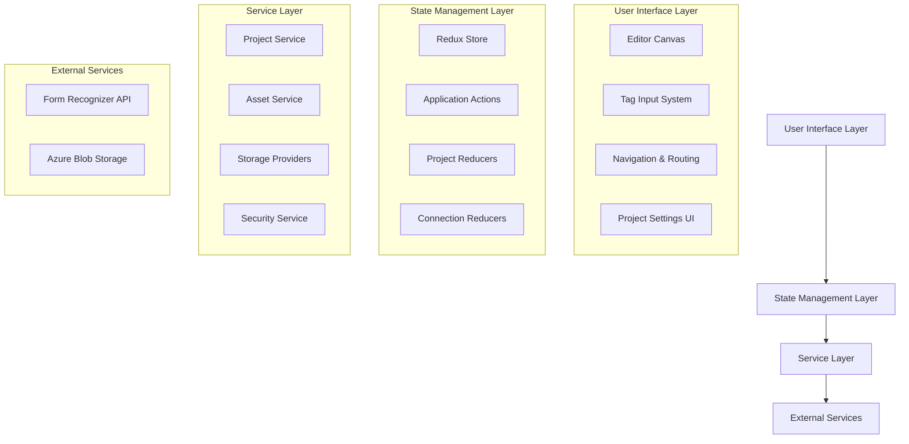
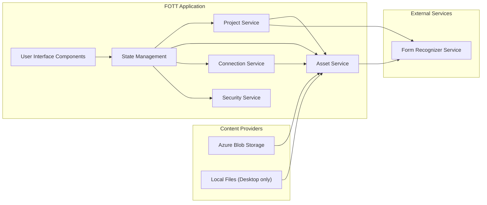
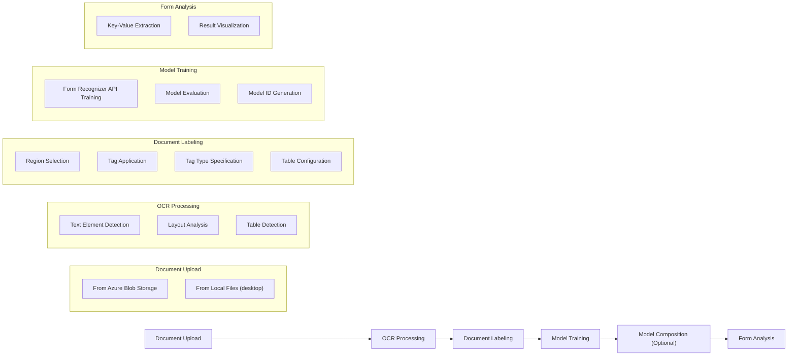
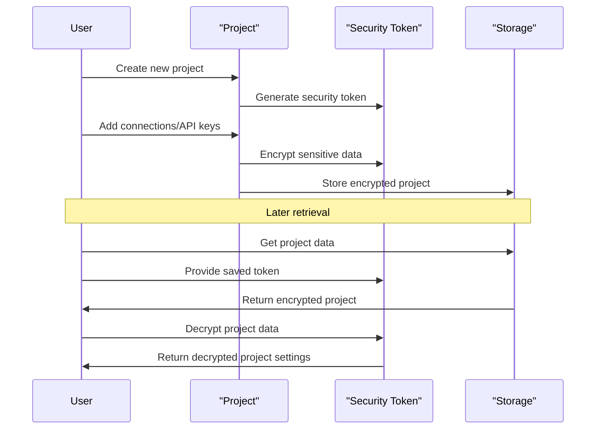
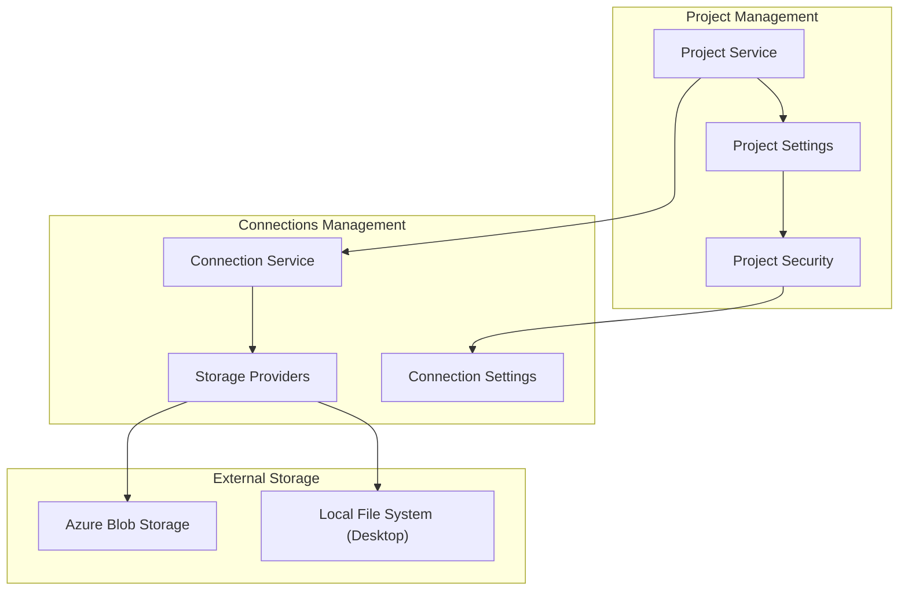
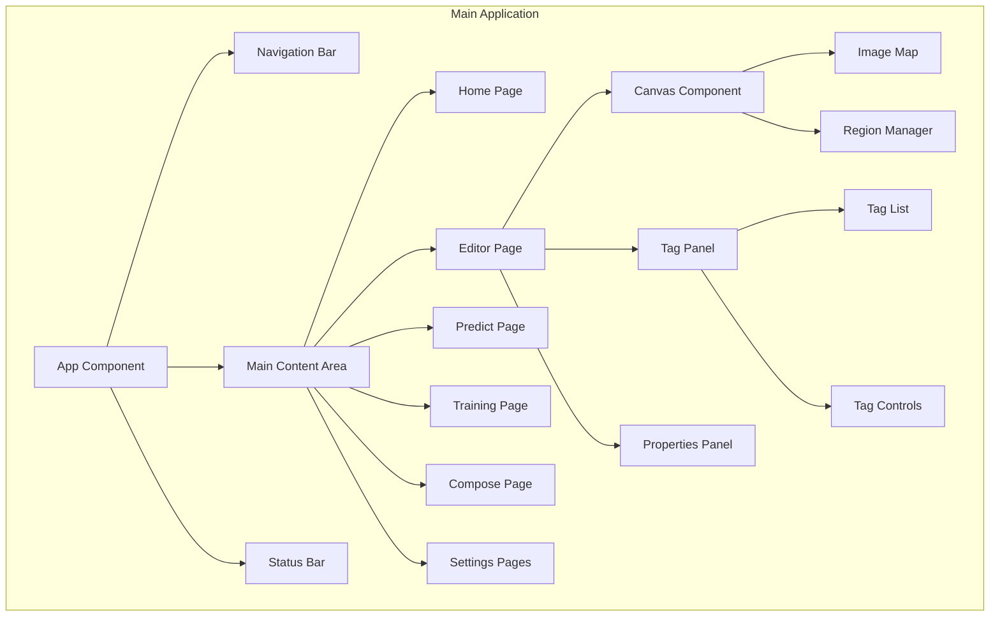
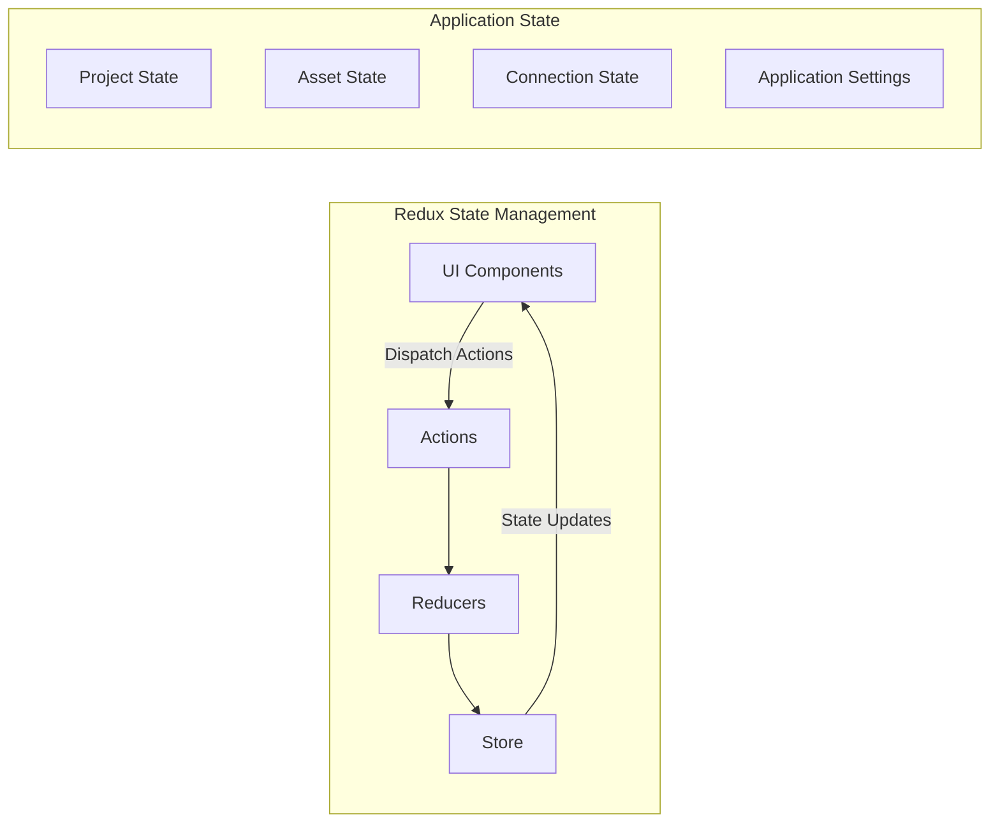
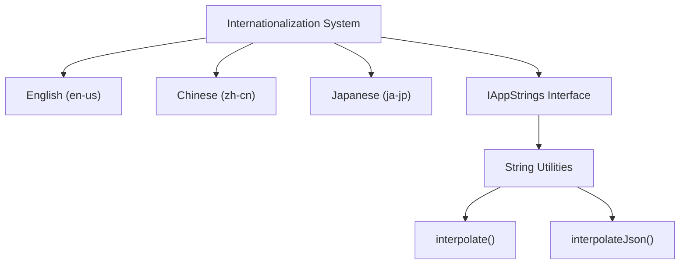

<!-- source: DeepWiki mcp.deepwiki.com · repo microsoft/OCR-Form-Tools · page 1 Overview · fetched 2026-10-26 -->

# Overview

Relevant source files

The following files were used as context for generating this wiki page:

- [README.ja-jp.md](README.ja-jp.md)
- [README.md](README.md)
- [README.zh-cn.md](README.zh-cn.md)
- [docs/images/compose.png](docs/images/compose.png)
- [docs/images/keyboard-shortcuts-icon.png](docs/images/keyboard-shortcuts-icon.png)
- [docs/images/share-icon.png](docs/images/share-icon.png)
- [package.json](package.json)
- [src/common/utils.ts](src/common/utils.ts)
- [src/react/components/shell/appSurveyLink.scss](src/react/components/shell/appSurveyLink.scss)
- [src/react/components/shell/appSurveyLink.tsx](src/react/components/shell/appSurveyLink.tsx)
- [yarn.lock](yarn.lock)

This document provides a comprehensive introduction to the OCR Form Testing Tool (FOTT), explaining its purpose, core architecture, and fundamental capabilities. FOTT is an open-source labeling tool for Form Recognizer, part of the Form OCR Test Toolset, designed to allow users to label forms, train custom machine learning models, and extract key-value pairs from documents.

## Purpose and Scope

The OCR Form Testing Tool is primarily designed to facilitate the process of labeling form data, training custom models using Azure Form Recognizer, and extracting structured information from documents. It enables users to:

- Label forms in various formats (PDF, JPEG, TIFF)
- Train custom models using the labeled data
- Extract key-value pairs from forms using the trained models
- Compose multiple models to enhance extraction capabilities

For detailed instructions on using specific features, refer to other sections in this wiki which cover individual components in greater depth.

Sources: [README.md:9-30](), [package.json:1-15]()

## System Architecture Overview

The OCR Form Testing Tool is built as a React + Redux web application written in TypeScript. It can be run as either a web application, desktop application (using Electron), or deployed via Docker.

### High-Level Architecture

Sources: [README.md:22-30](), [package.json:16-53]()

### Core Components and Data Flow

Sources: [README.md:31-62](), [src/common/utils.ts:93-124]()

## Key Features and Workflow

The OCR Form Testing Tool provides a structured workflow for document processing, model training, and prediction:

### Document Processing Workflow

Sources: [README.md:81-196]()

### Feature Overview

The system provides three main capabilities:

| Feature | Description | Components Involved |
|---------|-------------|---------------------|
| Labeling | Allows users to label text elements and tables in forms | Editor Canvas, Tag Input System, Asset Management |
| Training | Trains a custom model using Azure Form Recognizer with labeled data | Model Management, Form Recognizer Integration |
| Analysis | Uses trained models to analyze new documents and extract key-value pairs | Prediction System, Result Visualization |

Sources: [README.md:24-29](), [README.md:132-182]()

## System Components

### Security and Authentication

The system implements a security token mechanism for protecting sensitive information such as API keys and connection strings. Each project generates a unique security token that can be saved for later use. This token is used to encrypt sensitive project settings when stored.

Sources: [src/common/utils.ts:93-124](), [README.md:120-132](), [README.md:196-215]()

### Connections and Project Management

The system uses a "Bring Your Own Data" approach, where users configure connections to their data sources. Currently, Azure Blob Storage is the primary supported provider. Projects are managed through project files that store configuration but encrypt sensitive information.

Sources: [README.md:99-117](), [README.md:120-132](), [src/common/utils.ts:93-124]()

## Core UI Components

The user interface is organized into several key components that work together to provide the complete functionality:

Sources: [README.md:134-142]()

## State Management

The application uses Redux for state management, with a predictable unidirectional data flow:

Sources: [README.md:22-23](), [package.json:35-47]()

## Technology Stack

The OCR Form Testing Tool is built using the following key technologies:

| Category | Technologies |
|----------|--------------|
| Frontend Framework | React, Redux |
| UI Components | Fluent UI, Bootstrap |
| State Management | Redux, Redux Thunk |
| Languages | TypeScript |
| Build Tools | Webpack, React Scripts |
| External Services | Azure Form Recognizer, Azure Blob Storage |
| Desktop Integration | Electron |
| Internationalization | react-localization |

Sources: [package.json:17-53](), [README.md:22-23]()

## Deployment Options

The OCR Form Testing Tool can be deployed in three ways:

1. **Web Application**: Hosted service accessible via HTTPS
2. **Desktop Application**: Using Electron for local usage with access to the file system
3. **Docker Container**: Containerized version for easy deployment

Additional features in the desktop application include:
- Support for local file system as storage provider
- Support for cross-domain resource requests

Sources: [README.md:43-83]()

## Internationalization Support

The application supports multiple languages, with built-in support for English, Chinese, and Japanese:

Sources: [README.md:257-258](), [README.zh-cn.md](), [README.ja-jp.md]()

## Conclusion

The OCR Form Testing Tool (FOTT) provides a complete solution for labeling forms, training custom Form Recognizer models, and extracting key-value pairs from documents. Its architecture is designed around React and Redux, with modular components that handle different aspects of the workflow. The tool supports multiple deployment options and provides a comprehensive UI for managing the entire process from document upload to analysis.

---

