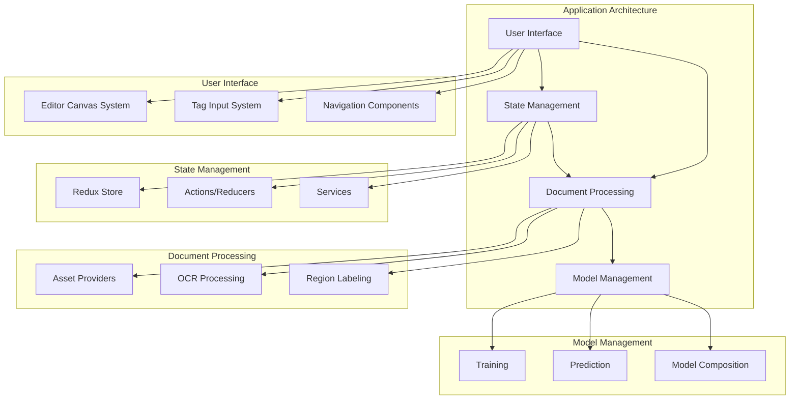
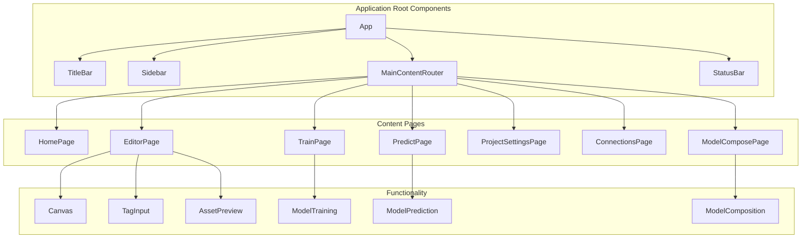
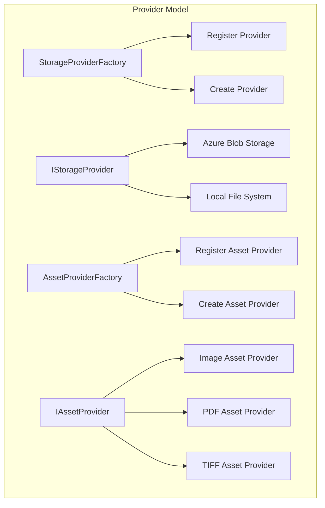
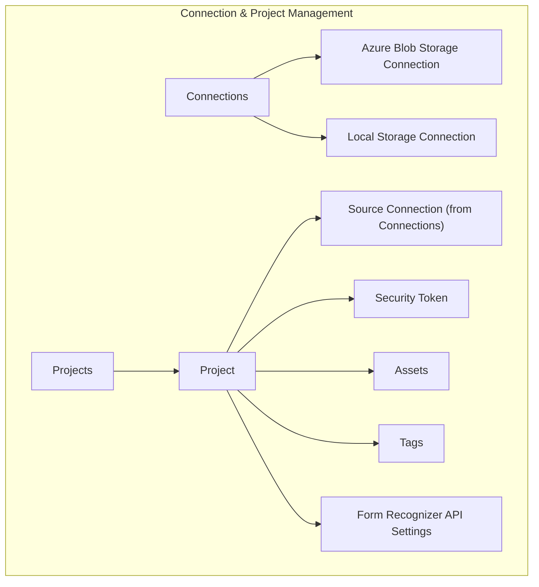
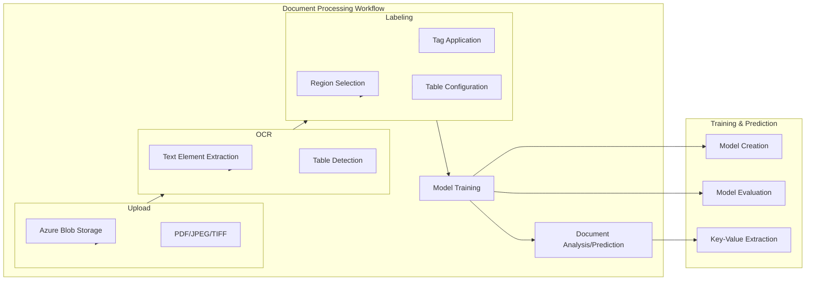
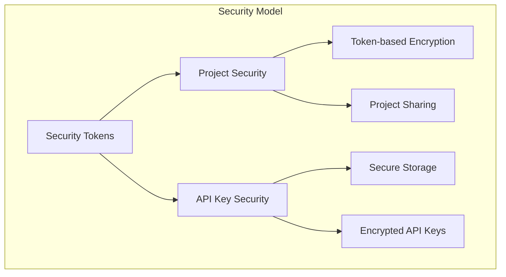
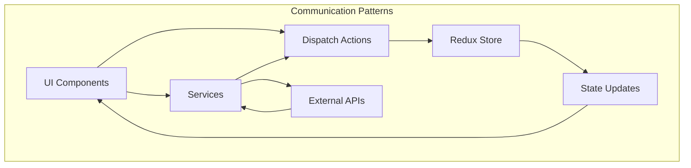

<!-- source: DeepWiki mcp.deepwiki.com · repo microsoft/OCR-Form-Tools · page 2 Core Architecture · fetched 2026-10-26 -->

# Core Architecture

<details>
<summary>Relevant source files</summary>

The following files were used as context for generating this wiki page:

- [README.ja-jp.md](README.ja-jp.md)
- [README.md](README.md)
- [README.zh-cn.md](README.zh-cn.md)
- [docs/images/compose.png](docs/images/compose.png)
- [docs/images/keyboard-shortcuts-icon.png](docs/images/keyboard-shortcuts-icon.png)
- [docs/images/share-icon.png](docs/images/share-icon.png)
- [src/App.tsx](src/App.tsx)
- [src/common/mockFactory.ts](src/common/mockFactory.ts)
- [src/models/applicationState.ts](src/models/applicationState.ts)
- [src/react/components/shell/appSurveyLink.scss](src/react/components/shell/appSurveyLink.scss)
- [src/react/components/shell/appSurveyLink.tsx](src/react/components/shell/appSurveyLink.tsx)
- [src/react/components/shell/shareProjectButton.scss](src/react/components/shell/shareProjectButton.scss)
- [src/react/components/shell/shareProjectButton.tsx](src/react/components/shell/shareProjectButton.tsx)
- [src/react/components/shell/sidebar.tsx](src/react/components/shell/sidebar.tsx)
- [src/redux/actions/actionCreators.ts](src/redux/actions/actionCreators.ts)
- [src/redux/actions/actionTypes.ts](src/redux/actions/actionTypes.ts)
- [src/redux/reducers/currentProjectReducer.ts](src/redux/reducers/currentProjectReducer.ts)

</details>


This document describes the foundational architectural components of the OCR Form Testing Tool (FOTT). It covers the system design, key subsystems, state management patterns, and primary data flows that power the application. This page focuses on the core architectural elements, providing a basis for understanding how the different components of the system work together.

For more specific information about individual subsystems, please refer to their respective pages:
- [Editor Canvas System](#2.1)
- [Tag Input System](#2.2)
- [Asset Management](#2.3)
- [State Management](#2.4)

## System Overview

FOTT is a React + Redux web application written in TypeScript. It provides functionality for labeling forms, training custom machine learning models with Azure Form Recognizer, and extracting key-value pairs from documents.



Sources: [README.md:19-29](), [App.tsx:1-114]()

## Application Structure

The application follows a typical React + Redux architecture with strong TypeScript typing:



Sources: [App.tsx:70-113](), [src/react/components/shell/sidebar.tsx:18-90]()

The main navigation structure is defined in the `Sidebar` component, which provides access to the main functionality areas:

- Home (Project Selection)
- Editor (Document Labeling)
- Training (Model Training)
- Model Compose (Combining Models)
- Analyze/Predict (Using Models)
- Project Settings
- Connections (External Resource Management)
- Prebuilt Models
- Layout Analysis
- Application Settings

Sources: [src/react/components/shell/sidebar.tsx:22-87]()

## Application State Model

The application state model is central to understanding how data flows through the system. It is defined in the `applicationState.ts` file and uses TypeScript interfaces to enforce type safety.

```mermaid
graph TD
    subgraph "Application State"
        IApplicationState["IApplicationState"] --> AppSettings["appSettings: IAppSettings"]
        IApplicationState --> Connections["connections: IConnection[]"]
        IApplicationState --> RecentProjects["recentProjects: IProject[]"]
        IApplicationState --> CurrentProject["currentProject: IProject"]
        IApplicationState --> AppError["appError?: IAppError"]
    end
    
    subgraph "Project Structure"
        CurrentProject --> ProjectID["id: string"]
        CurrentProject --> ProjectName["name: string"]
        CurrentProject --> SecurityToken["securityToken: string"]
        CurrentProject --> Tags["tags: ITag[]"]
        CurrentProject --> SourceConnection["sourceConnection: IConnection"]
        CurrentProject --> Assets["assets?: {[index: string]: IAsset}"]
        CurrentProject --> ApiSettings["apiUriBase: string, apiKey: string"]
        CurrentProject --> FolderPath["folderPath: string"]
        CurrentProject --> ModelRecords["trainRecord, recentModelRecords, predictModelId"]
    end
    
    subgraph "Assets"
        Assets --> Asset["IAsset"]
        Asset --> AssetID["id: string"]
        Asset --> AssetType["type: AssetType"]
        Asset --> AssetState["state: AssetState"]
        Asset --> AssetName["name: string"]
        Asset --> AssetPath["path: string"]
        Asset --> AssetSize["size: ISize"]
        Asset --> OCRData["ocr?: any"]
    end
    
    subgraph "Tags"
        Tags --> Tag["ITag"]
        Tag --> TagName["name: string"]
        Tag --> TagColor["color: string"]
        Tag --> TagType["type: FieldType"]
        Tag --> TagFormat["format: FieldFormat"]
    end
```



Sources: [src/models/applicationState.ts:15-47](), [src/models/applicationState.ts:85-102](), [src/models/applicationState.ts:121-127](), [src/models/applicationState.ts:173-190]()

The application state model consists of several key interfaces:

- `IApplicationState`: Root-level state container
- `IProject`: Project configuration and metadata
- `IAsset`: Document being processed (PDF, image, etc.)
- `IConnection`: Data source connection information
- `ITag`: Field label definition for form fields
- `IRegion`: Defined area within a document
- `IAssetMetadata`: Data about regions and tags for each asset

Sources: [src/models/applicationState.ts:15-24](), [src/models/applicationState.ts:85-102](), [src/models/applicationState.ts:173-190](), [src/models/applicationState.ts:155-161](), [src/models/applicationState.ts:121-127](), [src/models/applicationState.ts:229-241](), [src/models/applicationState.ts:203-208]()

## State Management

The application uses Redux for state management, following a unidirectional data flow pattern.

```mermaid
graph LR
    subgraph "State Flow"
        UIComponents["UI Components"] --> Actions["Redux Actions"]
        Actions --> Reducers["Redux Reducers"]
        Reducers --> Store["Redux Store"]
        Store --> UIComponents
    end
    
    subgraph "Action Types"
        Actions --> ProjectActions["Project Actions"]
        Actions --> ConnectionActions["Connection Actions"]
        Actions --> ApplicationActions["Application Actions"]
        Actions --> AssetActions["Asset Actions"]
    end
    
    subgraph "Reducers"
        Reducers --> CurrentProjectReducer["currentProjectReducer"]
        Reducers --> ConnectionsReducer["connectionsReducer"]
        Reducers --> AppSettingsReducer["appSettingsReducer"]
        Reducers --> RecentProjectsReducer["recentProjectsReducer"]
    end
    
    subgraph "Services"
        Services["Services"] --> Actions
        Services --> ProjectService["Project Service"]
        Services --> AssetService["Asset Service"]
        Services --> StorageProviders["Storage Providers"]
    end
```

Sources: [src/redux/actions/actionCreators.ts:1-107](), [src/redux/actions/actionTypes.ts:1-43](), [src/redux/reducers/currentProjectReducer.ts:1-116]()

The state management system is organized around several key components:

1. **Action Types**: Defined constants representing possible state changes (e.g., `LOAD_PROJECT_SUCCESS`, `SAVE_ASSET_METADATA_SUCCESS`)
2. **Action Creators**: Functions that create action objects with appropriate payloads
3. **Reducers**: Pure functions that take the current state and an action to produce a new state
4. **Redux Store**: Central repository of application state

Sources: [src/redux/actions/actionTypes.ts:7-42](), [src/redux/actions/actionCreators.ts:39-65](), [src/redux/reducers/currentProjectReducer.ts:21-116]()

Example of a reducer handling project actions:

```
export const reducer = (state: IProject = null, action: AnyAction): IProject => {
    switch (action.type) {
        case ActionTypes.DELETE_PROJECT_SUCCESS:
        case ActionTypes.CLOSE_PROJECT_SUCCESS:
            return null;
        case ActionTypes.LOAD_PROJECT_SUCCESS:
            return {...action.payload};
        case ActionTypes.ADD_ASSET_TO_PROJECT_SUCCESS:
            return {...state, lastVisitedAssetId: action.payload.id};
        // ... more handlers
    }
};
```

Sources: [src/redux/reducers/currentProjectReducer.ts:21-116]()

## Provider Model

The application implements a provider model for storage and asset management, allowing different storage backends to be used interchangeably.



Sources: [src/common/mockFactory.ts:304-351](), [src/common/mockFactory.ts:398-407]()

The provider model enables:

1. Extensibility for new storage types
2. Abstraction of storage implementation details
3. Easy testing with mock providers
4. Support for both cloud and local storage

Sources: [README.md:99-104]()

## Connection and Project Management

The application manages connections to external storage providers and uses these connections to organize projects.



Sources: [src/models/applicationState.ts:155-161](), [src/models/applicationState.ts:85-102]()

Projects are central to the application workflow:

1. Connections are created to storage providers
2. Projects are created using these connections
3. Source assets are loaded from the connected storage
4. Assets are labeled within the project
5. Models are trained using the project's labeled assets
6. Predictions are made using the trained models

Sources: [README.md:99-104](), [README.md:119-129](), [README.md:134-136]()

## Document Processing Workflow

The application implements a complete document processing workflow, from upload to analysis.



Sources: [README.md:26-28](), [README.md:84-96](), [README.md:134-145](), [README.md:166-183]()

## Security Model

The application implements a security model for protecting sensitive information:



Sources: [src/models/applicationState.ts:322-329](), [README.md:195-209]()

Security features include:

1. Security tokens for encrypting sensitive project settings
2. Secure storage of API keys
3. Project sharing capabilities with secure token exchange
4. Connection security using SAS URLs for Azure Blob Storage

Sources: [README.md:195-209](), [README.md:211-226](), [src/react/components/shell/shareProjectButton.tsx:39-50]()

## Cross-Component Communication

The application uses Redux for cross-component communication, supplemented by service interfaces for external interactions.



Sources: [src/App.tsx:34-45](), [src/redux/reducers/currentProjectReducer.ts:21-116]()

The primary communication patterns are:

1. Component-to-component via Redux state
2. Component-to-service via direct method calls
3. Service-to-external via API calls
4. Service-to-component via action dispatches

## Summary

The OCR Form Testing Tool (FOTT) architecture is built on modern web development patterns including React, Redux, and TypeScript. Its modular design separates concerns between UI components, state management, and service integration, while the provider model enables extensibility for different storage backends and asset types.

The core architectural components work together to provide a comprehensive document processing pipeline that supports labeling, training, and prediction for form recognition tasks.

Sources: [README.md:22-28](), [README.md:10-14]()

## Key Files

| File | Purpose |
| ---- | ------- |
| `src/models/applicationState.ts` | Defines the core data model and state interfaces |
| `src/redux/actions/actionTypes.ts` | Defines all possible state change actions |
| `src/redux/actions/actionCreators.ts` | Functions for creating type-safe actions |
| `src/redux/reducers/currentProjectReducer.ts` | Handles state updates for current project |
| `src/App.tsx` | Main application component and routing setup |
| `src/react/components/shell/sidebar.tsx` | Navigation structure of the application |

Sources: [src/models/applicationState.ts:1-553](), [src/redux/actions/actionTypes.ts:1-43](), [src/redux/actions/actionCreators.ts:1-107](), [src/redux/reducers/currentProjectReducer.ts:1-116](), [src/App.tsx:1-114](), [src/react/components/shell/sidebar.tsx:1-90]()

---

