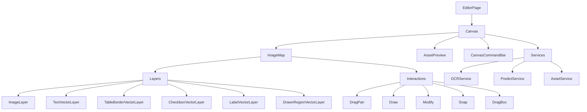
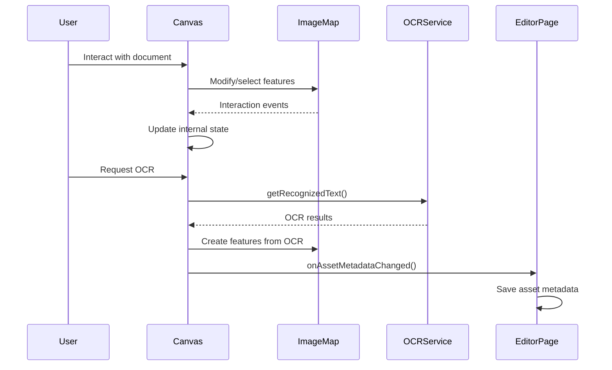
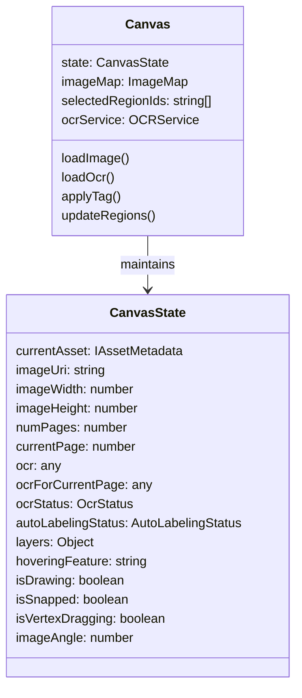
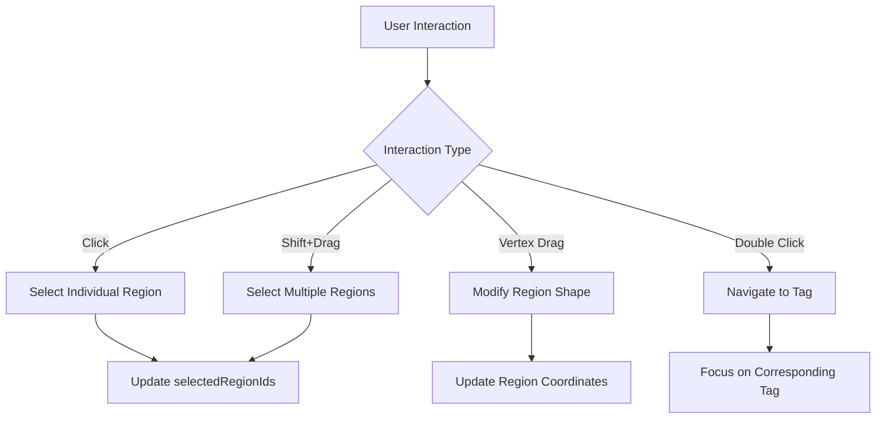
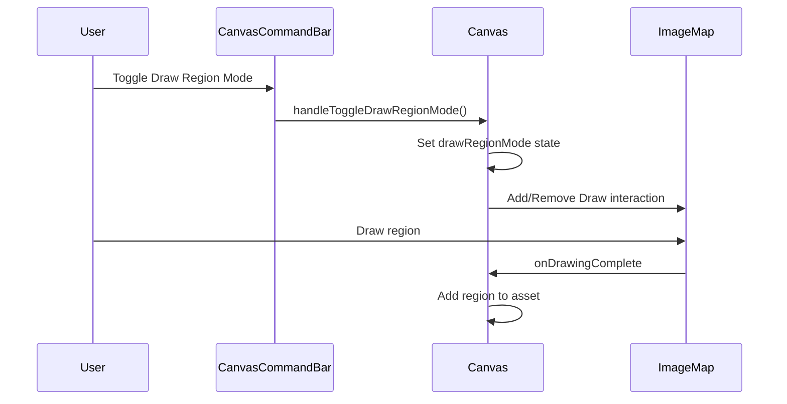
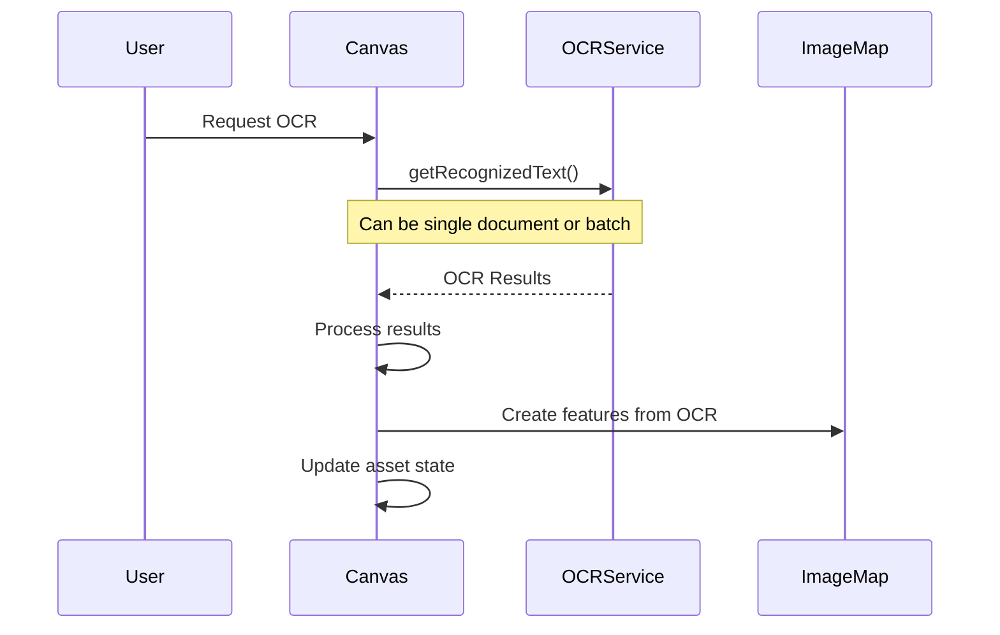
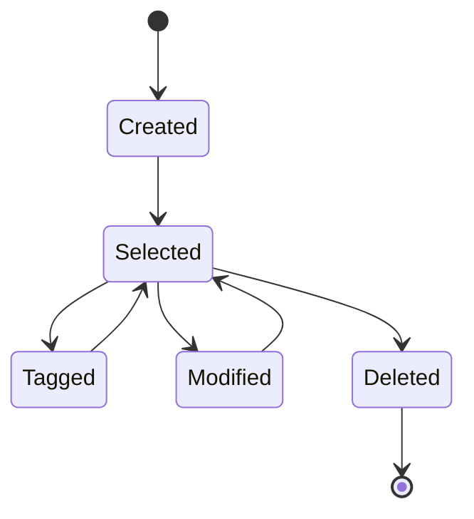
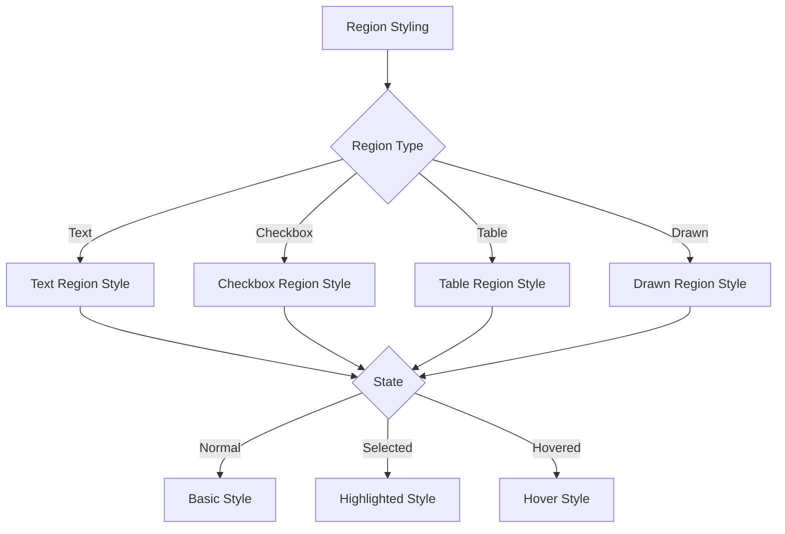

<!-- source: DeepWiki mcp.deepwiki.com · repo microsoft/OCR-Form-Tools · page 2.1 Editor Canvas System · fetched 2026-10-26 -->

# Editor Canvas System

Relevant source files

The following files were used as context for generating this wiki page:

- [src/react/components/common/imageMap/imageMap.tsx](src/react/components/common/imageMap/imageMap.tsx)
- [src/react/components/pages/editorPage/canvas.tsx](src/react/components/pages/editorPage/canvas.tsx)
- [src/react/components/pages/editorPage/editorPage.tsx](src/react/components/pages/editorPage/editorPage.tsx)

The Editor Canvas System is the central component for document viewing, annotation, and interaction in the OCR Form Tools application. This system provides the core functionality for displaying documents, managing regions (selections within documents), and facilitating labeling operations. It serves as the primary visual interface where users interact with their documents and create annotations.

For information about applying tags to regions, see [Tag Input System](#2.2). For more details on annotation techniques, see [Region Annotation](#3.1) and [Table Annotation](#3.2).

## Component Architecture

The Editor Canvas System consists of several interconnected components that work together to provide a comprehensive document editing experience:

Sources: [src/react/components/pages/editorPage/canvas.tsx:125-1162](). [src/react/components/pages/editorPage/editorPage.tsx:129-205]().

### Core Components

1. **Canvas**: The main controller component that orchestrates document loading, region management, and integrates with various services
2. **ImageMap**: Provides the rendering surface and interaction capabilities using OpenLayers
3. **CanvasCommandBar**: Toolbar that exposes actions like running OCR, zooming, and toggling layers
4. **AssetPreview**: Renders the actual document content (image, PDF, or TIFF)

## Data Flow

The Editor Canvas System handles the flow of data from user interactions to document annotations:

Sources: [src/react/components/pages/editorPage/canvas.tsx:183-334](). [src/react/components/pages/editorPage/canvas.tsx:1350-1390]().

## State Management

The Canvas component maintains several key pieces of state:

Sources: [src/react/components/pages/editorPage/canvas.tsx:74-100](). [src/react/components/pages/editorPage/canvas.tsx:136-161]().

## Layer Management

The ImageMap component manages multiple layers for different types of content:

| Layer Name | Purpose |
|------------|---------|
| `imageLayer` | Displays the document (image/PDF/TIFF) |
| `textVectorLayer` | Shows text regions from OCR |
| `tableBorderVectorLayer` | Renders table outlines |
| `tableIconVectorLayer` | Shows table icons for interaction |
| `checkboxVectorLayer` | Displays checkbox regions |
| `labelVectorLayer` | Shows tagged regions |
| `drawnRegionVectorLayer` | Contains user-drawn regions |
| `drawnLabelVectorLayer` | Shows labeled drawn regions |

Each layer can be toggled independently via the Canvas Command Bar, allowing users to focus on specific content types.

Sources: [src/react/components/common/imageMap/imageMap.tsx:72-80](). [src/react/components/common/imageMap/imageMap.tsx:211-217]().

## Interactions and Controls

The Editor Canvas System provides various interaction modes for manipulating documents and regions:

### Selection and Editing

The system supports selection of regions through single clicks, multi-selection with Shift+drag, and region modification through vertex manipulation:

Sources: [src/react/components/common/imageMap/imageMap.tsx:673-706](). [src/react/components/pages/editorPage/canvas.tsx:1192-1209]().

### Drawing Mode

Users can create custom regions by enabling draw mode:

Sources: [src/react/components/common/imageMap/imageMap.tsx:931-962](). [src/react/components/pages/editorPage/canvas.tsx:279-324]().

## Document and OCR Handling

### Document Types

The Editor Canvas System supports multiple document types:

| Type | Loading Method | Multi-page Support |
|------|---------------|-------------------|
| Image | Direct canvas loading | No |
| PDF | PDF.js rendering | Yes |
| TIFF | TIFF parsing and rendering | Yes |

Sources: [src/react/components/pages/editorPage/canvas.tsx:1320-1350](). [src/react/components/pages/editorPage/canvas.tsx:1391-1442]().

### OCR Processing

OCR can be run on individual documents or in batch:

Sources: [src/react/components/pages/editorPage/canvas.tsx:1350-1390](). [src/react/components/pages/editorPage/editorPage.tsx:978-1020]().

## Region Management

Regions are the fundamental unit of annotation in the system. The Canvas component provides comprehensive region management:

### Region Types

| Region Type | Category | Purpose |
|-------------|----------|---------|
| Text Region | `FeatureCategory.Text` | Represents text extracted from OCR |
| Checkbox Region | `FeatureCategory.Checkbox` | Represents selection marks/checkboxes |
| Table Region | `FeatureCategory.Text` | Represents tables with rows/columns |
| Drawn Region | `FeatureCategory.DrawnRegion` | Custom regions created by users |

Sources: [src/react/components/pages/editorPage/canvas.tsx:594-641](). [src/react/components/pages/editorPage/canvas.tsx:643-666]().

### Region Lifecycle

The Canvas component provides methods for each stage of the region lifecycle:

1. **Creation**: `addRegions()`, `convertRegionToFeature()`
2. **Selection**: `handleFeatureSelect()`, `onSelectedRegionsChanged()`
3. **Tagging**: `applyTag()`
4. **Modification**: `updateRegions()`
5. **Deletion**: `deleteRegions()`, `onRegionDelete()`

Sources: [src/react/components/pages/editorPage/canvas.tsx:592-728](). [src/react/components/pages/editorPage/canvas.tsx:457-571]().

## Styling and Visualization

The Editor Canvas System uses different styles to represent regions based on their state and type:

The styling functions are defined as methods in the Canvas component and passed to the ImageMap:

- `featureStyler`: Styles regular text regions
- `checkboxFeatureStyler`: Styles checkbox regions
- `labelFeatureStyler`: Styles labeled regions
- `tableBorderFeatureStyler`: Styles table borders
- `drawnRegionStyler`: Styles user-drawn regions

Sources: [src/react/components/pages/editorPage/canvas.tsx:945-1053](). [src/react/components/common/imageMap/imageMap.tsx:312-326]().

## Integration with Other Systems

The Editor Canvas System integrates with several other systems:

1. **Tag Input System**: Receives tags to apply to selected regions
2. **OCR Service**: Extracts text and layout from documents
3. **Predict Service**: Applies auto-labeling to documents
4. **Asset Service**: Manages document metadata and storage

This integration enables a seamless workflow from document loading to region creation, annotation, and storage.

Sources: [src/react/components/pages/editorPage/editorPage.tsx:596-608](). [src/react/components/pages/editorPage/canvas.tsx:405-439]().

## Performance Considerations

Several optimizations are implemented in the Editor Canvas System:

1. **Layer-based rendering**: Only visible layers are rendered
2. **Feature filtering**: Interactions only process features in relevant layers
3. **Throttling**: Batch operations like OCR are throttled to prevent overwhelming services
4. **Lazy loading**: Document pages are loaded on demand for multi-page documents

Sources: [src/react/components/common/imageMap/imageMap.tsx:211-276](). [src/react/components/pages/editorPage/editorPage.tsx:988-1014]().

## Conclusion

The Editor Canvas System serves as the primary interface for document annotation in the OCR Form Tools application. It provides a comprehensive set of tools for viewing documents, running OCR, creating and managing regions, and applying tags. The system's modular architecture allows for flexible integration with other components and services, creating a powerful platform for document analysis and labeling.

---

