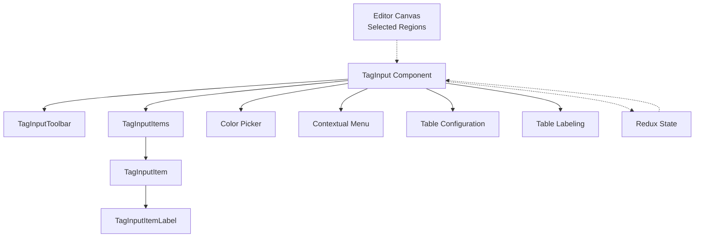
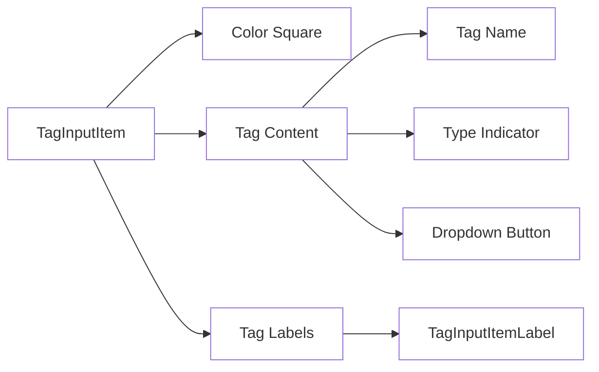
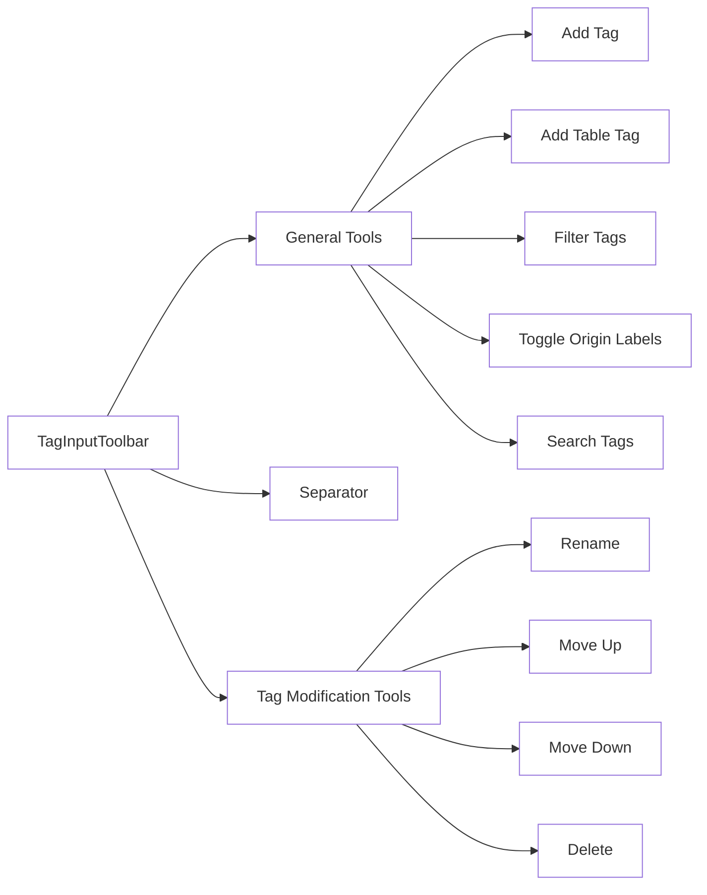
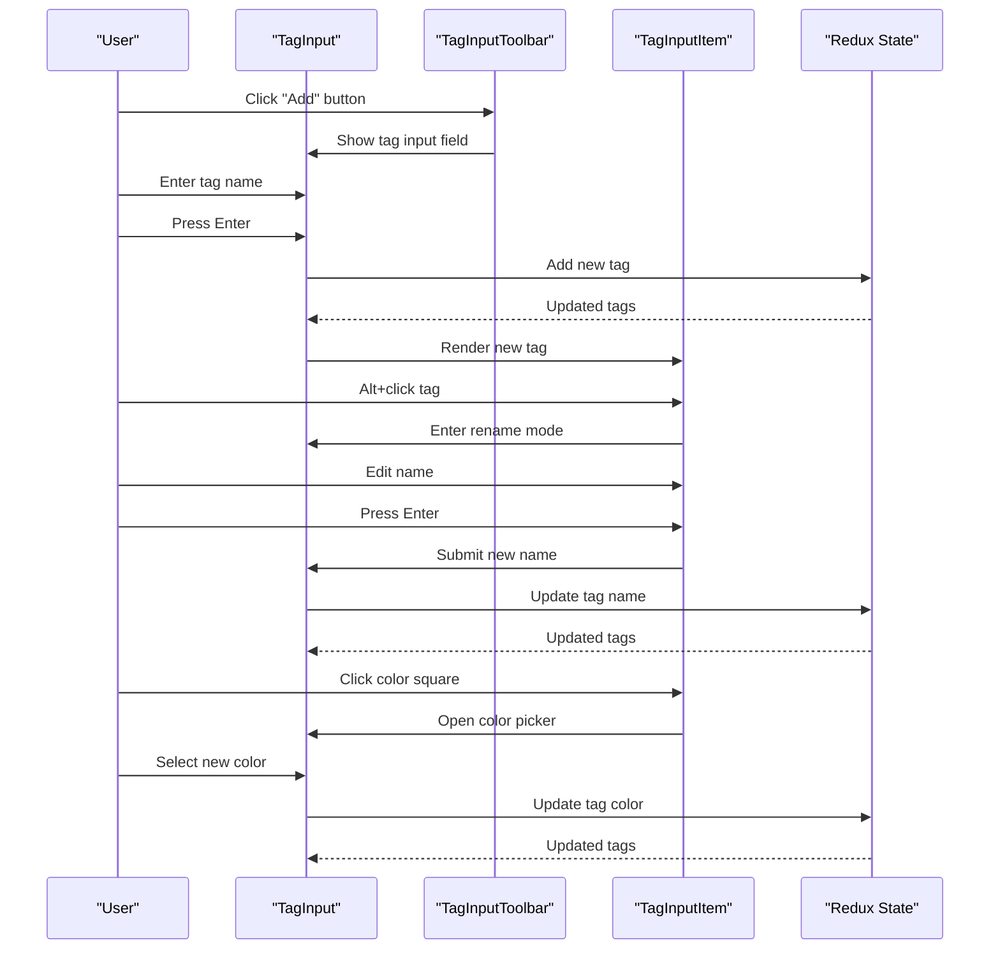
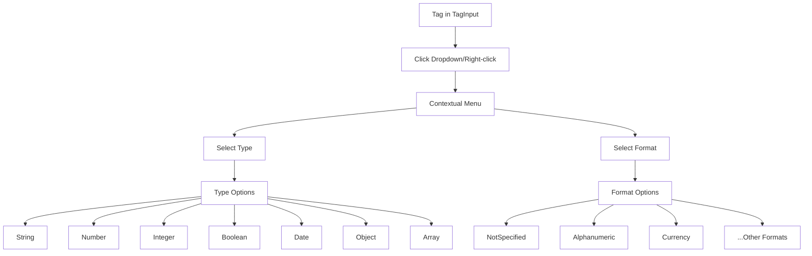
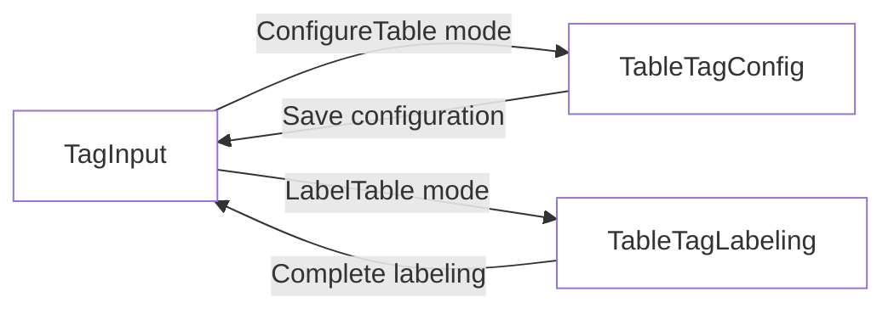
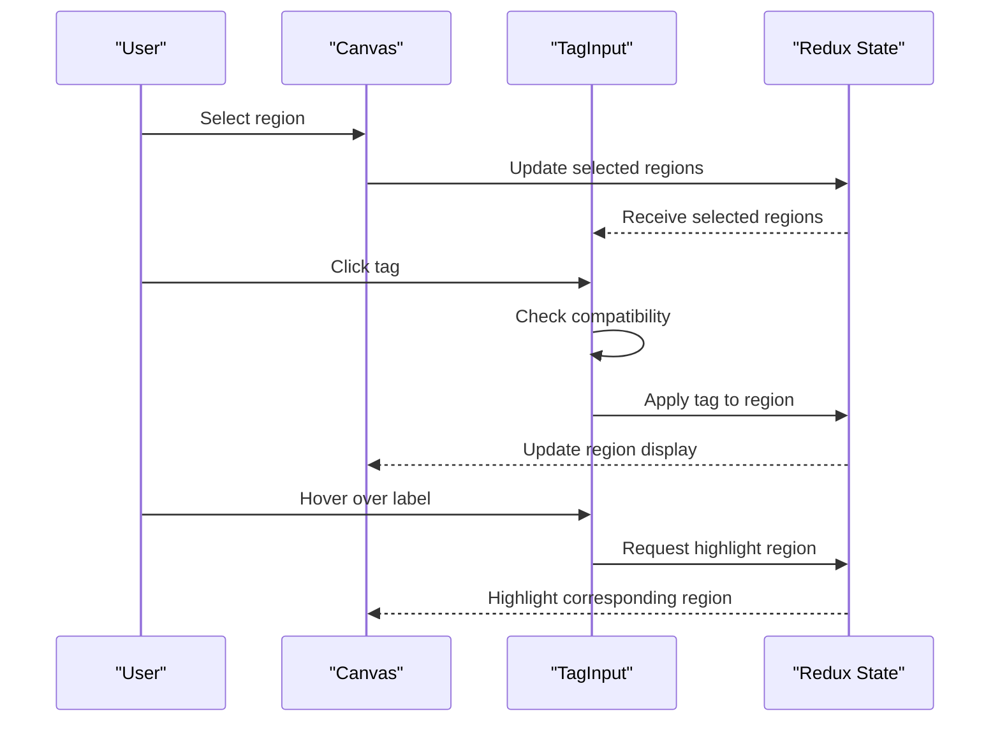

<!-- source: DeepWiki mcp.deepwiki.com · repo microsoft/OCR-Form-Tools · page 2.2 Tag Input System · fetched 2026-10-26 -->

# Tag Input System

<details>
<summary>Relevant source files</summary>

The following files were used as context for generating this wiki page:

- [src/react/components/common/tagInput/tagInput.scss](src/react/components/common/tagInput/tagInput.scss)
- [src/react/components/common/tagInput/tagInput.tsx](src/react/components/common/tagInput/tagInput.tsx)
- [src/react/components/common/tagInput/tagInputItem.test.tsx](src/react/components/common/tagInput/tagInputItem.test.tsx)
- [src/react/components/common/tagInput/tagInputItem.tsx](src/react/components/common/tagInput/tagInputItem.tsx)
- [src/react/components/common/tagInput/tagInputItemLabel.tsx](src/react/components/common/tagInput/tagInputItemLabel.tsx)
- [src/react/components/common/tagInput/tagInputToolbar.tsx](src/react/components/common/tagInput/tagInputToolbar.tsx)
- [src/react/components/pages/editorPage/canvas.scss](src/react/components/pages/editorPage/canvas.scss)
- [src/react/components/pages/editorPage/editorPage.scss](src/react/components/pages/editorPage/editorPage.scss)
- [src/react/components/toolbar/toolbarItem.tsx](src/react/components/toolbar/toolbarItem.tsx)

</details>


The Tag Input System manages the creation, organization, and application of tags for document annotation in the OCR Form Testing Tool (FOTT). This system provides the interface for users to define tags that represent fields to be extracted from documents, manage their properties, and apply them to regions in the document canvas.

For information about how regions are drawn and selected in documents, see [Region Annotation](#3.1). For information about the canvas where documents are viewed and annotated, see [Editor Canvas System](#2.1).

## System Overview

The Tag Input System provides a comprehensive interface for tag management with the following capabilities:

- Creating and deleting tags
- Renaming tags and changing their colors
- Organizing tags through reordering
- Setting tag data types and formats
- Filtering and searching tags
- Applying tags to selected regions
- Configuring table tags for structured data extraction



Sources: [src/react/components/common/tagInput/tagInput.tsx:118-297](). [src/react/components/common/tagInput/tagInputItem.tsx:60-356](). [src/react/components/common/tagInput/tagInputToolbar.tsx:53-246]().

## Core Components

### TagInput Component

The `TagInput` component is the main container for all tag management functionality. It maintains the state of tags and handles various tag operations through different operation modes.

```mermaid
statechart
    [*] --> Normal
    
    Normal --> ColorPicker: "Click tag color"
    Normal --> ContextualMenu: "Click dropdown/right-click"
    Normal --> Rename: "Alt+click or select rename"
    Normal --> ConfigureTable: "Configure table tag"
    Normal --> LabelTable: "Label table tag"
    
    ColorPicker --> Normal: "Select color/click outside"
    ContextualMenu --> Normal: "Select option/click outside"
    Rename --> Normal: "Confirm/cancel rename"
    ConfigureTable --> Normal: "Complete configuration"
    LabelTable --> Normal: "Complete labeling"
    
    state Operations {
        ColorPicker
        ContextualMenu
        Rename
    }
```

The component switches between these operation modes based on user interactions:

| Mode | Description | Trigger |
|------|-------------|---------|
| `TagOperationMode.None` | Normal state | Default |
| `TagOperationMode.ColorPicker` | Color selection active | Click on tag color |
| `TagOperationMode.ContextualMenu` | Context menu open | Click dropdown or right-click |
| `TagOperationMode.Rename` | Tag being renamed | Alt+click or select rename |
| `TagInputMode.ConfigureTable` | Configure table structure | "Add Table" or reconfigure existing table |
| `TagInputMode.LabelTable` | Labeling table regions | Click on table tag applied to region |

Sources: [src/react/components/common/tagInput/tagInput.tsx:41-47](). [src/react/components/common/tagInput/tagInput.tsx:118-297]().

### TagInputItem

The `TagInputItem` component renders individual tag entries in the tag list. Each item displays:

- Tag color square for visual identification
- Tag name with type information indicator if applicable
- Tag toolbar with options menu
- Associated labels (if any)
- Special indicators for selected and applied tags



The component responds to various click events:
- Regular click: Select the tag
- Ctrl+click: Toggle tag lock
- Alt+click: Rename the tag
- Click on color: Open color picker
- Click on dropdown: Open contextual menu

Sources: [src/react/components/common/tagInput/tagInputItem.tsx:60-356](). [src/react/components/common/tagInput/tagInputItemLabel.tsx:20-58]().

### TagInputToolbar

The `TagInputToolbar` component provides action buttons for tag management operations. It is displayed at the top of the tag input panel and includes buttons for:

- Adding tags and table tags
- Filtering tags (all vs. current page)
- Showing/hiding origin labels
- Searching tags
- Renaming selected tag
- Moving tags up/down in the list
- Deleting selected tag



Sources: [src/react/components/common/tagInput/tagInputToolbar.tsx:53-246]().

## User Interactions and Workflows

### Creating and Managing Tags

The Tag Input System provides several ways to create and manage tags:

1. **Creating tags**:
   - Click the "Add" button in the toolbar
   - Enter a tag name in the input field
   - Press Enter to create the tag
   - A color is automatically assigned to the tag

2. **Renaming tags**:
   - Alt+click on a tag or use the rename button
   - Edit the tag name
   - Press Enter to confirm
   
3. **Changing tag color**:
   - Click on the color square of a tag
   - Select a new color from the color picker

4. **Organizing tags**:
   - Use Move Up/Down buttons to reorder tags
   - This affects tag application order and visual organization

5. **Deleting tags**:
   - Select a tag and click the Delete button
   - Confirm the deletion if the tag is in use



Sources: [src/react/components/common/tagInput/tagInput.tsx:358-372](). [src/react/components/common/tagInput/tagInput.tsx:304-322](). [src/react/components/common/tagInput/tagInput.tsx:345-357]().

### Tag Properties and Types

Tags can have different data types and formats that determine how the extracted data is interpreted:

- **Tag Types**: String, Number, Integer, Boolean, Date, Object, Array
- **Tag Formats**: Various formats based on type (e.g., Currency, Time for Number type)

The type and format are set through the tag's contextual menu. These properties are visualized through icons and affect how the tag can be applied to regions.



Sources: [src/react/components/common/tagInput/tagInput.tsx:823-842](). [src/react/components/common/tagInput/tagInput.tsx:844-860]().

### Working with Table Tags

The Tag Input System provides special handling for table tags, which represent structured tabular data:

1. **Creating table tags**:
   - Click the "Add Table" button in the toolbar
   - Configure table structure (rows, columns)
   - Specify data types for table cells

2. **Labeling tables**:
   - Apply table tag to a region
   - System enters table labeling mode
   - Map document regions to table cells



Sources: [src/react/components/common/tagInput/tagInput.tsx:170-208]().

## Integration with Editor Canvas

The Tag Input System integrates closely with the Editor Canvas System:

1. **Applying tags to regions**:
   - User selects region(s) on canvas
   - Clicks on a tag in the tag input panel
   - Tag is applied to selected region(s)

2. **Highlighting regions**:
   - When hovering over a label in the tag panel
   - The corresponding region is highlighted on canvas

3. **Tag compatibility checks**:
   - System validates if selected tag is compatible with region type
   - Prevents invalid tag applications (e.g., checkbox tag to text region)



Sources: [src/react/components/common/tagInput/tagInput.tsx:557-606](). [src/react/components/common/tagInput/tagInputItem.tsx:343-354]().

## State Management

The Tag Input System uses Redux for state management. Key state updates include:

- Tag creation, deletion, and modification
- Tag selection and operation mode
- Tag filtering and searching
- Tag application to regions

The component maintains both local state for UI operations and syncs with the global Redux store for persistent changes.

Sources: [src/react/components/common/tagInput/tagInput.tsx:118-134](). [src/react/components/common/tagInput/tagInput.tsx:324-326]().

## Styling and Visual Elements

The Tag Input System uses dedicated SCSS styles to create a consistent visual appearance:

- Tag items with colored squares for visual identification
- Selected and applied tags with distinct highlighting
- Toolbar buttons with hover and active states
- Resizable tag input panel

The styling supports the dark UI theme of the application and provides visual feedback for user interactions.

Sources: [src/react/components/common/tagInput/tagInput.scss:7-323](). [src/react/components/common/tagInput/tagInputItem.tsx:89-105]().

## Key Implementation Details

### Tag Operation Modes

The system implements different operation modes through the `TagOperationMode` enum:

```typescript
export enum TagOperationMode {
    None,
    ColorPicker,
    ContextualMenu,
    Rename,
    LabelTable,
}
```

The current mode determines which UI components are displayed and how user interactions are processed.

Sources: [src/react/components/common/tagInput/tagInput.tsx:41-47]().

### Tag Validation

The system includes validation to ensure tags are valid:

- Tag names must be unique
- Tag names cannot be empty
- Tag names have length limits
- Tag types must be compatible with regions

```typescript
private validateTagLength = (tag: ITag) => {
    if (!tag.name.trim().length) {
        throw new Error(strings.tags.warnings.emptyName);
    }
    if (tag.name.length >= 128) {
        throw new Error("Tag name is too long (>= 128).");
    }
}

private validateTagUniqness = (tag: ITag, tags: ITag[]) => {
    if (tags.some((t) => isNameEqual(t.name, tag.name))) {
        throw new Error(strings.tags.warnings.existingName);
    }
}
```

Sources: [src/react/components/common/tagInput/tagInput.tsx:709-722]().

### Tag Compatibility Checks

The system checks if a tag is compatible with the selected region type before allowing application:

```typescript
if ((tag.type === FieldType.Object || tag.type === FieldType.Array) && this.props.selectedRegions?.length) {
    this.props.handleLabelTable(TagInputMode.LabelTable, tag)
    deselect = false;
} else if (labelAssigned && ((category === FeatureCategory.DrawnRegion) !== isTagLabelTypeDrawnRegion)) {
    // Handle incompatibility...
} else if (tagCategory === category || category === FeatureCategory.DrawnRegion ||
    (documentCount === 0 && type === FieldType.String && format === FieldFormat.NotSpecified)) {
    // Compatible cases...
} else {
    toast.warn(strings.tags.warnings.notCompatibleTagType, { autoClose: 7000 });
}
```

Sources: [src/react/components/common/tagInput/tagInput.tsx:572-600]().

## Conclusion

The Tag Input System is a central component of the OCR Form Testing Tool, providing comprehensive functionality for managing tags that represent fields to be extracted from documents. Through its integration with the Editor Canvas System, it enables users to create, organize, and apply tags to document regions, supporting the document annotation process for training custom form recognition models.

---

