<!-- source: DeepWiki mcp.deepwiki.com · repo microsoft/OCR-Form-Tools · page 2.3 Asset Management · fetched 2026-10-26 -->

# Asset Management

Relevant source files

The following files were used as context for generating this wiki page:

- [src/providers/storage/azureBlobStorage.ts](src/providers/storage/azureBlobStorage.ts)
- [src/react/components/common/assetPreview/pdfAsset.tsx](src/react/components/common/assetPreview/pdfAsset.tsx)
- [src/react/components/pages/prebuiltPredict/LoadFileHelper.ts](src/react/components/pages/prebuiltPredict/LoadFileHelper.ts)
- [src/react/components/shell/titleBar.tsx](src/react/components/shell/titleBar.tsx)
- [src/redux/actions/projectActions.ts](src/redux/actions/projectActions.ts)
- [src/services/assetService.ts](src/services/assetService.ts)
- [src/services/projectService.ts](src/services/projectService.ts)

This document describes the asset management system in the OCR Form Testing Tool (FOTT), which handles the loading, processing, storage, and manipulation of document assets (images, PDFs, TIFFs) within the application. For information about tagging or labeling these assets, see [Tag Input System](#2.2).

## Overview

The asset management system provides centralized functionality for dealing with document assets throughout their lifecycle in the application. It encompasses how assets are loaded from storage providers, processed, labeled, and saved back to storage, forming a critical component of the FOTT architecture.

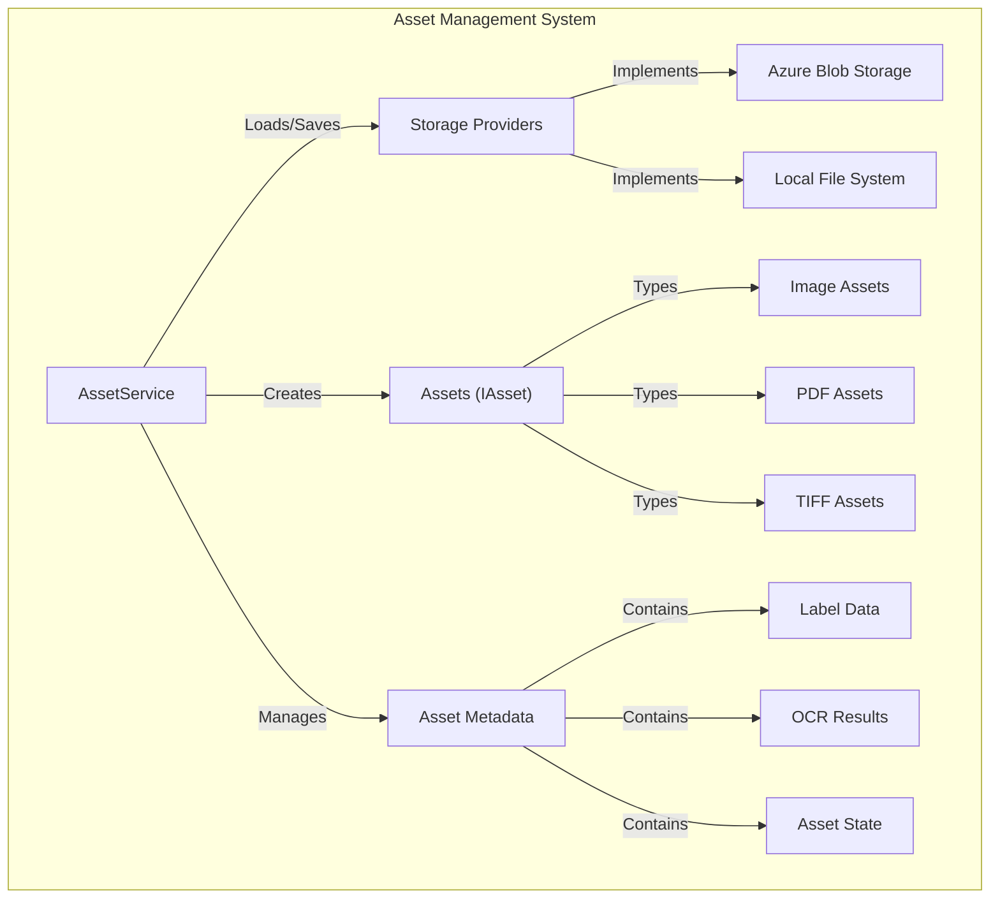

Sources: [src/services/assetService.ts:1-805](), [src/providers/storage/azureBlobStorage.ts:1-336]()

## Asset Service

The `AssetService` class is the central component of the asset management system, providing methods for creating, reading, updating, and deleting assets and their metadata.

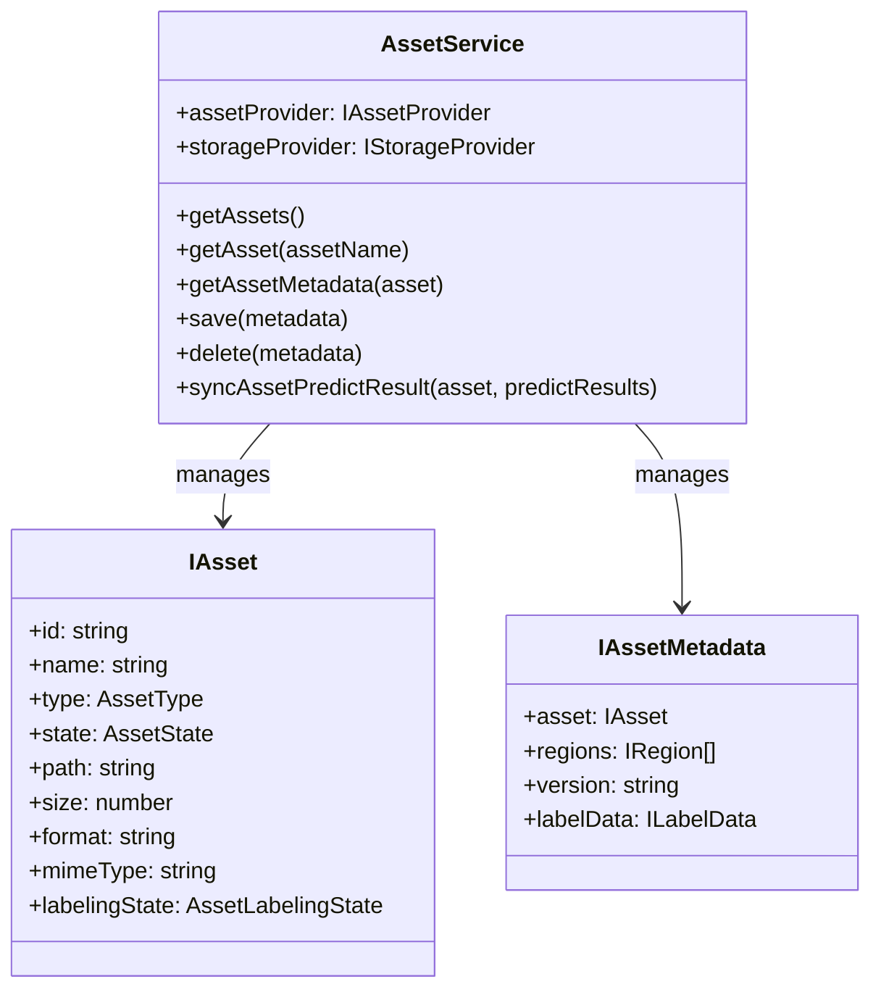

Sources: [src/services/assetService.ts:36-805]()

### Asset Creation and Detection

The `AssetService.createAssetFromFilePath` static method is responsible for creating asset objects from file paths. It performs several important functions:

1. Normalizes file paths
2. Generates unique asset IDs using SHA-256 hashing
3. Detects asset format based on file extension
4. Validates true file type using content checking
5. Determines asset type (Image, PDF, TIFF)

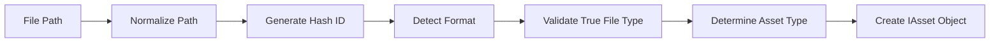

Sources: [src/services/assetService.ts:143-216]()

## Asset Types and States

Assets in FOTT can be of different types and can exist in various states throughout their lifecycle.

### Asset Types

The system supports three primary asset types:

| Asset Type | File Formats | Description |
|------------|--------------|-------------|
| Image      | JPG, PNG, BMP| Standard image formats |
| TIFF       | TIF, TIFF    | Multi-page image format |
| PDF        | PDF          | Document format with vector graphics and text |

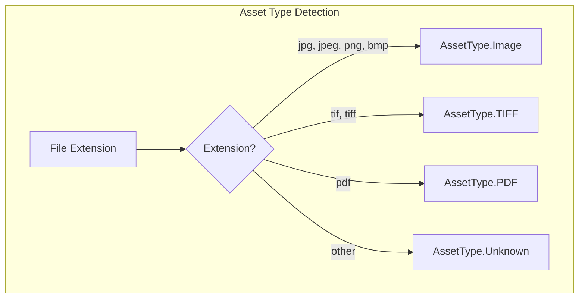

Sources: [src/services/assetService.ts:222-238]()

### Asset States

Assets can exist in different states that reflect their processing status:

| State      | Description |
|------------|-------------|
| NotVisited | Asset has not been processed or viewed |
| Visited    | Asset has been viewed but not labeled |
| Tagged     | Asset has been labeled with tags |

Additionally, assets have a `labelingState` property that provides more detailed information about how they were labeled:

| Labeling State | Description |
|----------------|-------------|
| ManuallyLabeled | Asset was labeled manually by a user |
| AutoLabeled     | Asset was labeled automatically by a model |
| AutoLabeledAndAdjusted | Asset was automatically labeled and then adjusted by a user |
| Trained | Asset has been used to train a model |

Sources: [src/services/assetService.ts:80-94](), [src/providers/storage/azureBlobStorage.ts:217-230]()

## Asset Storage and Providers

Assets and their metadata are stored and retrieved using storage providers. The system supports different storage backends through a provider interface.

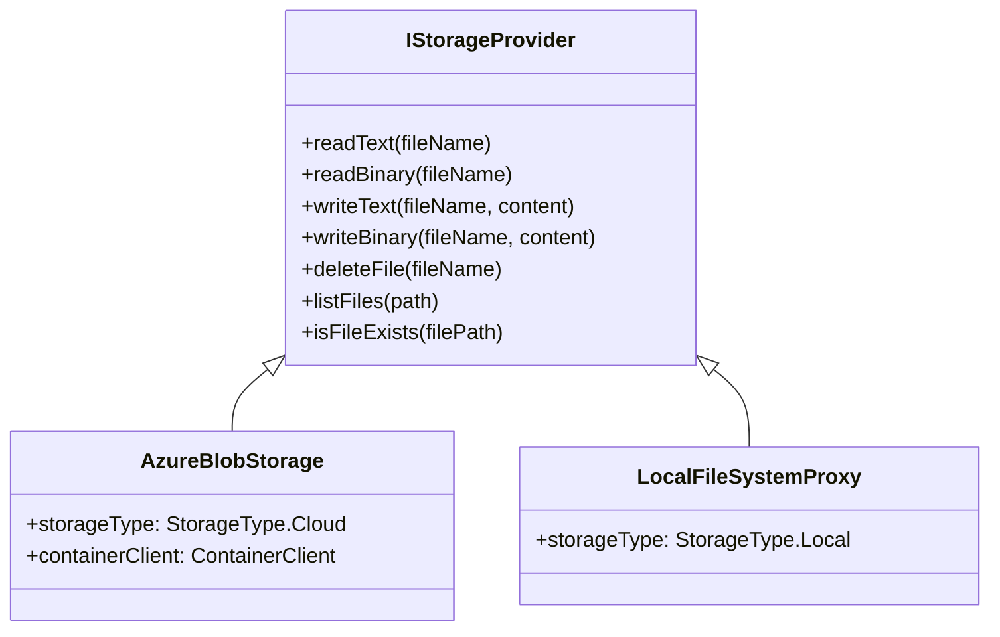

The `AssetService` uses both an `assetProvider` for retrieving assets and a `storageProvider` for reading and writing asset metadata files:

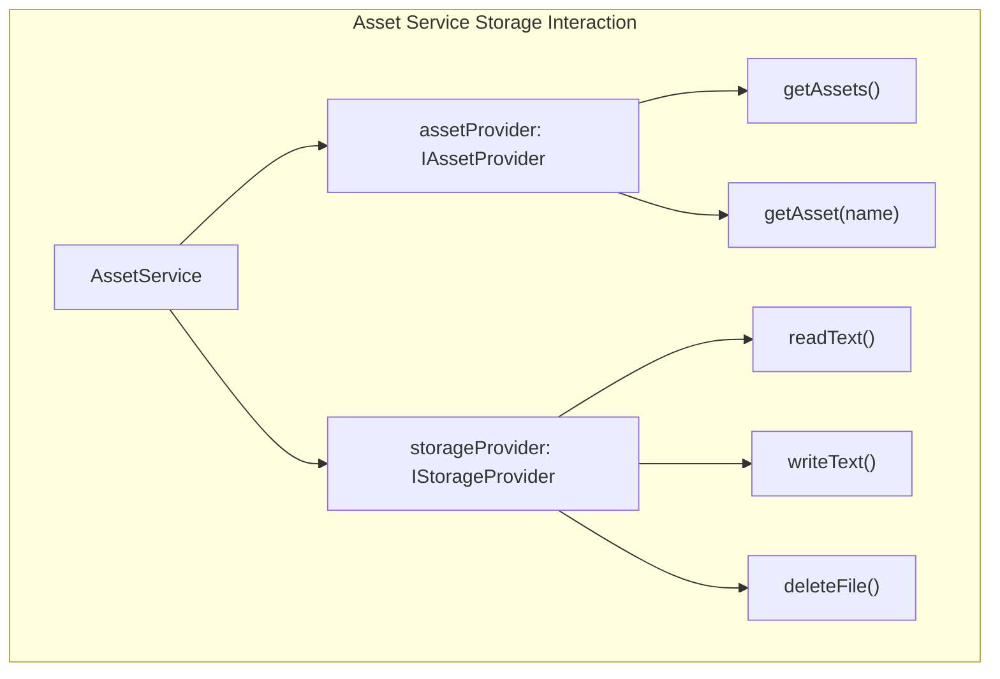

Sources: [src/services/assetService.ts:251-273](), [src/providers/storage/azureBlobStorage.ts:25-336]()

## Asset Metadata Management

Asset metadata includes labels, regions, and OCR results. The `AssetService` provides methods for managing this metadata.

### Metadata Structure

The asset metadata includes:

1. The asset object itself
2. Regions defined on the asset
3. Label data (document name, labels)
4. Version information

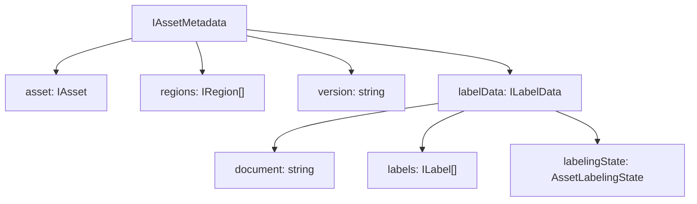

Sources: [src/services/assetService.ts:84-96](), [src/services/assetService.ts:359-434]()

### Saving and Loading Metadata

Asset metadata is saved to and loaded from storage using dedicated methods in the `AssetService`:

1. `getAssetMetadata(asset)`: Loads metadata for an asset
2. `save(metadata)`: Saves metadata for an asset

The metadata is stored in JSON format with a `.labels.json` extension:

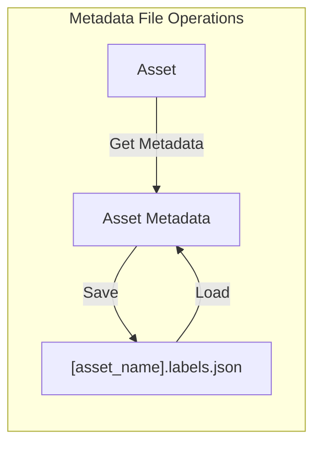

Sources: [src/services/assetService.ts:332-353](), [src/services/assetService.ts:359-434]()

## Asset Loading and Processing

The system provides functionality for loading different types of assets and processing them for display and OCR.

### File Type Detection and Validation

The system performs robust file type detection to ensure that files are correctly identified:

1. Initial detection based on file extension
2. Secondary validation of actual file content using `FileType` library
3. Handling of mismatched or spoofed file extensions

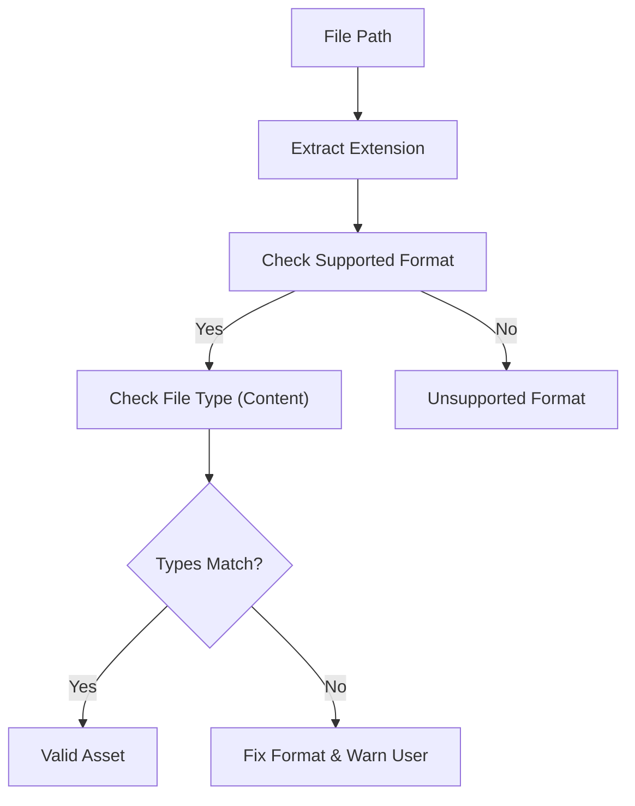

Sources: [src/services/assetService.ts:143-202](), [src/react/components/pages/prebuiltPredict/LoadFileHelper.ts:41-67]()

### Loading Different Asset Types

Different asset types require specialized loading processes:

1. **Images**: Direct loading via image URLs
2. **PDFs**: Rendered using PDF.js library
3. **TIFFs**: Parsed and rendered using custom utilities

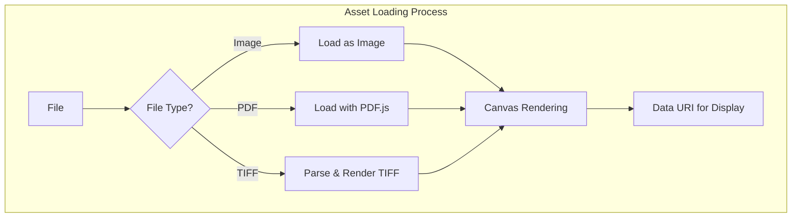

Sources: [src/react/components/common/assetPreview/pdfAsset.tsx:19-124](), [src/react/components/pages/prebuiltPredict/LoadFileHelper.ts:74-181]()

## Project-Asset Relationship

Assets are organized within projects, with actions for loading, adding, deleting, and updating assets being managed through Redux actions.

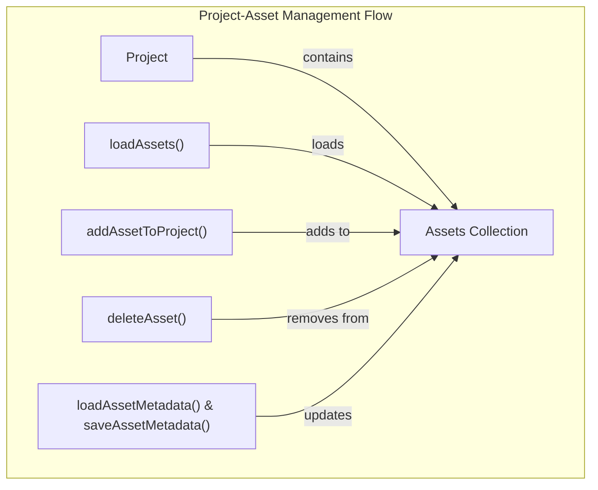

The relationship between projects and assets is maintained in the Redux state, with actions defined in `projectActions.ts` for manipulating this relationship.

Sources: [src/redux/actions/projectActions.ts:218-307](), [src/services/projectService.ts:180-193]()

## Integration with OCR Process

Assets are closely integrated with the OCR process:

1. OCR results are stored alongside assets with an `.ocr.json` extension
2. OCR results can be used to auto-label assets
3. The AssetService provides methods to sync prediction results with assets

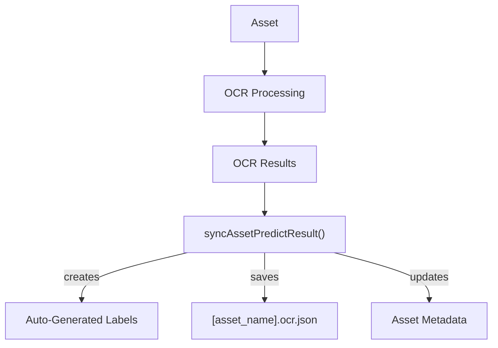

Sources: [src/services/assetService.ts:98-137]()

## Error Handling and Validation

The asset management system includes comprehensive error handling and validation:

1. Detection and correction of file extension mismatches
2. Validation of asset metadata during loading
3. Error handling for storage operations
4. Support for ignoring specific errors (like "not found" errors) in certain contexts

Sources: [src/services/assetService.ts:197-201](), [src/providers/storage/azureBlobStorage.ts:310-336]()

---

