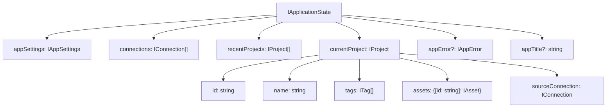
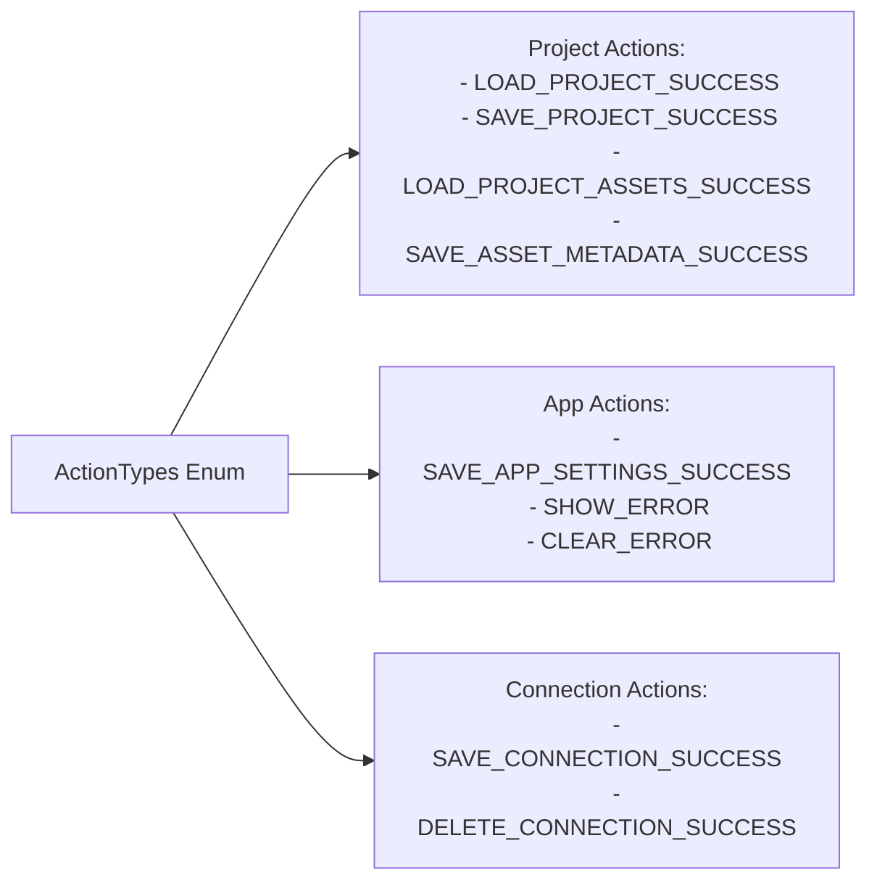
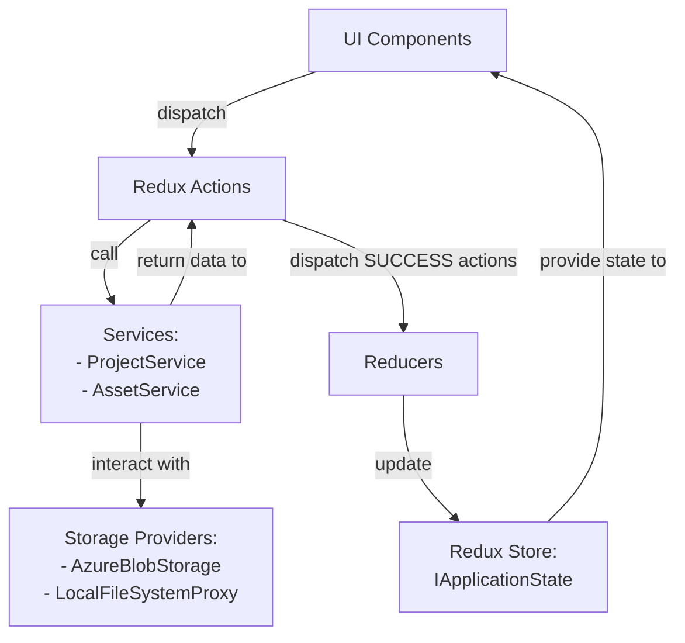
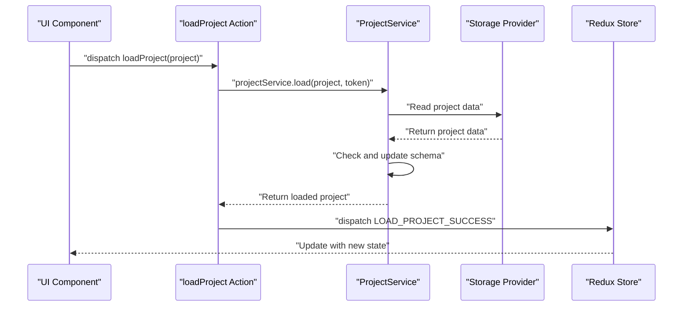
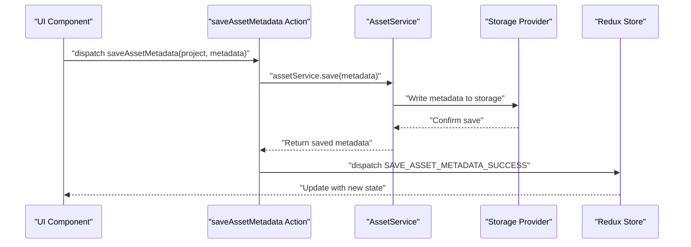
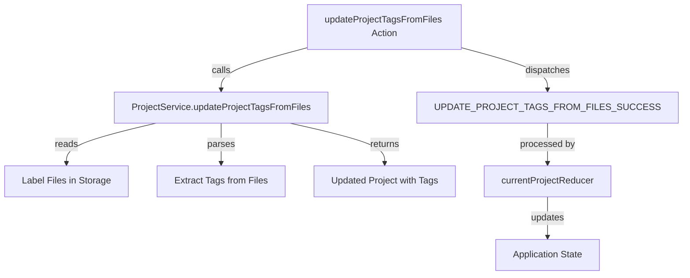

<!-- source: DeepWiki mcp.deepwiki.com · repo microsoft/OCR-Form-Tools · page 2.4 State Management · fetched 2026-10-26 -->

# State Management

<details>
<summary>Relevant source files</summary>

The following files were used as context for generating this wiki page:

- [src/common/mockFactory.ts](src/common/mockFactory.ts)
- [src/models/applicationState.ts](src/models/applicationState.ts)
- [src/providers/storage/azureBlobStorage.ts](src/providers/storage/azureBlobStorage.ts)
- [src/redux/actions/actionCreators.ts](src/redux/actions/actionCreators.ts)
- [src/redux/actions/actionTypes.ts](src/redux/actions/actionTypes.ts)
- [src/redux/actions/projectActions.ts](src/redux/actions/projectActions.ts)
- [src/redux/reducers/currentProjectReducer.ts](src/redux/reducers/currentProjectReducer.ts)
- [src/services/assetService.ts](src/services/assetService.ts)
- [src/services/projectService.ts](src/services/projectService.ts)

</details>


The OCR Form Testing Tool (FOTT) uses Redux for centralized state management throughout the application. This document explains how application state is structured, managed, and updated through the Redux architecture, including action types, reducers, and service integrations.

For information about component-specific state, see [User Interface](#5).

## State Structure Overview

The application's state is defined by the `IApplicationState` interface in the Redux store:



Sources: [src/models/applicationState.ts:15-23]()

The state tree consists of these primary slices:

| State Property | Purpose | Interface |
|----------------|---------|-----------|
| appSettings | Application-wide settings | IAppSettings |
| connections | Available data connections | IConnection[] |
| recentProjects | Recently used projects | IProject[] |
| currentProject | Active project being edited | IProject |
| appError | Current application error | IAppError |
| appTitle | Current application title | string |

Sources: [src/models/applicationState.ts:15-23](), [src/models/applicationState.ts:68-72]()

## Redux Implementation

### Actions and Action Types

Actions in FOTT follow the standard Redux pattern, with action types defined as an enum in `actionTypes.ts`:



Sources: [src/redux/actions/actionTypes.ts:7-42]()

The application provides helper functions to create action objects:

```typescript
// Create action without payload
export function createAction<TAction>(type): () => Action<TAction["type"]> { /* ... */ }

// Create action with payload
export function createPayloadAction<TAction>(type): (payload) => IPayloadAction<TAction["type"], TAction["payload"]> { /* ... */ }
```

Sources: [src/redux/actions/actionCreators.ts:49-65]()

### Reducers

Reducers process actions to update specific parts of the state. The `currentProjectReducer` handles project-related actions:

```typescript
export const reducer = (state: IProject = null, action: AnyAction): IProject => {
    switch (action.type) {
        case ActionTypes.LOAD_PROJECT_SUCCESS:
            return {...action.payload};
        case ActionTypes.SAVE_ASSET_METADATA_SUCCESS:
            // Update assets and potentially tags
            // ...
        // Other cases...
        default:
            return state;
    }
};
```

Sources: [src/redux/reducers/currentProjectReducer.ts:21-116]()

## Service Layer Integration

FOTT follows a pattern where services handle the business logic and data operations, then dispatch actions to update the state:



Sources: [src/redux/actions/projectActions.ts](), [src/services/projectService.ts](), [src/services/assetService.ts]()

### ProjectService

The `ProjectService` class provides methods for project operations:

```typescript
export default class ProjectService implements IProjectService {
    public async load(project: IProject, securityToken: ISecurityToken): Promise<IProject> { /* ... */ }
    public async save(project: IProject, securityToken: ISecurityToken, saveTags?: boolean): Promise<IProject> { /* ... */ }
    public async delete(project: IProject): Promise<void> { /* ... */ }
    // Other methods...
}
```

Sources: [src/services/projectService.ts:50-507]()

### AssetService

The `AssetService` class manages asset operations:

```typescript
export class AssetService {
    public async getAssets(): Promise<IAsset[]> { /* ... */ }
    public async getAssetMetadata(asset: IAsset): Promise<IAssetMetadata> { /* ... */ }
    public async save(metadata: IAssetMetadata): Promise<IAssetMetadata> { /* ... */ }
    // Other methods...
}
```

Sources: [src/services/assetService.ts:36-805]()

## Common State Flow Patterns

### Project Loading Flow

When loading a project, the application follows this flow:



Sources: [src/redux/actions/projectActions.ts:60-97](), [src/services/projectService.ts:56-72]()

### Asset Metadata Saving Flow

When saving asset metadata (annotations, labels, etc.):



Sources: [src/redux/actions/projectActions.ts:282-293](), [src/services/assetService.ts:332-353]()

## Redux Action Types

The application defines the following key action types:

| Category | Action Types | Purpose |
|----------|--------------|---------|
| Project | LOAD_PROJECT_SUCCESS | Update state after project loading |
| Project | SAVE_PROJECT_SUCCESS | Update state after project saving |
| Project | DELETE_PROJECT_SUCCESS | Remove project from state |
| Asset | LOAD_ASSET_METADATA_SUCCESS | Update state with asset metadata |
| Asset | SAVE_ASSET_METADATA_SUCCESS | Update state after metadata save |
| Connection | SAVE_CONNECTION_SUCCESS | Update connection in state |
| App | SAVE_APP_SETTINGS_SUCCESS | Update application settings |
| Error | SHOW_ERROR, CLEAR_ERROR | Manage application errors |

Sources: [src/redux/actions/actionTypes.ts:7-42]()

## Project Actions Implementation

The project actions are implemented as thunks (functions that return functions) to handle asynchronous operations:

```typescript
export function loadProject(project: IProject, sharedToken?: ISecurityToken):
    (dispatch: Dispatch, getState: () => IApplicationState) => Promise<IProject> {
    return async (dispatch: Dispatch, getState: () => IApplicationState) => {
        const appState = getState();
        const projectService = new ProjectService();
        
        // Find security token
        let projectToken: ISecurityToken;
        // ... token lookup logic
        
        // Load and update project
        const loadedProject = await projectService.load(project, projectToken);
        await ProjectService.checkAndUpdateSchema(loadedProject);
        const schemaUpdatedProject = await AssetService.checkAndUpdateSchema(loadedProject);
        
        // Dispatch action to update state
        dispatch(loadProjectAction(schemaUpdatedProject));
        return schemaUpdatedProject;
    };
}
```

Sources: [src/redux/actions/projectActions.ts:60-97]()

## State Update Patterns

### Updating Tags from Files

The application can update project tags based on label files in storage:



Sources: [src/redux/actions/projectActions.ts:130-138](), [src/services/projectService.ts:181-193]()

### Asset Metadata Updates

When saving asset metadata, the reducer may also update project tags if new tags are found:

```typescript
case ActionTypes.SAVE_ASSET_METADATA_SUCCESS:
    // Extract existing asset tags
    const assetTags = new Set();
    action.payload.regions.forEach((region) => 
        region.tags.forEach((tag) => assetTags.add(tag))
    );
    
    // Check for new tags not in project
    const newTags: ITag[] = state.tags ? [...state.tags] : [];
    let updateTags = false;
    
    assetTags.forEach((tag) => {
        if (!state.tags || !state.tags.find((projectTag) => tag === projectTag.name)) {
            const color = getNextColor(newTags);
            newTags.push({ name: tag, color } as ITag);
            updateTags = true;
        }
    });
    
    // Return updated state
    if (updateTags) {
        return { ...state, tags: newTags, assets: updatedAssets };
    }
```

Sources: [src/redux/reducers/currentProjectReducer.ts:56-92]()

## Conclusion

The Redux state management in FOTT provides a predictable and centralized approach to handling application data. The clear separation between UI components, actions, services, and reducers makes the codebase more maintainable and testable.

Key points to understand:

1. The `IApplicationState` interface defines the complete state tree
2. Actions and reducers follow standard Redux patterns
3. Services contain business logic and interact with storage providers
4. UI components dispatch actions and consume state through the Redux store
5. Common flows like project loading and asset saving follow a consistent pattern

Sources: [src/models/applicationState.ts](), [src/redux/actions/projectActions.ts](), [src/redux/reducers/currentProjectReducer.ts]()

---

