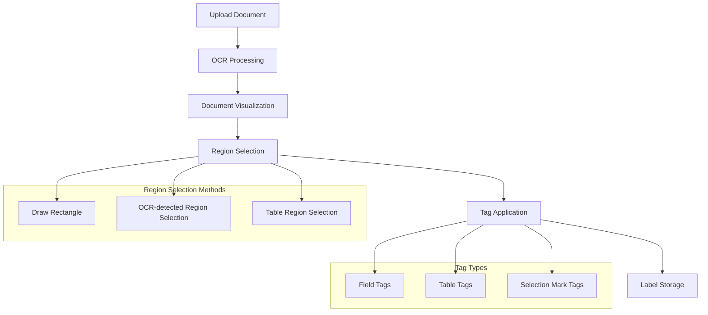
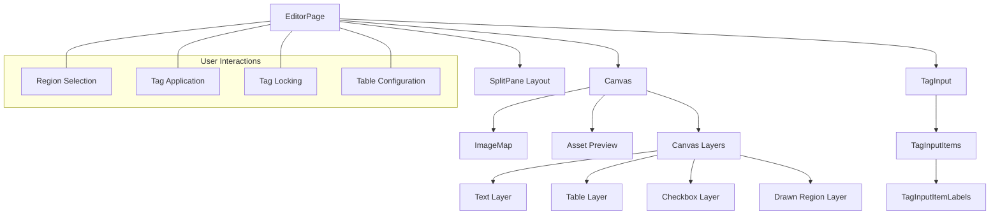
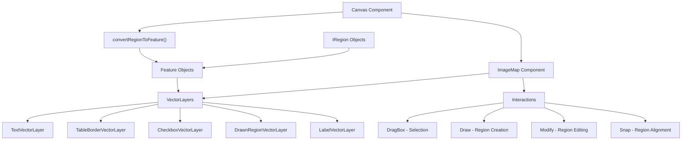
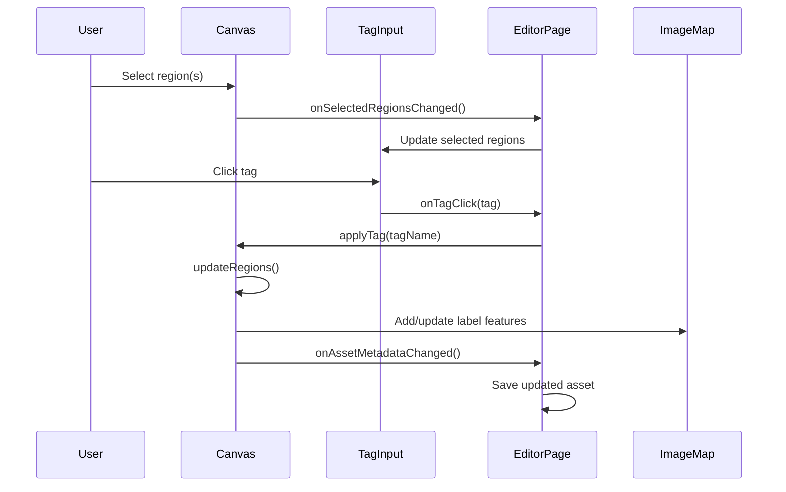
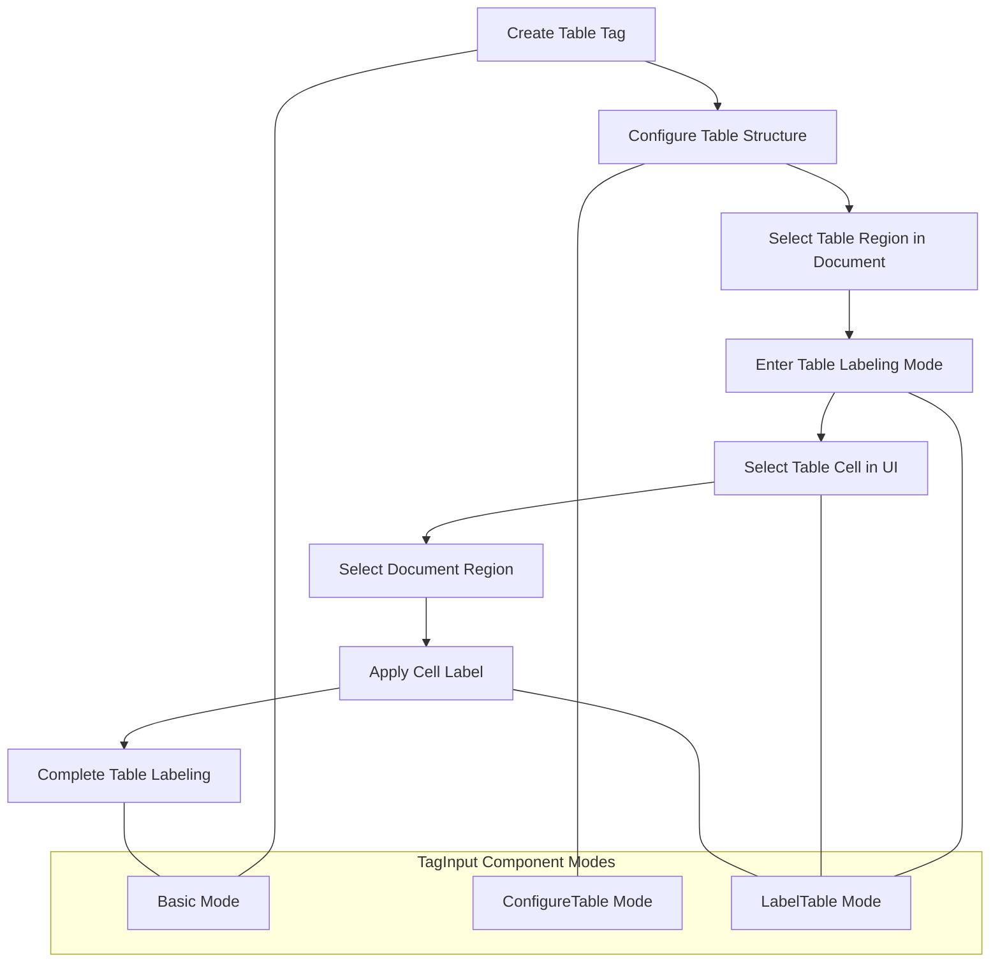
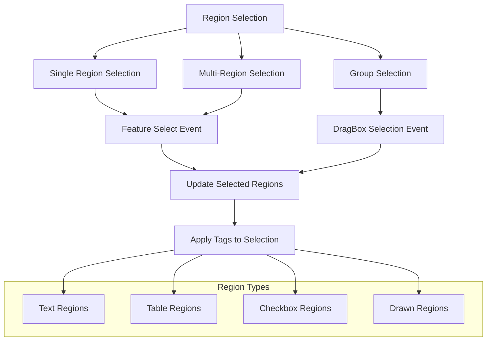
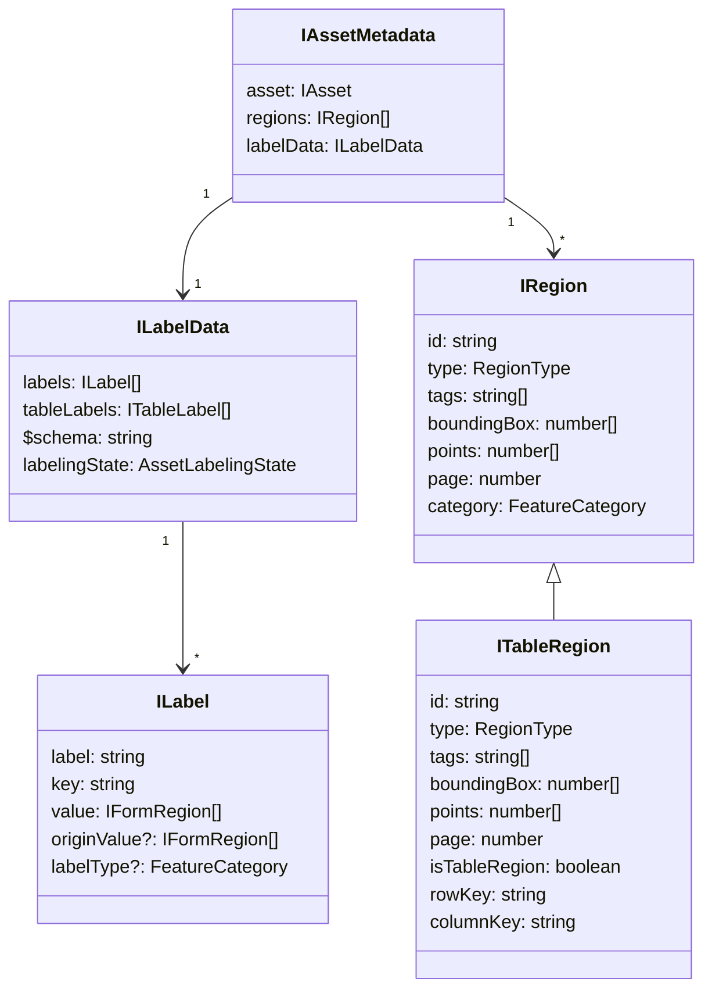
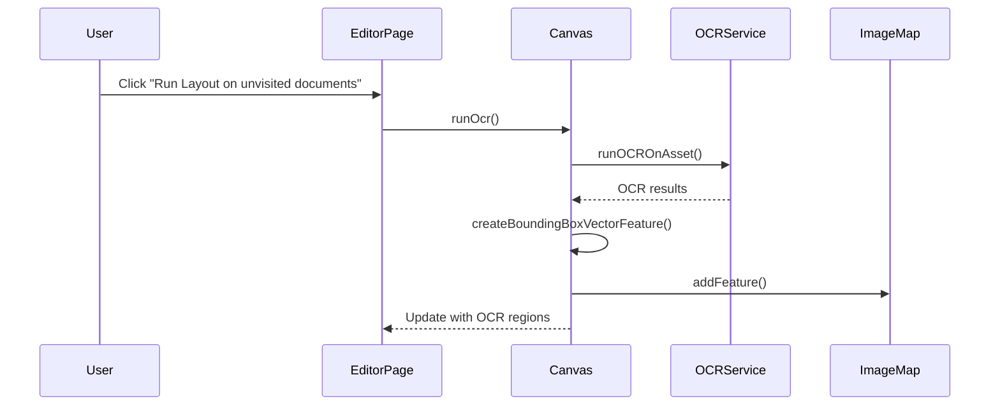
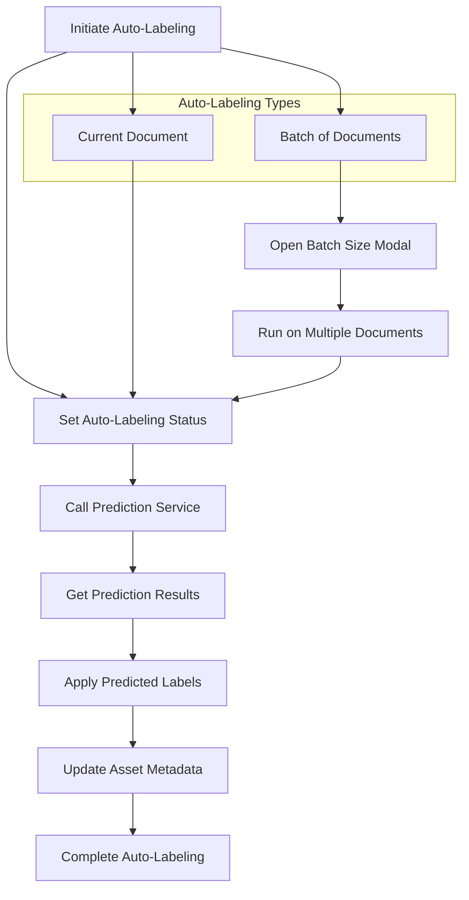

<!-- source: DeepWiki mcp.deepwiki.com · repo microsoft/OCR-Form-Tools · page 3 Document Labeling · fetched 2026-10-26 -->

# Document Labeling

<details>
<summary>Relevant source files</summary>

The following files were used as context for generating this wiki page:

- [src/react/components/common/imageMap/imageMap.tsx](src/react/components/common/imageMap/imageMap.tsx)
- [src/react/components/common/tagInput/tagInput.scss](src/react/components/common/tagInput/tagInput.scss)
- [src/react/components/common/tagInput/tagInput.tsx](src/react/components/common/tagInput/tagInput.tsx)
- [src/react/components/common/tagInput/tagInputItem.test.tsx](src/react/components/common/tagInput/tagInputItem.test.tsx)
- [src/react/components/common/tagInput/tagInputItem.tsx](src/react/components/common/tagInput/tagInputItem.tsx)
- [src/react/components/common/tagInput/tagInputItemLabel.tsx](src/react/components/common/tagInput/tagInputItemLabel.tsx)
- [src/react/components/pages/editorPage/canvas.tsx](src/react/components/pages/editorPage/canvas.tsx)
- [src/react/components/pages/editorPage/editorPage.scss](src/react/components/pages/editorPage/editorPage.scss)
- [src/react/components/pages/editorPage/editorPage.tsx](src/react/components/pages/editorPage/editorPage.tsx)

</details>


This page provides a detailed overview of the document labeling functionality in the OCR Form Testing Tool (FOTT). Document labeling is a core feature that allows users to annotate documents by selecting regions and applying tags to them, creating training data for custom form recognition models.

For information about managing tags and the tag input system, see [Tag Input System](#2.2).

## Overview of Document Labeling Process

Document labeling in FOTT follows a structured workflow that enables users to identify, select, and tag regions of interest within documents. This process is essential for creating the training data needed to build custom form recognition models.



Sources:
- [src/react/components/pages/editorPage/canvas.tsx:1-100]()
- [src/react/components/pages/editorPage/editorPage.tsx:1-50]()

## Labeling Interface Components

The document labeling interface consists of several key components that work together to provide a comprehensive labeling experience.



Sources:
- [src/react/components/pages/editorPage/editorPage.tsx:125-446]()
- [src/react/components/pages/editorPage/canvas.tsx:48-101]()
- [src/react/components/common/tagInput/tagInput.tsx:49-101]()

## Canvas Interaction System

The Canvas component serves as the central interface for document labeling, allowing users to view documents and interact with regions through the ImageMap component.

### Key Canvas Features

| Feature | Description | Implementation |
|---------|-------------|----------------|
| Region Selection | Select OCR-detected or manually drawn regions | `handleFeatureSelect` |
| Region Drawing | Draw custom regions on the document | `handleToggleDrawRegionMode`, `draw` interaction |
| Feature Styling | Visual styling for different region types | `featureStyler`, `labelFeatureStyler`, etc. |
| Layer Management | Toggle visibility of different region types | `toggleTextFeatureVisibility`, etc. |
| Region Management | Add, update, and delete regions | `addRegions`, `updateRegions`, `deleteRegions` |

Sources:
- [src/react/components/pages/editorPage/canvas.tsx:248-350]()
- [src/react/components/common/imageMap/imageMap.tsx:219-269]()

### Canvas-to-Region Mapping



Sources:
- [src/react/components/pages/editorPage/canvas.tsx:643-666]()
- [src/react/components/common/imageMap/imageMap.tsx:71-107]()

## Tag Application Process

The process of applying tags to regions involves several components working together to create a labeled document.

### Tag Application Flow



Sources:
- [src/react/components/pages/editorPage/canvas.tsx:456-570]()
- [src/react/components/pages/editorPage/editorPage.tsx:590-608]()
- [src/react/components/common/tagInput/tagInput.tsx:560-608]()

### Tag Application Logic

When applying a tag to a selected region, the system executes several steps:

1. Checks if the tag is compatible with the region type
2. Updates the region's tags array
3. Handles special cases for table regions or checkboxes
4. Updates the asset metadata with new label data
5. Redraws the region with appropriate styling

The `applyTag` method in the Canvas component handles this process:

```typescript
// Applies a tag to selected regions
public applyTag = (tag: string, rowIndex?: number, columnIndex?: number) => {
    const selectedRegions: IRegion[] = this.getSelectedRegions();
    // Apply tag logic
    // Update regions
    this.updateRegions([...selectedRegions, ...regions]);
}
```

Sources:
- [src/react/components/pages/editorPage/canvas.tsx:456-571]()

## Table Labeling

FOTT provides specialized functionality for labeling table structures in documents, which differs from standard region labeling.

### Table Labeling Modes

The TagInput component supports different modes for working with tables:

| Mode | Description | Component |
|------|-------------|-----------|
| Basic | Standard tag selection and application | `TagInput` (default view) |
| ConfigureTable | Define table structure (rows/columns) | `TableTagConfig` |
| LabelTable | Apply tags to table cells | `TableTagLabeling` |

Sources:
- [src/react/components/common/tagInput/tagInput.tsx:170-211]()
- [src/react/components/pages/editorPage/editorPage.tsx:460-538]()

### Table Labeling Workflow



Sources:
- [src/react/components/pages/editorPage/editorPage.tsx:473-538]()
- [src/react/components/common/tagInput/tagInput.tsx:170-211]()

## Region Selection and Interaction

The ImageMap component provides the core functionality for interacting with regions on the document.

### Region Selection Types



Sources:
- [src/react/components/common/imageMap/imageMap.tsx:302-429]()
- [src/react/components/pages/editorPage/canvas.tsx:586-827]()

### Drawing Custom Regions

The Canvas component allows users to draw custom regions when the built-in OCR detection doesn't identify all needed regions.

1. Toggle draw region mode
2. Draw rectangle on document
3. System creates new region
4. Apply tag to the newly drawn region

Sources:
- [src/react/components/pages/editorPage/canvas.tsx:157-188]()
- [src/react/components/common/imageMap/imageMap.tsx:156-194]()

## Label Data Structure

When regions are labeled, the system maintains a structured representation of the labels that can be used for training models.

### Label Data Model



Sources:
- [src/react/components/pages/editorPage/canvas.tsx:736-787]()
- [src/react/components/pages/editorPage/editorPage.tsx:208-214]()
- [src/react/components/common/tagInput/tagInput.tsx:444-473]()

## User Interface Components for Labeling

The document labeling interface consists of several key UI components that facilitate the labeling process.

### TagInput UI Structure

The TagInput component displays available tags and provides UI elements for managing them:

| UI Element | Description | Component |
|------------|-------------|-----------|
| Tag List | List of available tags to apply | `TagInputItem` |
| Tag Color | Visual indicator for each tag | `TagInputItem` color block |
| Tag Labels | Shows regions labeled with the tag | `TagInputItemLabel` |
| Tag Actions | Buttons for managing tags | `TagInputToolbar` |
| Context Menu | Additional tag operations | Contextual menu |

Sources:
- [src/react/components/common/tagInput/tagInput.tsx:159-296]()
- [src/react/components/common/tagInput/tagInput.scss:7-310]()
- [src/react/components/common/tagInput/tagInputItem.tsx:92-122]()

### Visual Tag Styling

The styling of tags and labeled regions provides visual feedback about their state:

```scss
.tag-item {
    &-selected {
        .tag-content {
            color: white;
            background: $darker-10 !important;
        }
    }

    &-applied {
        .tag-content {
            color: #fff;
            font-weight: 600;
            background: $darker-10 !important;
        }
    }
}
```

Sources:
- [src/react/components/common/tagInput/tagInput.scss:114-140]()
- [src/react/components/common/tagInput/tagInputItem.tsx:166-175]()

## Label Management System

The system maintains labels as distinct entities from tags and regions, representing the actual applied tags on specific document areas.

### Converting Regions to Labels

When regions are labeled, the Canvas component converts them to label data:

```typescript
private convertRegionsToLabelData = (regions: IRegion[], assetName: string) => {
    // Convert regions to labels
    // Structure data for storage
}
```

This conversion process ensures that the labels are stored in a format suitable for training models and persist even after the document is closed.

Sources:
- [src/react/components/pages/editorPage/canvas.tsx:736-787]()

### Label Visualization

Labeled regions are visually highlighted in the document, with styling based on the tag color and selection state.

Sources:
- [src/react/components/pages/editorPage/canvas.tsx:304-316]()
- [src/react/components/common/imageMap/imageMap.tsx:229-261]()

## Keyboard Interactions and Shortcuts

The document labeling system supports keyboard shortcuts to improve labeling efficiency.

| Shortcut | Action | Implementation |
|----------|--------|----------------|
| 1-9, 0 | Apply corresponding tag | `handleTagHotKey` |
| Delete/Backspace | Delete selected region | `handleKeyDown` |
| Escape | Cancel current operation | `handleKeyDown` |
| Shift | Enter label key mode | `handleKeyUp` |

Sources:
- [src/react/components/pages/editorPage/canvas.tsx:262-276]()
- [src/react/components/pages/editorPage/editorPage.tsx:700-718]()

## Integration with OCR and Auto-Labeling

Document labeling integrates with OCR processing and auto-labeling to assist with the labeling process.

### OCR Processing for Region Detection

Before labeling, the system can run OCR to detect text regions in the document:



Sources:
- [src/react/components/pages/editorPage/canvas.tsx:401-403]()
- [src/react/components/pages/editorPage/editorPage.tsx:251-269]()

### Auto-Labeling Workflow

Auto-labeling can be used to automatically label documents based on previously trained models:



Sources:
- [src/react/components/pages/editorPage/canvas.tsx:404-442]()
- [src/react/components/pages/editorPage/editorPage.tsx:375-382]()

## Document Labeling and Asset States

Assets progress through different states during the labeling process.

### Asset Labeling States

| State | Description | Visual Indicator |
|-------|-------------|------------------|
| Visited | Asset has been viewed | Orange badge |
| ManuallyLabeled | Labeled manually by user | Brown badge |
| AutoLabeled | Labeled by auto-labeling | Purple badge |
| AutoLabeledAndAdjusted | Auto-labeled with manual adjustments | Blue badge |
| Trained | Used for training a model | Green badge |

Sources:
- [src/react/components/pages/editorPage/canvas.tsx:751-785]()
- [src/react/components/pages/editorPage/editorPage.scss:232-246]()

## Conclusion

Document labeling is a core functionality in the OCR Form Testing Tool, enabling users to create training data for custom form recognition models. The system integrates canvas visualization, region selection, tag management, and label storage to provide a comprehensive labeling experience. Special functionality for tables and checkboxes addresses the needs of complex document structures.

Understanding the document labeling system and its components is essential for effectively using the tool to train custom models for form processing.

---

