<!-- source: DeepWiki mcp.deepwiki.com · repo microsoft/OCR-Form-Tools · page 3.1 Region Annotation · fetched 2026-10-26 -->

# Region Annotation

Relevant source files

The following files were used as context for generating this wiki page:

- [src/assets/sass/fabric-icons-inline.scss](src/assets/sass/fabric-icons-inline.scss)
- [src/config/fabric-icons.json](src/config/fabric-icons.json)
- [src/react/components/common/imageMap/imageMap.tsx](src/react/components/common/imageMap/imageMap.tsx)
- [src/react/components/pages/editorPage/canvas.tsx](src/react/components/pages/editorPage/canvas.tsx)
- [src/react/components/pages/editorPage/canvasCommandBar.tsx](src/react/components/pages/editorPage/canvasCommandBar.tsx)
- [src/react/components/pages/editorPage/editorPage.tsx](src/react/components/pages/editorPage/editorPage.tsx)
- [src/registerIcons.ts](src/registerIcons.ts)

## Purpose and Scope

This document describes the region annotation functionality within the OCR Form Testing Tool (FOTT), which enables users to select, create, and label regions of interest within documents. It covers the process of selecting existing regions detected through OCR, manually drawing new regions, and applying tags to these regions. For information about more specialized table annotation functionality, see [Table Annotation](#3.2).

## Overview

Region annotation is a core component of the document labeling workflow, allowing users to identify and tag important information in documents that can later be used to train custom machine learning models. The region annotation system supports both automatically detected regions (from OCR) and manually drawn regions.

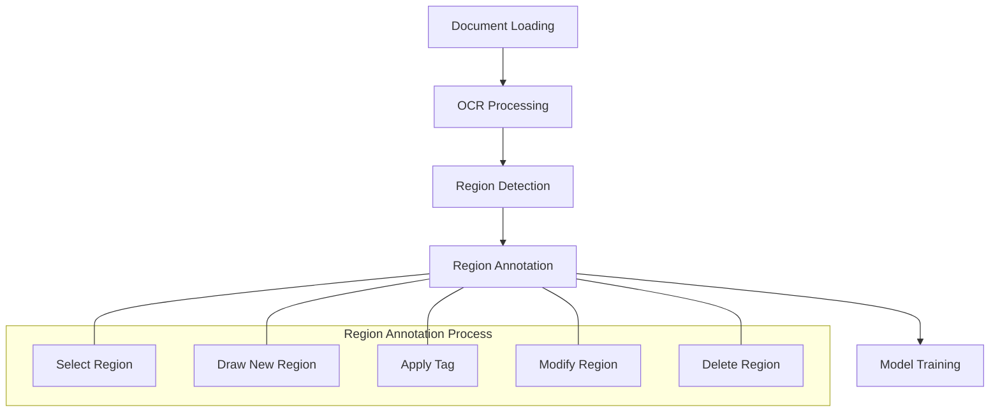

Sources: [src/react/components/pages/editorPage/canvas.tsx:125-846]()

## Region Types

The region annotation system supports several different types of regions, each handled differently in the UI:

| Region Type | Description | UI Representation |
|-------------|-------------|-------------------|
| Text | Regions containing textual content detected by OCR | Polygon outlines around text |
| Checkbox | Regions containing selection marks or checkboxes | Polygon outlines with checkbox styling |
| Drawn Region | User-drawn polygonal regions | Custom styled polygons |
| Label | Regions that have been assigned tags | Tagged polygons with visual indicators |
| Table | Table structures with rows and columns | Complex regions with table indicators (covered in [Table Annotation](#3.2)) |

The region types are defined in the codebase as part of the `FeatureCategory` enum.

Sources: [src/react/components/pages/editorPage/canvas.tsx:12-13](), [src/react/components/common/imageMap/imageMap.tsx:24-25]()

## Core Architecture

The region annotation functionality is built on several key components working together:

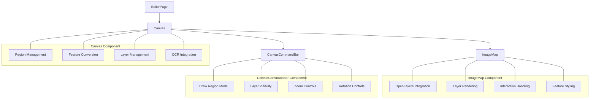

The Canvas component serves as the central coordinator for region annotation, while the ImageMap component handles the actual rendering and interactions with regions using OpenLayers. The CanvasCommandBar provides controls for toggling modes and adjusting the view.

Sources: [src/react/components/pages/editorPage/canvas.tsx:125-161](), [src/react/components/common/imageMap/imageMap.tsx:70-107](), [src/react/components/pages/editorPage/canvasCommandBar.tsx:35-236]()

## Region Selection

Users can select regions by clicking on them in the document view. The selection process flows through several components:

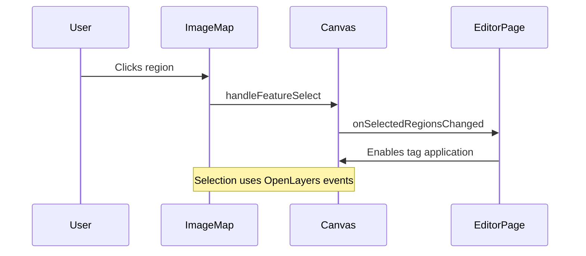

When a user clicks on a region, the ImageMap component detects this through OpenLayers event handling and triggers the `handleFeatureSelect` callback. This updates the selected regions in the Canvas component, which then notifies the EditorPage, enabling tag application for the selected region(s).

Multiple regions can be selected through group selection, which is activated using the SHIFT key or by dragging to create a selection box.

Sources: [src/react/components/common/imageMap/imageMap.tsx:663-706](), [src/react/components/pages/editorPage/canvas.tsx:587-589]()

## Drawing Regions

Users can create custom regions by enabling the "Draw Region" mode from the canvas command bar.

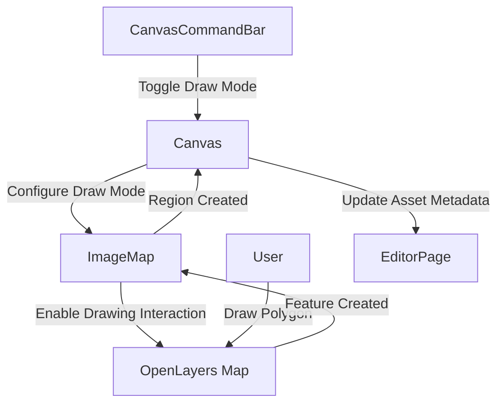

The draw region mode uses OpenLayers' drawing interactions to allow users to create polygon regions by clicking multiple points on the document. Once a region is drawn, it is added to the asset's regions collection and can be selected and tagged like any other region.

Sources: [src/react/components/pages/editorPage/canvasCommandBar.tsx:106-116](), [src/react/components/common/imageMap/imageMap.tsx:156-192]()

## Region Manipulation

Regions can be modified through several operations:

1. **Selection**: Clicking on a region to select it
2. **Moving**: Dragging a selected region to a new position
3. **Resizing/Reshaping**: Dragging vertices of a selected region
4. **Deletion**: Pressing Delete or Backspace when a region is selected

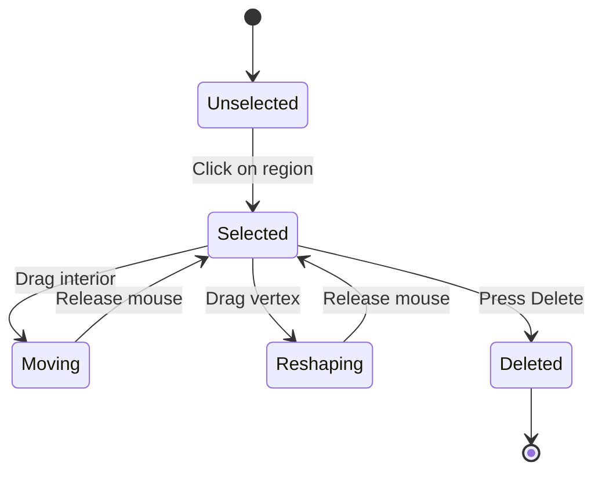

These manipulations are handled through the OpenLayers interaction system and synchronized with the application's state management.

Sources: [src/react/components/common/imageMap/imageMap.tsx:662-705](), [src/react/components/pages/editorPage/canvas.tsx:668-729]()

## Applying Tags to Regions

After selecting one or more regions, users can apply tags from the tag input panel:

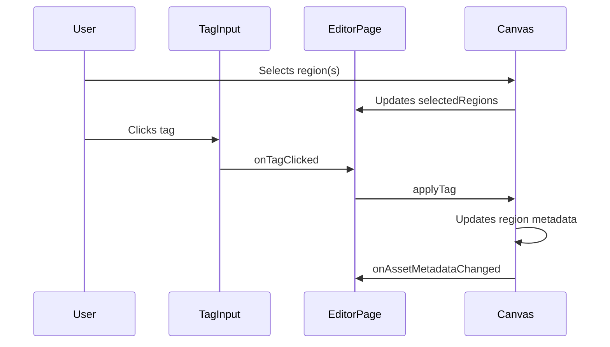

The tag application process:

1. User selects one or more regions
2. User clicks a tag from the tag panel
3. The Canvas component's `applyTag` method is called
4. The selected regions are updated with the new tag information
5. The asset metadata is updated to reflect these changes

Tags applied to regions are used to associate semantic meaning with document elements, which is essential for training custom form recognition models.

Sources: [src/react/components/pages/editorPage/editorPage.tsx:596-601](), [src/react/components/pages/editorPage/canvas.tsx:457-571]()

## Layer Visibility Control

The region annotation system allows users to control the visibility of different types of regions through layer controls in the CanvasCommandBar:

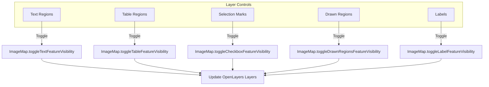

This allows users to focus on specific types of regions while working with complex documents.

Sources: [src/react/components/pages/editorPage/canvasCommandBar.tsx:52-102](), [src/react/components/common/imageMap/imageMap.tsx:219-297]()

## Region Data Structure

Regions in the application are represented by the `IRegion` interface, which contains information about the region's position, type, and associated tags:

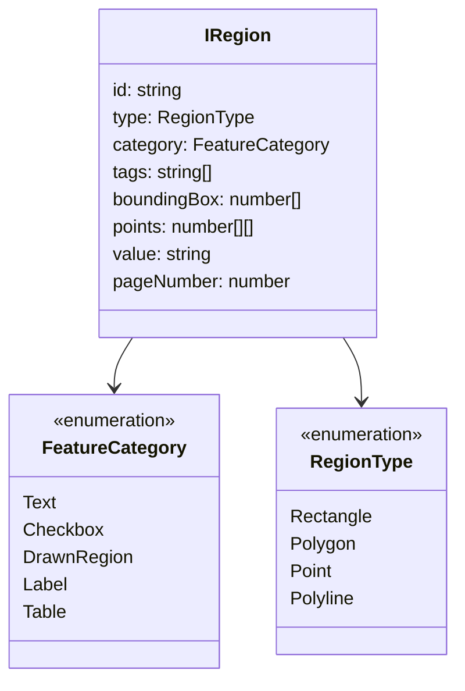

The region data is converted between different representations as it moves through the system:

1. `IRegion` in the application state
2. OpenLayers `Feature` objects for rendering
3. `ILabel` objects for storage and model training

Sources: [src/react/components/pages/editorPage/canvas.tsx:10-12](), [src/react/components/pages/editorPage/canvas.tsx:643-666]()

## Keyboard Interactions

The region annotation system supports several keyboard interactions to improve user efficiency:

| Key | Action |
|-----|--------|
| Delete / Backspace | Delete selected region(s) |
| Esc | Cancel current operation |
| Shift + Click | Multi-select regions |
| Number keys (1-9) | Apply corresponding tag to selected region(s) |

These keyboard shortcuts provide users with efficient ways to interact with regions without relying exclusively on mouse actions.

Sources: [src/react/components/pages/editorPage/canvas.tsx:262-269](), [src/react/components/pages/editorPage/editorPage.tsx:233-241]()

## Region to Label Conversion

A critical aspect of region annotation is the conversion between region data and label data, which is used for training models:

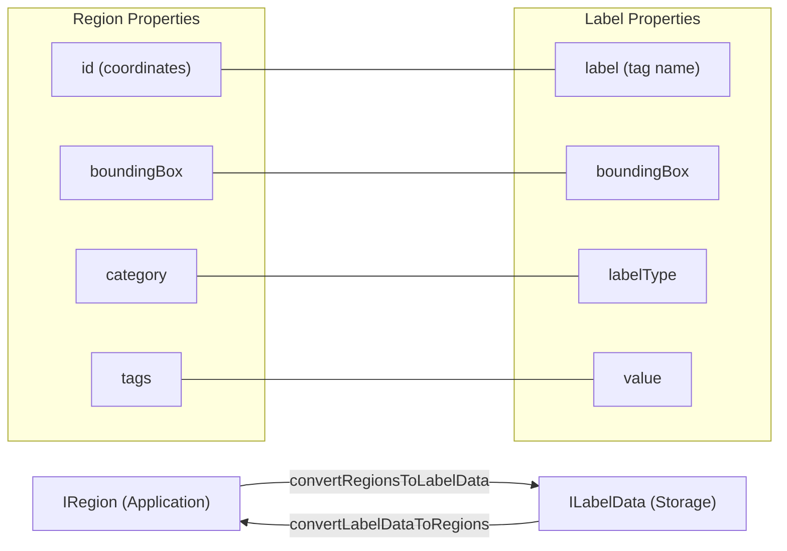

This bidirectional conversion ensures that regions created in the UI can be saved as label data for model training, and that label data can be loaded back into the UI as regions for viewing and editing.

Sources: [src/react/components/pages/editorPage/canvas.tsx:736-747]()

## Integration with OCR

The region annotation system is tightly integrated with OCR (Optical Character Recognition) to provide initial regions for annotation:

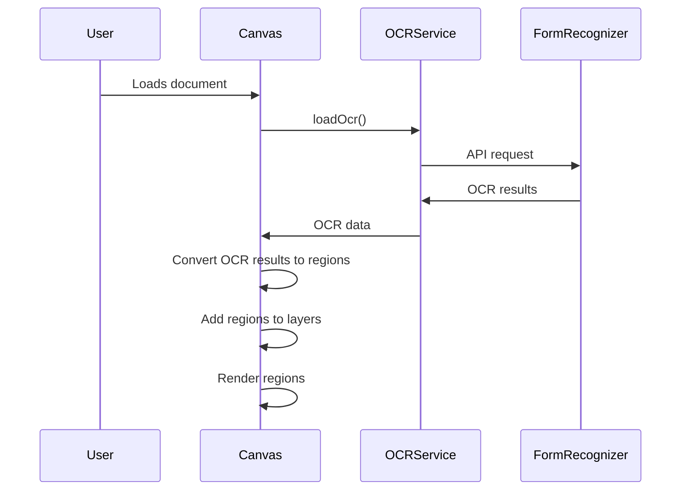

OCR processing identifies text, checkboxes, and other elements in the document, which are then converted to regions that users can select and tag. This integration provides a starting point for annotation, reducing the need for users to manually draw all regions.

Sources: [src/react/components/pages/editorPage/canvas.tsx:401-403]()

## Cross-Component Communication

The region annotation system relies on communication between multiple components:

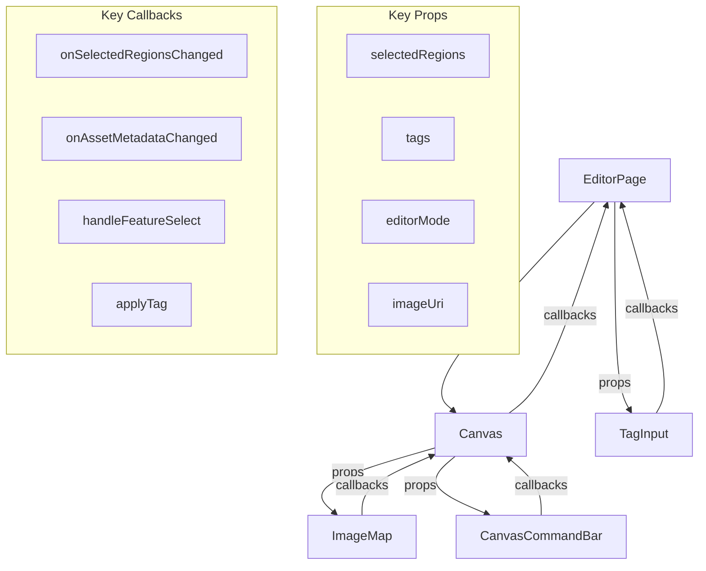

This communication flow ensures that user interactions in one component (e.g., selecting a region in the ImageMap) properly update the state in other components (e.g., enabling tag application in the TagInput).

Sources: [src/react/components/pages/editorPage/editorPage.tsx:304-329](), [src/react/components/pages/editorPage/canvas.tsx:297-336]()

## Performance Considerations

When working with complex documents containing many regions, performance can become a concern. The region annotation system addresses this through:

1. Layer-based rendering that allows showing/hiding different types of regions
2. Efficient feature management in OpenLayers
3. Separation of region data (application state) from rendering features (OpenLayers)

These optimizations help maintain a responsive user experience even when working with documents containing hundreds of regions.

Sources: [src/react/components/common/imageMap/imageMap.tsx:212-261]()

## Troubleshooting

Common issues that may arise during region annotation include:

1. **Regions not selectable**: Check if the correct layer is visible in the layer controls
2. **Drawing mode not working**: Ensure drawn regions layer is enabled and draw mode is toggled on
3. **Tags not applying to regions**: Verify that regions are properly selected before attempting to apply tags
4. **Slow performance**: Consider hiding layers that are not currently needed

Sources: [src/react/components/pages/editorPage/canvasCommandBar.tsx:52-102]()

---

