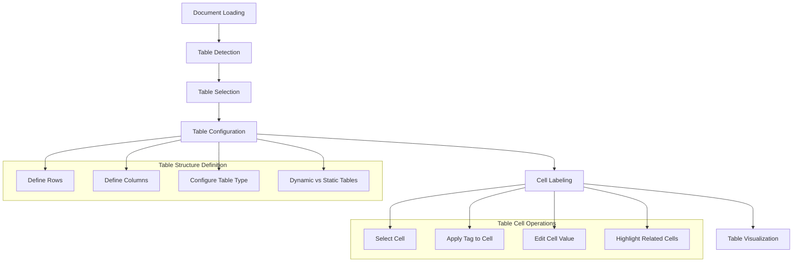
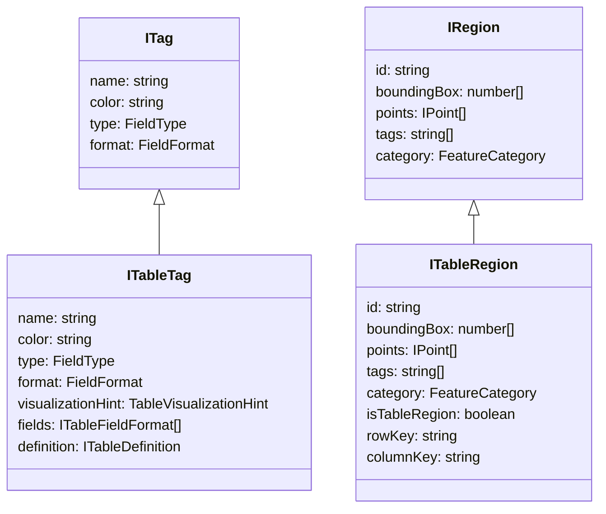
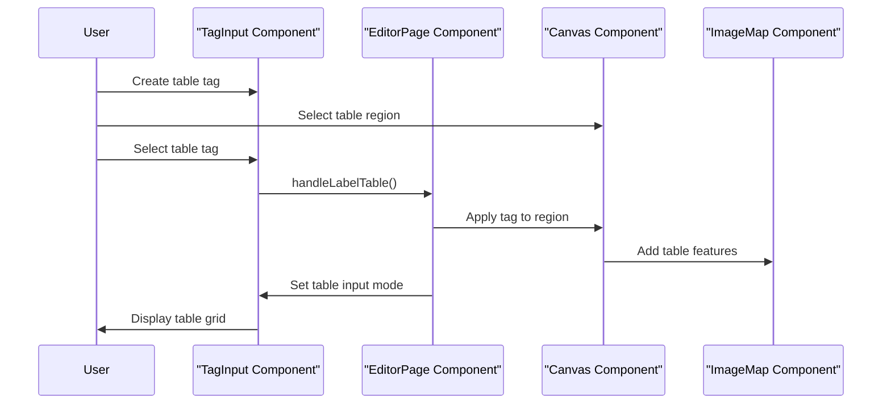
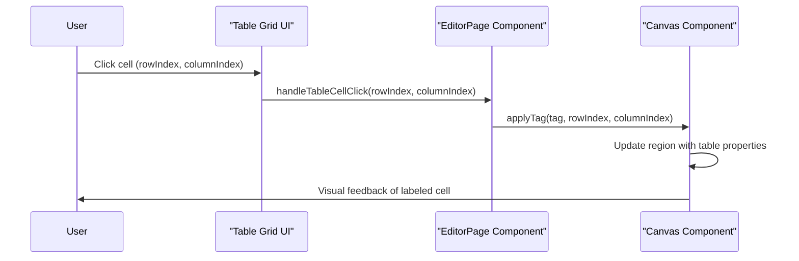
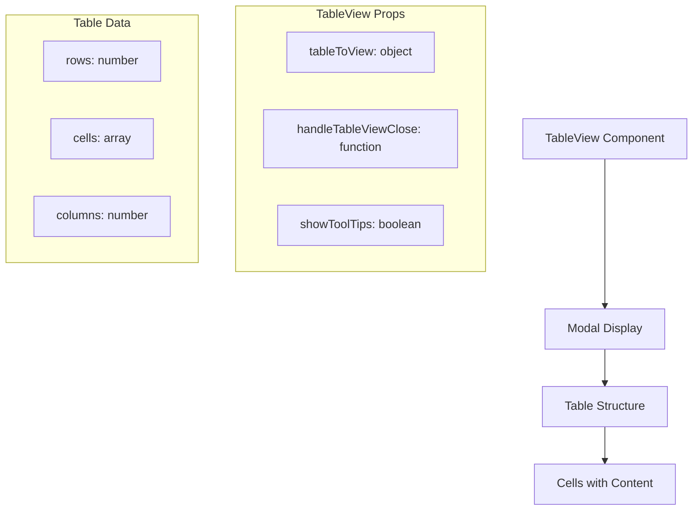
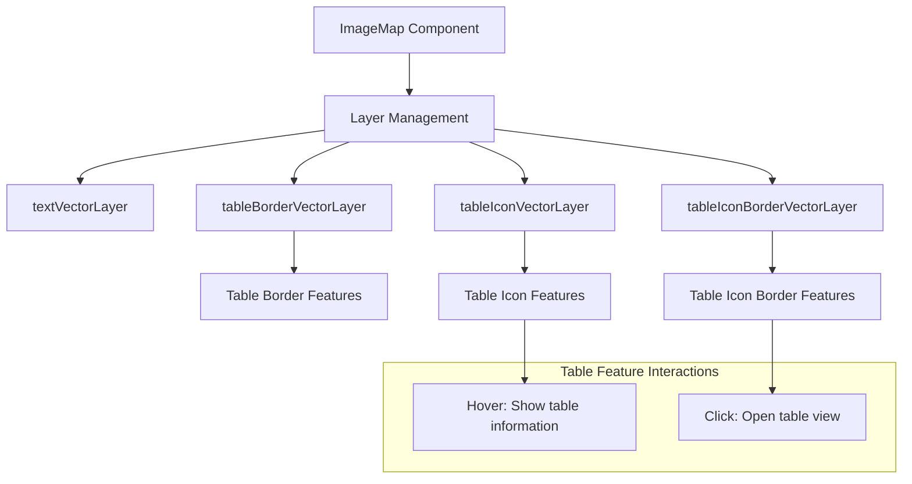
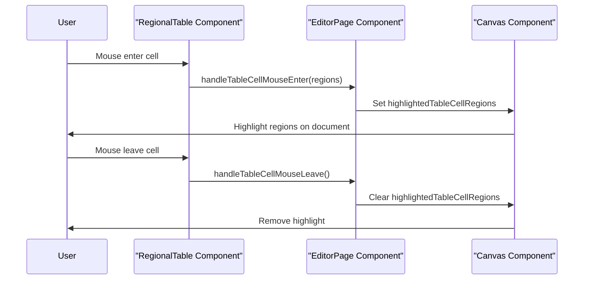
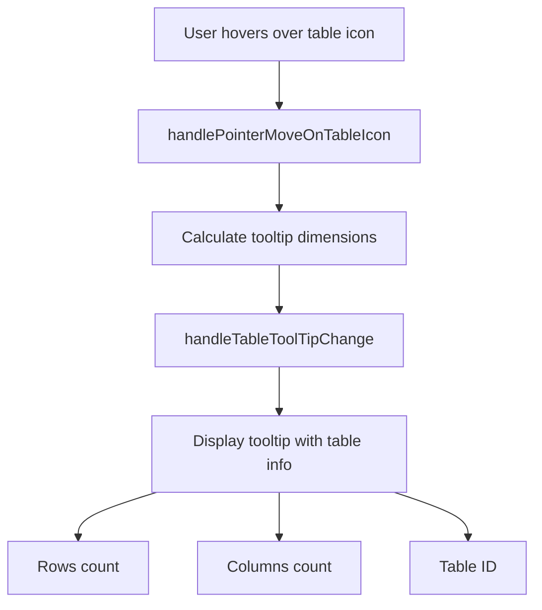
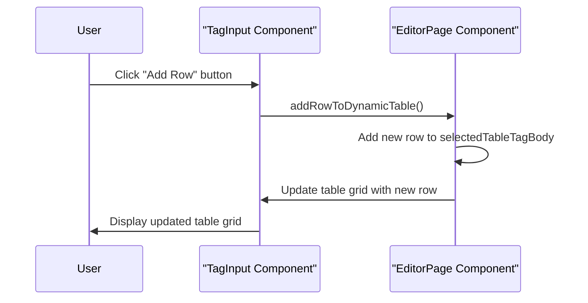
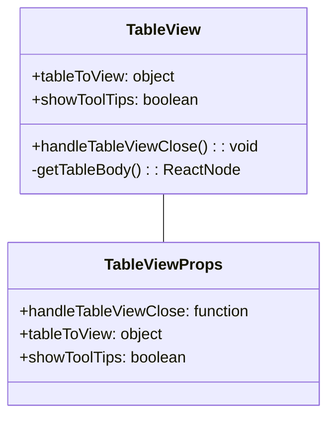

<!-- source: DeepWiki mcp.deepwiki.com · repo microsoft/OCR-Form-Tools · page 3.2 Table Annotation · fetched 2026-10-26 -->

# Table Annotation

<details>
<summary>Relevant source files</summary>

The following files were used as context for generating this wiki page:

- [src/react/components/common/imageMap/imageMap.tsx](src/react/components/common/imageMap/imageMap.tsx)
- [src/react/components/common/regionalTable/regionalTable.tsx](src/react/components/common/regionalTable/regionalTable.tsx)
- [src/react/components/pages/editorPage/canvas.tsx](src/react/components/pages/editorPage/canvas.tsx)
- [src/react/components/pages/editorPage/editorPage.tsx](src/react/components/pages/editorPage/editorPage.tsx)
- [src/react/components/pages/editorPage/tableView.scss](src/react/components/pages/editorPage/tableView.scss)
- [src/react/components/pages/editorPage/tableView.tsx](src/react/components/pages/editorPage/tableView.tsx)

</details>


## Purpose and Scope

Table Annotation is a specialized functionality within the OCR Form Testing Tool (FOTT) that enables users to identify, define, and label table structures within documents. This page explains how tables are annotated, visualized, and managed within the application.

For information about the general annotation process, see [Region Annotation](#3.1).

Sources: [src/react/components/pages/editorPage/editorPage.tsx:459-538](), [src/react/components/pages/editorPage/canvas.tsx:518-540]()

## Table Annotation Workflow



Sources: [src/react/components/pages/editorPage/editorPage.tsx:473-538](), [src/react/components/pages/editorPage/canvas.tsx:447-562]()

## Table Data Model

Tables in FOTT are represented using specialized data structures that extend the basic region concept. The system supports both array-type and object-type tables with different visualization approaches.

### Table Tags and Regions



Sources: [src/react/components/pages/editorPage/canvas.tsx:525-549]()

## Table Types and Visualization Hints

FOTT supports different types of tables with various visualization options:

| Table Type | Field Type | Description |
|------------|------------|-------------|
| Array Table | `FieldType.Array` | Dynamic tables where rows can be added or removed |
| Object Table | `FieldType.Object` | Fixed structure tables with predefined rows and columns |

| Visualization Hint | Description |
|--------------------|-------------|
| Vertical | Columns represent fields, rows represent records |
| Horizontal | Rows represent fields, columns represent records |

Sources: [src/react/components/pages/editorPage/canvas.tsx:525-540](), [src/react/components/pages/editorPage/editorPage.tsx:473-500]()

## Table Annotation Process

### Selecting and Configuring Tables

To annotate a table in a document:

1. Create a table tag with appropriate type (`Array` or `Object`) and visualization hint
2. Select the table region in the document
3. Apply the table tag to the selected region
4. Configure the table structure (rows and columns)

The system will then prepare a grid representation of the table for cell-level annotation.



Sources: [src/react/components/pages/editorPage/editorPage.tsx:473-538](), [src/react/components/pages/editorPage/canvas.tsx:447-470]()

### Cell Selection and Labeling

Once a table structure is defined, users can select and label individual cells:

1. Click on a cell in the table grid
2. Select a region in the document that corresponds to the cell
3. The system applies the tag with appropriate row and column keys



Sources: [src/react/components/pages/editorPage/editorPage.tsx:540-562](), [src/react/components/pages/editorPage/canvas.tsx:525-549]()

## Table Visualization

Tables in FOTT can be visualized in various ways:

### Table View Modal

The TableView component displays a modal with the complete table structure:



Sources: [src/react/components/pages/editorPage/tableView.tsx:38-79](), [src/react/components/pages/editorPage/tableView.scss:4-39]()

### Canvas Table Visualization

On the canvas, tables are visualized using multiple feature layers:

1. **Table Border Layer**: Displays the outer boundary of the table
2. **Table Icon Layer**: Shows an interactive icon for the table
3. **Table Icon Border Layer**: Provides visual feedback for table icon interaction



Sources: [src/react/components/common/imageMap/imageMap.tsx:318-328](), [src/react/components/common/imageMap/imageMap.tsx:756-791]()

## Table Cell Interaction

FOTT provides interactive capabilities for table cells:

### Cell Highlighting

When hovering over a cell in the table grid, corresponding regions in the document are highlighted:



Sources: [src/react/components/common/regionalTable/regionalTable.tsx:13-19](), [src/react/components/pages/editorPage/editorPage.tsx:557-563]()

### Table Information Tooltip

When hovering over a table icon on the canvas, a tooltip displays information about the table:



Sources: [src/react/components/common/imageMap/imageMap.tsx:756-791](), [src/react/components/pages/editorPage/canvas.tsx:334-345]()

## Adding Rows to Dynamic Tables

For array-type tables, users can add rows dynamically:



Sources: [src/react/components/pages/editorPage/editorPage.tsx:534-538]()

## Technical Implementation Details

### Table Region Conversion

When a table tag is applied to a region, the system converts it to a `ITableRegion` by adding specialized properties:

1. For array tables:
   - `rowKey` is set to the row index (e.g., "#0", "#1")
   - `columnKey` is set to the field key from the table definition

2. For object tables:
   - Row and column keys are derived from the field configurations based on visualization hint

```
rowKey + columnKey → uniquely identifies a cell in the table
```

Sources: [src/react/components/pages/editorPage/canvas.tsx:525-549]()

### Table Feature Rendering

Tables are rendered on the canvas using multiple feature layers:

| Layer | Purpose |
|-------|---------|
| tableBorderVectorLayer | Displays the outer boundary of the table |
| tableIconVectorLayer | Shows an icon representing the table |
| tableIconBorderVectorLayer | Provides an interactive border for the table icon |

Each layer has its own styler function to control the visual appearance.

Sources: [src/react/components/common/imageMap/imageMap.tsx:223-227](), [src/react/components/common/imageMap/imageMap.tsx:318-328]()

### Toggling Table Visibility

Tables can be shown or hidden using layer visibility controls:

```javascript
// Toggle table visibility
toggleTableFeatureVisibility = (visible: boolean = false) => {
    this.tableBorderVectorLayer.setVisible(visible || !this.tableBorderVectorLayer.getVisible());
    this.tableIconVectorLayer.setVisible(visible || !this.tableIconVectorLayer.getVisible());
    this.tableIconBorderVectorLayer.setVisible(visible || !this.tableIconBorderVectorLayer.getVisible());
}
```

This functionality is part of the layer visibility controls in the Canvas Command Bar.

Sources: [src/react/components/common/imageMap/imageMap.tsx:223-227]()

## Table View Modal

The Table View modal provides a comprehensive view of annotated tables, displaying the full table structure with all cells:



The modal interface includes:
- Table cells with content
- Optional tooltips showing confidence scores
- Styling for header cells
- Scroll capabilities for large tables

Sources: [src/react/components/pages/editorPage/tableView.tsx:38-79](), [src/react/components/pages/editorPage/tableView.scss:4-39]()

## Relationship with Other Features

Table annotation works in conjunction with other features in the OCR Form Testing Tool:

1. **OCR Processing**: Tables are often detected during OCR processing
2. **Region Annotation**: Tables start as regions before being specialized as tables
3. **Tag Management**: Table tags are created and managed through the tag input system
4. **Model Training**: Annotated tables contribute to training custom models

By providing specialized table annotation capabilities, FOTT enables users to accurately capture tabular data in forms, which is essential for comprehensive form processing.

Sources: [src/react/components/pages/editorPage/editorPage.tsx:473-538](), [src/react/components/pages/editorPage/canvas.tsx:447-562]()

---

