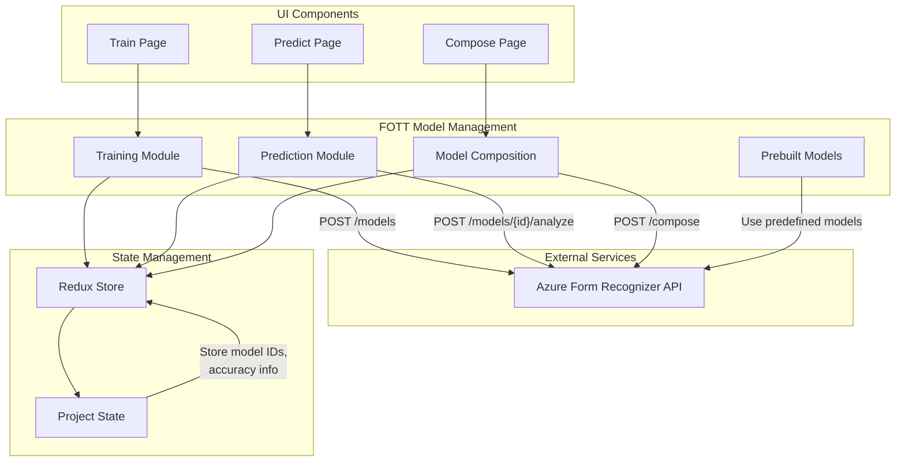
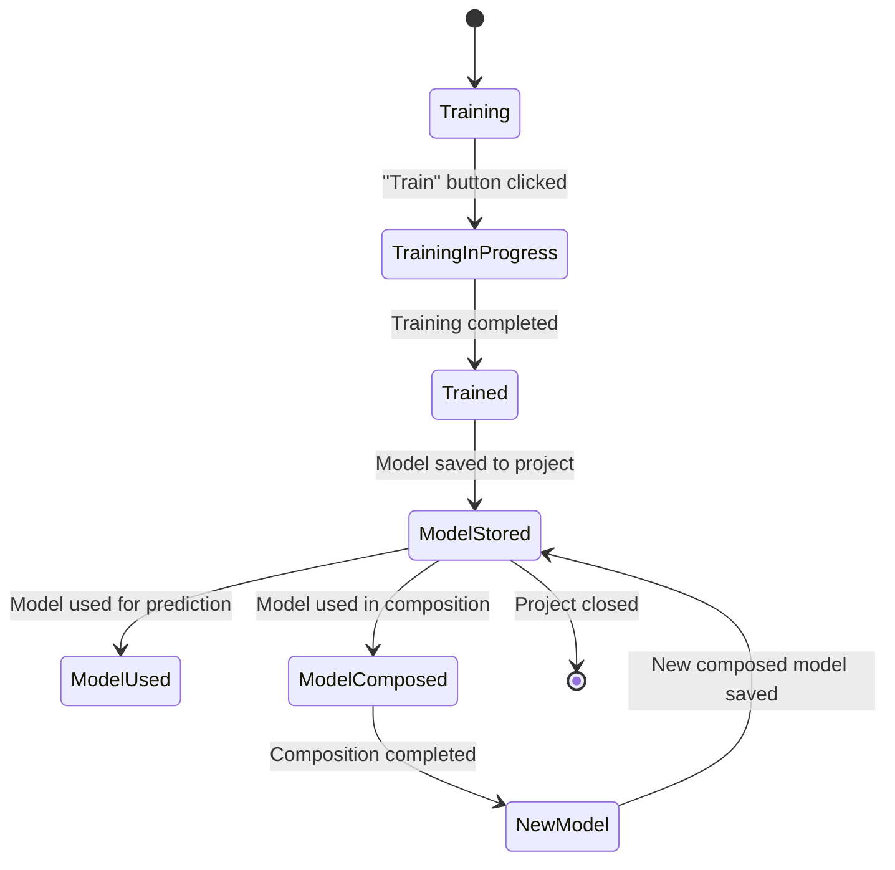
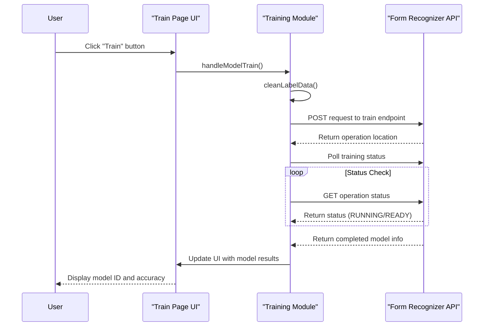
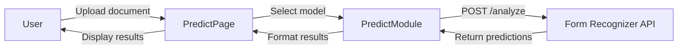
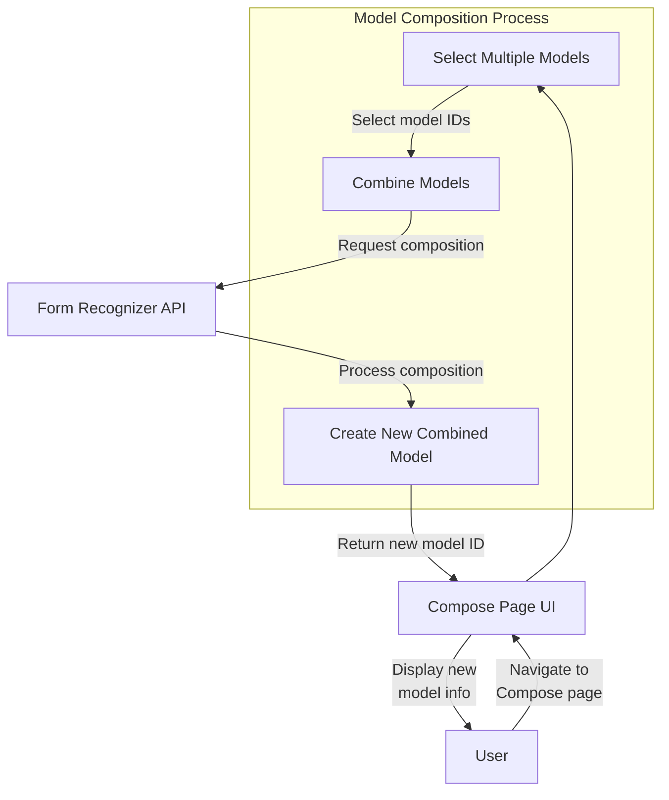
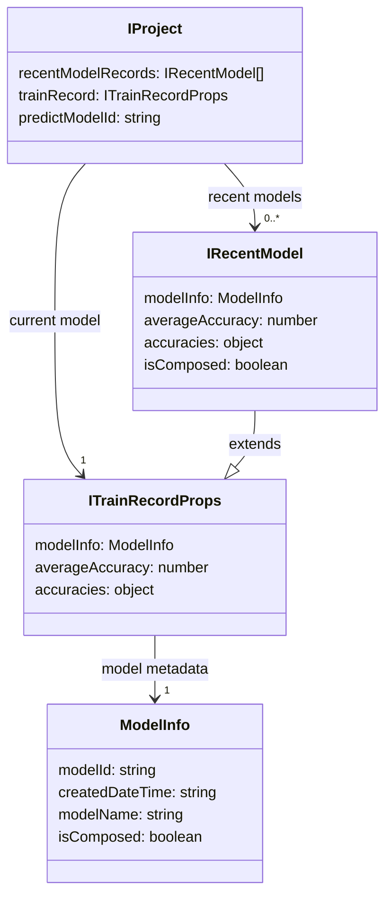
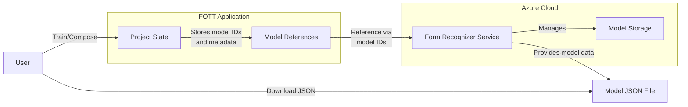
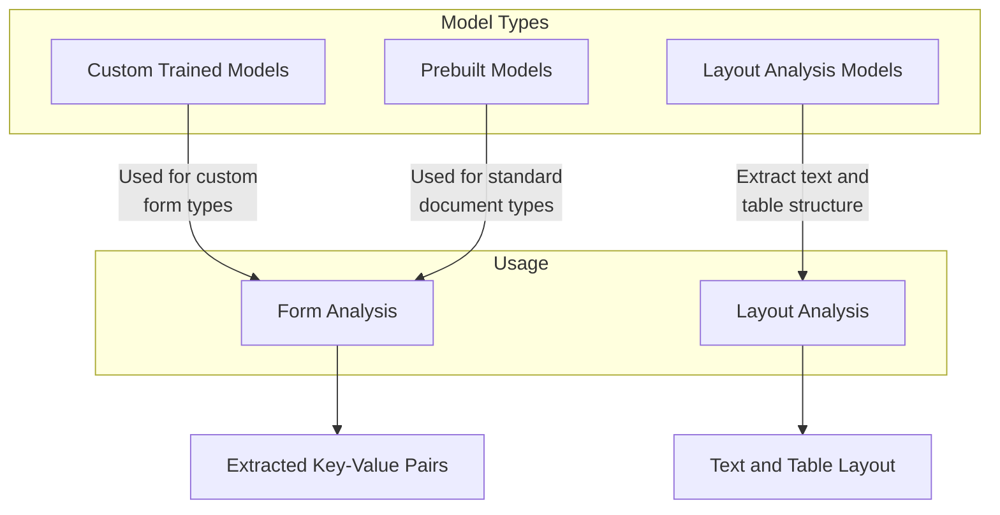
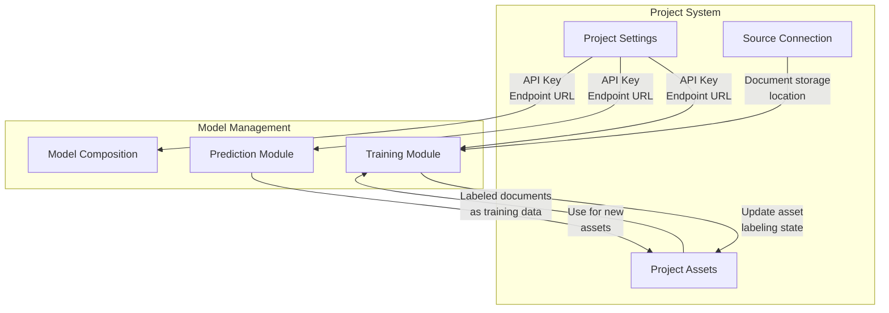
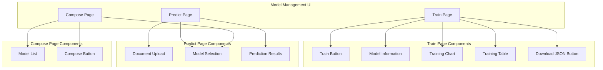

<!-- source: DeepWiki mcp.deepwiki.com · repo microsoft/OCR-Form-Tools · page 4 Model Management · fetched 2026-10-26 -->

# Model Management

Relevant source files

The following files were used as context for generating this wiki page:

- [README.ja-jp.md](README.ja-jp.md)
- [README.md](README.md)
- [README.zh-cn.md](README.zh-cn.md)
- [docs/images/compose.png](docs/images/compose.png)
- [docs/images/keyboard-shortcuts-icon.png](docs/images/keyboard-shortcuts-icon.png)
- [docs/images/share-icon.png](docs/images/share-icon.png)
- [src/react/components/pages/train/trainPage.tsx](src/react/components/pages/train/trainPage.tsx)
- [src/react/components/shell/appSurveyLink.scss](src/react/components/shell/appSurveyLink.scss)
- [src/react/components/shell/appSurveyLink.tsx](src/react/components/shell/appSurveyLink.tsx)

This document provides a technical overview of the model management system in the OCR Form Tools (FOTT). The model management system allows users to train custom machine learning models with Azure Form Recognizer, make predictions with trained models, compose multiple models together, and use prebuilt models for document analysis. 

For more details about the specific aspects of model management, refer to the related pages:
- [Training Models](#4.1) - Detailed information about the training process
- [Prediction System](#4.2) - How predictions work with trained models
- [Model Composition](#4.3) - Combining multiple models into one
- [Prebuilt and Layout Models](#4.4) - Using Azure's prebuilt models and layout analysis

## Model Management Architecture

The model management system in FOTT integrates with Azure Form Recognizer service to provide model training, prediction, and composition capabilities. These capabilities are exposed through the FOTT user interface.

Sources: [README.md:26-31](), [src/react/components/pages/train/trainPage.tsx:384-416]()

## Model Lifecycle

The lifecycle of a model in the OCR Form Tools follows a specific path from training to prediction.

Sources: [README.md:164-183](), [src/react/components/pages/train/trainPage.tsx:310-350]()

## Model Training

The training module enables users to create custom Form Recognizer models based on labeled documents. The training process requires:

1. A set of labeled documents (forms)
2. A connection to Azure Form Recognizer service
3. Optional: model name for better identification

### Training Process

When training is triggered, the system:

1. Cleans the label data to ensure it's in the correct format
2. Makes a POST request to the Form Recognizer API
3. Polls the operation status until the model is ready
4. Adds the new model to the project's `recentModelRecords`
5. Updates the UI with training results

The model information stored includes:
- Model ID (unique identifier for the model)
- Created date/time
- Model name (if provided)
- Average accuracy
- Per-field accuracy metrics

Sources: [src/react/components/pages/train/trainPage.tsx:310-350](), [src/react/components/pages/train/trainPage.tsx:360-477](), [README.md:164-183]()

## Model Prediction (Analysis)

The prediction module allows users to use trained models to analyze new documents and extract form data.

The prediction process:
1. User uploads a document not used in training
2. Selects a model to use for analysis
3. The system sends the document to Form Recognizer's analyze endpoint
4. The results are displayed showing extracted fields and values with confidence scores

Sources: [README.md:178-183]()

## Model Composition

Model composition allows users to combine multiple trained models into a single model. This is useful when you have multiple form types or want to create a more comprehensive model.

The composition process:
1. Models are listed in descending order by Model ID
2. User selects multiple models to compose
3. A new composed model is created, incorporating all the selected models
4. The new model can be used like any other model for analysis

Sources: [README.md:186-193]()

## Model Data Structure

The model data is stored in the Redux state with specific data structures that represent training records and composed models.

When a model is trained or composed, its information is:
1. Stored in the project state
2. Added to the `recentModelRecords` array (limited to a fixed number of records)
3. Set as the current model for prediction (`predictModelId`)

Sources: [src/react/components/pages/train/trainPage.tsx:479-493](), [src/react/components/pages/train/trainPage.tsx:511-522]()

## Model Storage and Retrieval

Models trained with Form Recognizer are stored in the Azure cloud. The OCR Form Tools application maintains references to these models but does not store the actual model data locally.

Users can:
1. View a list of recently used models in the project
2. Download the model JSON for offline reference
3. Use model IDs to make API calls directly to Form Recognizer

The model JSON contains the detailed information about the model, including its form field definitions and recognition parameters.

Sources: [src/react/components/pages/train/trainPage.tsx:574-616](), [README.md:169-172]()

## Prebuilt Models and Layout Analysis

In addition to custom-trained models, the system can utilize Azure's prebuilt models for standard document types and layout analysis.

These models expand the capabilities of the system beyond custom-trained models, allowing for:
1. Recognition of common document types without training
2. Extraction of text and layout information from any document
3. Identification of tables and their structure

Sources: [README.md:142-144]()

## Integration with Project System

The model management functionality is tightly integrated with the project system in FOTT.

Key integration points:
1. Project settings provide the Form Recognizer API key and endpoint URL
2. Project assets (labeled documents) serve as training data
3. Source connection provides the storage location for documents
4. Training updates the labeling state of assets to reflect their use in training

Sources: [src/react/components/pages/train/trainPage.tsx:114-121](), [src/react/components/pages/train/trainPage.tsx:317-336]()

## User Interface Components

The model management functionality is exposed through several user interface components:

These UI components provide:
1. Visual feedback on training progress and results
2. Model selection interfaces for prediction and composition
3. Visualization of prediction results
4. Access to download model JSON data

Sources: [src/react/components/pages/train/trainPage.tsx:131-240](), [README.md:178-193]()

## Summary

The Model Management system in OCR Form Tools provides a comprehensive suite of functionality for:
1. Training custom models with labeled form data
2. Making predictions on new documents using trained models
3. Composing multiple models to create more comprehensive models
4. Utilizing prebuilt models and layout analysis
5. Managing and accessing model data

This functionality is tightly integrated with the rest of the application, particularly the project system and document labeling components, providing a complete end-to-end solution for form recognition using Azure's Form Recognizer service.

Sources: [README.md:26-31](), [README.md:164-193]()

---

