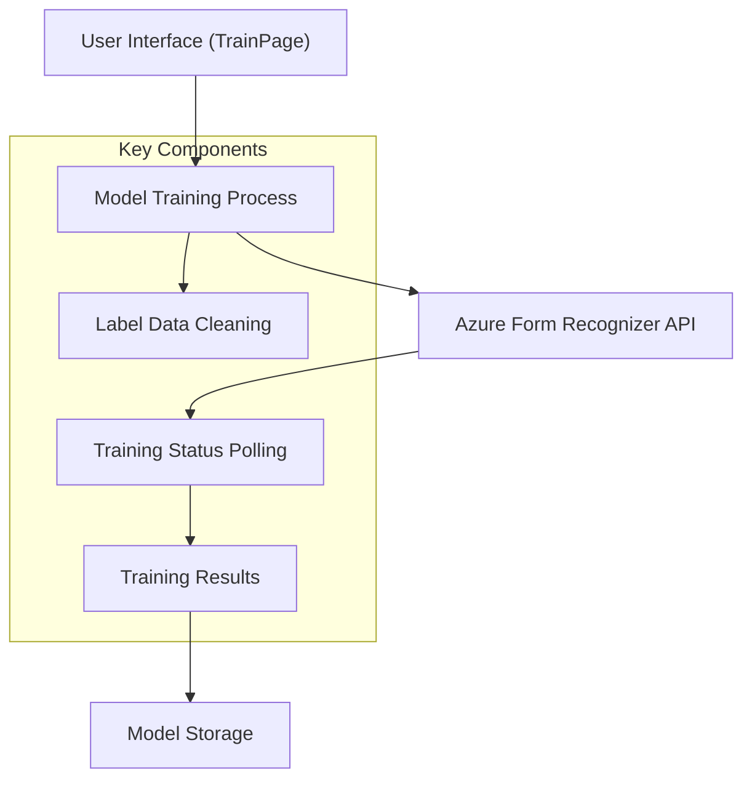
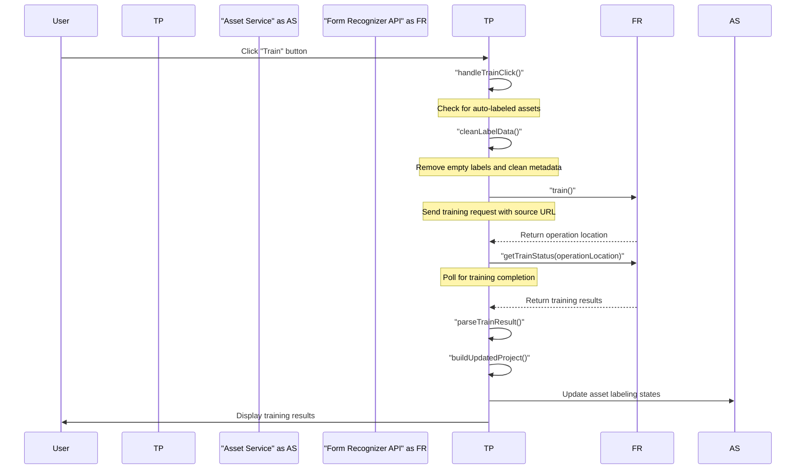
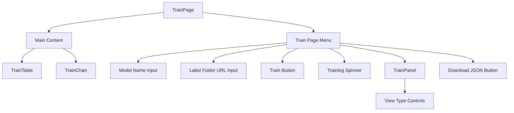
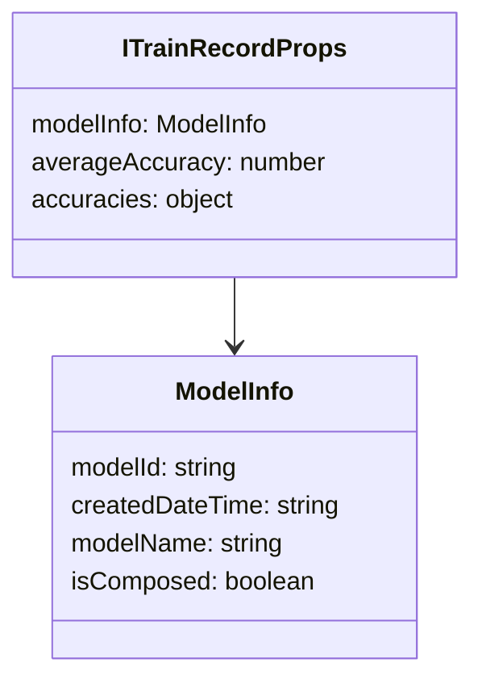

<!-- source: DeepWiki mcp.deepwiki.com · repo microsoft/OCR-Form-Tools · page 4.1 Training Models · fetched 2026-10-26 -->

# Training Models

Relevant source files

The following files were used as context for generating this wiki page:

- [src/react/components/pages/train/trainPage.tsx](src/react/components/pages/train/trainPage.tsx)

## Purpose and Scope

This document explains the training model system in the OCR Form Tools application. It covers how users train custom machine learning models with labeled form data, the training process workflow, UI components involved, and the underlying implementation.

For information about using trained models to make predictions on new documents, see [Prediction System](#4.2). For details on combining multiple models, see [Model Composition](#4.3).

## Training Models Overview

The training system enables users to create custom form recognition models by sending labeled data to Azure Form Recognizer. These models can then extract key-value pairs from documents based on the patterns learned during training.

Sources: [src/react/components/pages/train/trainPage.tsx:360-380](), [src/react/components/pages/train/trainPage.tsx:383-422]()

## Training Process Workflow

The training process consists of several steps, from preparing labeled data to obtaining a trained model:

Sources: [src/react/components/pages/train/trainPage.tsx:297-354](), [src/react/components/pages/train/trainPage.tsx:360-380]()

## User Interface Components

The training page UI consists of several key components that facilitate the model training process:

### Train Page Layout

The train page is divided into two main sections:
1. The main content area showing training results
2. The sidebar menu for initiating new training

Sources: [src/react/components/pages/train/trainPage.tsx:131-240]()

### Training Status and Results

After training, results are displayed in either table or chart format:

- **Table View**: Shows individual field accuracies in tabular format
- **Chart View**: Visualizes accuracies with a chart for better comparison

The user can toggle between these views using controls in the train panel component.

Sources: [src/react/components/pages/train/trainPage.tsx:140-150](), [src/react/components/pages/train/trainPage.tsx:356-358]()

## Training Process Implementation

### Data Preparation

Before training, the system cleans label data to ensure optimal training results:

1. Removes empty labels from assets
2. Updates asset labeling states
3. Removes metadata fields used for UI purposes (confidence, originValue, revised)

This ensures that only valid label data is sent to the Form Recognizer API.

Sources: [src/react/components/pages/train/trainPage.tsx:423-464]()

### Training Request

The training request includes the following parameters:

| Parameter | Description |
|-----------|-------------|
| source | URL pointing to the labeled data source (Azure Blob storage SAS URL or local folder path) |
| sourceFilter.prefix | Project folder path for filtering source files |
| sourceFilter.includeSubFolders | Whether to include subfolders (false by default) |
| useLabelFile | Always true, indicates to use label files |
| modelName | User-specified name for the trained model |

Sources: [src/react/components/pages/train/trainPage.tsx:383-422]()

### Monitoring Training Progress

The system uses a polling mechanism to check training status:

1. Sends initial training request and receives an operation location URL
2. Periodically calls the operation location to check status
3. Continues polling until training completes or fails, or timeout occurs
4. Timeout is calculated based on the number of assets (minimum 90 minutes)

Sources: [src/react/components/pages/train/trainPage.tsx:466-477](), [src/react/components/pages/train/trainPage.tsx:538-564]()

### Training Results Processing

After successful training, the system:

1. Parses the training response to extract model information and accuracies
2. Updates the project with the new train record
3. Sets the trained model as the predict model
4. Updates asset labeling states to "Trained"
5. Displays accuracies for each field

Sources: [src/react/components/pages/train/trainPage.tsx:511-530](), [src/react/components/pages/train/trainPage.tsx:479-494]()

## Model Management

### Training Record Structure

The training record contains detailed information about the trained model:

Sources: [src/react/components/pages/train/trainPage.tsx:511-522]()

### Model Storage and History

The system maintains a history of recent models in the project:

1. Adds new training records to the project's `recentModelRecords`
2. Limits the number of records to a predefined constant
3. Sets the most recent model as the default prediction model

Sources: [src/react/components/pages/train/trainPage.tsx:479-494]()

### Model Export

Users can download the trained model as a JSON file:

1. Retrieves the complete model JSON from the Form Recognizer API
2. Creates a downloadable blob containing the model data
3. Initiates download with filename based on model ID

Sources: [src/react/components/pages/train/trainPage.tsx:574-616]()

## Integration with External Systems

### Form Recognizer API

The training system communicates with the Azure Form Recognizer API through:

- POST request to initiate training (`/formrecognizer/v2.1/custom/models`)
- GET requests to poll training status
- GET request to retrieve model JSON for download

API endpoints are constructed based on the project's API URI base and version.

Sources: [src/react/components/pages/train/trainPage.tsx:383-422](), [src/react/components/pages/train/trainPage.tsx:466-477]()

### Persistence Layer

The system uses multiple storage mechanisms:

1. Project state in Redux store for the current session
2. Local storage for persisting user inputs (model name, label URL)
3. Project file storage for saving updated asset metadata

This ensures training configurations can be restored and training results are preserved.

Sources: [src/react/components/pages/train/trainPage.tsx:262-295](), [src/react/components/pages/train/trainPage.tsx:479-494]()

### Telemetry

The system logs training events to Application Insights for monitoring and analysis.

Sources: [src/react/components/pages/train/trainPage.tsx:351-353]()

## Error Handling

The training system handles various error scenarios:

1. Training failures (invalid data, service errors)
2. Timeouts for long-running training operations
3. Confirmation dialogs for training with auto-labeled assets
4. Specific error messages for local file system access issues

Each error is captured and displayed to the user with appropriate context.

Sources: [src/react/components/pages/train/trainPage.tsx:371-379](), [src/react/components/pages/train/trainPage.tsx:538-564]()

---

