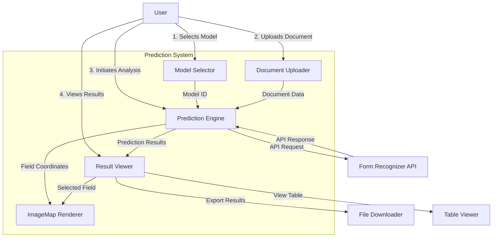
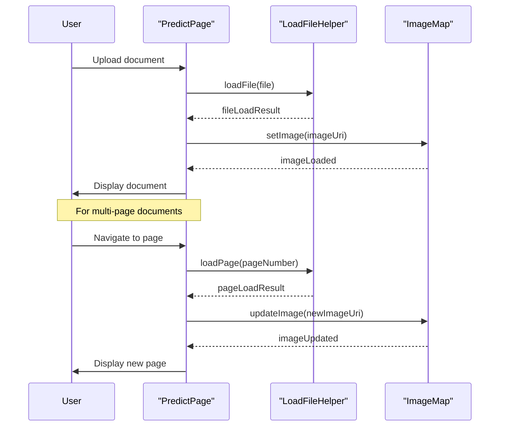
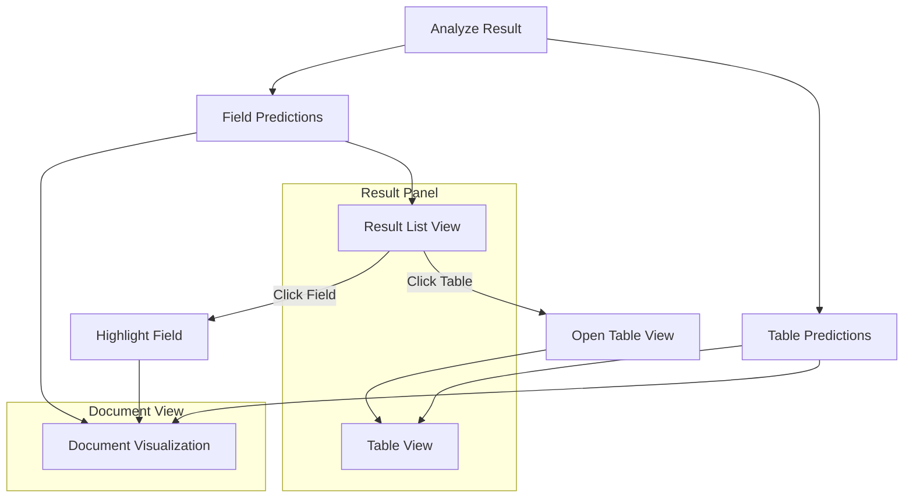
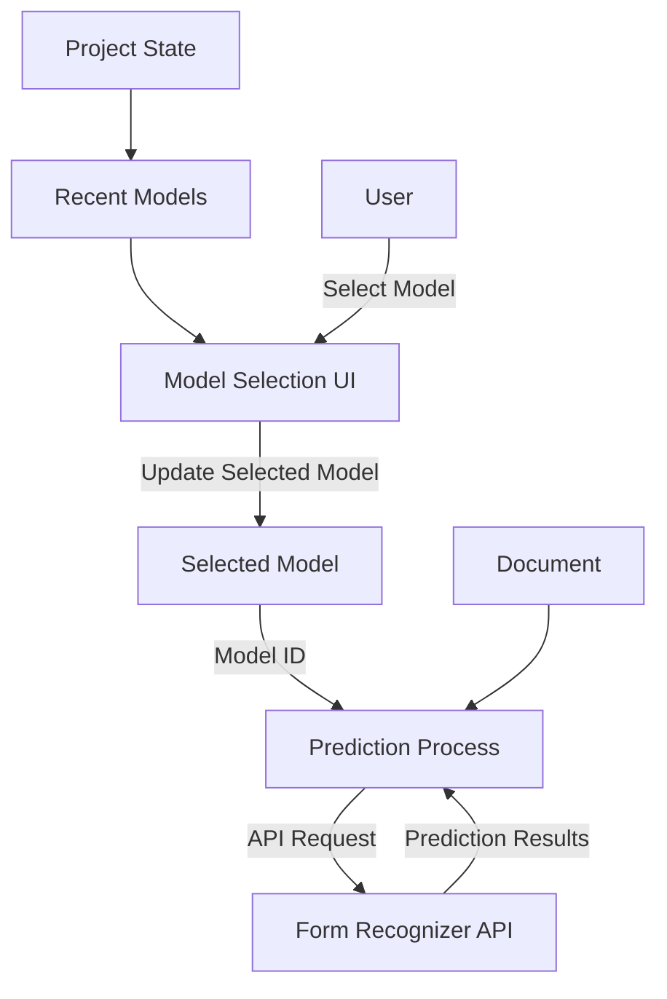
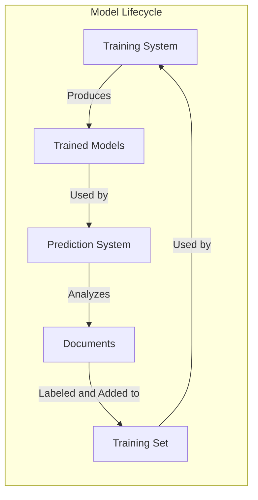
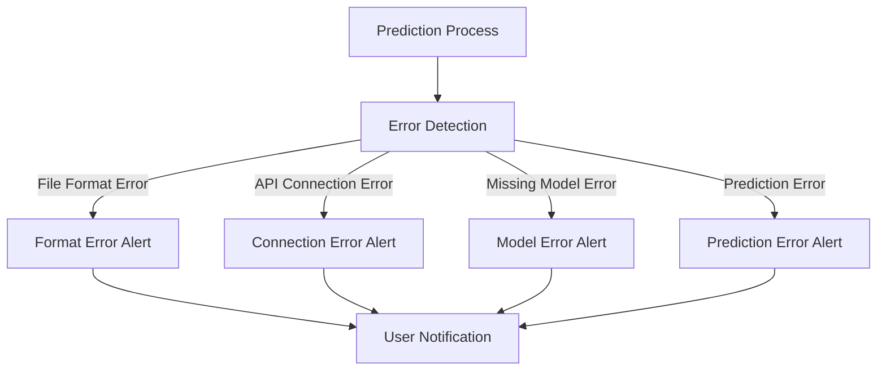

<!-- source: DeepWiki mcp.deepwiki.com · repo microsoft/OCR-Form-Tools · page 4.2 Prediction System · fetched 2026-10-26 -->

# Prediction System

Relevant source files

The following files were used as context for generating this wiki page:

- [src/react/components/pages/predict/predictModelInfo.scss](src/react/components/pages/predict/predictModelInfo.scss)
- [src/react/components/pages/predict/predictModelInfo.tsx](src/react/components/pages/predict/predictModelInfo.tsx)
- [src/react/components/pages/predict/predictPage.tsx](src/react/components/pages/predict/predictPage.tsx)
- [src/react/components/pages/predict/predictResult.scss](src/react/components/pages/predict/predictResult.scss)
- [src/react/components/pages/predict/predictResult.tsx](src/react/components/pages/predict/predictResult.tsx)
- [src/react/components/pages/train/trainChart.tsx](src/react/components/pages/train/trainChart.tsx)
- [src/react/components/pages/train/trainRecord.tsx](src/react/components/pages/train/trainRecord.tsx)
- [src/react/components/pages/train/trainTable.tsx](src/react/components/pages/train/trainTable.tsx)

## Purpose and Scope

The Prediction System enables users to analyze documents using trained Form Recognizer models. This system allows users to select a model, upload documents, run analysis, visualize results, and download the extracted information. The Prediction System is one of the core functionalities of the OCR Form Testing Tool (FOTT), enabling users to validate and utilize their trained models.

For information about training models, see [Training Models](#4.1). For details on combining multiple models for prediction, see [Model Composition](#4.3).

Sources: [src/react/components/pages/predict/predictPage.tsx:122-735]()

## Architecture Overview

The Prediction System consists of several interconnected components that work together to analyze documents using trained models.

Sources: [src/react/components/pages/predict/predictPage.tsx:122-735](), [src/react/components/pages/predict/predictResult.tsx:55-117]()

## Key Components

### PredictPage Component

The `PredictPage` component is the main container for the prediction functionality. It manages:

- Model selection
- Document uploading
- Prediction execution
- Result visualization
- Document navigation (for multi-page documents)

The component provides a two-panel interface:
1. Main panel - displays the document with highlighted prediction results
2. Sidebar panel - contains controls for model selection, file upload, and displays prediction results

Sources: [src/react/components/pages/predict/predictPage.tsx:122-735]()

### Document Loading and Processing

The Prediction System supports loading documents from local files or URLs. The document loading process includes:

1. File selection or URL input
2. Document loading and validation
3. OCR processing (for new documents)
4. Rendering the document in the viewer

Multi-page documents include navigation controls for moving between pages. The system also supports optional page range specification for processing only specific pages.

Sources: [src/react/components/pages/predict/predictPage.tsx:487-542](), [src/react/components/pages/predict/predictPage.tsx:544-596]()

### Prediction Execution

When a user initiates prediction, the system:

1. Validates model selection and document loading
2. Sends the document to the Form Recognizer API 
3. Processes the returned prediction results
4. Visualizes the results on the document
5. Displays extracted fields and values in the sidebar

The prediction process is managed by the `handleClick` method, which orchestrates the API call and result processing.

Sources: [src/react/components/pages/predict/predictPage.tsx:696-735]()

## Prediction Results

### Result Structure

Prediction results consist of:

1. **Field predictions** - Key-value pairs extracted from the document
2. **Table predictions** - Table structures detected in the document
3. **Model information** - Details about the model used for prediction including confidence scores

Each field prediction includes:
- Field name
- Extracted value
- Confidence score
- Bounding box coordinates
- Page number

Table predictions contain:
- Row and column structure
- Cell values
- Confidence scores

Sources: [src/react/components/pages/predict/predictResult.tsx:12-37]()

### Result Visualization

The Prediction System visualizes results in two ways:

1. **Document Annotation** - Highlighting the fields and tables on the document image
2. **Result Panel** - Displaying extracted values and confidence scores in the sidebar

Sources: [src/react/components/pages/predict/predictPage.tsx:655-682](), [src/react/components/pages/predict/predictResult.tsx:123-184]()

### PredictResult Component

The `PredictResult` component is responsible for rendering prediction results in the sidebar. It:

1. Displays field predictions with field names, values, and confidence scores
2. Provides interactive elements to highlight fields in the document
3. Renders special views for table predictions
4. Offers result download functionality in various formats (JSON, CSV)

The component groups results by field type and handles special rendering for tables and complex values.

Sources: [src/react/components/pages/predict/predictResult.tsx:55-117](), [src/react/components/pages/predict/predictResult.tsx:240-288]()

## Model Selection

The Prediction System includes a model selection mechanism that allows users to:

1. View recently used models
2. Select a model for prediction
3. See model information (ID, name, creation date)

Models are stored as recent model records in the project state and can be selected through the interface.

The system displays model information including:
- Model ID
- Model name (if available)
- Creation date
- Doc type confidence (after prediction)

Sources: [src/react/components/pages/predict/predictPage.tsx:294-334](), [src/react/components/pages/predict/predictModelInfo.tsx:7-21]()

## Result Export

The Prediction System allows users to export prediction results in multiple formats:

1. **JSON** - Complete prediction results in JSON format
2. **CSV** - Extracted key-value pairs and table data in CSV format

The export functionality is handled by the `PredictResult` component's download methods.

Additionally, users can download a Python script (`analyze.py`) that can be used to perform predictions programmatically using the same model.

Sources: [src/react/components/pages/predict/predictResult.tsx:240-288](), [src/react/components/pages/predict/predictPage.tsx:737-795]()

## Integration with Training Process

The Prediction System integrates with the Training System by:

1. Using models trained in the Training System
2. Providing an option to add analyzed documents to the training set
3. Sharing confidence metrics and model information formats

This integration creates a feedback loop where prediction results can inform further model training.

Sources: [src/react/components/pages/predict/predictPage.tsx:417-426](), [src/react/components/pages/predict/predictResult.tsx:90-95]()

## UI Components and Interactions

The Prediction System UI consists of several key components:

1. **Model Selection Panel** - Displays and allows selection of models
2. **File Upload Control** - Enables document uploading from local file system or URL
3. **Image Map** - Displays the document with highlighted prediction results
4. **Prediction Results Panel** - Shows extracted fields and values
5. **Table Viewer** - Displays extracted table structures
6. **Page Navigation** - Controls for multi-page documents
7. **Download Buttons** - Options to download results or analysis script

User interactions include:

- Selecting models
- Uploading documents
- Running analysis
- Navigating document pages
- Viewing and interacting with results
- Downloading results

Sources: [src/react/components/pages/predict/predictPage.tsx:249-483](), [src/react/components/pages/predict/predictResult.tsx:83-115]()

## Error Handling

The Prediction System includes comprehensive error handling for various scenarios:

1. Invalid file formats
2. API connection failures
3. Prediction errors
4. Model selection issues

Errors are displayed to users through alert dialogs with explanatory messages and recovery suggestions.

Sources: [src/react/components/pages/predict/predictPage.tsx:712-731](), [src/react/components/pages/predict/predictPage.tsx:459-473]()

## Architecture Interfaces

The Prediction System interfaces with several other systems in the application:

1. **Project System** - For accessing project information and models
2. **Form Recognizer API** - For performing document analysis
3. **Asset Management** - For handling document files
4. **State Management** - Using Redux for application state
5. **UI Components** - Shared components like ImageMap and DocumentFilePicker

These interfaces ensure the Prediction System integrates smoothly with the rest of the application.

Sources: [src/react/components/pages/predict/predictPage.tsx:49-59](), [src/react/components/pages/predict/predictPage.tsx:105-121]()

## Performance Considerations

The Prediction System implements several performance optimizations:

1. **Page-by-page processing** - Only loading and processing the current page
2. **Optional page range** - Allowing users to limit processing to specific pages
3. **Asynchronous operations** - Non-blocking API calls and file processing
4. **Loading states** - Clear indication of processing activities
5. **Memory management** - Proper cleanup of resources

These optimizations ensure responsive user experience, especially when dealing with large documents or complex models.

Sources: [src/react/components/pages/predict/predictPage.tsx:218-231](), [src/react/components/pages/predict/predictPage.tsx:359-365]()

---

