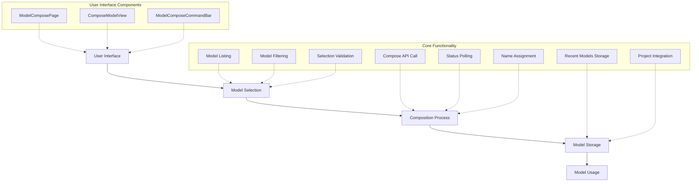
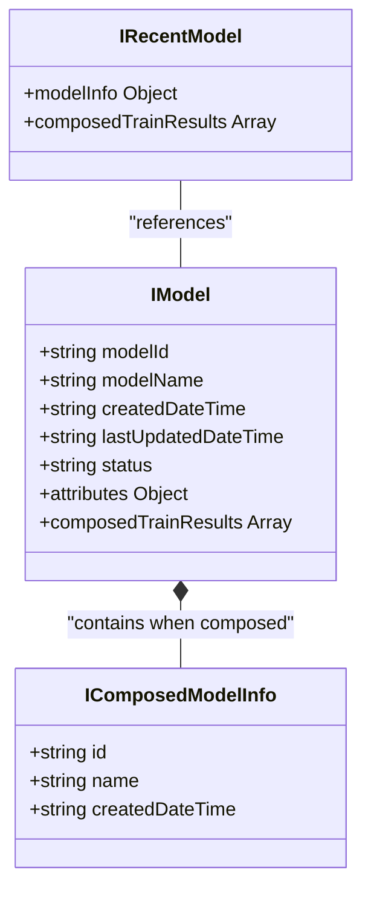
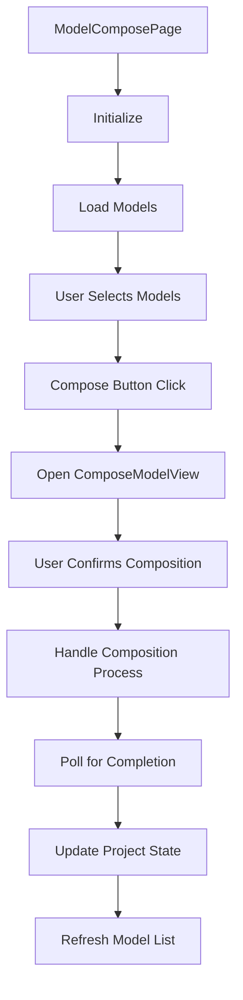
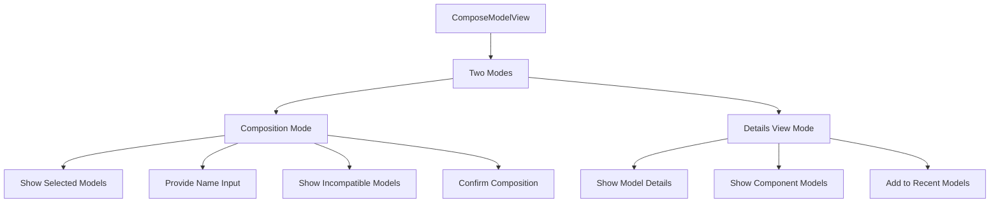
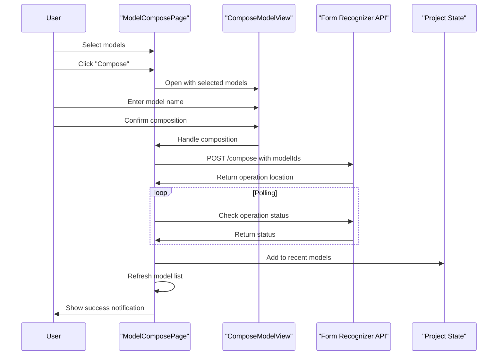
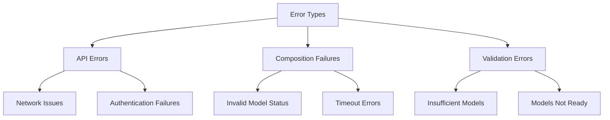

<!-- source: DeepWiki mcp.deepwiki.com · repo microsoft/OCR-Form-Tools · page 4.3 Model Composition · fetched 2026-10-26 -->

# Model Composition

<details>
<summary>Relevant source files</summary>

The following files were used as context for generating this wiki page:

- [src/providers/telemetry/telemetryProvider.jsx](src/providers/telemetry/telemetryProvider.jsx)
- [src/react/components/pages/modelCompose/composeModelView.tsx](src/react/components/pages/modelCompose/composeModelView.tsx)
- [src/react/components/pages/modelCompose/modelCompose.scss](src/react/components/pages/modelCompose/modelCompose.scss)
- [src/react/components/pages/modelCompose/modelCompose.tsx](src/react/components/pages/modelCompose/modelCompose.tsx)
- [src/services/telemetryService.ts](src/services/telemetryService.ts)

</details>


## Purpose and Scope

This document details the Model Composition system in the OCR Form Testing Tool (FOTT), which enables users to combine multiple individually trained models into a single, more powerful composite model. Model composition allows leveraging strengths from different models to improve overall form recognition accuracy. For information about creating individual models, see [Training Models](#4.1), and for using models in analysis, see [Prediction System](#4.2).

## System Overview

Model Composition allows users to select multiple trained models that are in a "ready" state, combine them into a new model with a custom name, and use this composite model for document analysis. The system tracks the component models that make up each composite model and provides a user interface for managing the composition process.



Sources: [src/react/components/pages/modelCompose/modelCompose.tsx](), [src/react/components/pages/modelCompose/composeModelView.tsx]()

## Data Structures

The Model Composition system uses several key data structures to represent models and their relationships:



Sources: [src/react/components/pages/modelCompose/modelCompose.tsx:78-94]()

## User Interface Components

### ModelComposePage

The main page component that handles model listing, selection, and composition initialization.

Key responsibilities:
- Fetching and displaying available models
- Handling model selection
- Initiating the composition process
- Managing the model list state (filtering, pagination)
- Updating project with composed models



Sources: [src/react/components/pages/modelCompose/modelCompose.tsx:113-847]()

### ComposeModelView

A modal component that provides the interface for:
- Viewing the selected models for composition
- Entering a name for the composed model
- Confirming the composition
- Viewing details of existing models



Sources: [src/react/components/pages/modelCompose/composeModelView.tsx:26-301]()

## Composition Process

The model composition process involves several steps:

1. **Model Selection**: User selects multiple models from the list
2. **Composition Initiation**: User clicks the "Compose" button
3. **Model Naming**: User provides a name for the new composed model
4. **API Request**: System sends a request to the Form Recognizer API
5. **Status Polling**: System polls for the composition operation status
6. **Project Update**: Once complete, the composed model is added to recent models



Sources: [src/react/components/pages/modelCompose/modelCompose.tsx:658-796]()

## Key Functions

### Model Loading and Management

```typescript
// Fetches the list of models from the API
private getModelList = async () => {
    // Get recent models from project
    let recentModels: IModel[] = [];
    if (this.props.project?.recentModelRecords?.length) {
        recentModels = await this.getRecentModels();
    }

    // Get models from API
    const res = await this.getResponse();
    let models = this.returnReadyModels(res.data.modelList)
    const link = res.data.nextLink;

    // Filter out recent models to avoid duplication
    const recentModelIds = this.getRecentModelIds(recentModels);
    models = models.filter((model) => recentModelIds.indexOf(model.modelId) === -1);

    // Combine recent and API models
    this.allModels = recentModels.concat(models);
}
```

Sources: [src/react/components/pages/modelCompose/modelCompose.tsx:420-455]()

### Model Composition

```typescript
// Handles the model composition process
private handleModelsCompose = async (selections: any[], name: string) => {
    // Create payload with model IDs and name
    const idList = [];
    selections.forEach((s) => idList.push(s.modelId));
    const payload = {
        modelIds: idList,
        modelName: name,
    };

    // Send compose request
    const apiVersion = getAPIVersion(this.props.project?.apiVersion);
    const link = interpolate(constants.apiModelsPath, { apiVersion }) + "/compose";
    const composeRes = await this.post(link, payload);
    
    // Wait for model to be ready
    const composedModel = await this.waitUntilModelIsReady(composeRes["headers"]["location"]);

    // Update project with new model
    const updatedProject = this.buildUpdatedProject(composedModel);
    await this.props.actions.saveProject(updatedProject, false, false);
}
```

Sources: [src/react/components/pages/modelCompose/modelCompose.tsx:754-796]()

### Status Polling

```typescript
// Poll for model readiness
private poll = (func, timeout, interval): Promise<any> => {
    const endTime = Number(new Date()) + (timeout || 10000);
    interval = interval || 100;

    const checkSucceeded = (resolve, reject) => {
        const ajax = func();
        ajax.then((response) => {
            if (response.data.modelInfo.status.toLowerCase() === constants.statusCodeReady) {
                resolve(response.data);
            } else if (response.data.modelInfo.status.toLowerCase() === constants.statusCodeInvalid) {
                toast.error(strings.modelCompose.errors.failedCompose, { autoClose: false });
                this.setState({ isComposing: false });
                return;
            } else if (Number(new Date()) < endTime) {
                // If not ready and timeout hasn't elapsed, poll again
                setTimeout(checkSucceeded, interval, resolve, reject);
            } else {
                // Timed out
                reject(new Error("Timed out for creating composed model"));
            }
        });
    };

    return new Promise(checkSucceeded);
}
```

Sources: [src/react/components/pages/modelCompose/modelCompose.tsx:714-738]()

## Model Storage and Management

Composed models are stored in the project's `recentModelRecords` array, which allows them to be accessed quickly for prediction tasks.

```typescript
// Builds an updated project with the new composed model
private buildUpdatedProject = (composedModel: object): IProject => {
    const newTrainRecord = {
        modelInfo: {
            createdDateTime: composedModel["modelInfo"]["createdDateTime"],
            modelId: composedModel["modelInfo"]["modelId"],
            modelName: composedModel["modelInfo"]["modelName"],
            isComposed: true,
        },
        composedTrainResults: composedModel["composedTrainResults"]
    } as IRecentModel;
    
    const recentModelRecords: IRecentModel[] = this.props.project.recentModelRecords ?
        [...this.props.project.recentModelRecords] : [];
    
    // Add to beginning of array
    recentModelRecords.unshift(newTrainRecord);
    
    // Limit to maximum number of recent models
    if (recentModelRecords.length > constants.recentModelRecordsCount) {
        recentModelRecords.pop();
    }

    return {
        ...this.props.project,
        recentModelRecords,
        predictModelId: newTrainRecord.modelInfo.modelId,
    };
}
```

Sources: [src/react/components/pages/modelCompose/modelCompose.tsx:457-479]()

## UI Interactions and Features

The Model Composition page provides several key features:

1. **Model List**: Displays all available models with details (ID, name, status, creation date)
2. **Model Filtering**: Allows filtering models by name or ID
3. **Pagination**: Loads models in batches for improved performance
4. **Model Selection**: Allows selecting multiple models for composition
5. **Composition Modal**: Interface for naming and confirming model composition
6. **Model Details**: View details of existing models, including component models

| Feature | Description | Implementation |
|---------|-------------|----------------|
| Model List | Table of available models | `DetailsList` component with columns for ID, name, status, dates |
| Model Filtering | Text search for models | `filterTextChange` function in command bar |
| Model Selection | Checkbox selection | Selection mode in `DetailsList` |
| Composition | Process of combining models | `handleModelsCompose` function |
| Status Tracking | Visual indication during composition | Spinner and state management |
| Model Details | View model information | Modal display of model metadata |

Sources: [src/react/components/pages/modelCompose/modelCompose.tsx:271-366](), [src/react/components/pages/modelCompose/composeModelView.tsx:119-266]()

## Telemetry

The system tracks model composition events for analytics and monitoring purposes:

```typescript
// Track composition event
if (this.appInsights) {
    this.appInsights.trackEvent({ name: "COMPOSE_MODEL_EVENT" });
}
```

When a user composes models, a "COMPOSE_MODEL_EVENT" is logged to Application Insights.

Sources: [src/react/components/pages/modelCompose/composeModelView.tsx:293-296](), [src/services/telemetryService.ts:16-17]()

## Error Handling

The Model Composition system handles several types of errors:

1. **API Errors**: Failed requests to the Form Recognizer API
2. **Composition Failures**: Models that fail to compose
3. **Validation Errors**: Attempts to compose incompatible models

Errors are displayed to users through alerts or toast notifications, and the system prevents users from attempting to compose models that are not in a "ready" state.



Sources: [src/react/components/pages/modelCompose/modelCompose.tsx:780-795](), [src/react/components/pages/modelCompose/composeModelView.tsx:165-168]()

## Integration with Project System

The Model Composition feature integrates with the project system by:

1. Accessing the project's connection information to make API calls
2. Storing composed models in the project's recent models list
3. Setting the composed model as the default prediction model

This integration ensures that composed models are persisted across sessions and can be easily used for document analysis.

Sources: [src/react/components/pages/modelCompose/modelCompose.tsx:669-702]()

## Summary

The Model Composition system provides a powerful way to combine the strengths of multiple form recognition models into a single model. It offers a user-friendly interface for selecting, composing, and managing models, with robust error handling and integration with the broader OCR Form Tools application.

The system handles the complexity of API communication, status tracking, and project integration, allowing users to focus on creating the most effective models for their document analysis needs.

---

