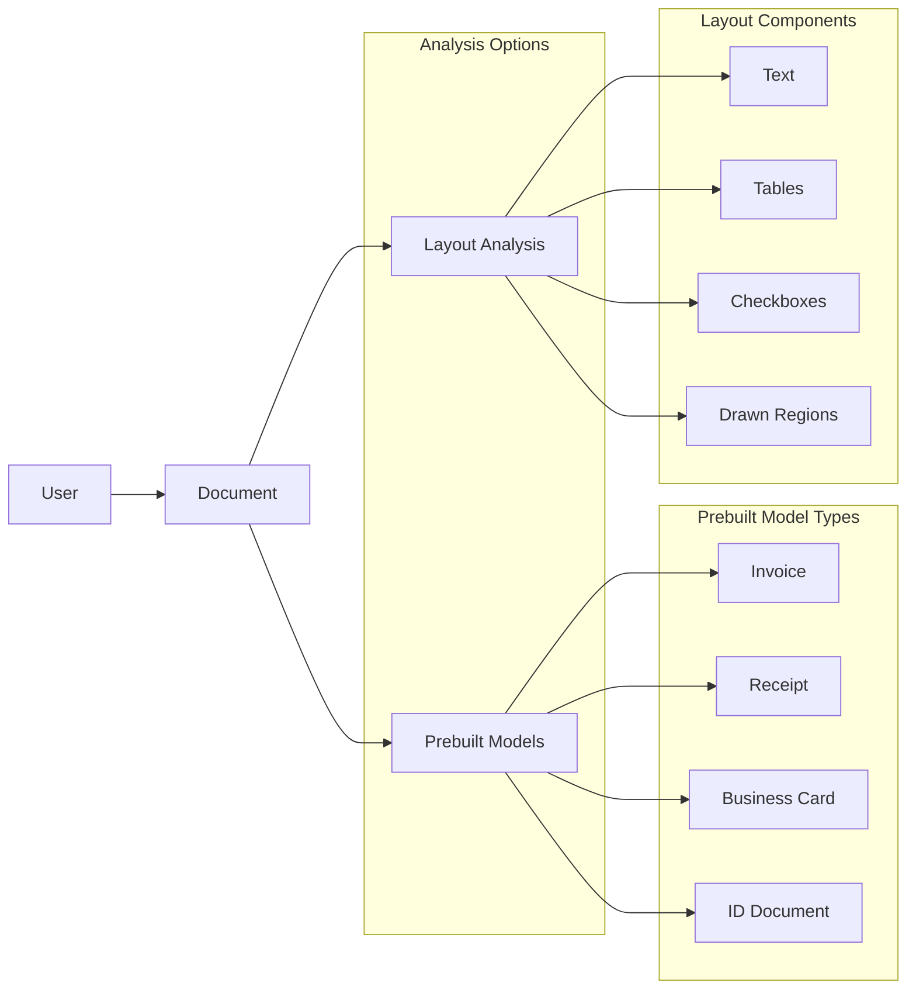
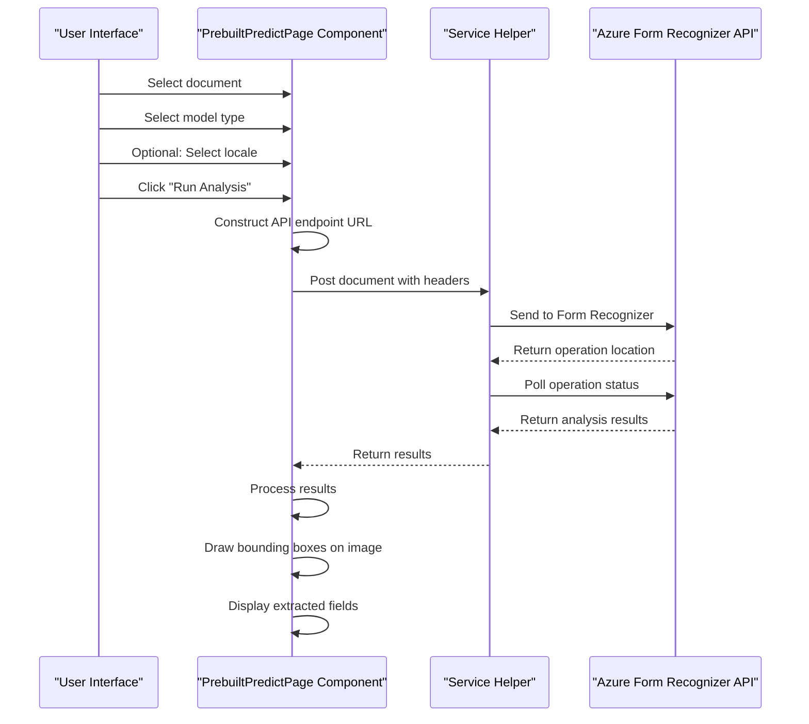
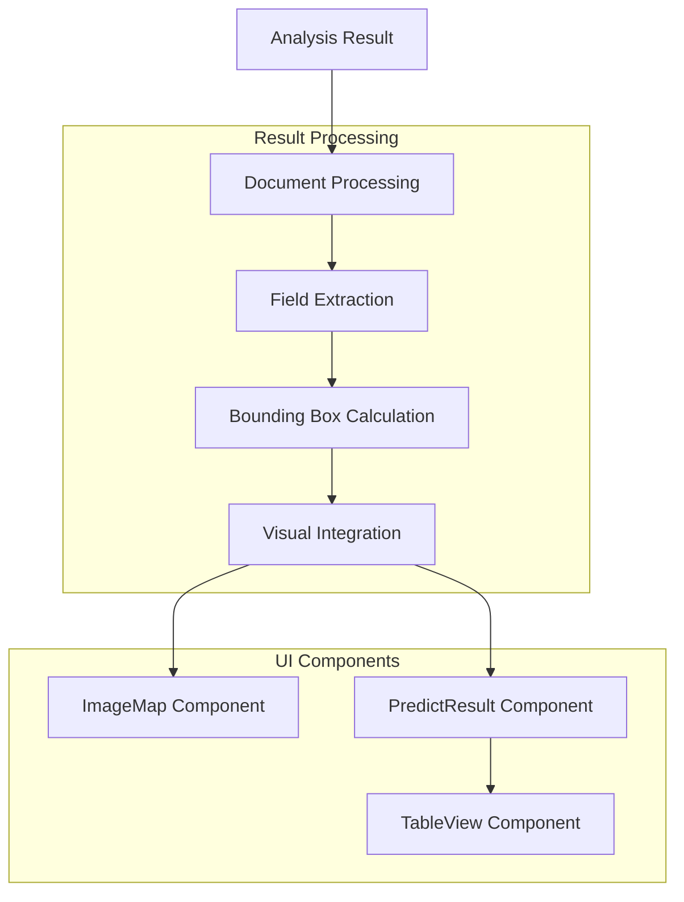
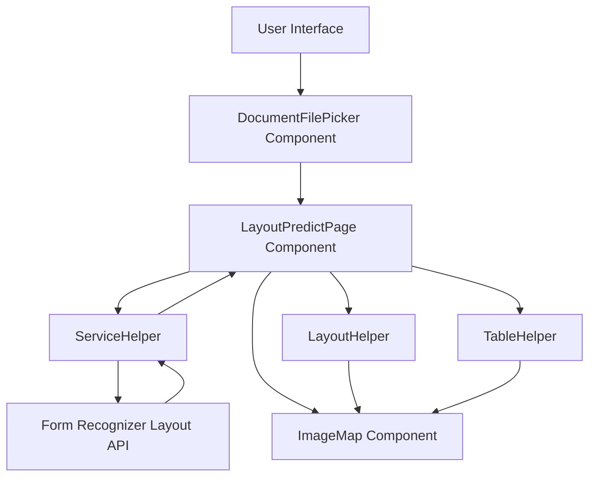
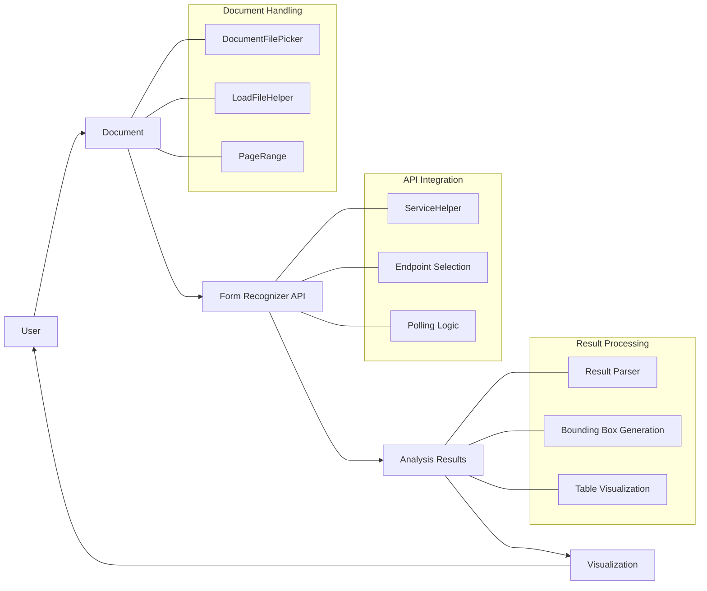
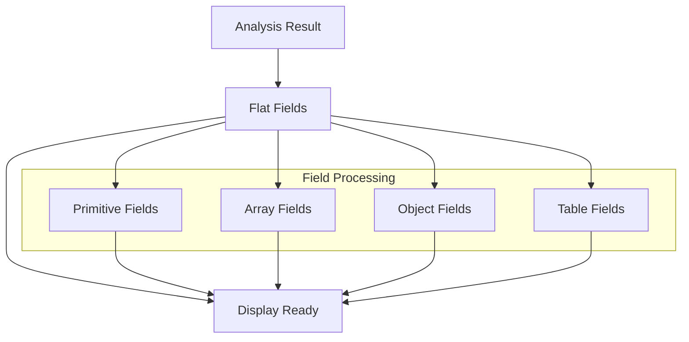

<!-- source: DeepWiki mcp.deepwiki.com · repo microsoft/OCR-Form-Tools · page 4.4 Prebuilt and Layout Models · fetched 2026-10-26 -->

# Prebuilt and Layout Models

<details>
<summary>Relevant source files</summary>

The following files were used as context for generating this wiki page:

- [src/common/constants.ts](src/common/constants.ts)
- [src/react/components/pages/prebuiltPredict/layoutPredictPage.tsx](src/react/components/pages/prebuiltPredict/layoutPredictPage.tsx)
- [src/react/components/pages/prebuiltPredict/prebuiltPredictPage.tsx](src/react/components/pages/prebuiltPredict/prebuiltPredictPage.tsx)

</details>


This document details the prebuilt models and layout analysis functionality available in the OCR Form Testing Tool. These capabilities allow users to analyze documents using pre-trained models without the need for custom training, making them valuable for rapid document processing and analysis.

For information about training custom models, see [Training Models](#4.1). For information about composing multiple models, see [Model Composition](#4.3).

## 1. Overview of Prebuilt and Layout Models

The OCR Form Testing Tool provides two types of pre-trained analysis capabilities:

1. **Prebuilt Models** - Domain-specific models trained to recognize and extract data from common document types like invoices, receipts, business cards, and IDs.

2. **Layout Analysis** - A general-purpose capability that recognizes and extracts text, tables, and selection marks from documents without requiring domain-specific training.



Sources: [src/react/components/pages/prebuiltPredict/prebuiltPredictPage.tsx:109-128](), [src/react/components/pages/prebuiltPredict/layoutPredictPage.tsx:462-476]()

## 2. Prebuilt Models

### 2.1 Available Prebuilt Models

The OCR Form Testing Tool supports the following prebuilt models:

| Model Type | Service Path | Locale Support | Description |
|------------|--------------|----------------|-------------|
| Invoice | invoice | No | Extracts key information from invoices |
| Receipt | receipt | Yes | Extracts data from sales receipts |
| Business card | businessCard | Yes | Extracts contact information from business cards |
| ID | idDocument | No | Extracts information from identity documents |

Sources: [src/react/components/pages/prebuiltPredict/prebuiltPredictPage.tsx:109-128]()

For models with locale support, the system currently supports the following locales:
- en-AU (Australian English)
- en-CA (Canadian English)
- en-GB (British English)
- en-IN (Indian English)
- en-US (American English)

Sources: [src/react/components/pages/prebuiltPredict/prebuiltPredictPage.tsx:130]()

### 2.2 Prebuilt Model Technical Implementation

The prebuilt models functionality is implemented through a dedicated page component that interacts with Azure Form Recognizer's prebuilt model endpoints.



Sources: [src/react/components/pages/prebuiltPredict/prebuiltPredictPage.tsx:756-773]()

The API endpoint URL is constructed dynamically based on the selected model type and locale:

```
/formrecognizer/v2.1/prebuilt/{modelType}/analyze?includeTextDetails=true
```

For models that support locale, the URL includes a locale parameter:

```
/formrecognizer/v2.1/prebuilt/{modelType}/analyze?includeTextDetails=true&locale={locale}
```

Sources: [src/react/components/pages/prebuiltPredict/prebuiltPredictPage.tsx:968-1036](), [src/common/constants.ts:58-59]()

### 2.3 Prediction Result Handling

When a prediction is completed, the system:

1. Processes the results to extract field information
2. Maps the results to the document's visual representation
3. Creates visual bounding boxes for each recognized field
4. Displays the extracted field values in a formatted panel

The results include both field values and position information (bounding boxes) that allow the system to highlight the detected information directly on the document.



Sources: [src/react/components/pages/prebuiltPredict/prebuiltPredictPage.tsx:689-705](), [src/react/components/pages/prebuiltPredict/prebuiltPredictPage.tsx:829-857]()

## 3. Layout Analysis

### 3.1 Layout Analysis Components

The layout analysis capability provides structural understanding of documents by identifying key components:

| Component | Description |
|-----------|-------------|
| Text | Extracts and positions all text content |
| Tables | Identifies table structures including rows and columns |
| Checkboxes | Recognizes selection marks and their states |
| Labels | Identifies label text associated with values |
| Drawn Regions | Recognizes manually drawn or highlighted areas |

Sources: [src/react/components/pages/prebuiltPredict/layoutPredictPage.tsx:122](), [src/react/components/pages/prebuiltPredict/layoutPredictPage.tsx:462-476]()

### 3.2 Layout Analysis Implementation

Layout analysis is implemented in a dedicated page component that handles document processing, API interaction, and result visualization:



Sources: [src/react/components/pages/prebuiltPredict/layoutPredictPage.tsx:99-102](), [src/react/components/pages/prebuiltPredict/layoutPredictPage.tsx:619-646]()

The API endpoint for layout analysis is:

```
/formrecognizer/v2.1/layout/analyze
```

With optional page range support:

```
/formrecognizer/v2.1/layout/analyze?pages=1-3
```

Sources: [src/react/components/pages/prebuiltPredict/layoutPredictPage.tsx:619-626](), [src/common/constants.ts:58-59]()

### 3.3 Result Visualization

The layout analysis results are visualized on the document with different feature types:

1. Text features - Show all text elements with their bounding boxes
2. Table features - Display table structure and allow viewing table content
3. Checkbox features - Show selection marks with their states
4. Label features - Display field labels
5. Drawn region features - Show user-drawn or highlighted areas

The system provides layer controls to toggle visibility of different feature types, allowing users to focus on specific elements.

Sources: [src/react/components/pages/prebuiltPredict/layoutPredictPage.tsx:462-476]()

## 4. Common Architecture Components

Both prebuilt models and layout analysis implementations share several key architectural components:

### 4.1 Document Processing Flow



Sources: [src/react/components/pages/prebuiltPredict/prebuiltPredictPage.tsx:42-47](), [src/react/components/pages/prebuiltPredict/layoutPredictPage.tsx:44-46]()

### 4.2 UI Components

Both analysis types use a common set of UI components:

1. **DocumentFilePicker** - Allows selecting files for analysis
2. **PageRange** - Enables specifying page ranges for multi-page documents
3. **ImageMap** - Displays the document with overlaid analysis results
4. **TableView** - Shows table content in a structured format
5. **Canvas** commands - Provides zooming, rotation, and layer controls

Sources: [src/react/components/pages/prebuiltPredict/prebuiltPredictPage.tsx:32-39](), [src/react/components/pages/prebuiltPredict/layoutPredictPage.tsx:36-43]()

### 4.3 Helper Classes

Both implementations use specialized helper classes to manage specific aspects of functionality:

| Helper Class | Purpose |
|--------------|---------|
| LoadFileHelper | Manages loading and processing document files |
| LayoutHelper | Handles drawing layout elements on the document |
| TableHelper | Manages table detection, display, and interaction |

Sources: [src/react/components/pages/prebuiltPredict/prebuiltPredictPage.tsx:172-174](), [src/react/components/pages/prebuiltPredict/layoutPredictPage.tsx:100-134]()

## 5. Usage Guide

### 5.1 Using Prebuilt Models

1. Navigate to the Prebuilt Models page
2. Configure API connection settings (key and endpoint)
3. Select a document file
4. Choose the appropriate prebuilt model type
5. Select locale if applicable
6. Click "Run Analysis"
7. View and interact with the analysis results:
   - Field values are displayed in the results panel
   - Fields are highlighted on the document
   - Click on a field in the results to highlight it on the document

### 5.2 Using Layout Analysis

1. Navigate to the Layout Analysis page
2. Configure API connection settings (key and endpoint)
3. Select a document file
4. Click "Run Layout"
5. View and interact with the analysis results:
   - Use layer controls to toggle visibility of different element types
   - Click on table icons to view table content
   - Navigate between pages for multi-page documents
   - Download results in JSON or CSV format

## 6. Technical Considerations

### 6.1 API Versions

The prebuilt and layout models currently use Form Recognizer API version v2.1 as specified in the constants file. This version provides access to the supported prebuilt models and layout analysis capability.

Sources: [src/common/constants.ts:9-10](), [src/common/constants.ts:58]()

### 6.2 Resource Limitations

When using prebuilt models with PDF documents, there's a limitation on the number of pages that can be processed. The system will display an alert if the document exceeds this limit.

Sources: [src/react/components/pages/prebuiltPredict/prebuiltPredictPage.tsx:948-955]()

### 6.3 Result Processing

Results from prebuilt models require special processing to handle complex field types like arrays and nested objects:



Sources: [src/react/components/pages/prebuiltPredict/prebuiltPredictPage.tsx:859-909]()

## 7. Integration with Other System Components

The prebuilt and layout models functionality integrates with other components of the OCR Form Testing Tool:

1. **Project Management** - While not directly connected to projects, the analysis results can inform the creation of new custom models.

2. **Model Composition** - Results from prebuilt models can help determine which fields to include in composed models.

3. **Document Labeling** - Layout analysis results can provide a foundation for more efficient document labeling.

For information about these related systems, see [Project Management](#2.3), [Model Composition](#4.3), and [Document Labeling](#3).

---

