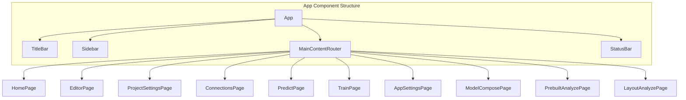
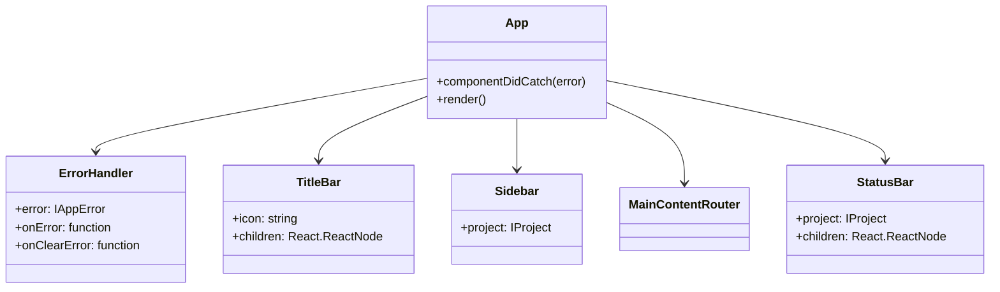
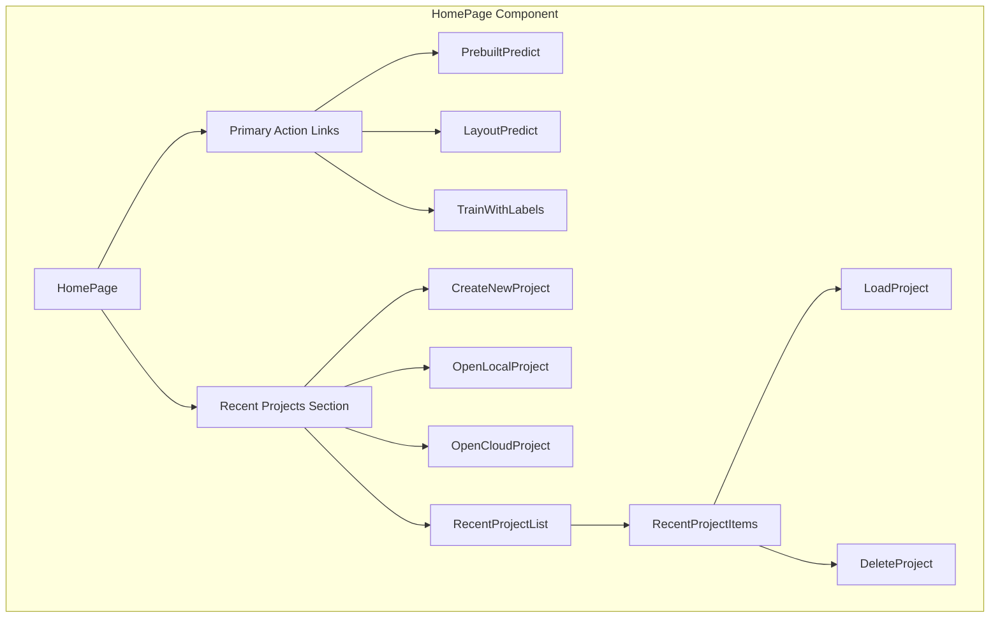
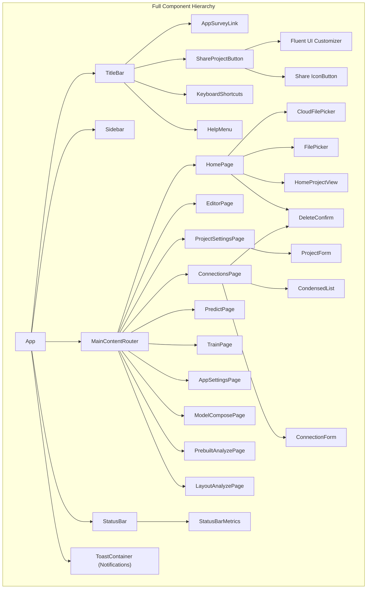

<!-- source: DeepWiki mcp.deepwiki.com · repo microsoft/OCR-Form-Tools · page 5 User Interface · fetched 2026-10-26 -->

# User Interface

<details>
<summary>Relevant source files</summary>

The following files were used as context for generating this wiki page:

- [src/App.tsx](src/App.tsx)
- [src/react/components/pages/appSettings/appSettingsPage.tsx](src/react/components/pages/appSettings/appSettingsPage.tsx)
- [src/react/components/pages/connections/connectionsPage.tsx](src/react/components/pages/connections/connectionsPage.tsx)
- [src/react/components/pages/homepage/homePage.tsx](src/react/components/pages/homepage/homePage.tsx)
- [src/react/components/pages/projectSettings/projectSettingsPage.tsx](src/react/components/pages/projectSettings/projectSettingsPage.tsx)
- [src/react/components/shell/shareProjectButton.scss](src/react/components/shell/shareProjectButton.scss)
- [src/react/components/shell/shareProjectButton.tsx](src/react/components/shell/shareProjectButton.tsx)
- [src/react/components/shell/sidebar.tsx](src/react/components/shell/sidebar.tsx)

</details>


This page documents the main user interface architecture of the OCR Form Testing Tool (FOTT), describing the key UI components, their organization, and interactions. The page focuses on the structural aspects of the interface rather than individual functionality details, which are covered in other sections of the documentation.

For details about specific editor functionality, see [Tag Input System](#2.2) and [Editor Canvas System](#2.1). For information about navigation paths and routing, see [Navigation and Routing](#5.1).

## UI Architecture Overview

The OCR Form Testing Tool follows a modern single-page application architecture built with React and Redux. The interface is divided into four primary regions that are consistently visible throughout the application:



Sources: [src/App.tsx:70-106](), [src/react/components/shell/sidebar.tsx:18-90]()

The four main UI regions include:

1. **TitleBar**: Header area containing the application title and global action buttons
2. **Sidebar**: Navigation panel for accessing different application features
3. **Main Content**: Central area where the active component is rendered based on the current route
4. **StatusBar**: Footer displaying project metrics and status information

## Core UI Components

### App Component

The `App` component is the root component that orchestrates the entire application's UI structure. It manages error handling, keyboard events, and renders the primary UI regions.



Sources: [src/App.tsx:52-114]()

### TitleBar

The `TitleBar` component appears at the top of the application and contains:

- Application icon and title
- Survey link for user feedback
- Project sharing functionality
- Keyboard shortcuts access
- Help menu access

The TitleBar uses icons from the Fluent UI library for a consistent visual language.

Sources: [src/App.tsx:84-97]()

### Sidebar

The `Sidebar` component provides the main navigation for the application. It renders a vertical list of icon buttons that link to different functional areas:

| Icon | Page | Condition |
|------|------|-----------|
| Home | Home page | Always visible |
| Tag | Editor | Visible when project is loaded |
| MachineLearning | Train | Visible when project is loaded |
| Merge | Model Compose | Visible when project is loaded |
| Insights | Analyze | Visible when project is loaded |
| DocumentManagement | Project Settings | Visible when project is loaded |
| Plug | Connections | Always visible |
| ContactCard | Prebuilt Analysis | Always visible |
| KeyPhraseExtraction | Layout Analysis | Always visible |
| Settings | App Settings | Always visible |

Sources: [src/react/components/shell/sidebar.tsx:18-90]()

### MainContentRouter

The `MainContentRouter` component handles routing to different page components based on the current URL. This component uses React Router to manage navigation between different views.

Sources: [src/App.tsx:100]()

### StatusBar

The `StatusBar` component appears at the bottom of the application and displays project metrics and status information, providing users with context about the current project state.

Sources: [src/App.tsx:102-104]()

## Page Components

The application consists of several page components that are rendered in the main content area depending on the current route:

### HomePage

The `HomePage` is the landing page of the application and serves as the entry point for users. It provides:

- Three main action paths (Prebuilt Prediction, Layout Analysis, Custom Model Training)
- Quick access to recent projects
- Options to create new projects or open existing ones



Sources: [src/react/components/pages/homepage/homePage.tsx:65-324]()

### Project Settings Page

The `ProjectSettingsPage` allows users to create and edit project settings. It handles:

- Project creation workflow
- Project configuration updates
- Validation of project settings

The page uses a form-based interface with fields for project name, description, connections, and tag configuration.

Sources: [src/react/components/pages/projectSettings/projectSettingsPage.tsx:70-259]()

### Connections Page

The `ConnectionsPage` manages external data source connections, primarily for Azure Blob Storage. It provides:

- A list view of existing connections
- Interface for creating new connections
- Editing capabilities for existing connections
- Connection deletion with confirmation

Sources: [src/react/components/pages/connections/connectionsPage.tsx:57-175]()

### App Settings Page

The `AppSettingsPage` presents configuration options for application-level settings, including security tokens used for encryption/decryption of project data.

Sources: [src/react/components/pages/appSettings/appSettingsPage.tsx:52-85]()

## UI Component Hierarchy

The following diagram shows a more detailed view of the component hierarchy within the FOTT application:



Sources: [src/App.tsx:70-106](), [src/react/components/pages/homepage/homePage.tsx:82-195](), [src/react/components/shell/shareProjectButton.tsx:36-75]()

## UI State Management

The user interface components are connected to application state through Redux, following a unidirectional data flow pattern. The main UI-related state elements include:

| State Element | Purpose |
|---------------|---------|
| `currentProject` | The active project being viewed or edited |
| `recentProjects` | List of recently accessed projects |
| `connections` | Available data connections |
| `appSettings` | Application configuration settings |
| `appError` | Current application error, if any |

Components connect to Redux state using the `@connect` decorator pattern, mapping state to props and binding action creators:

```typescript
function mapStateToProps(state: IApplicationState) {
    return {
        recentProjects: state.recentProjects,
        connections: state.connections,
        appSettings: state.appSettings,
        project: state.currentProject,
    };
}

function mapDispatchToProps(dispatch) {
    return {
        actions: bindActionCreators(projectActions, dispatch),
        applicationActions: bindActionCreators(applicationActions, dispatch),
        appTitleActions: bindActionCreators(appTitleActions, dispatch),
    };
}

@connect(mapStateToProps, mapDispatchToProps)
export default class HomePage extends React.Component<IHomePageProps, IHomePageState> {
    // Component implementation
}
```

Sources: [src/react/components/pages/homepage/homePage.tsx:48-66](), [src/react/components/pages/projectSettings/projectSettingsPage.tsx:49-64]()

## UI Interaction Patterns

The FOTT application implements several consistent interaction patterns:

1. **Navigation**: The sidebar provides the primary navigation mechanism with icon-based links to main application areas.

2. **Page Actions**: Most pages include a set of primary actions (Save, Cancel, Delete) that appear consistently positioned.

3. **Confirmation Dialogs**: Destructive actions like deletion show confirmation dialogs before proceeding.

4. **Notifications**: The application uses toast notifications to provide feedback on operation success or failure.

5. **Form Validation**: Input forms provide validation feedback to ensure data correctness.

6. **Project Context**: Project-specific actions are only enabled when a project is loaded, with disabled states clearly indicated.

Sources: [src/react/components/pages/homepage/homePage.tsx:176-180](), [src/react/components/pages/projectSettings/projectSettingsPage.tsx:142-149](), [src/react/components/shell/sidebar.tsx:30-55]()

## Shared UI Components

The application reuses several common UI components across different pages:

| Component | Purpose | Usage |
|-----------|---------|-------|
| `CondensedList` | Displays a condensed list of items with actions | Recent projects, Connections |
| `Confirm` | Shows a confirmation dialog for destructive actions | Delete project, Delete connection |
| `FilePicker` | Allows selection of local files | Project import |
| `CloudFilePicker` | Allows selection of files from cloud storage | Project import from Azure |
| `FontIcon` | Displays consistent iconography | Throughout the UI |
| `ConditionalNavLink` | Navigation link that can be conditionally disabled | Sidebar links |

Sources: [src/react/components/pages/homepage/homePage.tsx:168-173](), [src/react/components/pages/connections/connectionsPage.tsx:98-104](), [src/react/components/shell/sidebar.tsx:30-55]()

## Summary

The OCR Form Testing Tool user interface follows a structured component-based architecture with clear separation of concerns. The four main UI regions (TitleBar, Sidebar, MainContent, StatusBar) provide a consistent layout, while specialized page components handle specific functional areas. The Redux state management system ensures a unidirectional data flow, making the UI behavior predictable and maintainable.

---

