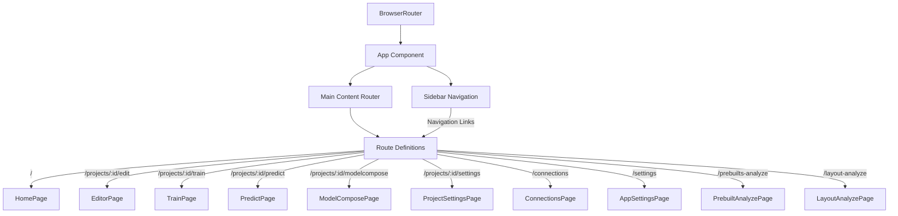
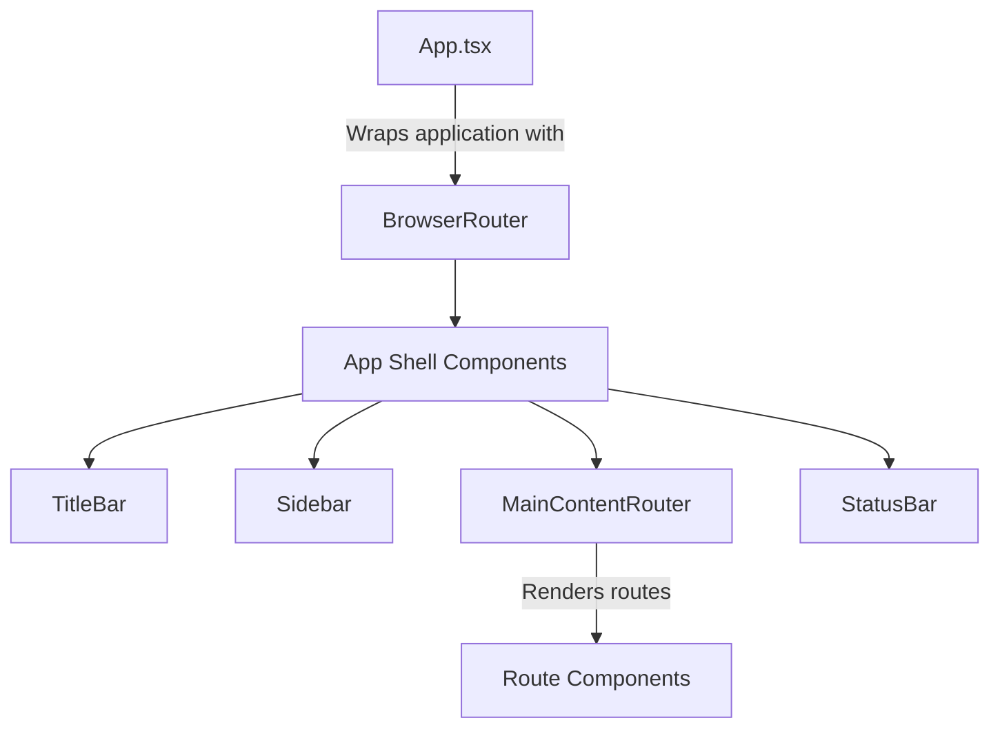
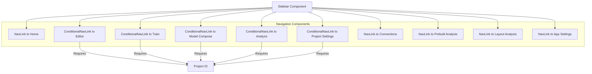
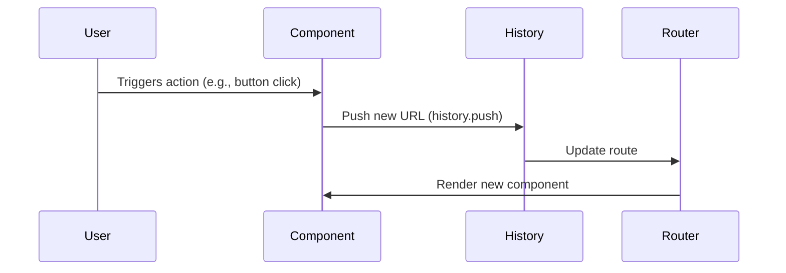
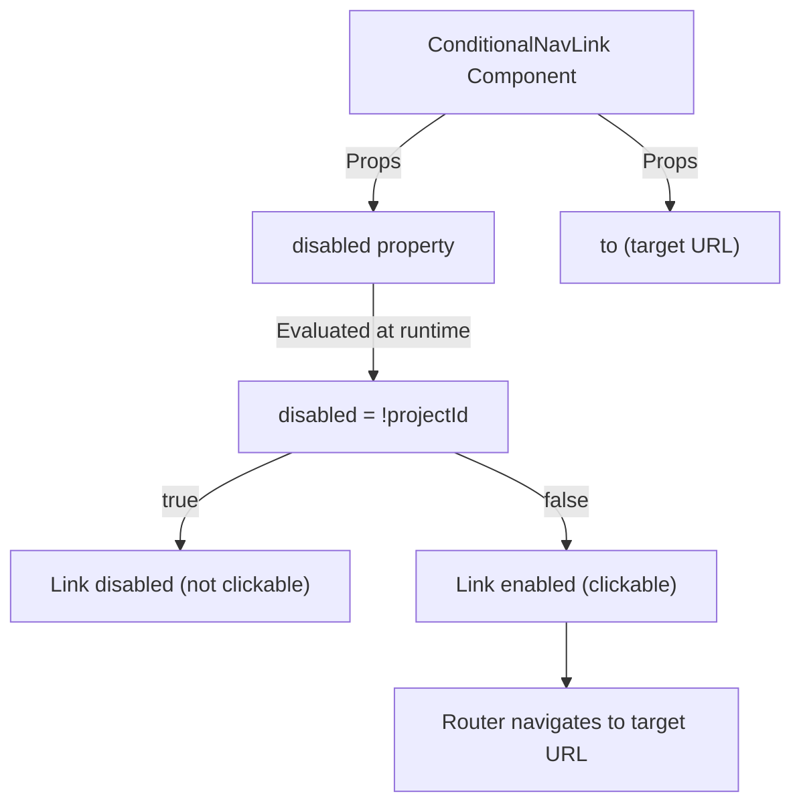
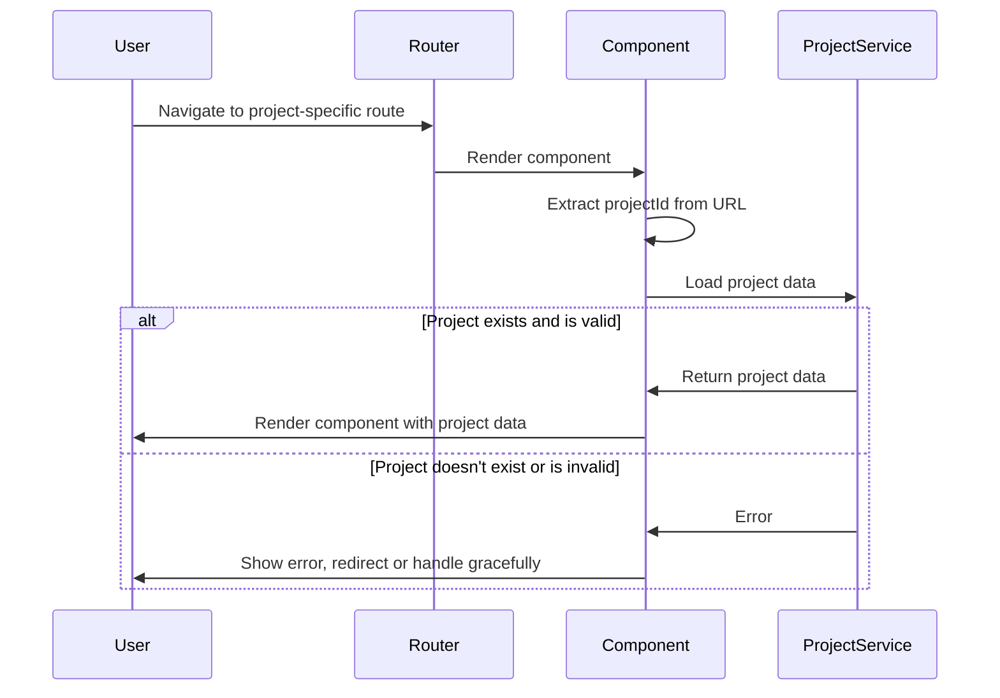
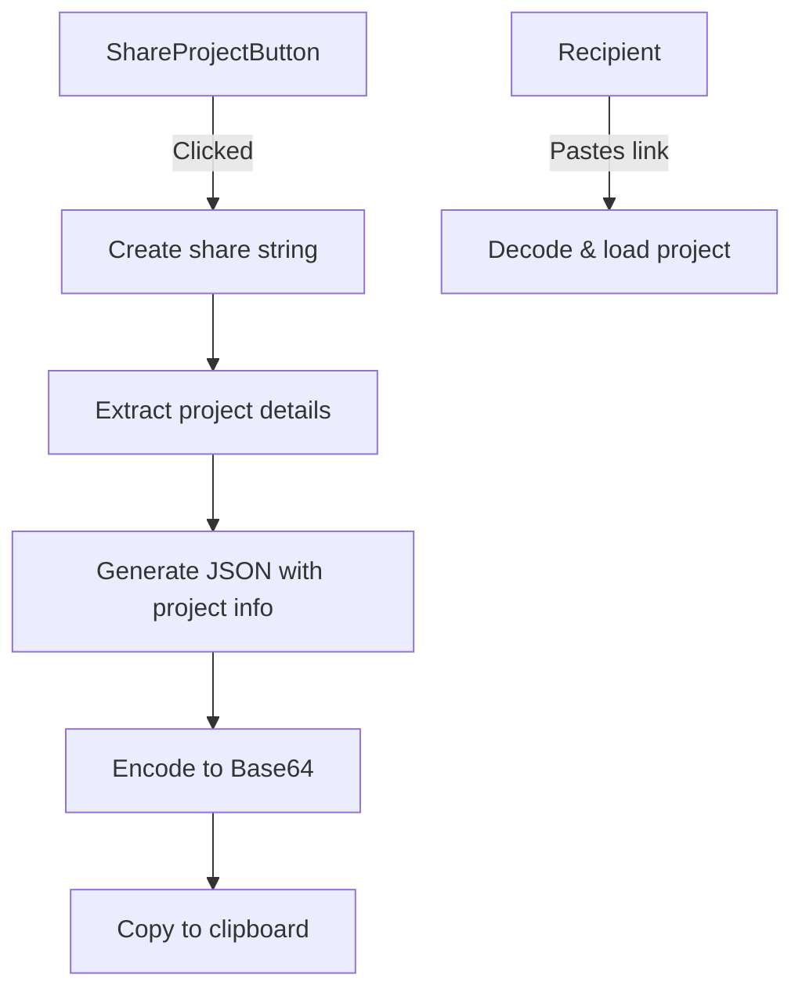
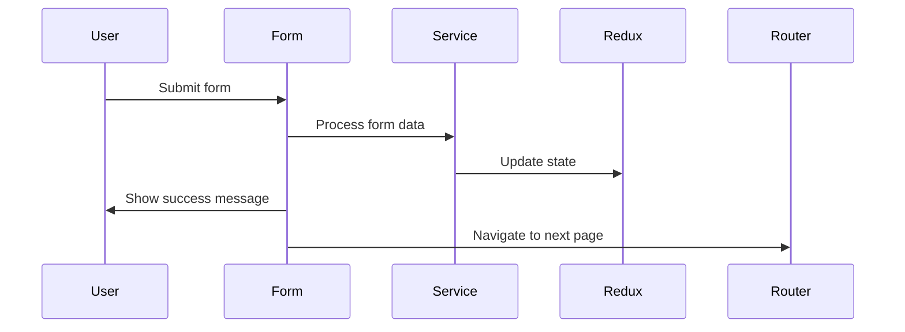

<!-- source: DeepWiki mcp.deepwiki.com · repo microsoft/OCR-Form-Tools · page 5.1 Navigation and Routing · fetched 2026-10-26 -->

# Navigation and Routing

<details>
<summary>Relevant source files</summary>

The following files were used as context for generating this wiki page:

- [src/App.tsx](src/App.tsx)
- [src/react/components/pages/appSettings/appSettingsPage.tsx](src/react/components/pages/appSettings/appSettingsPage.tsx)
- [src/react/components/pages/connections/connectionsPage.tsx](src/react/components/pages/connections/connectionsPage.tsx)
- [src/react/components/pages/homepage/homePage.tsx](src/react/components/pages/homepage/homePage.tsx)
- [src/react/components/pages/projectSettings/projectSettingsPage.tsx](src/react/components/pages/projectSettings/projectSettingsPage.tsx)
- [src/react/components/shell/shareProjectButton.scss](src/react/components/shell/shareProjectButton.scss)
- [src/react/components/shell/shareProjectButton.tsx](src/react/components/shell/shareProjectButton.tsx)
- [src/react/components/shell/sidebar.tsx](src/react/components/shell/sidebar.tsx)

</details>


## Purpose and Scope

This document explains the navigation and routing architecture in the OCR Form Testing Tool (FOTT). It covers how the application manages navigation between different pages, the routing configuration, URL structure, and programmatic navigation patterns. For information about the overall User Interface components, see [User Interface](#5).

## Overview of Routing Architecture

The FOTT application uses React Router for managing navigation between different views. The routing system enables users to navigate between various functional areas such as the homepage, editor, model training, prediction, and settings pages.



Sources: [src/App.tsx:7-8](), [src/App.tsx:99-100](), [src/react/components/shell/sidebar.tsx:4-77]()

## Router Setup

The application's routing is set up in the App component, which wraps the entire application with the `BrowserRouter` component from React Router.



Sources: [src/App.tsx:81-108]()

## Main Navigation Components

### Sidebar Navigation

The Sidebar component provides the primary navigation menu, allowing users to navigate between different sections of the application.



The Sidebar uses two types of navigation links:
- `NavLink`: Standard navigation links that are always active
- `ConditionalNavLink`: Navigation links that are conditionally enabled based on whether a project is loaded

Sources: [src/react/components/shell/sidebar.tsx:18-90]()

### URL Structure and Route Mapping

The application uses a hierarchical URL structure to organize its routes:

| URL Pattern | Component | Description |
|-------------|-----------|-------------|
| `/` | HomePage | Landing page with project selection and creation options |
| `/projects/create` | ProjectSettingsPage | Page for creating a new project |
| `/projects/:id/edit` | EditorPage | Document editor for tagging regions |
| `/projects/:id/train` | TrainPage | Model training interface |
| `/projects/:id/modelcompose` | ModelComposePage | Interface for composing models |
| `/projects/:id/predict` | PredictPage | Interface for analyzing documents with trained models |
| `/projects/:id/settings` | ProjectSettingsPage | Project configuration page |
| `/connections` | ConnectionsPage | Connection management page |
| `/connections/:connectionId` | ConnectionForm | Connection creation/editing page |
| `/settings` | AppSettingsPage | Application settings page |
| `/prebuilts-analyze` | PrebuiltAnalyzePage | Interface for using prebuilt models |
| `/layout-analyze` | LayoutAnalyzePage | Interface for layout analysis |

Sources: [src/react/components/shell/sidebar.tsx:25-86](), [src/react/components/pages/homepage/homePage.tsx:198-211](), [src/react/components/pages/connectionsPage.tsx:114-125]()

## Programmatic Navigation

The application uses the `history` object provided by React Router to navigate programmatically between pages. This is commonly done in event handlers and after completing certain operations.



Common programmatic navigation patterns in the application:

1. **Creating a new project**:
   ```javascript
   this.props.history.push("/projects/create");
   ```

2. **Navigating to a project editor after loading**:
   ```javascript
   this.props.history.push(`/projects/${project.id}/edit`);
   ```

3. **After completing an operation (e.g., saving settings)**:
   ```javascript
   this.props.history.goBack();
   ```

Sources: [src/react/components/pages/homepage/homePage.tsx:198-211](), [src/react/components/pages/homepage/homePage.tsx:226](), [src/react/components/pages/projectSettings/projectSettingsPage.tsx:214-216](), [src/react/components/pages/appSettings/appSettingsPage.tsx:79-83]()

## Conditional Navigation

The application implements conditional navigation to ensure that certain routes are only accessible in specific contexts, such as when a project is loaded.



The `ConditionalNavLink` component is used to disable navigation links when their target pages require a project to be loaded, but no project is currently active.

Sources: [src/react/components/shell/sidebar.tsx:30-62]()

## Route Authentication and Protection

While not implementing traditional authentication, the application ensures that project-specific routes verify the existence of valid project data before rendering their content.



Sources: [src/react/components/pages/projectSettings/projectSettingsPage.tsx:79-103](), [src/react/components/pages/homepage/homePage.tsx:222-278]()

## Sharing Project Links

The application includes functionality to share project links, allowing users to collaborate on the same project.



When a project link is shared, it contains encoded information about the project, including security tokens needed to access the project resources.

Sources: [src/react/components/shell/shareProjectButton.tsx:38-59]()

## Common Navigation Patterns

### Navigation after Form Submission

A common pattern in the application is to navigate away from a form page after successful form submission.



For example:
- After saving a project, navigate to the editor page
- After saving application settings, navigate back to the previous page
- After saving a connection, navigate back to the connections list

Sources: [src/react/components/pages/projectSettings/projectSettingsPage.tsx:193-226](), [src/react/components/pages/appSettings/appSettingsPage.tsx:76-84](), [src/react/components/pages/connections/connectionsPage.tsx:149-174]()

### Cancellation Navigation

When a user cancels a form, the application typically navigates back to the previous page.

```javascript
private onFormCancel() {
    this.props.history.goBack();
}
```

Sources: [src/react/components/pages/appSettings/appSettingsPage.tsx:82-84](), [src/react/components/pages/projectSettings/projectSettingsPage.tsx:229-232]()

## Summary

The FOTT application implements a comprehensive routing system using React Router to enable navigation between different functional areas. The routing architecture combines declarative routing through components like `NavLink` and `Route` with programmatic navigation using the `history` object. Conditional navigation ensures that routes requiring project context are only accessible when a project is loaded.

---

