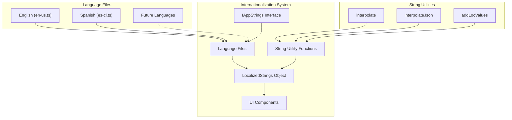
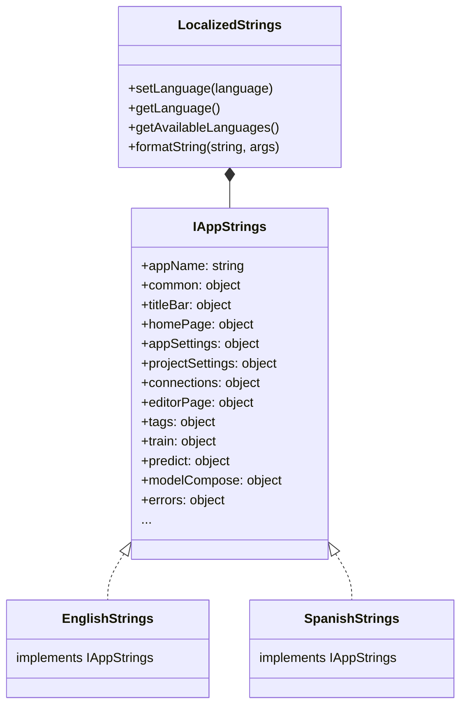
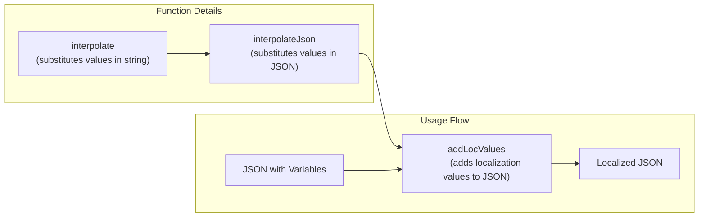
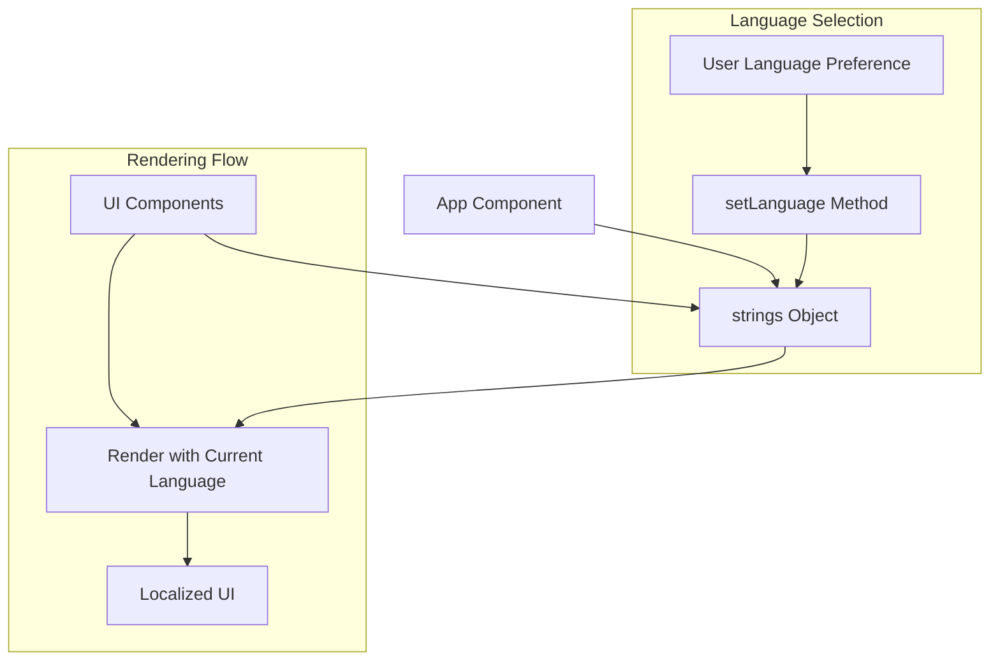

<!-- source: DeepWiki mcp.deepwiki.com · repo microsoft/OCR-Form-Tools · page 5.2 Internationalization · fetched 2026-10-26 -->

# Internationalization

<details>
<summary>Relevant source files</summary>

The following files were used as context for generating this wiki page:

- [src/common/localization/en-us.ts](src/common/localization/en-us.ts)
- [src/common/localization/es-cl.ts](src/common/localization/es-cl.ts)
- [src/common/strings.ts](src/common/strings.ts)

</details>


This document provides a detailed overview of the multi-language support system in the OCR Form Testing Tool (FOTT). It explains how the application supports localization, the structure of language files, and how new languages can be added to the system.

## Purpose and Scope

The FOTT application is designed with internationalization capabilities, allowing the user interface to be presented in multiple languages. This document covers the architecture of the internationalization system, how it integrates with the UI components, and how to extend the system with additional languages.

## Internationalization Architecture

The FOTT application uses the `react-localization` library to implement multi-language support. The system is structured around a central interface that defines all required strings, language-specific files that implement this interface, and utility functions for string manipulation and interpolation.



Sources: [src/common/strings.ts:1-760](), [src/common/localization/en-us.ts:1-826](), [src/common/localization/es-cl.ts:1-830]()

## Core Components

### IAppStrings Interface

The foundation of the internationalization system is the `IAppStrings` interface, which defines all text strings required by the application. This interface serves as a contract that all language implementations must fulfill, ensuring consistency across different language versions.



Sources: [src/common/strings.ts:12-713]()

The `IAppStrings` interface ensures that all necessary text strings are available in each supported language. This design allows for type safety and helps prevent missing translations when adding new languages.

### Language Files

Each supported language has its own implementation file that exports an object conforming to the `IAppStrings` interface. Currently, the application supports:

1. English (en-us.ts)
2. Spanish (es-cl.ts)

These files contain the actual text strings used throughout the application in their respective languages. For example:

| Component | English | Spanish |
|-----------|---------|---------|
| appName | "Form OCR Testing Tool" | "Herramienta de prueba de formulario OCR" |
| common.save | "Save" | "Guardar" |
| common.cancel | "Cancel" | "Cancelar" |
| train.title | "Train" | "Entrenar" |

Sources: [src/common/localization/en-us.ts:11-823](), [src/common/localization/es-cl.ts:11-826]()

### LocalizedStrings Implementation

The application creates an instance of `LocalizedStrings` with all the supported languages, which is then exported as the `strings` constant for use throughout the application:

```typescript
export const strings: IStrings = new LocalizedStrings({
    en: english,
    es: spanish,
});
```

Sources: [src/common/strings.ts:722-725]()

## String Interpolation Utilities

The internationalization system includes three utility functions for string manipulation and interpolation:



Sources: [src/common/strings.ts:727-759]()

1. `interpolate` - Substitutes variables in a template string with corresponding values from a parameters object.
2. `interpolateJson` - Applies the same substitution to a JSON object by first stringifying it, performing substitution, and then parsing it back.
3. `addLocValues` - Specifically for adding localization values to a JSON object, using the current language settings.

These utilities are particularly useful for dynamic messages that require variable insertion, such as:

```
deleteSuccess: "Successfully deleted ${project.name}"
```

When displayed, `${project.name}` would be replaced with the actual project name.

Sources: [src/common/strings.ts:733-759]()

## Using Internationalization in Components

UI components access localized strings through the exported `strings` object. The current language is automatically determined or can be set programmatically.

### Example Usage in Components

```typescript
// In a React component
import { strings } from "../common/strings";

function SaveButton() {
  return <button>{strings.common.save}</button>;
}
```

The `react-localization` library automatically updates the UI when the language is changed.

## Adding a New Language

To add support for a new language:

1. Create a new file in the `src/common/localization` directory (e.g., `fr-fr.ts` for French)
2. Implement the `IAppStrings` interface with translations for all required strings
3. Import the new language in `strings.ts`
4. Add the new language to the `LocalizedStrings` constructor

```typescript
// 1. Import the new language
import { french } from "./localization/fr-fr";

// 2. Add it to the LocalizedStrings constructor
export const strings: IStrings = new LocalizedStrings({
    en: english,
    es: spanish,
    fr: french,
});
```

## Best Practices

1. **Maintain Interface Consistency**: Always ensure that any new strings added to the application are also added to the `IAppStrings` interface
2. **Complete Translations**: Ensure that all strings in the interface have translations in all supported languages
3. **Use Interpolation for Dynamic Content**: Use the provided utility functions for strings with variable content
4. **Avoid Concatenation**: Instead of concatenating strings, use template variables to ensure proper translation

## Integration with Application UI

The internationalization system is integrated throughout the application, with the `strings` object being imported in UI components where text needs to be displayed.



Sources: [src/common/strings.ts:722-725]()

## Conclusion

The internationalization system in the OCR Form Testing Tool provides a robust framework for supporting multiple languages. By centralizing string definitions in the `IAppStrings` interface and implementing language-specific versions, the application ensures consistency across different languages while making it straightforward to add support for new languages in the future.

The system's integration with React components allows for seamless language switching without requiring application restarts or page reloads.

---

