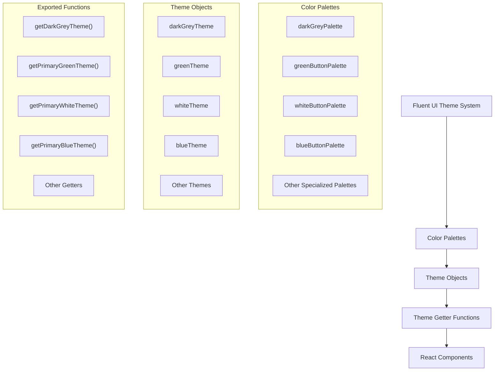
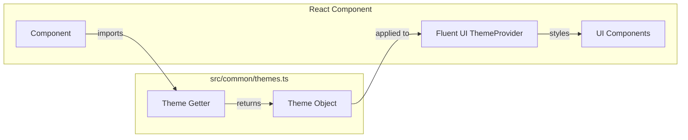
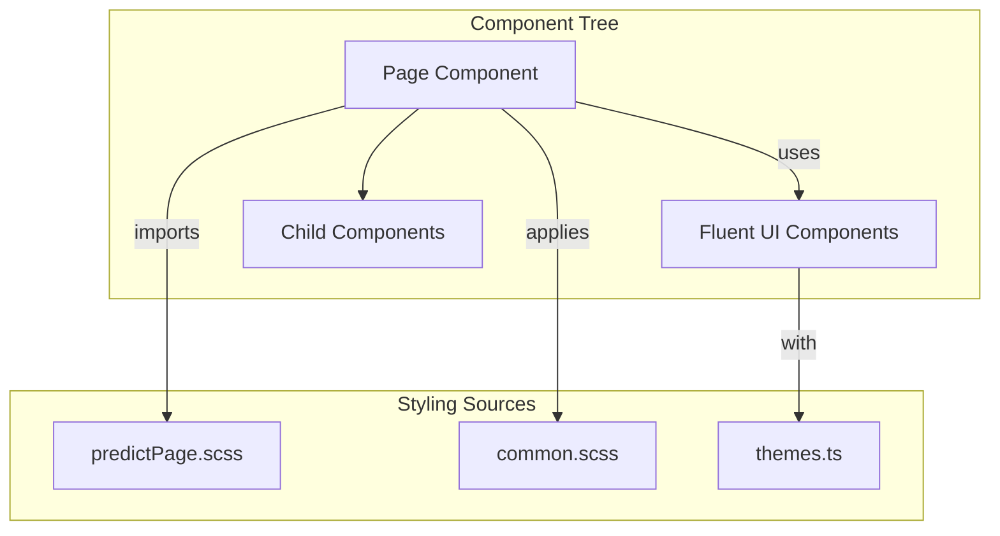

<!-- source: DeepWiki mcp.deepwiki.com · repo microsoft/OCR-Form-Tools · page 5.3 Themes and Styling · fetched 2026-10-26 -->

# Themes and Styling

Relevant source files

The following files were used as context for generating this wiki page:

- [public/analyze.py](public/analyze.py)
- [src/common/themes.ts](src/common/themes.ts)
- [src/react/components/common/common.scss](src/react/components/common/common.scss)
- [src/react/components/pages/predict/predictPage.scss](src/react/components/pages/predict/predictPage.scss)

## Purpose and Scope

This document outlines the theming and styling approach used in the OCR Form Testing Tool (FOTT). It covers the color palettes, theme creation, common style classes, and how theming is applied throughout the application. The document focuses on the technical implementation of styling rather than design guidelines.

For information about internationalization, which includes text localization but not styling, see [Internationalization](#5.2).

## Theme System Overview

FOTT uses Microsoft's Fluent UI React framework for theming, with custom color palettes defined for different UI elements. The application primarily implements a dark-themed interface with accent colors for specific interactive elements.

Sources: [src/common/themes.ts:1-371]()

## Color Palettes

The application defines multiple color palettes to maintain consistent styling across different UI elements. Each palette contains a standardized set of color tokens following the Fluent UI naming conventions, with variations for primary colors, neutrals, and state colors.

Key palettes include:

| Palette Name | Purpose | Primary Color |
|--------------|---------|---------------|
| darkGreyPalette | Main application background | #E5E6E6 with dark background |
| greenButtonPalette | Success and confirmation actions | #78ad0e |
| whiteButtonPalette | Default buttons | white |
| redButtonPalette | Destructive actions | #f2635e |
| blueButtonPalette | Information and links | #5bc0de |
| rightPaneDefaultButtonPalette | Right panel buttons | #E9ECEF |
| darkThemePalette | Dark mode foundation | Based on #1f1f1f background |

Sources: [src/common/themes.ts:3-201]()

## Theme Creation and Management

Themes are created using Fluent UI's `createTheme` function, which takes a palette definition and generates a complete theme object with all the necessary style tokens. These themes are then exposed through getter functions that can be imported by components.

The application exports the following theme getter functions:

- `getRightPaneDefaultButtonTheme()`
- `getPrimaryWhiteTheme()`
- `getDarkGreyTheme()`
- `getPrimaryRedTheme()`
- `getPrimaryGreenTheme()`
- `getPrimaryGreyTheme()`
- `getPrimaryBlueTheme()`
- `getDarkTheme()`
- `getGreenWithWhiteBackgroundTheme()`
- `getDefaultDarkTheme()`
- `getDefaultTheme()`
- `getSubMenuTheme()`
- `getLightGreyTheme()`

Sources: [src/common/themes.ts:307-370]()

## SCSS Styling System

In addition to the Fluent UI theme system, the application uses SCSS for defining component-specific styles. SCSS files are organized by:

1. Common styles - Shared utility classes and common element styling
2. Component-specific styles - Styles targeting specific UI components
3. Page-specific styles - Styles for entire page layouts

### Common SCSS Classes

The application provides utility classes for:

1. Background colors with graduated intensity levels:
   - `.bg-darker-1` through `.bg-darker-5`
   - `.bg-lighter-1` through `.bg-lighter-5`

2. Layout utilities:
   - `.flex-center` - Center-aligned flex container
   - `.container-space-between` - Flex container with space-between justification
   - `.container-items-end` - Flex container with items aligned to the end

3. Common element styling:
   - `.btn32px` - Standard 32px height button
   - `.loading-icon` - Animated loading indicator
   - `.separator-right-pane-main` - Standard section separator for right pane

Sources: [src/react/components/common/common.scss:1-203]()

## Page-Specific Styling

Each major page or component can have its own SCSS file for specialized styling needs. For example, the Predict page has specific styles for:

- Model selection dropdowns
- Table view for results
- Layout of the main content and sidebar
- Special styling for cells, headers, and interactive elements in the prediction results

Sources: [src/react/components/pages/predict/predictPage.scss:1-179]()

## Theme Implementation Pattern

The application implements theming through a combination of:

1. **Component-specific theming** - Components import specific theme getters based on their function
2. **Global theming** - Base application theme applied at a high level
3. **Class-based styling** - Using SCSS utility classes for common styling needs
4. **Inline styling** - For component-specific adjustments

### Example: Predict Page Styling

The Predict page combines all these approaches:

1. Uses theme objects for interactive elements (buttons, dropdowns)
2. Implements page-specific SCSS for layout and specialized components
3. Uses common utility classes for spacing, alignment, and backgrounds
4. Applies specific visual treatments for table cells, headers, and result displays

Sources: [src/react/components/pages/predict/predictPage.scss:1-179]()

## Theme Variables and Constants

The application defines a set of SCSS variables (referenced in the common.scss file) that are used throughout the styling system. These include:

- Base color variables (`$darker-1` through `$darker-5`)
- Contrast variables (`$lighter-1` through `$lighter-5`)
- Specific UI element colors

These variables allow for consistent styling and easier theme adjustments across the application.

Sources: [src/react/components/common/common.scss:11-41]()

## Best Practices for Theme Implementation

When extending the UI within this application, the recommended approach is to:

1. Use existing theme getter functions for interactive components
2. Leverage common SCSS utility classes for layout and spacing
3. Create component-specific styles only when necessary
4. Maintain consistency with the existing dark theme and color palette

This ensures a consistent user experience and maintains the visual design language of the application.

Sources: 
- [src/common/themes.ts:307-370]()
- [src/react/components/common/common.scss:1-203]()

---

