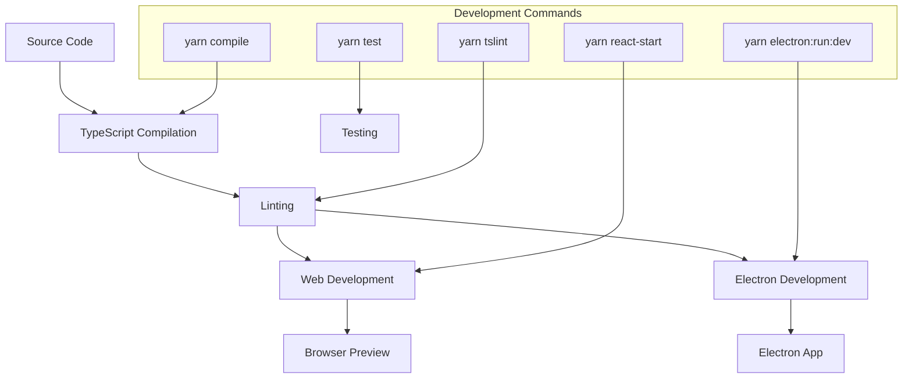
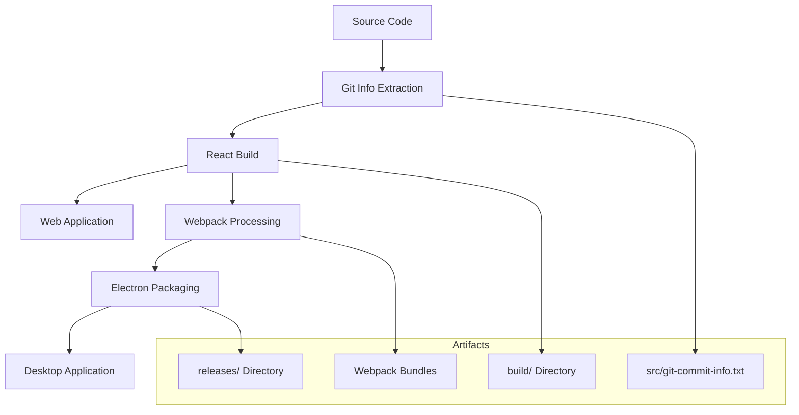
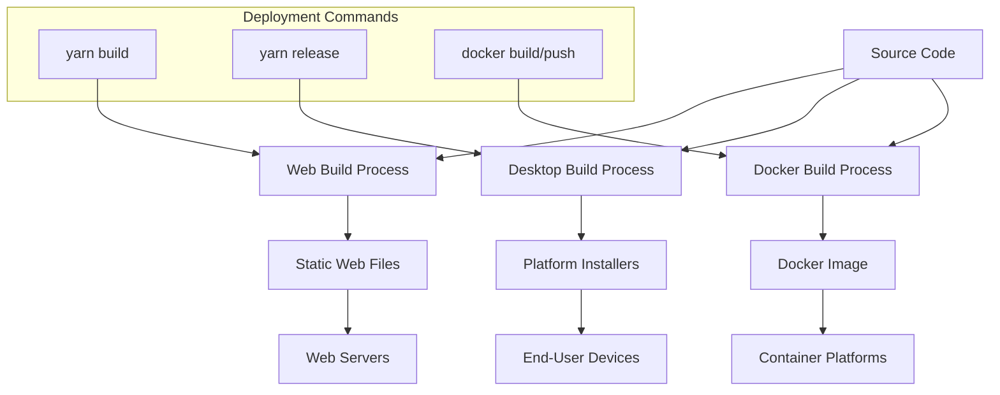
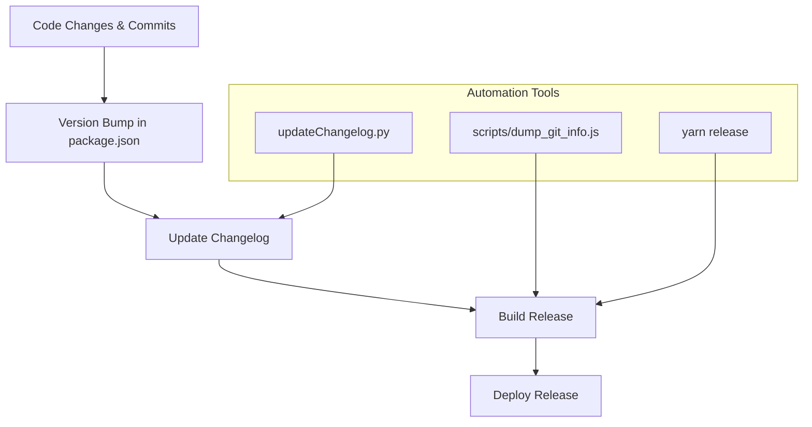

<!-- source: DeepWiki mcp.deepwiki.com · repo microsoft/OCR-Form-Tools · page 6 Development and Deployment · fetched 2026-10-26 -->

# Development and Deployment

<details>
<summary>Relevant source files</summary>

The following files were used as context for generating this wiki page:

- [.gitignore](.gitignore)
- [CHANGELOG.md](CHANGELOG.md)
- [package.json](package.json)
- [public/updateChangelog.py](public/updateChangelog.py)
- [scripts/dump_git_info.js](scripts/dump_git_info.js)
- [scripts/dump_git_info.sh](scripts/dump_git_info.sh)
- [src/common/utils.ts](src/common/utils.ts)
- [src/react/components/pages/editorPage/canvasCommandBar.scss](src/react/components/pages/editorPage/canvasCommandBar.scss)
- [src/react/components/shell/statusBar.scss](src/react/components/shell/statusBar.scss)
- [src/react/components/shell/statusBar.tsx](src/react/components/shell/statusBar.tsx)
- [yarn.lock](yarn.lock)

</details>


This document provides comprehensive guidance for developers working with the OCR Form Testing Tool (FOTT) codebase. It covers the development environment setup, build processes, deployment procedures, and version management to help developers effectively contribute to and deploy the application.

## Environment Setup

The FOTT application is built using React with TypeScript and supports both web browser and Electron desktop environments.

### Prerequisites

- Node.js (>= 12.13.1)
- npm (>= 6.4.1) or yarn

### Key Dependencies

FOTT relies on various dependencies to deliver its functionality:

| Category | Key Dependencies |
| --- | --- |
| Core | React, TypeScript, Redux, Redux-Thunk |
| UI | @fluentui/react, Bootstrap, Reactstrap |
| Data Management | LocalForage, Axios |
| Document Processing | PDFJS, UTIF |
| Cloud Integration | Azure Storage Blob |
| Development | Webpack, TSLint, Jest, Electron |

Sources: [package.json:17-53]()

### Installation

1. Clone the repository:
```bash
git clone https://github.com/microsoft/OCR-Form-Tools.git
cd OCR-Form-Tools
```

2. Install dependencies:
```bash
yarn install
```

3. Configure environment:
   - Create `.env.electron` file for Electron-specific environment variables
   - For development, you can use local storage providers

## Development Workflow

### Development Scripts

FOTT provides several npm scripts to facilitate development:

| Command | Description |
| --- | --- |
| `yarn start` | Starts the development server with Electron |
| `yarn react-start` | Starts only the React development server |
| `yarn compile` | Compiles TypeScript files |
| `yarn tslint` | Runs linting checks |
| `yarn tslintfix` | Runs linting and fixes issues automatically |
| `yarn test` | Runs the test suite |

Sources: [package.json:55-71]()

### Development Flow Diagram



Sources: [package.json:55-71]()

## Build Process

The build process transforms source code into deployable artifacts for different platforms.

### Build Scripts

| Command | Description |
| --- | --- |
| `yarn build` | Builds the React application |
| `yarn webpack:dev` | Webpack build for development |
| `yarn webpack:prod` | Webpack build for production |
| `yarn electron:run:prod` | Build and run Electron app in production mode |
| `yarn release` | Create a production release package |

Sources: [package.json:55-71]()

### Build Workflow

The build process involves several key steps:

1. **Git Information Extraction**:
   - The `scripts/dump_git_info.js` script extracts the current git commit information
   - This information is saved to `src/git-commit-info.txt`
   - Used to display version and commit hash in the application status bar

2. **React Application Build**:
   - Compiles TypeScript to JavaScript
   - Bundles and optimizes the application
   - Generates static assets in the `build` directory

3. **Webpack Processing**:
   - Different configurations for development and production
   - Optimizes the application for the target environment

4. **Electron Packaging** (for desktop releases):
   - Bundles the web application with Electron
   - Creates platform-specific installers



Sources: [scripts/dump_git_info.js:1-15](), [package.json:58-69]()

### Version Information Tracking

FOTT tracks version information in the build through a specific process:

1. The build script uses `dump_git_info.js` to extract the git commit hash:
```javascript
const lastCommit = child_process.execSync('git log -1', {encoding: 'utf8'});
fs.writeFile("src/git-commit-info.txt", lastCommit, (err) => {
    // Handle file writing
});
```

2. The `StatusBar` component reads this information and displays it in the UI:

```typescript
componentDidMount() {
    const commitInfoUrl = require("../../../git-commit-info.txt");
    axios.get(commitInfoUrl).then(res => {
        // match the git commit hash
        const commitHash = /commit ([0-9a-fA-F]{7})/.exec(res?.data)[1];
        this.setState({ commitHash: commitHash || "" });
    });
}
```

3. The version is displayed in the status bar:
```typescript
<span>{constants.appVersion}-{this.state?.commitHash}</span>
```

Sources: [scripts/dump_git_info.js:1-15](), [src/react/components/shell/statusBar.tsx:17-25](), [src/react/components/shell/statusBar.tsx:46-48]()

## Deployment Options

FOTT supports multiple deployment options to accommodate different usage scenarios.

### Web Application Deployment

For web application deployment:

1. Build the application: `yarn build`
2. Deploy the contents of the `build` directory to your web server
3. Configure the server to handle client-side routing

### Desktop Application Deployment

For desktop deployment:

1. Create a production release: `yarn release`
2. The resulting installer packages are created in the `releases` directory
3. Distribute the appropriate installer for the target platform (Windows, macOS, Linux)

### Docker Deployment

The application can also be containerized for deployment:

1. Build the application
2. Create a Docker image using the provided Dockerfile
3. Deploy the container to your container hosting environment



Sources: [package.json:58-69]()

## Version Control and Releases

FOTT uses semantic versioning and maintains a detailed changelog to track changes across releases.

### Versioning Scheme

The version format is `MAJOR.MINOR.PATCH[-PREVIEW.BUILD]` where:
- MAJOR versions include significant changes
- MINOR versions include new features
- PATCH versions include bug fixes
- PREVIEW indicates pre-release versions
- BUILD is an incremental build number

The current version is defined in `package.json` as 2.1.0.

Sources: [package.json:2-3]()

### Changelog Management

The changelog is maintained in `CHANGELOG.md` and follows a structured format:

- Each entry includes version, commit hash, and date
- Changes are categorized (features, fixes, refactors)
- Links to pull requests and commits are provided

The `updateChangelog.py` script automates changelog updates by:

1. Reading the last entry in the changelog
2. Fetching new commits since that entry
3. Formatting commit messages into changelog entries
4. Adding the new entries to the changelog



Sources: [CHANGELOG.md:1-370](), [public/updateChangelog.py:1-61]()

### API Version Management

The application supports multiple API versions of the Form Recognizer service:

1. The `getAPIVersion` function determines which API version to use:
```typescript
export function getAPIVersion(projectAPIVersion: string): string {
    return (constants.enableAPIVersionSelection && projectAPIVersion) 
        ? projectAPIVersion 
        : constants.apiVersion;
}
```

2. This API version is displayed in the status bar for debugging and verification

Sources: [src/common/utils.ts:424-426](), [src/react/components/shell/statusBar.tsx:30-31]()

## Continuous Integration

FOTT uses a continuous integration process to ensure code quality and build stability.

### Build Verification

The CI process performs the following validations:

1. Code compilation and type checking
2. Linting for code quality
3. Unit tests execution
4. Build verification

### Release Process

The release process follows these steps:

1. Version bump in package.json
2. Update changelog using updateChangelog.py
3. Create a release build with `yarn release`
4. Tag the release in the repository
5. Publish the release artifacts

## Cross-Platform Compatibility

FOTT is designed to be cross-platform compatible:

| Platform | Support Type | Build Command |
|----------|--------------|--------------|
| Windows  | Full         | `yarn release` |
| macOS    | Full         | `yarn release` |
| Linux    | Full         | `yarn release` |
| Web      | Full         | `yarn build`   |

The Electron packaging process generates appropriate installers for each supported platform.

Sources: [package.json:69]()

## Testing

For information about testing approaches and tools used in the project, see the [Testing](#6.1) page.

## Versioning and Releases

For detailed information about the versioning system and release process, see the [Versioning and Releases](#6.2) page.

---

