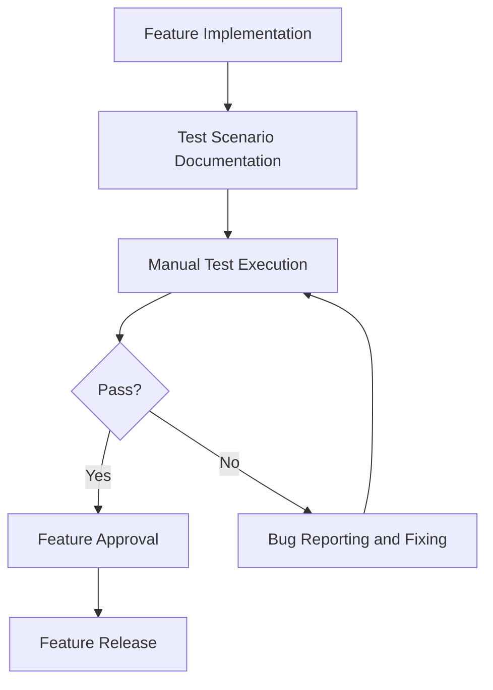
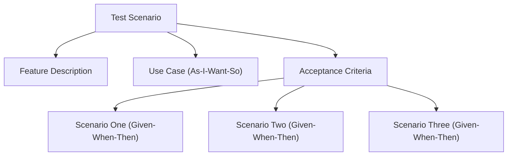
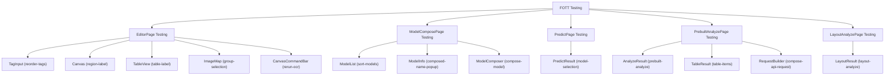
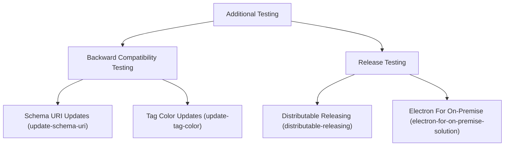

<!-- source: DeepWiki mcp.deepwiki.com · repo microsoft/OCR-Form-Tools · page 6.1 Testing · fetched 2026-10-26 -->

# Testing

<details>
<summary>Relevant source files</summary>

The following files were used as context for generating this wiki page:

- [docs/manual_testing/manual-test-runbook.md](docs/manual_testing/manual-test-runbook.md)

</details>


This page describes the testing approaches and tools used in the OCR Form Testing Tool (FOTT). The primary focus is on manual testing methodologies that ensure feature functionality and backward compatibility.

## Testing Approach

The FOTT project uses a structured manual testing approach documented in a comprehensive test runbook. Each feature is tested according to detailed scenarios with clearly defined acceptance criteria. 

### Manual Testing Workflow



Sources: [docs/manual_testing/manual-test-runbook.md:1-4]()

### Test Scenario Structure

Each test scenario in the FOTT manual testing runbook follows a consistent structure that facilitates thorough verification of functionality:



This structured approach ensures comprehensive test coverage and clear documentation of expected behavior.

Sources: [docs/manual_testing/manual-test-runbook.md:35-58]()

## Testing by UI Component

Testing in FOTT is organized according to the application's UI components, with specific test scenarios for each component's features.



Sources: [docs/manual_testing/manual-test-runbook.md:4-26]()

### Editor Page Component Testing

The Editor Page is the most extensively tested component, with test scenarios covering:

#### Table Labeling

Table labeling tests verify functionality for:
- Configuring fixed-sized tables
- Assigning labels to tables
- Managing dynamic tables
- Reconfiguring tables

Example test scenario:
```
Given I'm on the edit page and loaded images
When I click the "add new table tag" icon button
Then I should see a new "Configure table tag" sidebar on the right side of the screen
```

Sources: [docs/manual_testing/manual-test-runbook.md:60-131]()

#### Region Labeling

Region labeling tests verify:
- Drawing regions on documents
- Selecting and modifying regions
- Applying regions to tags
- Layer visibility and management

Example test scenario:
```
Given I'm on the editor page and click the draw region button on the canvas command bar
When I click and drag on the document image
Then I should see a region being drawn
```

Sources: [docs/manual_testing/manual-test-runbook.md:145-287]()

#### Group Selection

Tests for the group selection tool verify:
- Multiple word selection
- Selection interaction with existing selections
- Application of selected words to tags

Example test scenario:
```
Given I'm on the editor page
When I hold shift, click, and drag
Then I should see a bounding box drawn on the form
```

Sources: [docs/manual_testing/manual-test-runbook.md:348-397]()

#### OCR Rerunning

Tests verify the ability to:
- Run OCR on the current document
- Run OCR on all documents
- View updated OCR results

Example test scenario:
```
Given I've opened a project containing documents, and I'm on the Tag Editor page
When I click "Run Layout on current document" in the canvas command bar
Then I should see "Running Layout..." for the current document
```

Sources: [docs/manual_testing/manual-test-runbook.md:658-685]()

#### Document Management

Tests verify the ability to:
- Delete documents through the FOTT interface
- Update storage providers accordingly

Sources: [docs/manual_testing/manual-test-runbook.md:573-589]()

#### Tag Reordering

Tests verify the ability to:
- Efficiently reorder tags in a list
- Move tags up and down without visual issues

Sources: [docs/manual_testing/manual-test-runbook.md:636-655]()

### Model Management Testing

Several components related to model management have specific test scenarios:

#### Model Training

Tests verify:
- Adding custom model names during training
- Viewing trained models in records
- Downloading JSON files for trained models

Example test scenario:
```
Given I've opened a project containing documents and I'm on the Train page
When I type customized name in input field and click train button
Then I should see typed name shows in Train Record after record shows up
```

Sources: [docs/manual_testing/manual-test-runbook.md:688-719](), [docs/manual_testing/manual-test-runbook.md:35-58]()

#### Model Composition

Tests verify:
- Selecting multiple models for composition
- Adding custom names for composed models
- Viewing composed models in the list
- Sorting and filtering models

Example test scenario:
```
Given I've opened a project containing documents and I'm on the Model Compose page
When I double click a row with composed model
Then I should see a pop up which shows all models used to compose the model
```

Sources: [docs/manual_testing/manual-test-runbook.md:328-346](), [docs/manual_testing/manual-test-runbook.md:688-728]()

#### Model Selection for Analysis

Tests verify:
- Selecting models for analysis
- Tracking recent models
- Analyzing documents with selected models

Example test scenario:
```
Given I've trained or composed a model for my current project
When I go to the analyze page
Then I should see my most recent model in the right pane header
```

Sources: [docs/manual_testing/manual-test-runbook.md:430-483]()

### Prebuilt Analyze Testing

Tests for the prebuilt analyze feature verify:
- Analysis workflow
- Table items field functionality
- API request composition

Example test scenario:
```
Given I am on the "prebuilt analyze" page, analyzed an invoice type file with "Items" field
When I clicked the "Click to view analyzed table"
Then I should see a modal table pop up with the content of the "Items"
```

Sources: [docs/manual_testing/manual-test-runbook.md:730-850]()

### Layout Analyze Testing

Tests for the layout analyze feature verify:
- Basic workflow functionality
- Table visualization features

Example test scenario:
```
Given I saw the analyze result on the layout-analyza page
When I click the "Table" icon on the UI
Then I can see a table visualization popped up on the UI
```

Sources: [docs/manual_testing/manual-test-runbook.md:853-879]()

## Additional Testing Areas

Beyond component functionality, the FOTT testing approach includes:



Sources: [docs/manual_testing/manual-test-runbook.md:28-33]()

### Backward Compatibility Testing

Backward compatibility tests ensure that:

#### Schema URI Updates
- New version FOTT properly updates schema URIs in existing projects
- New projects use the correct schema URIs

Example test scenario:
```
Given An existed project
When I use a new version FOTT with updated "fieldsSchema" URI
Then The "$schema" field in the "field.json" files is corresponding to the new "fieldsSchema" URI
```

Sources: [docs/manual_testing/manual-test-runbook.md:753-777]()

#### Tag Color Updates
- Undefined tag colors are updated to supported colors
- Projects shared between versions maintain proper tag colors

Example test scenario:
```
Given I have blob storage with a field.json file that has more than 248 fields
When I open a new project with the current testing version
Then I can see n-248 tags at the end of the tags field with different colors
```

Sources: [docs/manual_testing/manual-test-runbook.md:808-831]()

### Release Testing

Release testing focuses on:

#### Distributable Releasing
- Creating distributable installers for Windows, Mac, and Linux
- Verifying installer functionality

Example test scenario:
```
Given I've updated dependencies
When I run `yarn release`
Then a distributable installer should be created in the releases folder
```

Sources: [docs/manual_testing/manual-test-runbook.md:544-570]()

#### Electron for On-Premise Solutions
- Supporting FOTT features in Electron
- Supporting local file system providers
- Opening local projects

Example test scenario:
```
Given I've installed new dependencies and started FOTT in Electron
When I create a new connection with the local file system as the provider
Then I should be able to create a project with the created connection
```

Sources: [docs/manual_testing/manual-test-runbook.md:592-633]()

## Testing Best Practices

Based on the test runbook structure, the following best practices are observed in FOTT testing:

1. **Clear Feature Description** - Each test begins with a concise description of the feature being tested
2. **User-Centric Use Cases** - Tests are framed around user needs using As-I-Want-So format
3. **Explicit Acceptance Criteria** - Multiple scenarios define precise conditions for feature acceptance
4. **Given-When-Then Format** - Test scenarios follow a consistent format that clarifies:
   - Initial conditions (Given)
   - User actions (When)
   - Expected results (Then)
5. **Comprehensive Coverage** - Tests cover all UI components and major features
6. **Backward Compatibility** - Explicit testing for compatibility with previous versions
7. **Platform Support** - Testing across multiple platforms (Windows, Mac, Linux)

## Test Execution

The manual test runbook serves as a guide for test execution. Testers follow each scenario, performing the specified actions and verifying the expected outcomes. Issues identified during testing are reported for fixing, and features are only approved for release when all tests pass.

Sources: [docs/manual_testing/manual-test-runbook.md:1-33]()

## Conclusion

Testing in the OCR Form Testing Tool follows a structured manual approach with comprehensive test scenarios documented in the test runbook. This approach ensures thorough verification of feature functionality, backward compatibility, and platform support. The combination of component testing, backward compatibility testing, and release testing provides confidence in the quality and reliability of the FOTT application.

---

