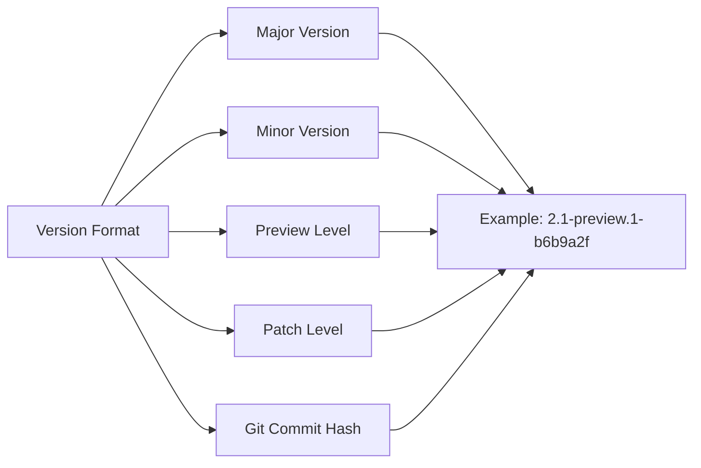
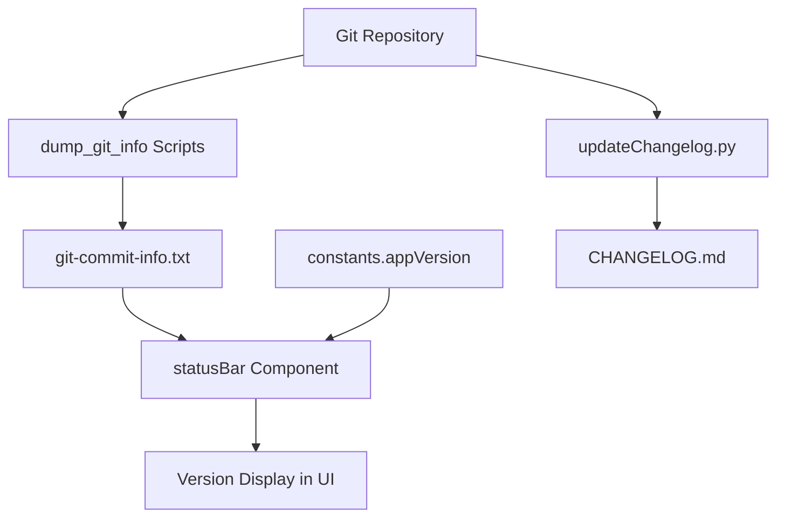
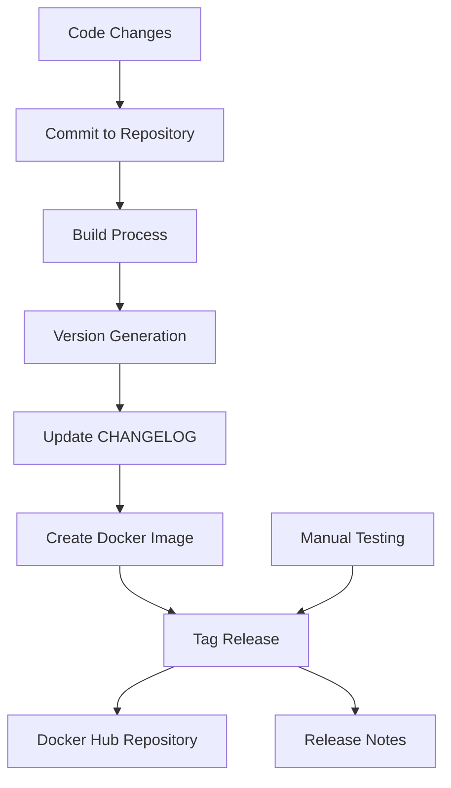
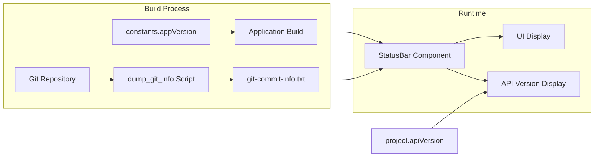

<!-- source: DeepWiki mcp.deepwiki.com · repo microsoft/OCR-Form-Tools · page 6.2 Versioning and Releases · fetched 2026-10-26 -->

# Versioning and Releases

<details>
<summary>Relevant source files</summary>

The following files were used as context for generating this wiki page:

- [.gitignore](.gitignore)
- [CHANGELOG.md](CHANGELOG.md)
- [public/updateChangelog.py](public/updateChangelog.py)
- [scripts/dump_git_info.js](scripts/dump_git_info.js)
- [scripts/dump_git_info.sh](scripts/dump_git_info.sh)
- [src/react/components/pages/editorPage/canvasCommandBar.scss](src/react/components/pages/editorPage/canvasCommandBar.scss)
- [src/react/components/shell/statusBar.scss](src/react/components/shell/statusBar.scss)
- [src/react/components/shell/statusBar.tsx](src/react/components/shell/statusBar.tsx)

</details>


This document explains the versioning system and release process used by the OCR Form Tools (FOTT) application. It covers how versions are structured, managed, and displayed in the application, as well as how releases are tracked and documented.

## Version Structure

The OCR Form Tools uses a structured versioning format that combines semantic versioning with Git commit information.



The version format consists of the following components:

| Component | Description | Example |
|-----------|-------------|---------|
| Major Version | Primary version number | 2 |
| Minor Version | Feature level version | 1 |
| Preview Indicator | Indicates preview release | preview |
| Patch Level | Incremental patch number | 1 |
| Git Commit Hash | Short hash of the commit | b6b9a2f |

Sources: [CHANGELOG.md:1-20](), [src/react/components/shell/statusBar.tsx:45-48]()

## Version Management

The application tracks version information through several mechanisms:



### Git Commit Tracking

The application captures the current Git commit using shell or Node.js scripts that run during the build process:

1. The `dump_git_info.sh` or `dump_git_info.js` script executes a `git log -1` command
2. The output is written to `src/git-commit-info.txt`
3. This file is loaded by the application at runtime to display the current commit

Sources: [scripts/dump_git_info.sh:1-5](), [scripts/dump_git_info.js:1-15]()

### Version Display

The version information is displayed in the application's status bar:

1. The `StatusBar` component loads the commit hash from `git-commit-info.txt`
2. It displays the version in the format `{appVersion}-{commitHash}`
3. The version links to the CHANGELOG.md file on GitHub

Sources: [src/react/components/shell/statusBar.tsx:16-55]()

## Release Process

The OCR Form Tools follows a structured release process that involves several steps:



### Container Releases

The project is primarily distributed as Docker container images:

1. Container images are published to the [Microsoft Azure Cognitive Services Custom Form Labeltool](https://hub.docker.com/_/microsoft-azure-cognitive-services-custom-form-labeltool) Docker Hub repository
2. The latest preview release is tracked by the `latest-preview` image tag
3. Specific versions are tagged with their version identifier

For example, the release notes in CHANGELOG.md indicate that container 2.1-Preview's latest release references **2.1-preview.1-1f33130 (10-09-2020)**.

Sources: [CHANGELOG.md:5-6]()

## Changelog Management

The project maintains a detailed changelog that documents all changes made in each release:

### Changelog Format

Each release entry in the changelog follows this format:

```
### [Version-CommitHash] ([Date])
* [Change description] ([PR link])
* [Change description] ([PR link])
...
```

### Automated Changelog Updates

The changelog is automatically updated using a Python script:

1. The `updateChangelog.py` script parses the existing CHANGELOG.md
2. It identifies the last documented commit
3. It retrieves all new commits since the last documented one
4. It formats the commits into changelog entries
5. It writes the updated content back to CHANGELOG.md

The script formats commit messages and adds links to the corresponding GitHub pull requests and commits.

Sources: [public/updateChangelog.py:1-62]()

## Version Information Flow

The following diagram illustrates how version information flows through the application:



The version information displayed in the application comes from two primary sources:

1. The application version from constants
2. The Git commit hash from git-commit-info.txt

Additionally, the API version being used is displayed for each project, which is determined from the project configuration.

Sources: [src/react/components/shell/statusBar.tsx:19-25](), [src/react/components/shell/statusBar.tsx:30-54]()

## Accessing Previous Versions

Previous versions of the OCR Form Tools can be accessed through:

1. Docker Hub using specific version tags
2. GitHub repository using commit hashes or release tags

The CHANGELOG.md file serves as the primary reference for identifying specific versions and their features or bug fixes.

Sources: [CHANGELOG.md:1-350]()

## Release Versioning Examples

The following table shows examples of releases from the changelog:

| Version | Date | Key Changes |
|---------|------|-------------|
| 2.1-preview.2-b6b9a2f | 12-10-2020 | Update appVersion to 2.1.2, locale additions |
| 2.1-preview.1-1f33130 | 10-09-2020 | Support image map interactions for container releases |
| 2.0.0-1c39800 | 06-05-2020 | Enable download analyze script, CORS error handling |

Sources: [CHANGELOG.md:9-19](), [CHANGELOG.md:101-102](), [CHANGELOG.md:320-325]()

---

