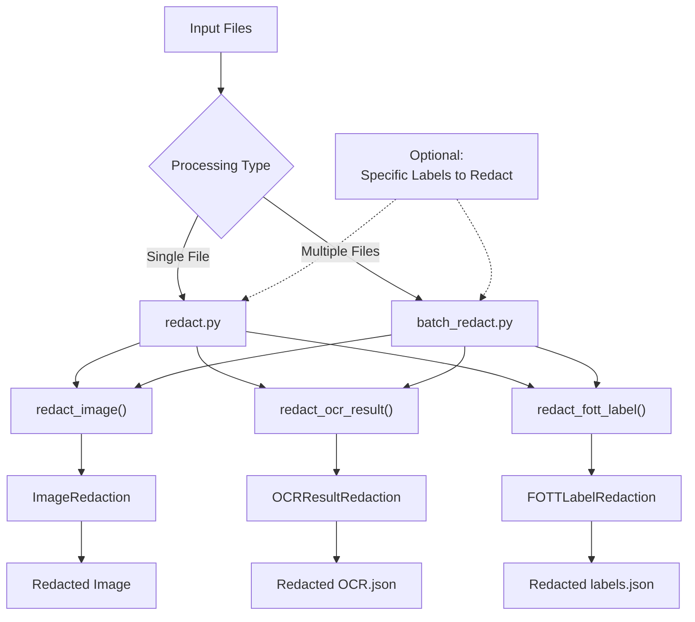
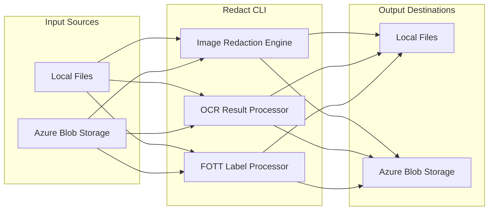
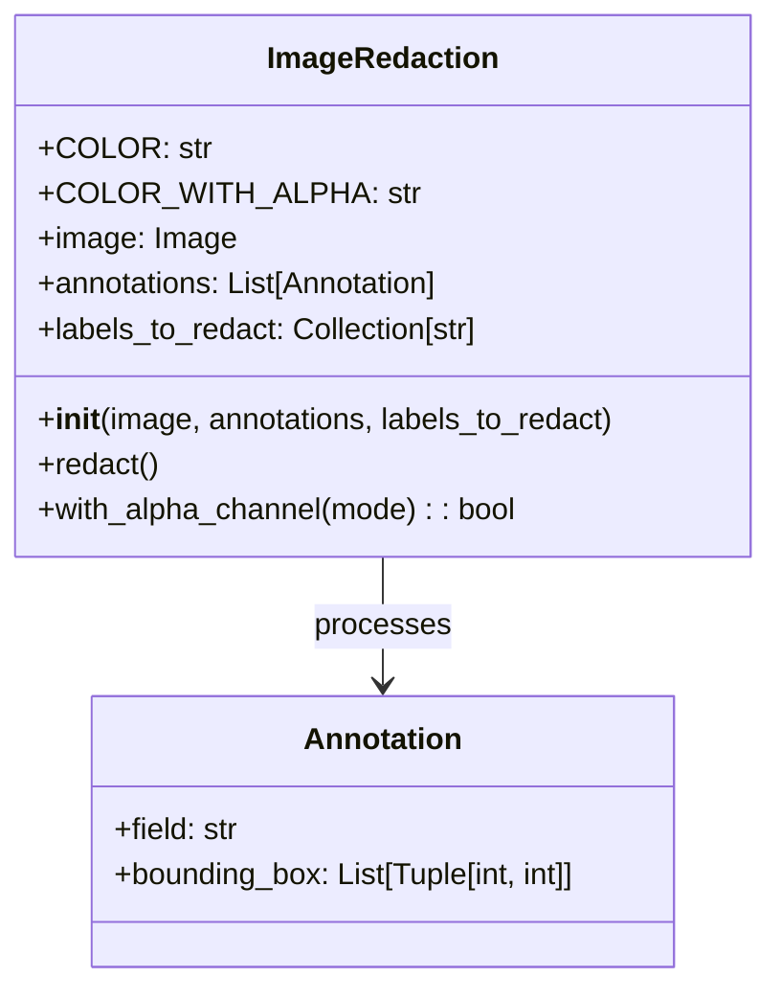
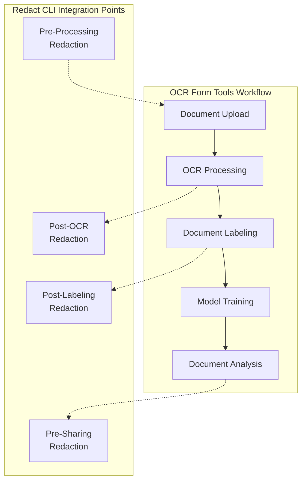

<!-- source: DeepWiki mcp.deepwiki.com · repo microsoft/OCR-Form-Tools · page 7 Additional Tools · fetched 2026-10-26 -->

# Additional Tools

<details>
<summary>Relevant source files</summary>

The following files were used as context for generating this wiki page:

- [scripts/redact_cli_py/CHANGELOG.md](scripts/redact_cli_py/CHANGELOG.md)
- [scripts/redact_cli_py/README.md](scripts/redact_cli_py/README.md)
- [scripts/redact_cli_py/redact/redaction/image_redaction.py](scripts/redact_cli_py/redact/redaction/image_redaction.py)
- [scripts/redact_cli_py/tests/factories/image_factory.py](scripts/redact_cli_py/tests/factories/image_factory.py)
- [scripts/redact_cli_py/tests/redaction/test_image_redaction.py](scripts/redact_cli_py/tests/redaction/test_image_redaction.py)

</details>


This document covers supplementary tools included in the OCR Form Testing Tool repository that extend the core functionality. These utilities provide additional capabilities for specialized use cases in the document processing workflow.

## Redact CLI

The Redaction Tool is a utility that enables users to remove Personally Identifiable Information (PII) or sensitive information from documents before sharing them with others. It processes documents and produces redacted versions while preserving the semantic structure of the original content.

### Redaction Workflow



Sources: [scripts/redact_cli_py/README.md:3-4](), [scripts/redact_cli_py/README.md:12-227]()

### Capabilities and Features

The Redact CLI can process three types of content:

1. **Images** - Visually redacts sensitive information from document images
2. **OCR Results** - Redacts text in OCR JSON files while preserving text structure
3. **FOTT Labels** - Redacts annotations in the labels.json file

Key features include:

- Preservation of text semantics (length, case patterns, character/digit patterns)
- Support for selective redaction of specific labels
- Batch processing capabilities for multiple files
- Support for local file system and Azure Blob Storage
- PDF document support (single-page in current version)



Sources: [scripts/redact_cli_py/README.md:3-16](), [scripts/redact_cli_py/README.md:157-200]()

### Technical Implementation

The core redaction functionality is implemented in the `redact` package, with specialized classes handling different redaction types:

| Redaction Type | Implementation Class | Description |
|----------------|----------------------|-------------|
| Image Redaction | `ImageRedaction` | Masks sensitive regions with white polygons |
| OCR Result Redaction | OCR Result Processor | Replaces text while preserving format |
| FOTT Label Redaction | FOTT Label Processor | Redacts annotations in label files |

The image redaction implementation uses the Python Imaging Library (PIL) to process images and draw white polygons over sensitive regions:



Sources: [scripts/redact_cli_py/redact/redaction/image_redaction.py:12-71](), [scripts/redact_cli_py/tests/factories/image_factory.py:8-42](), [scripts/redact_cli_py/tests/redaction/test_image_redaction.py:12-69]()

### Setup and Usage

#### Environment Setup

The Redact CLI requires:
- Python 3.9 or pyenv for auto-installing Python 3.9
- pipenv for Python package management

Setup process:
1. Install pyenv (for Python version management)
2. Install pipenv
3. Install required packages using the Pipfile

#### Basic Usage

The tool provides three main redaction commands:

1. **Image Redaction**:
   ```
   python redact.py image <image_path> <fott_label_path> <output_path>
   ```

2. **OCR Result Redaction**:
   ```
   python redact.py ocr <ocr_result_path> <fott_label_path> <output_path> <api_version>
   ```

3. **FOTT Label Redaction**:
   ```
   python redact.py fott <fott_label_path> <output_path>
   ```

For selective redaction, an additional parameter can be provided to specify which labels to redact:
```
python redact.py image <image_path> <fott_label_path> <output_path> "Label_01,Label_04"
```

Sources: [scripts/redact_cli_py/README.md:19-95](), [scripts/redact_cli_py/README.md:98-155]()

#### Batch Processing

The batch redaction feature supports processing multiple files at once:

```
python batch_redact.py <input_container> <input_folder_path> <output_container> <output_folder_path> <api_version>
```

Where containers can be:
- `local` for local file system
- Azure Blob Storage URL with SAS token for cloud storage

Examples:
1. Local to local: `python batch_redact.py local raw/ local redacted/`
2. Cloud to local: `python batch_redact.py "https://account/container?token" folder/ local redacted/`
3. Local to cloud: `python batch_redact.py local raw/ "https://account/container?token" folder/`
4. Cloud to cloud: `python batch_redact.py "https://account/container?token" folder1/ "https://account/container?token" folder2/`

Sources: [scripts/redact_cli_py/README.md:158-213]()

### Version History

The current version is 0.3.2. Key milestones in development include:

| Version | Release Date | Major Changes |
|---------|--------------|---------------|
| 0.3.2 | 2022-08-11 | Code style refactoring |
| 0.3.1 | 2022-08-02 | Multi-page PDF and TIFF support |
| 0.3.0 | 2022-01-06 | Form Recognizer v3.0 support |
| 0.2.3 | 2021-12-13 | Latin ligature and diacritics support |
| 0.2.2 | 2021-11-17 | Selective label redaction and PDF support |
| 0.2.0 | 2021-07-09 | Azure Blob Storage support |
| 0.1.0 | 2021-06-25 | Initial release |

Sources: [scripts/redact_cli_py/CHANGELOG.md:1-73]()

### Limitations

- Currently supports Latin characters redaction only
- For non-Latin document support, users need to contact the Form Recognizer team
- Batch redaction supports specific image formats (.jpeg, .jpg, .png, .tif, .tiff, .bmp) and PDF files

Sources: [scripts/redact_cli_py/README.md:13-14](), [scripts/redact_cli_py/README.md:227-232]()

## Integration with OCR Form Tools

The Redact CLI serves as a complementary tool in the OCR Form Tools ecosystem, particularly in workflows requiring privacy protection before document processing.



Sources: [scripts/redact_cli_py/README.md:3-11]()

This additional tool enhances the privacy and security capabilities of the OCR Form Tools by providing a command-line interface for redacting sensitive information at various stages of the document processing workflow.