# Page: Overview

# Overview

<details>
<summary>Relevant source files</summary>

The following files were used as context for generating this wiki page:

- [README.ja-jp.md](README.ja-jp.md)
- [README.md](README.md)
- [README.zh-cn.md](README.zh-cn.md)
- [docs/images/compose.png](docs/images/compose.png)
- [docs/images/keyboard-shortcuts-icon.png](docs/images/keyboard-shortcuts-icon.png)
- [docs/images/share-icon.png](docs/images/share-icon.png)
- [package.json](package.json)
- [src/common/utils.ts](src/common/utils.ts)
- [src/react/components/shell/appSurveyLink.scss](src/react/components/shell/appSurveyLink.scss)
- [src/react/components/shell/appSurveyLink.tsx](src/react/components/shell/appSurveyLink.tsx)
- [yarn.lock](yarn.lock)

</details>


This document provides a comprehensive introduction to the OCR Form Testing Tool (FOTT), explaining its purpose, core architecture, and fundamental capabilities. FOTT is an open-source labeling tool for Form Recognizer, part of the Form OCR Test Toolset, designed to allow users to label forms, train custom machine learning models, and extract key-value pairs from documents.

## Purpose and Scope

The OCR Form Testing Tool is primarily designed to facilitate the process of labeling form data, training custom models using Azure Form Recognizer, and extracting structured information from documents. It enables users to:

- Label forms in various formats (PDF, JPEG, TIFF)
- Train custom models using the labeled data
- Extract key-value pairs from forms using the trained models
- Compose multiple models to enhance extraction capabilities

For detailed instructions on using specific features, refer to other sections in this wiki which cover individual components in greater depth.

Sources: [README.md:9-30](), [package.json:1-15]()

## System Architecture Overview

The OCR Form Testing Tool is built as a React + Redux web application written in TypeScript. It can be run as either a web application, desktop application (using Electron), or deployed via Docker.

### High-Level Architecture

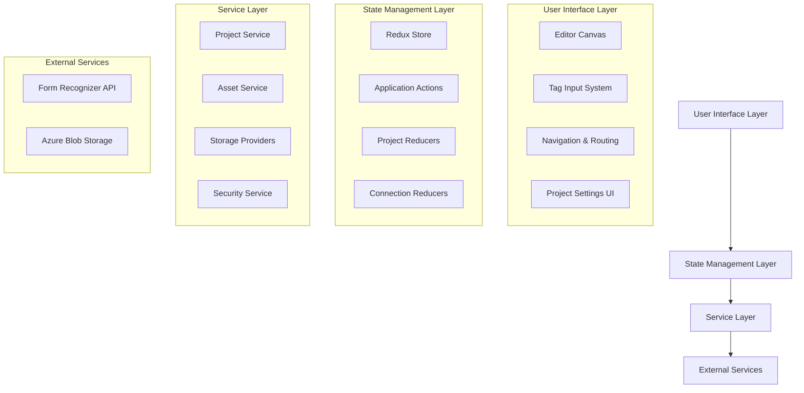

Sources: [README.md:22-30](), [package.json:16-53]()

### Core Components and Data Flow

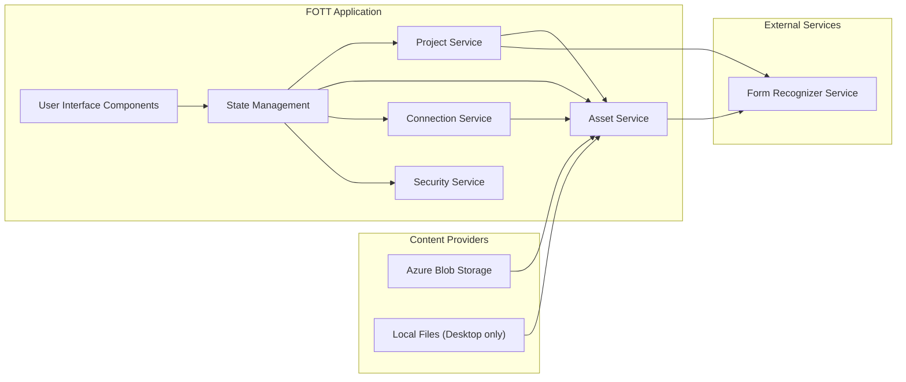

Sources: [README.md:31-62](), [src/common/utils.ts:93-124]()

## Key Features and Workflow

The OCR Form Testing Tool provides a structured workflow for document processing, model training, and prediction:

### Document Processing Workflow

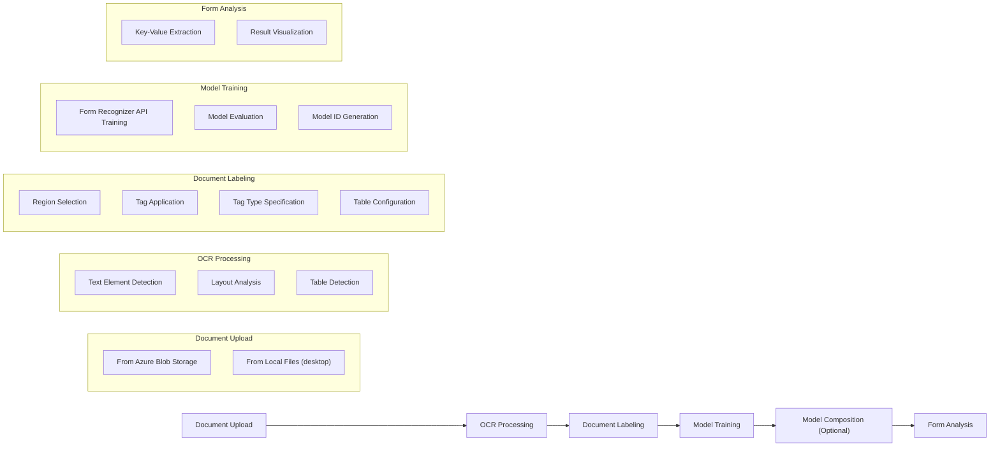

Sources: [README.md:81-196]()

### Feature Overview

The system provides three main capabilities:

| Feature | Description | Components Involved |
|---------|-------------|---------------------|
| Labeling | Allows users to label text elements and tables in forms | Editor Canvas, Tag Input System, Asset Management |
| Training | Trains a custom model using Azure Form Recognizer with labeled data | Model Management, Form Recognizer Integration |
| Analysis | Uses trained models to analyze new documents and extract key-value pairs | Prediction System, Result Visualization |

Sources: [README.md:24-29](), [README.md:132-182]()

## System Components

### Security and Authentication

The system implements a security token mechanism for protecting sensitive information such as API keys and connection strings. Each project generates a unique security token that can be saved for later use. This token is used to encrypt sensitive project settings when stored.

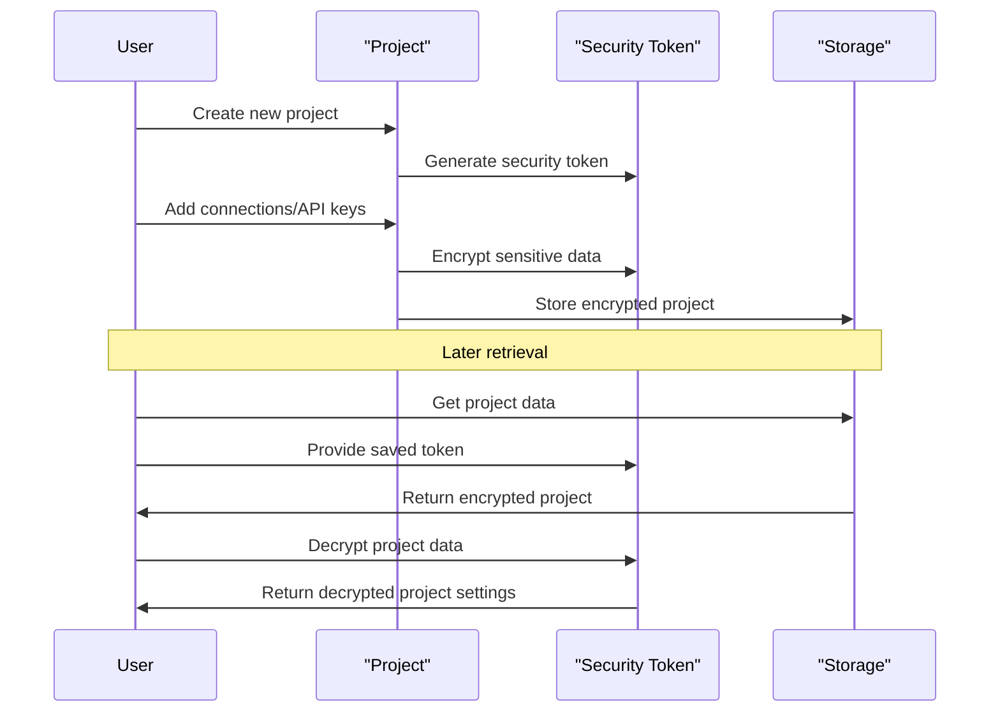

Sources: [src/common/utils.ts:93-124](), [README.md:120-132](), [README.md:196-215]()

### Connections and Project Management

The system uses a "Bring Your Own Data" approach, where users configure connections to their data sources. Currently, Azure Blob Storage is the primary supported provider. Projects are managed through project files that store configuration but encrypt sensitive information.

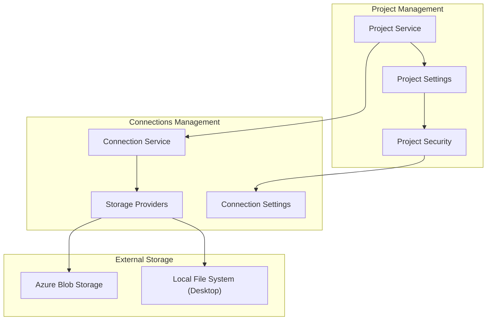

Sources: [README.md:99-117](), [README.md:120-132](), [src/common/utils.ts:93-124]()

## Core UI Components

The user interface is organized into several key components that work together to provide the complete functionality:

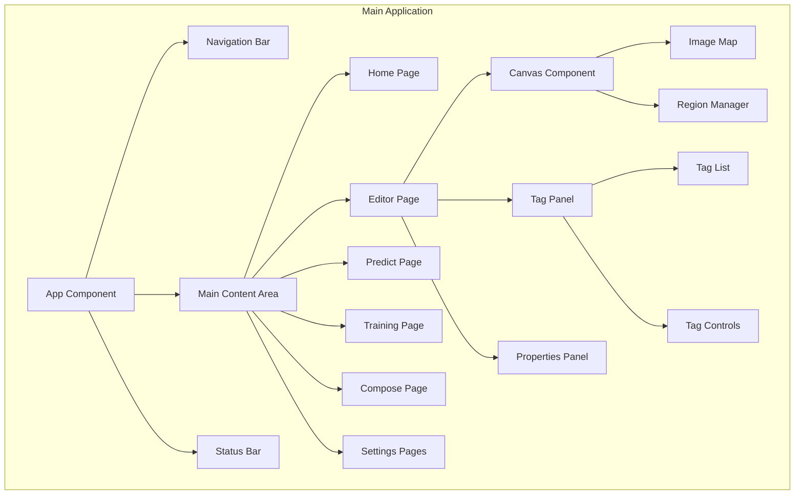

Sources: [README.md:134-142]()

## State Management

The application uses Redux for state management, with a predictable unidirectional data flow:

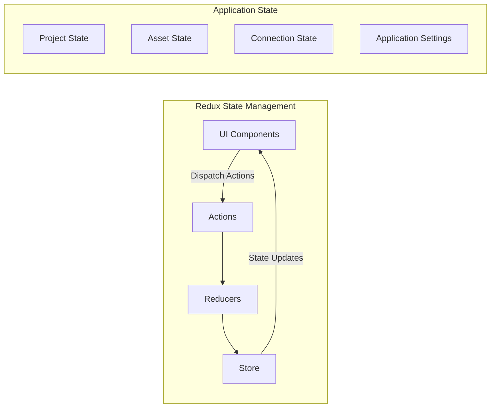

Sources: [README.md:22-23](), [package.json:35-47]()

## Technology Stack

The OCR Form Testing Tool is built using the following key technologies:

| Category | Technologies |
|----------|--------------|
| Frontend Framework | React, Redux |
| UI Components | Fluent UI, Bootstrap |
| State Management | Redux, Redux Thunk |
| Languages | TypeScript |
| Build Tools | Webpack, React Scripts |
| External Services | Azure Form Recognizer, Azure Blob Storage |
| Desktop Integration | Electron |
| Internationalization | react-localization |

Sources: [package.json:17-53](), [README.md:22-23]()

## Deployment Options

The OCR Form Testing Tool can be deployed in three ways:

1. **Web Application**: Hosted service accessible via HTTPS
2. **Desktop Application**: Using Electron for local usage with access to the file system
3. **Docker Container**: Containerized version for easy deployment

Additional features in the desktop application include:
- Support for local file system as storage provider
- Support for cross-domain resource requests

Sources: [README.md:43-83]()

## Internationalization Support

The application supports multiple languages, with built-in support for English, Chinese, and Japanese:

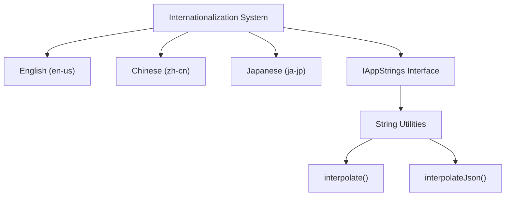

Sources: [README.md:257-258](), [README.zh-cn.md](), [README.ja-jp.md]()

## Conclusion

The OCR Form Testing Tool (FOTT) provides a complete solution for labeling forms, training custom Form Recognizer models, and extracting key-value pairs from documents. Its architecture is designed around React and Redux, with modular components that handle different aspects of the workflow. The tool supports multiple deployment options and provides a comprehensive UI for managing the entire process from document upload to analysis.

---

# Page: Core Architecture

# Core Architecture

<details>
<summary>Relevant source files</summary>

The following files were used as context for generating this wiki page:

- [README.ja-jp.md](README.ja-jp.md)
- [README.md](README.md)
- [README.zh-cn.md](README.zh-cn.md)
- [docs/images/compose.png](docs/images/compose.png)
- [docs/images/keyboard-shortcuts-icon.png](docs/images/keyboard-shortcuts-icon.png)
- [docs/images/share-icon.png](docs/images/share-icon.png)
- [src/App.tsx](src/App.tsx)
- [src/common/mockFactory.ts](src/common/mockFactory.ts)
- [src/models/applicationState.ts](src/models/applicationState.ts)
- [src/react/components/shell/appSurveyLink.scss](src/react/components/shell/appSurveyLink.scss)
- [src/react/components/shell/appSurveyLink.tsx](src/react/components/shell/appSurveyLink.tsx)
- [src/react/components/shell/shareProjectButton.scss](src/react/components/shell/shareProjectButton.scss)
- [src/react/components/shell/shareProjectButton.tsx](src/react/components/shell/shareProjectButton.tsx)
- [src/react/components/shell/sidebar.tsx](src/react/components/shell/sidebar.tsx)
- [src/redux/actions/actionCreators.ts](src/redux/actions/actionCreators.ts)
- [src/redux/actions/actionTypes.ts](src/redux/actions/actionTypes.ts)
- [src/redux/reducers/currentProjectReducer.ts](src/redux/reducers/currentProjectReducer.ts)

</details>


This document describes the foundational architectural components of the OCR Form Testing Tool (FOTT). It covers the system design, key subsystems, state management patterns, and primary data flows that power the application. This page focuses on the core architectural elements, providing a basis for understanding how the different components of the system work together.

For more specific information about individual subsystems, please refer to their respective pages:
- [Editor Canvas System](#2.1)
- [Tag Input System](#2.2)
- [Asset Management](#2.3)
- [State Management](#2.4)

## System Overview

FOTT is a React + Redux web application written in TypeScript. It provides functionality for labeling forms, training custom machine learning models with Azure Form Recognizer, and extracting key-value pairs from documents.

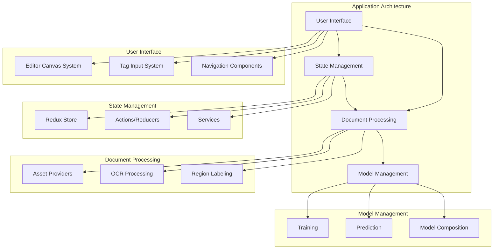

Sources: [README.md:19-29](), [App.tsx:1-114]()

## Application Structure

The application follows a typical React + Redux architecture with strong TypeScript typing:

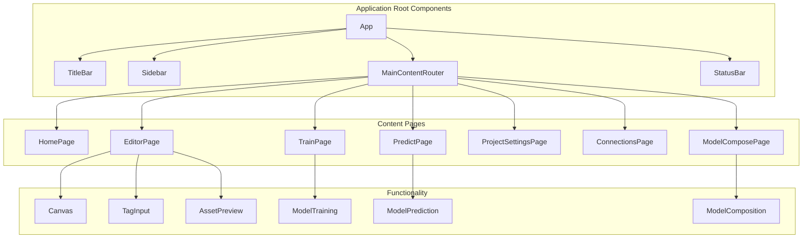

Sources: [App.tsx:70-113](), [src/react/components/shell/sidebar.tsx:18-90]()

The main navigation structure is defined in the `Sidebar` component, which provides access to the main functionality areas:

- Home (Project Selection)
- Editor (Document Labeling)
- Training (Model Training)
- Model Compose (Combining Models)
- Analyze/Predict (Using Models)
- Project Settings
- Connections (External Resource Management)
- Prebuilt Models
- Layout Analysis
- Application Settings

Sources: [src/react/components/shell/sidebar.tsx:22-87]()

## Application State Model

The application state model is central to understanding how data flows through the system. It is defined in the `applicationState.ts` file and uses TypeScript interfaces to enforce type safety.

```mermaid
graph TD
    subgraph "Application State"
        IApplicationState["IApplicationState"] --> AppSettings["appSettings: IAppSettings"]
        IApplicationState --> Connections["connections: IConnection[]"]
        IApplicationState --> RecentProjects["recentProjects: IProject[]"]
        IApplicationState --> CurrentProject["currentProject: IProject"]
        IApplicationState --> AppError["appError?: IAppError"]
    end
    
    subgraph "Project Structure"
        CurrentProject --> ProjectID["id: string"]
        CurrentProject --> ProjectName["name: string"]
        CurrentProject --> SecurityToken["securityToken: string"]
        CurrentProject --> Tags["tags: ITag[]"]
        CurrentProject --> SourceConnection["sourceConnection: IConnection"]
        CurrentProject --> Assets["assets?: {[index: string]: IAsset}"]
        CurrentProject --> ApiSettings["apiUriBase: string, apiKey: string"]
        CurrentProject --> FolderPath["folderPath: string"]
        CurrentProject --> ModelRecords["trainRecord, recentModelRecords, predictModelId"]
    end
    
    subgraph "Assets"
        Assets --> Asset["IAsset"]
        Asset --> AssetID["id: string"]
        Asset --> AssetType["type: AssetType"]
        Asset --> AssetState["state: AssetState"]
        Asset --> AssetName["name: string"]
        Asset --> AssetPath["path: string"]
        Asset --> AssetSize["size: ISize"]
        Asset --> OCRData["ocr?: any"]
    end
    
    subgraph "Tags"
        Tags --> Tag["ITag"]
        Tag --> TagName["name: string"]
        Tag --> TagColor["color: string"]
        Tag --> TagType["type: FieldType"]
        Tag --> TagFormat["format: FieldFormat"]
    end
```

Sources: [src/models/applicationState.ts:15-47](), [src/models/applicationState.ts:85-102](), [src/models/applicationState.ts:121-127](), [src/models/applicationState.ts:173-190]()

The application state model consists of several key interfaces:

- `IApplicationState`: Root-level state container
- `IProject`: Project configuration and metadata
- `IAsset`: Document being processed (PDF, image, etc.)
- `IConnection`: Data source connection information
- `ITag`: Field label definition for form fields
- `IRegion`: Defined area within a document
- `IAssetMetadata`: Data about regions and tags for each asset

Sources: [src/models/applicationState.ts:15-24](), [src/models/applicationState.ts:85-102](), [src/models/applicationState.ts:173-190](), [src/models/applicationState.ts:155-161](), [src/models/applicationState.ts:121-127](), [src/models/applicationState.ts:229-241](), [src/models/applicationState.ts:203-208]()

## State Management

The application uses Redux for state management, following a unidirectional data flow pattern.

```mermaid
graph LR
    subgraph "State Flow"
        UIComponents["UI Components"] --> Actions["Redux Actions"]
        Actions --> Reducers["Redux Reducers"]
        Reducers --> Store["Redux Store"]
        Store --> UIComponents
    end
    
    subgraph "Action Types"
        Actions --> ProjectActions["Project Actions"]
        Actions --> ConnectionActions["Connection Actions"]
        Actions --> ApplicationActions["Application Actions"]
        Actions --> AssetActions["Asset Actions"]
    end
    
    subgraph "Reducers"
        Reducers --> CurrentProjectReducer["currentProjectReducer"]
        Reducers --> ConnectionsReducer["connectionsReducer"]
        Reducers --> AppSettingsReducer["appSettingsReducer"]
        Reducers --> RecentProjectsReducer["recentProjectsReducer"]
    end
    
    subgraph "Services"
        Services["Services"] --> Actions
        Services --> ProjectService["Project Service"]
        Services --> AssetService["Asset Service"]
        Services --> StorageProviders["Storage Providers"]
    end
```

Sources: [src/redux/actions/actionCreators.ts:1-107](), [src/redux/actions/actionTypes.ts:1-43](), [src/redux/reducers/currentProjectReducer.ts:1-116]()

The state management system is organized around several key components:

1. **Action Types**: Defined constants representing possible state changes (e.g., `LOAD_PROJECT_SUCCESS`, `SAVE_ASSET_METADATA_SUCCESS`)
2. **Action Creators**: Functions that create action objects with appropriate payloads
3. **Reducers**: Pure functions that take the current state and an action to produce a new state
4. **Redux Store**: Central repository of application state

Sources: [src/redux/actions/actionTypes.ts:7-42](), [src/redux/actions/actionCreators.ts:39-65](), [src/redux/reducers/currentProjectReducer.ts:21-116]()

Example of a reducer handling project actions:

```
export const reducer = (state: IProject = null, action: AnyAction): IProject => {
    switch (action.type) {
        case ActionTypes.DELETE_PROJECT_SUCCESS:
        case ActionTypes.CLOSE_PROJECT_SUCCESS:
            return null;
        case ActionTypes.LOAD_PROJECT_SUCCESS:
            return {...action.payload};
        case ActionTypes.ADD_ASSET_TO_PROJECT_SUCCESS:
            return {...state, lastVisitedAssetId: action.payload.id};
        // ... more handlers
    }
};
```

Sources: [src/redux/reducers/currentProjectReducer.ts:21-116]()

## Provider Model

The application implements a provider model for storage and asset management, allowing different storage backends to be used interchangeably.

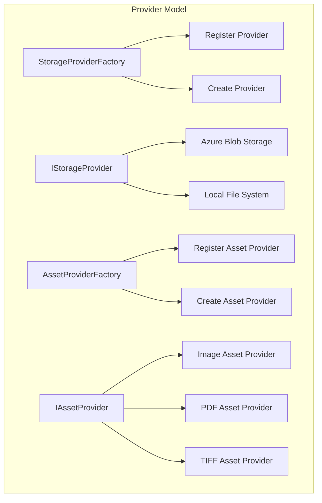

Sources: [src/common/mockFactory.ts:304-351](), [src/common/mockFactory.ts:398-407]()

The provider model enables:

1. Extensibility for new storage types
2. Abstraction of storage implementation details
3. Easy testing with mock providers
4. Support for both cloud and local storage

Sources: [README.md:99-104]()

## Connection and Project Management

The application manages connections to external storage providers and uses these connections to organize projects.

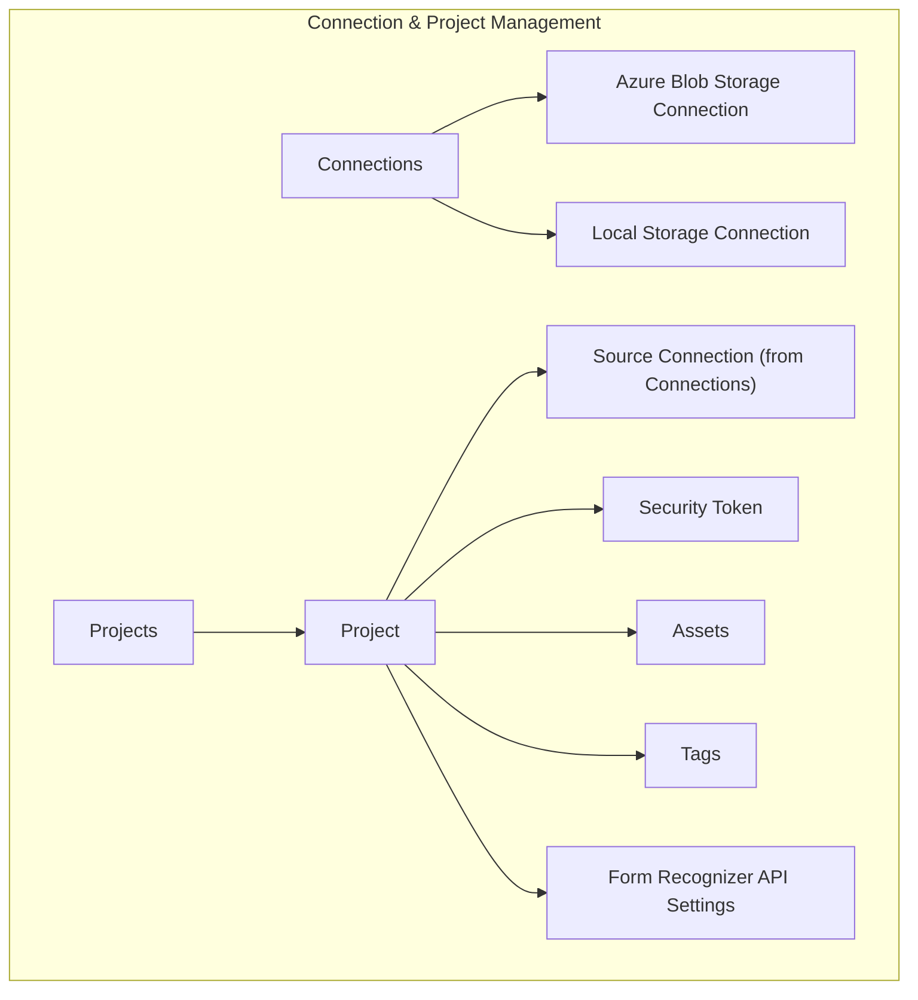

Sources: [src/models/applicationState.ts:155-161](), [src/models/applicationState.ts:85-102]()

Projects are central to the application workflow:

1. Connections are created to storage providers
2. Projects are created using these connections
3. Source assets are loaded from the connected storage
4. Assets are labeled within the project
5. Models are trained using the project's labeled assets
6. Predictions are made using the trained models

Sources: [README.md:99-104](), [README.md:119-129](), [README.md:134-136]()

## Document Processing Workflow

The application implements a complete document processing workflow, from upload to analysis.

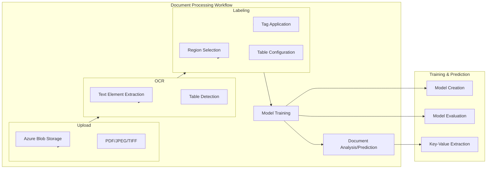

Sources: [README.md:26-28](), [README.md:84-96](), [README.md:134-145](), [README.md:166-183]()

## Security Model

The application implements a security model for protecting sensitive information:

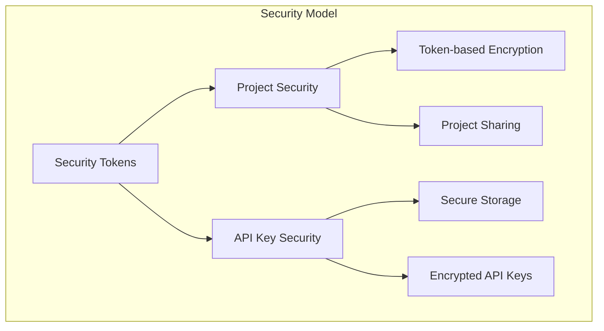

Sources: [src/models/applicationState.ts:322-329](), [README.md:195-209]()

Security features include:

1. Security tokens for encrypting sensitive project settings
2. Secure storage of API keys
3. Project sharing capabilities with secure token exchange
4. Connection security using SAS URLs for Azure Blob Storage

Sources: [README.md:195-209](), [README.md:211-226](), [src/react/components/shell/shareProjectButton.tsx:39-50]()

## Cross-Component Communication

The application uses Redux for cross-component communication, supplemented by service interfaces for external interactions.

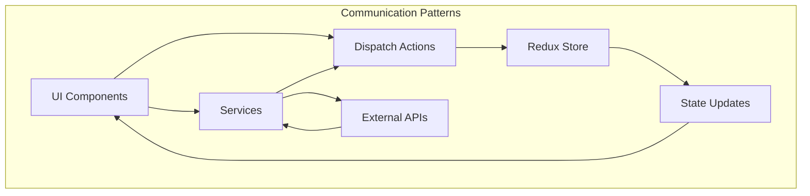

Sources: [src/App.tsx:34-45](), [src/redux/reducers/currentProjectReducer.ts:21-116]()

The primary communication patterns are:

1. Component-to-component via Redux state
2. Component-to-service via direct method calls
3. Service-to-external via API calls
4. Service-to-component via action dispatches

## Summary

The OCR Form Testing Tool (FOTT) architecture is built on modern web development patterns including React, Redux, and TypeScript. Its modular design separates concerns between UI components, state management, and service integration, while the provider model enables extensibility for different storage backends and asset types.

The core architectural components work together to provide a comprehensive document processing pipeline that supports labeling, training, and prediction for form recognition tasks.

Sources: [README.md:22-28](), [README.md:10-14]()

## Key Files

| File | Purpose |
| ---- | ------- |
| `src/models/applicationState.ts` | Defines the core data model and state interfaces |
| `src/redux/actions/actionTypes.ts` | Defines all possible state change actions |
| `src/redux/actions/actionCreators.ts` | Functions for creating type-safe actions |
| `src/redux/reducers/currentProjectReducer.ts` | Handles state updates for current project |
| `src/App.tsx` | Main application component and routing setup |
| `src/react/components/shell/sidebar.tsx` | Navigation structure of the application |

Sources: [src/models/applicationState.ts:1-553](), [src/redux/actions/actionTypes.ts:1-43](), [src/redux/actions/actionCreators.ts:1-107](), [src/redux/reducers/currentProjectReducer.ts:1-116](), [src/App.tsx:1-114](), [src/react/components/shell/sidebar.tsx:1-90]()

---

# Page: Editor Canvas System

# Editor Canvas System

<details>
<summary>Relevant source files</summary>

The following files were used as context for generating this wiki page:

- [src/react/components/common/imageMap/imageMap.tsx](src/react/components/common/imageMap/imageMap.tsx)
- [src/react/components/pages/editorPage/canvas.tsx](src/react/components/pages/editorPage/canvas.tsx)
- [src/react/components/pages/editorPage/editorPage.tsx](src/react/components/pages/editorPage/editorPage.tsx)

</details>


The Editor Canvas System is the central component for document viewing, annotation, and interaction in the OCR Form Tools application. This system provides the core functionality for displaying documents, managing regions (selections within documents), and facilitating labeling operations. It serves as the primary visual interface where users interact with their documents and create annotations.

For information about applying tags to regions, see [Tag Input System](#2.2). For more details on annotation techniques, see [Region Annotation](#3.1) and [Table Annotation](#3.2).

## Component Architecture

The Editor Canvas System consists of several interconnected components that work together to provide a comprehensive document editing experience:

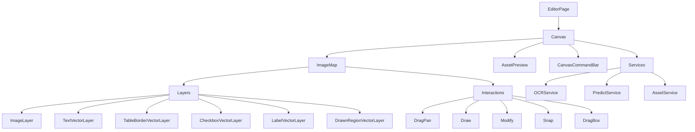

Sources: [src/react/components/pages/editorPage/canvas.tsx:125-1162](). [src/react/components/pages/editorPage/editorPage.tsx:129-205]().

### Core Components

1. **Canvas**: The main controller component that orchestrates document loading, region management, and integrates with various services
2. **ImageMap**: Provides the rendering surface and interaction capabilities using OpenLayers
3. **CanvasCommandBar**: Toolbar that exposes actions like running OCR, zooming, and toggling layers
4. **AssetPreview**: Renders the actual document content (image, PDF, or TIFF)

## Data Flow

The Editor Canvas System handles the flow of data from user interactions to document annotations:

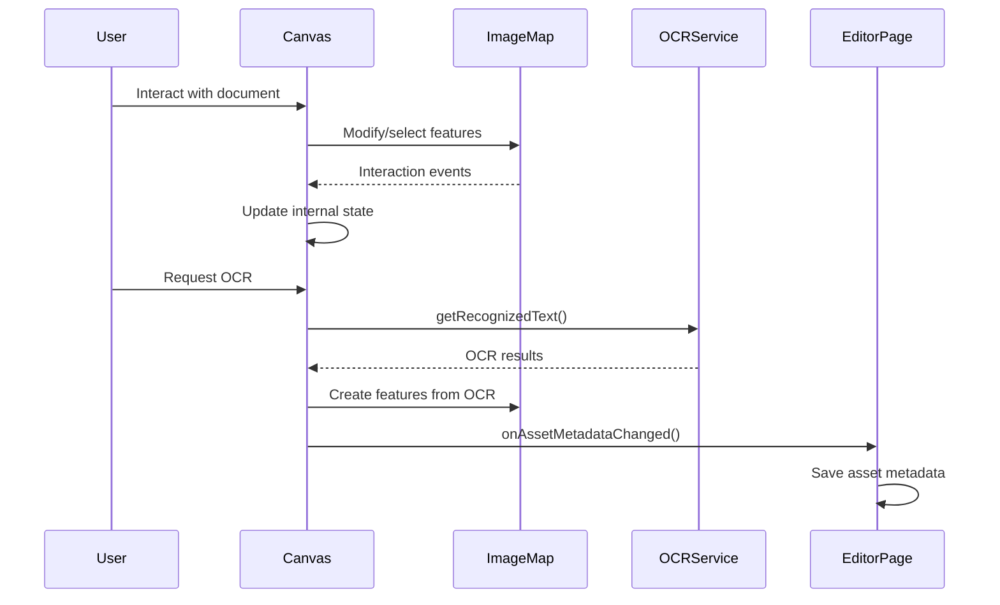

Sources: [src/react/components/pages/editorPage/canvas.tsx:183-334](). [src/react/components/pages/editorPage/canvas.tsx:1350-1390]().

## State Management

The Canvas component maintains several key pieces of state:

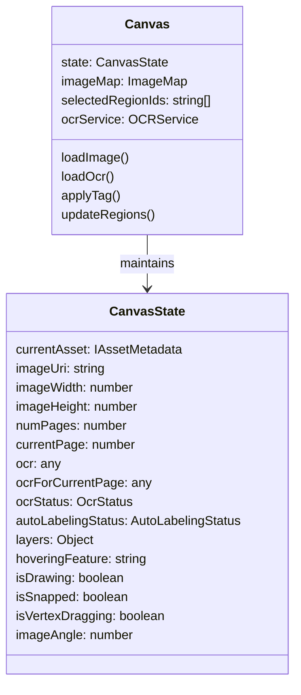

Sources: [src/react/components/pages/editorPage/canvas.tsx:74-100](). [src/react/components/pages/editorPage/canvas.tsx:136-161]().

## Layer Management

The ImageMap component manages multiple layers for different types of content:

| Layer Name | Purpose |
|------------|---------|
| `imageLayer` | Displays the document (image/PDF/TIFF) |
| `textVectorLayer` | Shows text regions from OCR |
| `tableBorderVectorLayer` | Renders table outlines |
| `tableIconVectorLayer` | Shows table icons for interaction |
| `checkboxVectorLayer` | Displays checkbox regions |
| `labelVectorLayer` | Shows tagged regions |
| `drawnRegionVectorLayer` | Contains user-drawn regions |
| `drawnLabelVectorLayer` | Shows labeled drawn regions |

Each layer can be toggled independently via the Canvas Command Bar, allowing users to focus on specific content types.

Sources: [src/react/components/common/imageMap/imageMap.tsx:72-80](). [src/react/components/common/imageMap/imageMap.tsx:211-217]().

## Interactions and Controls

The Editor Canvas System provides various interaction modes for manipulating documents and regions:

### Selection and Editing

The system supports selection of regions through single clicks, multi-selection with Shift+drag, and region modification through vertex manipulation:

```mermaid
graph TD
    A["User Interaction"] --> B{"Interaction Type"}
    B -->|"Click"| C["Select Individual Region"]
    B -->|"Shift+Drag"| D["Select Multiple Regions"]
    B -->|"Vertex Drag"| E["Modify Region Shape"]
    B -->|"Double Click"| F["Navigate to Tag"]
    
    C --> G["Update selectedRegionIds"]
    D --> G
    E --> H["Update Region Coordinates"]
    F --> I["Focus on Corresponding Tag"]
```

Sources: [src/react/components/common/imageMap/imageMap.tsx:673-706](). [src/react/components/pages/editorPage/canvas.tsx:1192-1209]().

### Drawing Mode

Users can create custom regions by enabling draw mode:

```mermaid
sequenceDiagram
    participant User
    participant CanvasCommandBar
    participant Canvas
    participant ImageMap
    
    User->>CanvasCommandBar: Toggle Draw Region Mode
    CanvasCommandBar->>Canvas: handleToggleDrawRegionMode()
    Canvas->>Canvas: Set drawRegionMode state
    Canvas->>ImageMap: Add/Remove Draw interaction
    User->>ImageMap: Draw region
    ImageMap->>Canvas: onDrawingComplete
    Canvas->>Canvas: Add region to asset
```

Sources: [src/react/components/common/imageMap/imageMap.tsx:931-962](). [src/react/components/pages/editorPage/canvas.tsx:279-324]().

## Document and OCR Handling

### Document Types

The Editor Canvas System supports multiple document types:

| Type | Loading Method | Multi-page Support |
|------|---------------|-------------------|
| Image | Direct canvas loading | No |
| PDF | PDF.js rendering | Yes |
| TIFF | TIFF parsing and rendering | Yes |

Sources: [src/react/components/pages/editorPage/canvas.tsx:1320-1350](). [src/react/components/pages/editorPage/canvas.tsx:1391-1442]().

### OCR Processing

OCR can be run on individual documents or in batch:

```mermaid
sequenceDiagram
    participant User
    participant Canvas
    participant OCRService
    participant ImageMap
    
    User->>Canvas: Request OCR
    Canvas->>OCRService: getRecognizedText()
    Note over Canvas,OCRService: Can be single document or batch
    OCRService-->>Canvas: OCR Results
    Canvas->>Canvas: Process results
    Canvas->>ImageMap: Create features from OCR
    Canvas->>Canvas: Update asset state
```

Sources: [src/react/components/pages/editorPage/canvas.tsx:1350-1390](). [src/react/components/pages/editorPage/editorPage.tsx:978-1020]().

## Region Management

Regions are the fundamental unit of annotation in the system. The Canvas component provides comprehensive region management:

### Region Types

| Region Type | Category | Purpose |
|-------------|----------|---------|
| Text Region | `FeatureCategory.Text` | Represents text extracted from OCR |
| Checkbox Region | `FeatureCategory.Checkbox` | Represents selection marks/checkboxes |
| Table Region | `FeatureCategory.Text` | Represents tables with rows/columns |
| Drawn Region | `FeatureCategory.DrawnRegion` | Custom regions created by users |

Sources: [src/react/components/pages/editorPage/canvas.tsx:594-641](). [src/react/components/pages/editorPage/canvas.tsx:643-666]().

### Region Lifecycle

```mermaid
stateDiagram-v2
    [*] --> Created
    Created --> Selected
    Selected --> Tagged
    Selected --> Modified
    Selected --> Deleted
    Modified --> Selected
    Tagged --> Selected
    Deleted --> [*]
```

The Canvas component provides methods for each stage of the region lifecycle:

1. **Creation**: `addRegions()`, `convertRegionToFeature()`
2. **Selection**: `handleFeatureSelect()`, `onSelectedRegionsChanged()`
3. **Tagging**: `applyTag()`
4. **Modification**: `updateRegions()`
5. **Deletion**: `deleteRegions()`, `onRegionDelete()`

Sources: [src/react/components/pages/editorPage/canvas.tsx:592-728](). [src/react/components/pages/editorPage/canvas.tsx:457-571]().

## Styling and Visualization

The Editor Canvas System uses different styles to represent regions based on their state and type:

```mermaid
graph TD
    A["Region Styling"] --> B{"Region Type"}
    B -->|"Text"| C["Text Region Style"]
    B -->|"Checkbox"| D["Checkbox Region Style"]
    B -->|"Table"| E["Table Region Style"]
    B -->|"Drawn"| F["Drawn Region Style"]
    
    C --> G{"State"}
    D --> G
    E --> G
    F --> G
    
    G -->|"Normal"| H["Basic Style"]
    G -->|"Selected"| I["Highlighted Style"]
    G -->|"Hovered"| J["Hover Style"]
```

The styling functions are defined as methods in the Canvas component and passed to the ImageMap:

- `featureStyler`: Styles regular text regions
- `checkboxFeatureStyler`: Styles checkbox regions
- `labelFeatureStyler`: Styles labeled regions
- `tableBorderFeatureStyler`: Styles table borders
- `drawnRegionStyler`: Styles user-drawn regions

Sources: [src/react/components/pages/editorPage/canvas.tsx:945-1053](). [src/react/components/common/imageMap/imageMap.tsx:312-326]().

## Integration with Other Systems

The Editor Canvas System integrates with several other systems:

1. **Tag Input System**: Receives tags to apply to selected regions
2. **OCR Service**: Extracts text and layout from documents
3. **Predict Service**: Applies auto-labeling to documents
4. **Asset Service**: Manages document metadata and storage

This integration enables a seamless workflow from document loading to region creation, annotation, and storage.

Sources: [src/react/components/pages/editorPage/editorPage.tsx:596-608](). [src/react/components/pages/editorPage/canvas.tsx:405-439]().

## Performance Considerations

Several optimizations are implemented in the Editor Canvas System:

1. **Layer-based rendering**: Only visible layers are rendered
2. **Feature filtering**: Interactions only process features in relevant layers
3. **Throttling**: Batch operations like OCR are throttled to prevent overwhelming services
4. **Lazy loading**: Document pages are loaded on demand for multi-page documents

Sources: [src/react/components/common/imageMap/imageMap.tsx:211-276](). [src/react/components/pages/editorPage/editorPage.tsx:988-1014]().

## Conclusion

The Editor Canvas System serves as the primary interface for document annotation in the OCR Form Tools application. It provides a comprehensive set of tools for viewing documents, running OCR, creating and managing regions, and applying tags. The system's modular architecture allows for flexible integration with other components and services, creating a powerful platform for document analysis and labeling.

---

# Page: Tag Input System

# Tag Input System

<details>
<summary>Relevant source files</summary>

The following files were used as context for generating this wiki page:

- [src/react/components/common/tagInput/tagInput.scss](src/react/components/common/tagInput/tagInput.scss)
- [src/react/components/common/tagInput/tagInput.tsx](src/react/components/common/tagInput/tagInput.tsx)
- [src/react/components/common/tagInput/tagInputItem.test.tsx](src/react/components/common/tagInput/tagInputItem.test.tsx)
- [src/react/components/common/tagInput/tagInputItem.tsx](src/react/components/common/tagInput/tagInputItem.tsx)
- [src/react/components/common/tagInput/tagInputItemLabel.tsx](src/react/components/common/tagInput/tagInputItemLabel.tsx)
- [src/react/components/common/tagInput/tagInputToolbar.tsx](src/react/components/common/tagInput/tagInputToolbar.tsx)
- [src/react/components/pages/editorPage/canvas.scss](src/react/components/pages/editorPage/canvas.scss)
- [src/react/components/pages/editorPage/editorPage.scss](src/react/components/pages/editorPage/editorPage.scss)
- [src/react/components/toolbar/toolbarItem.tsx](src/react/components/toolbar/toolbarItem.tsx)

</details>


The Tag Input System manages the creation, organization, and application of tags for document annotation in the OCR Form Testing Tool (FOTT). This system provides the interface for users to define tags that represent fields to be extracted from documents, manage their properties, and apply them to regions in the document canvas.

For information about how regions are drawn and selected in documents, see [Region Annotation](#3.1). For information about the canvas where documents are viewed and annotated, see [Editor Canvas System](#2.1).

## System Overview

The Tag Input System provides a comprehensive interface for tag management with the following capabilities:

- Creating and deleting tags
- Renaming tags and changing their colors
- Organizing tags through reordering
- Setting tag data types and formats
- Filtering and searching tags
- Applying tags to selected regions
- Configuring table tags for structured data extraction

```mermaid
flowchart TD
    A["TagInput Component"] --> B["TagInputToolbar"]
    A --> C["TagInputItems"]
    A --> D["Color Picker"]
    A --> E["Contextual Menu"]
    A --> F["Table Configuration"]
    A --> G["Table Labeling"]
    
    C --> H["TagInputItem"]
    H --> I["TagInputItemLabel"]
    
    J["Editor Canvas<br>Selected Regions"] -.-> A
    K["Redux State"] -.-> A
    A -.-> K
    
    classDef component rect, rounded;
    class A,B,C,D,E,F,G,H,I component;
```

Sources: [src/react/components/common/tagInput/tagInput.tsx:118-297](). [src/react/components/common/tagInput/tagInputItem.tsx:60-356](). [src/react/components/common/tagInput/tagInputToolbar.tsx:53-246]().

## Core Components

### TagInput Component

The `TagInput` component is the main container for all tag management functionality. It maintains the state of tags and handles various tag operations through different operation modes.

```mermaid
statechart
    [*] --> Normal
    
    Normal --> ColorPicker: "Click tag color"
    Normal --> ContextualMenu: "Click dropdown/right-click"
    Normal --> Rename: "Alt+click or select rename"
    Normal --> ConfigureTable: "Configure table tag"
    Normal --> LabelTable: "Label table tag"
    
    ColorPicker --> Normal: "Select color/click outside"
    ContextualMenu --> Normal: "Select option/click outside"
    Rename --> Normal: "Confirm/cancel rename"
    ConfigureTable --> Normal: "Complete configuration"
    LabelTable --> Normal: "Complete labeling"
    
    state Operations {
        ColorPicker
        ContextualMenu
        Rename
    }
```

The component switches between these operation modes based on user interactions:

| Mode | Description | Trigger |
|------|-------------|---------|
| `TagOperationMode.None` | Normal state | Default |
| `TagOperationMode.ColorPicker` | Color selection active | Click on tag color |
| `TagOperationMode.ContextualMenu` | Context menu open | Click dropdown or right-click |
| `TagOperationMode.Rename` | Tag being renamed | Alt+click or select rename |
| `TagInputMode.ConfigureTable` | Configure table structure | "Add Table" or reconfigure existing table |
| `TagInputMode.LabelTable` | Labeling table regions | Click on table tag applied to region |

Sources: [src/react/components/common/tagInput/tagInput.tsx:41-47](). [src/react/components/common/tagInput/tagInput.tsx:118-297]().

### TagInputItem

The `TagInputItem` component renders individual tag entries in the tag list. Each item displays:

- Tag color square for visual identification
- Tag name with type information indicator if applicable
- Tag toolbar with options menu
- Associated labels (if any)
- Special indicators for selected and applied tags

```mermaid
flowchart LR
    A["TagInputItem"] --> B["Color Square"]
    A --> C["Tag Content"]
    A --> D["Tag Labels"]
    
    C --> E["Tag Name"]
    C --> F["Type Indicator"]
    C --> G["Dropdown Button"]
    
    D --> H["TagInputItemLabel"]
    
    style A fill:white
    style B fill:white
    style C fill:white
    style D fill:white
    style E fill:white
    style F fill:white
    style G fill:white
    style H fill:white
```

The component responds to various click events:
- Regular click: Select the tag
- Ctrl+click: Toggle tag lock
- Alt+click: Rename the tag
- Click on color: Open color picker
- Click on dropdown: Open contextual menu

Sources: [src/react/components/common/tagInput/tagInputItem.tsx:60-356](). [src/react/components/common/tagInput/tagInputItemLabel.tsx:20-58]().

### TagInputToolbar

The `TagInputToolbar` component provides action buttons for tag management operations. It is displayed at the top of the tag input panel and includes buttons for:

- Adding tags and table tags
- Filtering tags (all vs. current page)
- Showing/hiding origin labels
- Searching tags
- Renaming selected tag
- Moving tags up/down in the list
- Deleting selected tag

```mermaid
flowchart LR
    A["TagInputToolbar"] --> B["General Tools"]
    A --> C["Separator"]
    A --> D["Tag Modification Tools"]
    
    B --> B1["Add Tag"]
    B --> B2["Add Table Tag"]
    B --> B3["Filter Tags"]
    B --> B4["Toggle Origin Labels"]
    B --> B5["Search Tags"]
    
    D --> D1["Rename"]
    D --> D2["Move Up"]
    D --> D3["Move Down"]
    D --> D4["Delete"]
    
    style A fill:white
    style B fill:white
    style C fill:white
    style D fill:white
    style B1 fill:white
    style B2 fill:white
    style B3 fill:white
    style B4 fill:white
    style B5 fill:white
    style D1 fill:white
    style D2 fill:white
    style D3 fill:white
    style D4 fill:white
```

Sources: [src/react/components/common/tagInput/tagInputToolbar.tsx:53-246]().

## User Interactions and Workflows

### Creating and Managing Tags

The Tag Input System provides several ways to create and manage tags:

1. **Creating tags**:
   - Click the "Add" button in the toolbar
   - Enter a tag name in the input field
   - Press Enter to create the tag
   - A color is automatically assigned to the tag

2. **Renaming tags**:
   - Alt+click on a tag or use the rename button
   - Edit the tag name
   - Press Enter to confirm
   
3. **Changing tag color**:
   - Click on the color square of a tag
   - Select a new color from the color picker

4. **Organizing tags**:
   - Use Move Up/Down buttons to reorder tags
   - This affects tag application order and visual organization

5. **Deleting tags**:
   - Select a tag and click the Delete button
   - Confirm the deletion if the tag is in use

```mermaid
sequenceDiagram
    participant U as "User"
    participant TI as "TagInput"
    participant TB as "TagInputToolbar"
    participant TItem as "TagInputItem"
    participant R as "Redux State"
    
    U->>TB: Click "Add" button
    TB->>TI: Show tag input field
    U->>TI: Enter tag name
    U->>TI: Press Enter
    TI->>R: Add new tag
    R-->>TI: Updated tags
    TI->>TItem: Render new tag
    
    U->>TItem: Alt+click tag
    TItem->>TI: Enter rename mode
    U->>TItem: Edit name
    U->>TItem: Press Enter
    TItem->>TI: Submit new name
    TI->>R: Update tag name
    R-->>TI: Updated tags
    
    U->>TItem: Click color square
    TItem->>TI: Open color picker
    U->>TI: Select new color
    TI->>R: Update tag color
    R-->>TI: Updated tags
```

Sources: [src/react/components/common/tagInput/tagInput.tsx:358-372](). [src/react/components/common/tagInput/tagInput.tsx:304-322](). [src/react/components/common/tagInput/tagInput.tsx:345-357]().

### Tag Properties and Types

Tags can have different data types and formats that determine how the extracted data is interpreted:

- **Tag Types**: String, Number, Integer, Boolean, Date, Object, Array
- **Tag Formats**: Various formats based on type (e.g., Currency, Time for Number type)

The type and format are set through the tag's contextual menu. These properties are visualized through icons and affect how the tag can be applied to regions.

```mermaid
flowchart TD
    A["Tag in TagInput"] --> B["Click Dropdown/Right-click"]
    B --> C["Contextual Menu"]
    C --> D["Select Type"]
    D --> E["Type Options"]
    E --> F["String"]
    E --> G["Number"]
    E --> H["Integer"]
    E --> I["Boolean"]
    E --> J["Date"]
    E --> K["Object"]
    E --> L["Array"]
    
    C --> M["Select Format"]
    M --> N["Format Options"]
    N --> O["NotSpecified"]
    N --> P["Alphanumeric"]
    N --> Q["Currency"]
    N --> R["...Other Formats"]
    
    style A fill:white
    style B fill:white
    style C fill:white
    style D fill:white
    style E fill:white
    style F fill:white
    style G fill:white
    style H fill:white
    style I fill:white
    style J fill:white
    style K fill:white
    style L fill:white
    style M fill:white
    style N fill:white
    style O fill:white
    style P fill:white
    style Q fill:white
    style R fill:white
```

Sources: [src/react/components/common/tagInput/tagInput.tsx:823-842](). [src/react/components/common/tagInput/tagInput.tsx:844-860]().

### Working with Table Tags

The Tag Input System provides special handling for table tags, which represent structured tabular data:

1. **Creating table tags**:
   - Click the "Add Table" button in the toolbar
   - Configure table structure (rows, columns)
   - Specify data types for table cells

2. **Labeling tables**:
   - Apply table tag to a region
   - System enters table labeling mode
   - Map document regions to table cells

```mermaid
flowchart LR
    A["TagInput"] -->|"ConfigureTable mode"| B["TableTagConfig"]
    A -->|"LabelTable mode"| C["TableTagLabeling"]
    
    B -->|"Save configuration"| A
    C -->|"Complete labeling"| A
    
    style A fill:white
    style B fill:white
    style C fill:white
```

Sources: [src/react/components/common/tagInput/tagInput.tsx:170-208]().

## Integration with Editor Canvas

The Tag Input System integrates closely with the Editor Canvas System:

1. **Applying tags to regions**:
   - User selects region(s) on canvas
   - Clicks on a tag in the tag input panel
   - Tag is applied to selected region(s)

2. **Highlighting regions**:
   - When hovering over a label in the tag panel
   - The corresponding region is highlighted on canvas

3. **Tag compatibility checks**:
   - System validates if selected tag is compatible with region type
   - Prevents invalid tag applications (e.g., checkbox tag to text region)

```mermaid
sequenceDiagram
    participant U as "User"
    participant C as "Canvas"
    participant TI as "TagInput"
    participant R as "Redux State"
    
    U->>C: Select region
    C->>R: Update selected regions
    R-->>TI: Receive selected regions
    U->>TI: Click tag
    TI->>TI: Check compatibility
    TI->>R: Apply tag to region
    R-->>C: Update region display
    
    U->>TI: Hover over label
    TI->>R: Request highlight region
    R-->>C: Highlight corresponding region
```

Sources: [src/react/components/common/tagInput/tagInput.tsx:557-606](). [src/react/components/common/tagInput/tagInputItem.tsx:343-354]().

## State Management

The Tag Input System uses Redux for state management. Key state updates include:

- Tag creation, deletion, and modification
- Tag selection and operation mode
- Tag filtering and searching
- Tag application to regions

The component maintains both local state for UI operations and syncs with the global Redux store for persistent changes.

Sources: [src/react/components/common/tagInput/tagInput.tsx:118-134](). [src/react/components/common/tagInput/tagInput.tsx:324-326]().

## Styling and Visual Elements

The Tag Input System uses dedicated SCSS styles to create a consistent visual appearance:

- Tag items with colored squares for visual identification
- Selected and applied tags with distinct highlighting
- Toolbar buttons with hover and active states
- Resizable tag input panel

The styling supports the dark UI theme of the application and provides visual feedback for user interactions.

Sources: [src/react/components/common/tagInput/tagInput.scss:7-323](). [src/react/components/common/tagInput/tagInputItem.tsx:89-105]().

## Key Implementation Details

### Tag Operation Modes

The system implements different operation modes through the `TagOperationMode` enum:

```typescript
export enum TagOperationMode {
    None,
    ColorPicker,
    ContextualMenu,
    Rename,
    LabelTable,
}
```

The current mode determines which UI components are displayed and how user interactions are processed.

Sources: [src/react/components/common/tagInput/tagInput.tsx:41-47]().

### Tag Validation

The system includes validation to ensure tags are valid:

- Tag names must be unique
- Tag names cannot be empty
- Tag names have length limits
- Tag types must be compatible with regions

```typescript
private validateTagLength = (tag: ITag) => {
    if (!tag.name.trim().length) {
        throw new Error(strings.tags.warnings.emptyName);
    }
    if (tag.name.length >= 128) {
        throw new Error("Tag name is too long (>= 128).");
    }
}

private validateTagUniqness = (tag: ITag, tags: ITag[]) => {
    if (tags.some((t) => isNameEqual(t.name, tag.name))) {
        throw new Error(strings.tags.warnings.existingName);
    }
}
```

Sources: [src/react/components/common/tagInput/tagInput.tsx:709-722]().

### Tag Compatibility Checks

The system checks if a tag is compatible with the selected region type before allowing application:

```typescript
if ((tag.type === FieldType.Object || tag.type === FieldType.Array) && this.props.selectedRegions?.length) {
    this.props.handleLabelTable(TagInputMode.LabelTable, tag)
    deselect = false;
} else if (labelAssigned && ((category === FeatureCategory.DrawnRegion) !== isTagLabelTypeDrawnRegion)) {
    // Handle incompatibility...
} else if (tagCategory === category || category === FeatureCategory.DrawnRegion ||
    (documentCount === 0 && type === FieldType.String && format === FieldFormat.NotSpecified)) {
    // Compatible cases...
} else {
    toast.warn(strings.tags.warnings.notCompatibleTagType, { autoClose: 7000 });
}
```

Sources: [src/react/components/common/tagInput/tagInput.tsx:572-600]().

## Conclusion

The Tag Input System is a central component of the OCR Form Testing Tool, providing comprehensive functionality for managing tags that represent fields to be extracted from documents. Through its integration with the Editor Canvas System, it enables users to create, organize, and apply tags to document regions, supporting the document annotation process for training custom form recognition models.

---

# Page: Asset Management

# Asset Management

<details>
<summary>Relevant source files</summary>

The following files were used as context for generating this wiki page:

- [src/providers/storage/azureBlobStorage.ts](src/providers/storage/azureBlobStorage.ts)
- [src/react/components/common/assetPreview/pdfAsset.tsx](src/react/components/common/assetPreview/pdfAsset.tsx)
- [src/react/components/pages/prebuiltPredict/LoadFileHelper.ts](src/react/components/pages/prebuiltPredict/LoadFileHelper.ts)
- [src/react/components/shell/titleBar.tsx](src/react/components/shell/titleBar.tsx)
- [src/redux/actions/projectActions.ts](src/redux/actions/projectActions.ts)
- [src/services/assetService.ts](src/services/assetService.ts)
- [src/services/projectService.ts](src/services/projectService.ts)

</details>


This document describes the asset management system in the OCR Form Testing Tool (FOTT), which handles the loading, processing, storage, and manipulation of document assets (images, PDFs, TIFFs) within the application. For information about tagging or labeling these assets, see [Tag Input System](#2.2).

## Overview

The asset management system provides centralized functionality for dealing with document assets throughout their lifecycle in the application. It encompasses how assets are loaded from storage providers, processed, labeled, and saved back to storage, forming a critical component of the FOTT architecture.

```mermaid
flowchart TD
    subgraph "Asset Management System"
        AS["AssetService"] --> |"Loads/Saves"| SP["Storage Providers"]
        AS --> |"Creates"| A["Assets (IAsset)"]
        AS --> |"Manages"| AM["Asset Metadata"]
        
        SP --> |"Implements"| AZURE["Azure Blob Storage"]
        SP --> |"Implements"| LOCAL["Local File System"]
        
        A --> |"Types"| IMG["Image Assets"]
        A --> |"Types"| PDF["PDF Assets"]
        A --> |"Types"| TIFF["TIFF Assets"]
        
        AM --> |"Contains"| LD["Label Data"]
        AM --> |"Contains"| OCR["OCR Results"]
        AM --> |"Contains"| STATE["Asset State"]
    end
```

Sources: [src/services/assetService.ts:1-805](), [src/providers/storage/azureBlobStorage.ts:1-336]()

## Asset Service

The `AssetService` class is the central component of the asset management system, providing methods for creating, reading, updating, and deleting assets and their metadata.

```mermaid
classDiagram
    class AssetService {
        +assetProvider: IAssetProvider
        +storageProvider: IStorageProvider
        +getAssets()
        +getAsset(assetName)
        +getAssetMetadata(asset)
        +save(metadata)
        +delete(metadata)
        +syncAssetPredictResult(asset, predictResults)
    }
    
    class IAsset {
        +id: string
        +name: string
        +type: AssetType
        +state: AssetState
        +path: string
        +size: number
        +format: string
        +mimeType: string
        +labelingState: AssetLabelingState
    }
    
    class IAssetMetadata {
        +asset: IAsset
        +regions: IRegion[]
        +version: string
        +labelData: ILabelData
    }
    
    AssetService --> IAsset: manages
    AssetService --> IAssetMetadata: manages
```

Sources: [src/services/assetService.ts:36-805]()

### Asset Creation and Detection

The `AssetService.createAssetFromFilePath` static method is responsible for creating asset objects from file paths. It performs several important functions:

1. Normalizes file paths
2. Generates unique asset IDs using SHA-256 hashing
3. Detects asset format based on file extension
4. Validates true file type using content checking
5. Determines asset type (Image, PDF, TIFF)

```mermaid
flowchart LR
    FP["File Path"] --> NORM["Normalize Path"]
    NORM --> HASH["Generate Hash ID"]
    HASH --> FMT["Detect Format"]
    FMT --> VAL["Validate True File Type"]
    VAL --> DET["Determine Asset Type"]
    DET --> ASSET["Create IAsset Object"]
```

Sources: [src/services/assetService.ts:143-216]()

## Asset Types and States

Assets in FOTT can be of different types and can exist in various states throughout their lifecycle.

### Asset Types

The system supports three primary asset types:

| Asset Type | File Formats | Description |
|------------|--------------|-------------|
| Image      | JPG, PNG, BMP| Standard image formats |
| TIFF       | TIF, TIFF    | Multi-page image format |
| PDF        | PDF          | Document format with vector graphics and text |

```mermaid
flowchart TD
    subgraph "Asset Type Detection"
        EXT["File Extension"] --> CHECK{"Extension?"}
        CHECK -->|"jpg, jpeg, png, bmp"| IMG["AssetType.Image"]
        CHECK -->|"tif, tiff"| TIFF["AssetType.TIFF"]
        CHECK -->|"pdf"| PDF["AssetType.PDF"]
        CHECK -->|"other"| UNK["AssetType.Unknown"]
    end
```

Sources: [src/services/assetService.ts:222-238]()

### Asset States

Assets can exist in different states that reflect their processing status:

| State      | Description |
|------------|-------------|
| NotVisited | Asset has not been processed or viewed |
| Visited    | Asset has been viewed but not labeled |
| Tagged     | Asset has been labeled with tags |

Additionally, assets have a `labelingState` property that provides more detailed information about how they were labeled:

| Labeling State | Description |
|----------------|-------------|
| ManuallyLabeled | Asset was labeled manually by a user |
| AutoLabeled     | Asset was labeled automatically by a model |
| AutoLabeledAndAdjusted | Asset was automatically labeled and then adjusted by a user |
| Trained | Asset has been used to train a model |

Sources: [src/services/assetService.ts:80-94](), [src/providers/storage/azureBlobStorage.ts:217-230]()

## Asset Storage and Providers

Assets and their metadata are stored and retrieved using storage providers. The system supports different storage backends through a provider interface.

```mermaid
classDiagram
    class IStorageProvider {
        +readText(fileName)
        +readBinary(fileName)
        +writeText(fileName, content)
        +writeBinary(fileName, content)
        +deleteFile(fileName)
        +listFiles(path)
        +isFileExists(filePath)
    }
    
    class AzureBlobStorage {
        +storageType: StorageType.Cloud
        +containerClient: ContainerClient
    }
    
    class LocalFileSystemProxy {
        +storageType: StorageType.Local
    }
    
    IStorageProvider <|-- AzureBlobStorage
    IStorageProvider <|-- LocalFileSystemProxy
```

The `AssetService` uses both an `assetProvider` for retrieving assets and a `storageProvider` for reading and writing asset metadata files:

```mermaid
flowchart TD
    subgraph "Asset Service Storage Interaction"
        AS["AssetService"] --> AP["assetProvider: IAssetProvider"]
        AS --> SP["storageProvider: IStorageProvider"]
        
        AP --> GA["getAssets()"]
        AP --> GA1["getAsset(name)"]
        
        SP --> RT["readText()"]
        SP --> WT["writeText()"]
        SP --> DF["deleteFile()"]
    end
```

Sources: [src/services/assetService.ts:251-273](), [src/providers/storage/azureBlobStorage.ts:25-336]()

## Asset Metadata Management

Asset metadata includes labels, regions, and OCR results. The `AssetService` provides methods for managing this metadata.

### Metadata Structure

The asset metadata includes:

1. The asset object itself
2. Regions defined on the asset
3. Label data (document name, labels)
4. Version information

```mermaid
flowchart TD
    AM["IAssetMetadata"] --> A["asset: IAsset"]
    AM --> R["regions: IRegion[]"]
    AM --> V["version: string"]
    AM --> LD["labelData: ILabelData"]
    
    LD --> D["document: string"]
    LD --> L["labels: ILabel[]"]
    LD --> LS["labelingState: AssetLabelingState"]
```

Sources: [src/services/assetService.ts:84-96](), [src/services/assetService.ts:359-434]()

### Saving and Loading Metadata

Asset metadata is saved to and loaded from storage using dedicated methods in the `AssetService`:

1. `getAssetMetadata(asset)`: Loads metadata for an asset
2. `save(metadata)`: Saves metadata for an asset

The metadata is stored in JSON format with a `.labels.json` extension:

```mermaid
flowchart LR
    subgraph "Metadata File Operations"
        A["Asset"] --> |"Get Metadata"| AM["Asset Metadata"]
        AM --> |"Save"| LF["[asset_name].labels.json"]
        LF --> |"Load"| AM
    end
```

Sources: [src/services/assetService.ts:332-353](), [src/services/assetService.ts:359-434]()

## Asset Loading and Processing

The system provides functionality for loading different types of assets and processing them for display and OCR.

### File Type Detection and Validation

The system performs robust file type detection to ensure that files are correctly identified:

1. Initial detection based on file extension
2. Secondary validation of actual file content using `FileType` library
3. Handling of mismatched or spoofed file extensions

```mermaid
flowchart TD
    FP["File Path"] --> EXT["Extract Extension"]
    EXT --> SFC["Check Supported Format"]
    SFC --> |"Yes"| CFT["Check File Type (Content)"]
    CFT --> MATCH{"Types Match?"}
    MATCH --> |"Yes"| VALID["Valid Asset"]
    MATCH --> |"No"| FIX["Fix Format & Warn User"]
    SFC --> |"No"| ERR["Unsupported Format"]
```

Sources: [src/services/assetService.ts:143-202](), [src/react/components/pages/prebuiltPredict/LoadFileHelper.ts:41-67]()

### Loading Different Asset Types

Different asset types require specialized loading processes:

1. **Images**: Direct loading via image URLs
2. **PDFs**: Rendered using PDF.js library
3. **TIFFs**: Parsed and rendered using custom utilities

```mermaid
flowchart TD
    subgraph "Asset Loading Process"
        FILE["File"] --> CHECK{"File Type?"}
        CHECK --> |"Image"| IMG["Load as Image"]
        CHECK --> |"PDF"| PDF["Load with PDF.js"]
        CHECK --> |"TIFF"| TIFF["Parse & Render TIFF"]
        
        IMG --> CANVAS["Canvas Rendering"]
        PDF --> CANVAS
        TIFF --> CANVAS
        
        CANVAS --> URI["Data URI for Display"]
    end
```

Sources: [src/react/components/common/assetPreview/pdfAsset.tsx:19-124](), [src/react/components/pages/prebuiltPredict/LoadFileHelper.ts:74-181]()

## Project-Asset Relationship

Assets are organized within projects, with actions for loading, adding, deleting, and updating assets being managed through Redux actions.

```mermaid
flowchart TD
    subgraph "Project-Asset Management Flow"
        P["Project"] --> |"contains"| ASSETS["Assets Collection"]
        
        LOAD["loadAssets()"] --> |"loads"| ASSETS
        ADD["addAssetToProject()"] --> |"adds to"| ASSETS
        DEL["deleteAsset()"] --> |"removes from"| ASSETS
        UPDATE["loadAssetMetadata() & saveAssetMetadata()"] --> |"updates"| ASSETS
    end
```

The relationship between projects and assets is maintained in the Redux state, with actions defined in `projectActions.ts` for manipulating this relationship.

Sources: [src/redux/actions/projectActions.ts:218-307](), [src/services/projectService.ts:180-193]()

## Integration with OCR Process

Assets are closely integrated with the OCR process:

1. OCR results are stored alongside assets with an `.ocr.json` extension
2. OCR results can be used to auto-label assets
3. The AssetService provides methods to sync prediction results with assets

```mermaid
flowchart TD
    A["Asset"] --> OCR["OCR Processing"]
    OCR --> RESULT["OCR Results"]
    RESULT --> SYNC["syncAssetPredictResult()"]
    SYNC --> |"creates"| LABEL["Auto-Generated Labels"]
    SYNC --> |"saves"| OF["[asset_name].ocr.json"]
    SYNC --> |"updates"| AM["Asset Metadata"]
```

Sources: [src/services/assetService.ts:98-137]()

## Error Handling and Validation

The asset management system includes comprehensive error handling and validation:

1. Detection and correction of file extension mismatches
2. Validation of asset metadata during loading
3. Error handling for storage operations
4. Support for ignoring specific errors (like "not found" errors) in certain contexts

Sources: [src/services/assetService.ts:197-201](), [src/providers/storage/azureBlobStorage.ts:310-336]()

---

# Page: State Management

# State Management

<details>
<summary>Relevant source files</summary>

The following files were used as context for generating this wiki page:

- [src/common/mockFactory.ts](src/common/mockFactory.ts)
- [src/models/applicationState.ts](src/models/applicationState.ts)
- [src/providers/storage/azureBlobStorage.ts](src/providers/storage/azureBlobStorage.ts)
- [src/redux/actions/actionCreators.ts](src/redux/actions/actionCreators.ts)
- [src/redux/actions/actionTypes.ts](src/redux/actions/actionTypes.ts)
- [src/redux/actions/projectActions.ts](src/redux/actions/projectActions.ts)
- [src/redux/reducers/currentProjectReducer.ts](src/redux/reducers/currentProjectReducer.ts)
- [src/services/assetService.ts](src/services/assetService.ts)
- [src/services/projectService.ts](src/services/projectService.ts)

</details>


The OCR Form Testing Tool (FOTT) uses Redux for centralized state management throughout the application. This document explains how application state is structured, managed, and updated through the Redux architecture, including action types, reducers, and service integrations.

For information about component-specific state, see [User Interface](#5).

## State Structure Overview

The application's state is defined by the `IApplicationState` interface in the Redux store:

```mermaid
graph TD
    appState["IApplicationState"] --> appSettings["appSettings: IAppSettings"]
    appState --> connections["connections: IConnection[]"]
    appState --> recentProjects["recentProjects: IProject[]"]
    appState --> currentProject["currentProject: IProject"]
    appState --> appError["appError?: IAppError"]
    appState --> appTitle["appTitle?: string"]
    
    currentProject --> id["id: string"]
    currentProject --> name["name: string"]
    currentProject --> tags["tags: ITag[]"]
    currentProject --> assets["assets: {[id: string]: IAsset}"]
    currentProject --> sourceConnection["sourceConnection: IConnection"]
```

Sources: [src/models/applicationState.ts:15-23]()

The state tree consists of these primary slices:

| State Property | Purpose | Interface |
|----------------|---------|-----------|
| appSettings | Application-wide settings | IAppSettings |
| connections | Available data connections | IConnection[] |
| recentProjects | Recently used projects | IProject[] |
| currentProject | Active project being edited | IProject |
| appError | Current application error | IAppError |
| appTitle | Current application title | string |

Sources: [src/models/applicationState.ts:15-23](), [src/models/applicationState.ts:68-72]()

## Redux Implementation

### Actions and Action Types

Actions in FOTT follow the standard Redux pattern, with action types defined as an enum in `actionTypes.ts`:

```mermaid
graph LR
    ActionTypes["ActionTypes Enum"] --> ProjectActions["Project Actions:
    - LOAD_PROJECT_SUCCESS
    - SAVE_PROJECT_SUCCESS
    - LOAD_PROJECT_ASSETS_SUCCESS
    - SAVE_ASSET_METADATA_SUCCESS"]
    
    ActionTypes --> AppActions["App Actions:
    - SAVE_APP_SETTINGS_SUCCESS
    - SHOW_ERROR
    - CLEAR_ERROR"]
    
    ActionTypes --> ConnectionActions["Connection Actions:
    - SAVE_CONNECTION_SUCCESS
    - DELETE_CONNECTION_SUCCESS"]
```

Sources: [src/redux/actions/actionTypes.ts:7-42]()

The application provides helper functions to create action objects:

```typescript
// Create action without payload
export function createAction<TAction>(type): () => Action<TAction["type"]> { /* ... */ }

// Create action with payload
export function createPayloadAction<TAction>(type): (payload) => IPayloadAction<TAction["type"], TAction["payload"]> { /* ... */ }
```

Sources: [src/redux/actions/actionCreators.ts:49-65]()

### Reducers

Reducers process actions to update specific parts of the state. The `currentProjectReducer` handles project-related actions:

```typescript
export const reducer = (state: IProject = null, action: AnyAction): IProject => {
    switch (action.type) {
        case ActionTypes.LOAD_PROJECT_SUCCESS:
            return {...action.payload};
        case ActionTypes.SAVE_ASSET_METADATA_SUCCESS:
            // Update assets and potentially tags
            // ...
        // Other cases...
        default:
            return state;
    }
};
```

Sources: [src/redux/reducers/currentProjectReducer.ts:21-116]()

## Service Layer Integration

FOTT follows a pattern where services handle the business logic and data operations, then dispatch actions to update the state:

```mermaid
graph TD
    UI["UI Components"] --> |"dispatch"| Actions["Redux Actions"]
    
    Actions --> |"call"| Services["Services:
    - ProjectService
    - AssetService"]
    
    Services --> |"interact with"| Providers["Storage Providers:
    - AzureBlobStorage
    - LocalFileSystemProxy"]
    
    Services --> |"return data to"| Actions
    
    Actions --> |"dispatch SUCCESS actions"| Reducers["Reducers"]
    
    Reducers --> |"update"| Store["Redux Store:
    IApplicationState"]
    
    Store --> |"provide state to"| UI
```

Sources: [src/redux/actions/projectActions.ts](), [src/services/projectService.ts](), [src/services/assetService.ts]()

### ProjectService

The `ProjectService` class provides methods for project operations:

```typescript
export default class ProjectService implements IProjectService {
    public async load(project: IProject, securityToken: ISecurityToken): Promise<IProject> { /* ... */ }
    public async save(project: IProject, securityToken: ISecurityToken, saveTags?: boolean): Promise<IProject> { /* ... */ }
    public async delete(project: IProject): Promise<void> { /* ... */ }
    // Other methods...
}
```

Sources: [src/services/projectService.ts:50-507]()

### AssetService

The `AssetService` class manages asset operations:

```typescript
export class AssetService {
    public async getAssets(): Promise<IAsset[]> { /* ... */ }
    public async getAssetMetadata(asset: IAsset): Promise<IAssetMetadata> { /* ... */ }
    public async save(metadata: IAssetMetadata): Promise<IAssetMetadata> { /* ... */ }
    // Other methods...
}
```

Sources: [src/services/assetService.ts:36-805]()

## Common State Flow Patterns

### Project Loading Flow

When loading a project, the application follows this flow:

```mermaid
sequenceDiagram
    participant UI as "UI Component"
    participant Action as "loadProject Action"
    participant ProjectSvc as "ProjectService"
    participant StorageProv as "Storage Provider"
    participant Store as "Redux Store"
    
    UI->>Action: "dispatch loadProject(project)"
    Action->>ProjectSvc: "projectService.load(project, token)"
    ProjectSvc->>StorageProv: "Read project data"
    StorageProv-->>ProjectSvc: "Return project data"
    ProjectSvc->>ProjectSvc: "Check and update schema"
    ProjectSvc-->>Action: "Return loaded project"
    Action->>Store: "dispatch LOAD_PROJECT_SUCCESS"
    Store-->>UI: "Update with new state"
```

Sources: [src/redux/actions/projectActions.ts:60-97](), [src/services/projectService.ts:56-72]()

### Asset Metadata Saving Flow

When saving asset metadata (annotations, labels, etc.):

```mermaid
sequenceDiagram
    participant UI as "UI Component"
    participant Action as "saveAssetMetadata Action"
    participant AssetSvc as "AssetService"
    participant StorageProv as "Storage Provider"
    participant Store as "Redux Store"
    
    UI->>Action: "dispatch saveAssetMetadata(project, metadata)"
    Action->>AssetSvc: "assetService.save(metadata)"
    AssetSvc->>StorageProv: "Write metadata to storage"
    StorageProv-->>AssetSvc: "Confirm save"
    AssetSvc-->>Action: "Return saved metadata"
    Action->>Store: "dispatch SAVE_ASSET_METADATA_SUCCESS"
    Store-->>UI: "Update with new state"
```

Sources: [src/redux/actions/projectActions.ts:282-293](), [src/services/assetService.ts:332-353]()

## Redux Action Types

The application defines the following key action types:

| Category | Action Types | Purpose |
|----------|--------------|---------|
| Project | LOAD_PROJECT_SUCCESS | Update state after project loading |
| Project | SAVE_PROJECT_SUCCESS | Update state after project saving |
| Project | DELETE_PROJECT_SUCCESS | Remove project from state |
| Asset | LOAD_ASSET_METADATA_SUCCESS | Update state with asset metadata |
| Asset | SAVE_ASSET_METADATA_SUCCESS | Update state after metadata save |
| Connection | SAVE_CONNECTION_SUCCESS | Update connection in state |
| App | SAVE_APP_SETTINGS_SUCCESS | Update application settings |
| Error | SHOW_ERROR, CLEAR_ERROR | Manage application errors |

Sources: [src/redux/actions/actionTypes.ts:7-42]()

## Project Actions Implementation

The project actions are implemented as thunks (functions that return functions) to handle asynchronous operations:

```typescript
export function loadProject(project: IProject, sharedToken?: ISecurityToken):
    (dispatch: Dispatch, getState: () => IApplicationState) => Promise<IProject> {
    return async (dispatch: Dispatch, getState: () => IApplicationState) => {
        const appState = getState();
        const projectService = new ProjectService();
        
        // Find security token
        let projectToken: ISecurityToken;
        // ... token lookup logic
        
        // Load and update project
        const loadedProject = await projectService.load(project, projectToken);
        await ProjectService.checkAndUpdateSchema(loadedProject);
        const schemaUpdatedProject = await AssetService.checkAndUpdateSchema(loadedProject);
        
        // Dispatch action to update state
        dispatch(loadProjectAction(schemaUpdatedProject));
        return schemaUpdatedProject;
    };
}
```

Sources: [src/redux/actions/projectActions.ts:60-97]()

## State Update Patterns

### Updating Tags from Files

The application can update project tags based on label files in storage:

```mermaid
graph TD
    updateAction["updateProjectTagsFromFiles Action"] --> |"calls"| projectService["ProjectService.updateProjectTagsFromFiles"]
    projectService --> |"reads"| labelFiles["Label Files in Storage"]
    projectService --> |"parses"| tagsFromFiles["Extract Tags from Files"]
    projectService --> |"returns"| updatedProject["Updated Project with Tags"]
    updateAction --> |"dispatches"| updateSuccessAction["UPDATE_PROJECT_TAGS_FROM_FILES_SUCCESS"]
    updateSuccessAction --> |"processed by"| reducer["currentProjectReducer"]
    reducer --> |"updates"| state["Application State"]
```

Sources: [src/redux/actions/projectActions.ts:130-138](), [src/services/projectService.ts:181-193]()

### Asset Metadata Updates

When saving asset metadata, the reducer may also update project tags if new tags are found:

```typescript
case ActionTypes.SAVE_ASSET_METADATA_SUCCESS:
    // Extract existing asset tags
    const assetTags = new Set();
    action.payload.regions.forEach((region) => 
        region.tags.forEach((tag) => assetTags.add(tag))
    );
    
    // Check for new tags not in project
    const newTags: ITag[] = state.tags ? [...state.tags] : [];
    let updateTags = false;
    
    assetTags.forEach((tag) => {
        if (!state.tags || !state.tags.find((projectTag) => tag === projectTag.name)) {
            const color = getNextColor(newTags);
            newTags.push({ name: tag, color } as ITag);
            updateTags = true;
        }
    });
    
    // Return updated state
    if (updateTags) {
        return { ...state, tags: newTags, assets: updatedAssets };
    }
```

Sources: [src/redux/reducers/currentProjectReducer.ts:56-92]()

## Conclusion

The Redux state management in FOTT provides a predictable and centralized approach to handling application data. The clear separation between UI components, actions, services, and reducers makes the codebase more maintainable and testable.

Key points to understand:

1. The `IApplicationState` interface defines the complete state tree
2. Actions and reducers follow standard Redux patterns
3. Services contain business logic and interact with storage providers
4. UI components dispatch actions and consume state through the Redux store
5. Common flows like project loading and asset saving follow a consistent pattern

Sources: [src/models/applicationState.ts](), [src/redux/actions/projectActions.ts](), [src/redux/reducers/currentProjectReducer.ts]()

---

# Page: Document Labeling

# Document Labeling

<details>
<summary>Relevant source files</summary>

The following files were used as context for generating this wiki page:

- [src/react/components/common/imageMap/imageMap.tsx](src/react/components/common/imageMap/imageMap.tsx)
- [src/react/components/common/tagInput/tagInput.scss](src/react/components/common/tagInput/tagInput.scss)
- [src/react/components/common/tagInput/tagInput.tsx](src/react/components/common/tagInput/tagInput.tsx)
- [src/react/components/common/tagInput/tagInputItem.test.tsx](src/react/components/common/tagInput/tagInputItem.test.tsx)
- [src/react/components/common/tagInput/tagInputItem.tsx](src/react/components/common/tagInput/tagInputItem.tsx)
- [src/react/components/common/tagInput/tagInputItemLabel.tsx](src/react/components/common/tagInput/tagInputItemLabel.tsx)
- [src/react/components/pages/editorPage/canvas.tsx](src/react/components/pages/editorPage/canvas.tsx)
- [src/react/components/pages/editorPage/editorPage.scss](src/react/components/pages/editorPage/editorPage.scss)
- [src/react/components/pages/editorPage/editorPage.tsx](src/react/components/pages/editorPage/editorPage.tsx)

</details>


This page provides a detailed overview of the document labeling functionality in the OCR Form Testing Tool (FOTT). Document labeling is a core feature that allows users to annotate documents by selecting regions and applying tags to them, creating training data for custom form recognition models.

For information about managing tags and the tag input system, see [Tag Input System](#2.2).

## Overview of Document Labeling Process

Document labeling in FOTT follows a structured workflow that enables users to identify, select, and tag regions of interest within documents. This process is essential for creating the training data needed to build custom form recognition models.

```mermaid
flowchart TD
    A["Upload Document"] --> B["OCR Processing"]
    B --> C["Document Visualization"]
    C --> D["Region Selection"]
    D --> E["Tag Application"]
    E --> F["Label Storage"]

    subgraph "Region Selection Methods"
        D1["Draw Rectangle"]
        D2["OCR-detected Region Selection"]
        D3["Table Region Selection"]
    end

    subgraph "Tag Types"
        E1["Field Tags"]
        E2["Table Tags"]
        E3["Selection Mark Tags"]
    end

    D --> D1
    D --> D2
    D --> D3
    E --> E1
    E --> E2
    E --> E3
```

Sources:
- [src/react/components/pages/editorPage/canvas.tsx:1-100]()
- [src/react/components/pages/editorPage/editorPage.tsx:1-50]()

## Labeling Interface Components

The document labeling interface consists of several key components that work together to provide a comprehensive labeling experience.

```mermaid
graph TD
    A["EditorPage"] --> B["Canvas"]
    A --> C["TagInput"]
    A --> D["SplitPane Layout"]
    
    B --> E["ImageMap"]
    B --> F["Asset Preview"]
    
    C --> G["TagInputItems"]
    G --> H["TagInputItemLabels"]
    
    B --> I["Canvas Layers"]
    I --> I1["Text Layer"]
    I --> I2["Table Layer"]
    I --> I3["Checkbox Layer"]
    I --> I4["Drawn Region Layer"]
    
    subgraph "User Interactions"
        J1["Region Selection"]
        J2["Tag Application"]
        J3["Tag Locking"]
        J4["Table Configuration"]
    end
    
    A --- J1
    A --- J2
    A --- J3
    A --- J4
```

Sources:
- [src/react/components/pages/editorPage/editorPage.tsx:125-446]()
- [src/react/components/pages/editorPage/canvas.tsx:48-101]()
- [src/react/components/common/tagInput/tagInput.tsx:49-101]()

## Canvas Interaction System

The Canvas component serves as the central interface for document labeling, allowing users to view documents and interact with regions through the ImageMap component.

### Key Canvas Features

| Feature | Description | Implementation |
|---------|-------------|----------------|
| Region Selection | Select OCR-detected or manually drawn regions | `handleFeatureSelect` |
| Region Drawing | Draw custom regions on the document | `handleToggleDrawRegionMode`, `draw` interaction |
| Feature Styling | Visual styling for different region types | `featureStyler`, `labelFeatureStyler`, etc. |
| Layer Management | Toggle visibility of different region types | `toggleTextFeatureVisibility`, etc. |
| Region Management | Add, update, and delete regions | `addRegions`, `updateRegions`, `deleteRegions` |

Sources:
- [src/react/components/pages/editorPage/canvas.tsx:248-350]()
- [src/react/components/common/imageMap/imageMap.tsx:219-269]()

### Canvas-to-Region Mapping

```mermaid
flowchart TD
    A["Canvas Component"] --> B["ImageMap Component"]
    B --> C["VectorLayers"]
    
    C --> D["TextVectorLayer"]
    C --> E["TableBorderVectorLayer"]
    C --> F["CheckboxVectorLayer"]
    C --> G["DrawnRegionVectorLayer"]
    C --> H["LabelVectorLayer"]
    
    B --> I["Interactions"]
    I --> J["DragBox - Selection"]
    I --> K["Draw - Region Creation"]
    I --> L["Modify - Region Editing"]
    I --> M["Snap - Region Alignment"]
    
    N["IRegion Objects"] --> O["Feature Objects"]
    O --> C
    
    A --> P["convertRegionToFeature()"]
    P --> O
```

Sources:
- [src/react/components/pages/editorPage/canvas.tsx:643-666]()
- [src/react/components/common/imageMap/imageMap.tsx:71-107]()

## Tag Application Process

The process of applying tags to regions involves several components working together to create a labeled document.

### Tag Application Flow

```mermaid
sequenceDiagram
    participant User
    participant Canvas
    participant TagInput
    participant EditorPage
    participant ImageMap
    
    User->>Canvas: Select region(s)
    Canvas->>EditorPage: onSelectedRegionsChanged()
    EditorPage->>TagInput: Update selected regions
    User->>TagInput: Click tag
    TagInput->>EditorPage: onTagClick(tag)
    EditorPage->>Canvas: applyTag(tagName)
    Canvas->>Canvas: updateRegions()
    Canvas->>ImageMap: Add/update label features
    Canvas->>EditorPage: onAssetMetadataChanged()
    EditorPage->>EditorPage: Save updated asset
```

Sources:
- [src/react/components/pages/editorPage/canvas.tsx:456-570]()
- [src/react/components/pages/editorPage/editorPage.tsx:590-608]()
- [src/react/components/common/tagInput/tagInput.tsx:560-608]()

### Tag Application Logic

When applying a tag to a selected region, the system executes several steps:

1. Checks if the tag is compatible with the region type
2. Updates the region's tags array
3. Handles special cases for table regions or checkboxes
4. Updates the asset metadata with new label data
5. Redraws the region with appropriate styling

The `applyTag` method in the Canvas component handles this process:

```typescript
// Applies a tag to selected regions
public applyTag = (tag: string, rowIndex?: number, columnIndex?: number) => {
    const selectedRegions: IRegion[] = this.getSelectedRegions();
    // Apply tag logic
    // Update regions
    this.updateRegions([...selectedRegions, ...regions]);
}
```

Sources:
- [src/react/components/pages/editorPage/canvas.tsx:456-571]()

## Table Labeling

FOTT provides specialized functionality for labeling table structures in documents, which differs from standard region labeling.

### Table Labeling Modes

The TagInput component supports different modes for working with tables:

| Mode | Description | Component |
|------|-------------|-----------|
| Basic | Standard tag selection and application | `TagInput` (default view) |
| ConfigureTable | Define table structure (rows/columns) | `TableTagConfig` |
| LabelTable | Apply tags to table cells | `TableTagLabeling` |

Sources:
- [src/react/components/common/tagInput/tagInput.tsx:170-211]()
- [src/react/components/pages/editorPage/editorPage.tsx:460-538]()

### Table Labeling Workflow

```mermaid
flowchart TD
    A["Create Table Tag"] --> B["Configure Table Structure"]
    B --> C["Select Table Region in Document"]
    C --> D["Enter Table Labeling Mode"]
    D --> E["Select Table Cell in UI"]
    E --> F["Select Document Region"]
    F --> G["Apply Cell Label"]
    G --> H["Complete Table Labeling"]
    
    subgraph "TagInput Component Modes"
        I["Basic Mode"]
        J["ConfigureTable Mode"]
        K["LabelTable Mode"]
    end
    
    A --- I
    B --- J
    D --- K
    E --- K
    G --- K
    H --- I
```

Sources:
- [src/react/components/pages/editorPage/editorPage.tsx:473-538]()
- [src/react/components/common/tagInput/tagInput.tsx:170-211]()

## Region Selection and Interaction

The ImageMap component provides the core functionality for interacting with regions on the document.

### Region Selection Types

```mermaid
graph TD
    A["Region Selection"] --> B["Single Region Selection"]
    A --> C["Multi-Region Selection"]
    A --> D["Group Selection"]
    
    B --> E["Feature Select Event"]
    C --> E
    D --> F["DragBox Selection Event"]
    
    E --> G["Update Selected Regions"]
    F --> G
    
    G --> H["Apply Tags to Selection"]
    
    subgraph "Region Types"
        I["Text Regions"]
        J["Table Regions"]
        K["Checkbox Regions"]
        L["Drawn Regions"]
    end
    
    H --> I
    H --> J
    H --> K
    H --> L
```

Sources:
- [src/react/components/common/imageMap/imageMap.tsx:302-429]()
- [src/react/components/pages/editorPage/canvas.tsx:586-827]()

### Drawing Custom Regions

The Canvas component allows users to draw custom regions when the built-in OCR detection doesn't identify all needed regions.

1. Toggle draw region mode
2. Draw rectangle on document
3. System creates new region
4. Apply tag to the newly drawn region

Sources:
- [src/react/components/pages/editorPage/canvas.tsx:157-188]()
- [src/react/components/common/imageMap/imageMap.tsx:156-194]()

## Label Data Structure

When regions are labeled, the system maintains a structured representation of the labels that can be used for training models.

### Label Data Model

```mermaid
classDiagram
    class IAssetMetadata {
        asset: IAsset
        regions: IRegion[]
        labelData: ILabelData
    }
    
    class ILabelData {
        labels: ILabel[]
        tableLabels: ITableLabel[]
        $schema: string
        labelingState: AssetLabelingState
    }
    
    class ILabel {
        label: string
        key: string
        value: IFormRegion[]
        originValue?: IFormRegion[]
        labelType?: FeatureCategory
    }
    
    class IRegion {
        id: string
        type: RegionType
        tags: string[]
        boundingBox: number[]
        points: number[]
        page: number
        category: FeatureCategory
    }
    
    class ITableRegion {
        id: string
        type: RegionType
        tags: string[]
        boundingBox: number[]
        points: number[]
        page: number
        isTableRegion: boolean
        rowKey: string
        columnKey: string
    }
    
    IAssetMetadata "1" --> "1" ILabelData
    IAssetMetadata "1" --> "*" IRegion
    ILabelData "1" --> "*" ILabel
    IRegion <|-- ITableRegion
```

Sources:
- [src/react/components/pages/editorPage/canvas.tsx:736-787]()
- [src/react/components/pages/editorPage/editorPage.tsx:208-214]()
- [src/react/components/common/tagInput/tagInput.tsx:444-473]()

## User Interface Components for Labeling

The document labeling interface consists of several key UI components that facilitate the labeling process.

### TagInput UI Structure

The TagInput component displays available tags and provides UI elements for managing them:

| UI Element | Description | Component |
|------------|-------------|-----------|
| Tag List | List of available tags to apply | `TagInputItem` |
| Tag Color | Visual indicator for each tag | `TagInputItem` color block |
| Tag Labels | Shows regions labeled with the tag | `TagInputItemLabel` |
| Tag Actions | Buttons for managing tags | `TagInputToolbar` |
| Context Menu | Additional tag operations | Contextual menu |

Sources:
- [src/react/components/common/tagInput/tagInput.tsx:159-296]()
- [src/react/components/common/tagInput/tagInput.scss:7-310]()
- [src/react/components/common/tagInput/tagInputItem.tsx:92-122]()

### Visual Tag Styling

The styling of tags and labeled regions provides visual feedback about their state:

```scss
.tag-item {
    &-selected {
        .tag-content {
            color: white;
            background: $darker-10 !important;
        }
    }

    &-applied {
        .tag-content {
            color: #fff;
            font-weight: 600;
            background: $darker-10 !important;
        }
    }
}
```

Sources:
- [src/react/components/common/tagInput/tagInput.scss:114-140]()
- [src/react/components/common/tagInput/tagInputItem.tsx:166-175]()

## Label Management System

The system maintains labels as distinct entities from tags and regions, representing the actual applied tags on specific document areas.

### Converting Regions to Labels

When regions are labeled, the Canvas component converts them to label data:

```typescript
private convertRegionsToLabelData = (regions: IRegion[], assetName: string) => {
    // Convert regions to labels
    // Structure data for storage
}
```

This conversion process ensures that the labels are stored in a format suitable for training models and persist even after the document is closed.

Sources:
- [src/react/components/pages/editorPage/canvas.tsx:736-787]()

### Label Visualization

Labeled regions are visually highlighted in the document, with styling based on the tag color and selection state.

Sources:
- [src/react/components/pages/editorPage/canvas.tsx:304-316]()
- [src/react/components/common/imageMap/imageMap.tsx:229-261]()

## Keyboard Interactions and Shortcuts

The document labeling system supports keyboard shortcuts to improve labeling efficiency.

| Shortcut | Action | Implementation |
|----------|--------|----------------|
| 1-9, 0 | Apply corresponding tag | `handleTagHotKey` |
| Delete/Backspace | Delete selected region | `handleKeyDown` |
| Escape | Cancel current operation | `handleKeyDown` |
| Shift | Enter label key mode | `handleKeyUp` |

Sources:
- [src/react/components/pages/editorPage/canvas.tsx:262-276]()
- [src/react/components/pages/editorPage/editorPage.tsx:700-718]()

## Integration with OCR and Auto-Labeling

Document labeling integrates with OCR processing and auto-labeling to assist with the labeling process.

### OCR Processing for Region Detection

Before labeling, the system can run OCR to detect text regions in the document:

```mermaid
sequenceDiagram
    participant User
    participant EditorPage
    participant Canvas
    participant OCRService
    participant ImageMap
    
    User->>EditorPage: Click "Run Layout on unvisited documents"
    EditorPage->>Canvas: runOcr()
    Canvas->>OCRService: runOCROnAsset()
    OCRService-->>Canvas: OCR results
    Canvas->>Canvas: createBoundingBoxVectorFeature()
    Canvas->>ImageMap: addFeature()
    Canvas-->>EditorPage: Update with OCR regions
```

Sources:
- [src/react/components/pages/editorPage/canvas.tsx:401-403]()
- [src/react/components/pages/editorPage/editorPage.tsx:251-269]()

### Auto-Labeling Workflow

Auto-labeling can be used to automatically label documents based on previously trained models:

```mermaid
flowchart TD
    A["Initiate Auto-Labeling"] --> B["Set Auto-Labeling Status"]
    B --> C["Call Prediction Service"]
    C --> D["Get Prediction Results"]
    D --> E["Apply Predicted Labels"]
    E --> F["Update Asset Metadata"]
    F --> G["Complete Auto-Labeling"]
    
    subgraph "Auto-Labeling Types"
        H["Current Document"]
        I["Batch of Documents"]
    end
    
    A --> H
    A --> I
    
    H --> B
    I --> J["Open Batch Size Modal"]
    J --> K["Run on Multiple Documents"]
    K --> B
```

Sources:
- [src/react/components/pages/editorPage/canvas.tsx:404-442]()
- [src/react/components/pages/editorPage/editorPage.tsx:375-382]()

## Document Labeling and Asset States

Assets progress through different states during the labeling process.

### Asset Labeling States

| State | Description | Visual Indicator |
|-------|-------------|------------------|
| Visited | Asset has been viewed | Orange badge |
| ManuallyLabeled | Labeled manually by user | Brown badge |
| AutoLabeled | Labeled by auto-labeling | Purple badge |
| AutoLabeledAndAdjusted | Auto-labeled with manual adjustments | Blue badge |
| Trained | Used for training a model | Green badge |

Sources:
- [src/react/components/pages/editorPage/canvas.tsx:751-785]()
- [src/react/components/pages/editorPage/editorPage.scss:232-246]()

## Conclusion

Document labeling is a core functionality in the OCR Form Testing Tool, enabling users to create training data for custom form recognition models. The system integrates canvas visualization, region selection, tag management, and label storage to provide a comprehensive labeling experience. Special functionality for tables and checkboxes addresses the needs of complex document structures.

Understanding the document labeling system and its components is essential for effectively using the tool to train custom models for form processing.

---

# Page: Region Annotation

# Region Annotation

<details>
<summary>Relevant source files</summary>

The following files were used as context for generating this wiki page:

- [src/assets/sass/fabric-icons-inline.scss](src/assets/sass/fabric-icons-inline.scss)
- [src/config/fabric-icons.json](src/config/fabric-icons.json)
- [src/react/components/common/imageMap/imageMap.tsx](src/react/components/common/imageMap/imageMap.tsx)
- [src/react/components/pages/editorPage/canvas.tsx](src/react/components/pages/editorPage/canvas.tsx)
- [src/react/components/pages/editorPage/canvasCommandBar.tsx](src/react/components/pages/editorPage/canvasCommandBar.tsx)
- [src/react/components/pages/editorPage/editorPage.tsx](src/react/components/pages/editorPage/editorPage.tsx)
- [src/registerIcons.ts](src/registerIcons.ts)

</details>


## Purpose and Scope

This document describes the region annotation functionality within the OCR Form Testing Tool (FOTT), which enables users to select, create, and label regions of interest within documents. It covers the process of selecting existing regions detected through OCR, manually drawing new regions, and applying tags to these regions. For information about more specialized table annotation functionality, see [Table Annotation](#3.2).

## Overview

Region annotation is a core component of the document labeling workflow, allowing users to identify and tag important information in documents that can later be used to train custom machine learning models. The region annotation system supports both automatically detected regions (from OCR) and manually drawn regions.

```mermaid
flowchart TD
    A["Document Loading"] --> B["OCR Processing"]
    B --> C["Region Detection"]
    C --> D["Region Annotation"]
    D --> E["Model Training"]
    
    subgraph "Region Annotation Process"
        D1["Select Region"]
        D2["Draw New Region"]
        D3["Apply Tag"]
        D4["Modify Region"]
        D5["Delete Region"]
    end
    
    D --- D1
    D --- D2
    D --- D3
    D --- D4
    D --- D5
```

Sources: [src/react/components/pages/editorPage/canvas.tsx:125-846]()

## Region Types

The region annotation system supports several different types of regions, each handled differently in the UI:

| Region Type | Description | UI Representation |
|-------------|-------------|-------------------|
| Text | Regions containing textual content detected by OCR | Polygon outlines around text |
| Checkbox | Regions containing selection marks or checkboxes | Polygon outlines with checkbox styling |
| Drawn Region | User-drawn polygonal regions | Custom styled polygons |
| Label | Regions that have been assigned tags | Tagged polygons with visual indicators |
| Table | Table structures with rows and columns | Complex regions with table indicators (covered in [Table Annotation](#3.2)) |

The region types are defined in the codebase as part of the `FeatureCategory` enum.

Sources: [src/react/components/pages/editorPage/canvas.tsx:12-13](), [src/react/components/common/imageMap/imageMap.tsx:24-25]()

## Core Architecture

The region annotation functionality is built on several key components working together:

```mermaid
flowchart TD
    A["EditorPage"] --> B["Canvas"]
    B --> C["ImageMap"]
    B --> D["CanvasCommandBar"]
    
    subgraph "Canvas Component"
        B1["Region Management"]
        B2["Feature Conversion"]
        B3["Layer Management"]
        B4["OCR Integration"]
    end
    
    subgraph "ImageMap Component"
        C1["OpenLayers Integration"]
        C2["Layer Rendering"]
        C3["Interaction Handling"]
        C4["Feature Styling"]
    end
    
    subgraph "CanvasCommandBar Component"
        D1["Draw Region Mode"]
        D2["Layer Visibility"]
        D3["Zoom Controls"]
        D4["Rotation Controls"]
    end
    
    B --- B1
    B --- B2
    B --- B3
    B --- B4
    
    C --- C1
    C --- C2
    C --- C3
    C --- C4
    
    D --- D1
    D --- D2
    D --- D3
    D --- D4
```

The Canvas component serves as the central coordinator for region annotation, while the ImageMap component handles the actual rendering and interactions with regions using OpenLayers. The CanvasCommandBar provides controls for toggling modes and adjusting the view.

Sources: [src/react/components/pages/editorPage/canvas.tsx:125-161](), [src/react/components/common/imageMap/imageMap.tsx:70-107](), [src/react/components/pages/editorPage/canvasCommandBar.tsx:35-236]()

## Region Selection

Users can select regions by clicking on them in the document view. The selection process flows through several components:

```mermaid
sequenceDiagram
    participant User
    participant ImageMap
    participant Canvas
    participant EditorPage
    
    User->>ImageMap: Clicks region
    ImageMap->>Canvas: handleFeatureSelect
    Canvas->>EditorPage: onSelectedRegionsChanged
    EditorPage->>Canvas: Enables tag application
    
    Note over ImageMap,Canvas: Selection uses OpenLayers events
```

When a user clicks on a region, the ImageMap component detects this through OpenLayers event handling and triggers the `handleFeatureSelect` callback. This updates the selected regions in the Canvas component, which then notifies the EditorPage, enabling tag application for the selected region(s).

Multiple regions can be selected through group selection, which is activated using the SHIFT key or by dragging to create a selection box.

Sources: [src/react/components/common/imageMap/imageMap.tsx:663-706](), [src/react/components/pages/editorPage/canvas.tsx:587-589]()

## Drawing Regions

Users can create custom regions by enabling the "Draw Region" mode from the canvas command bar.

```mermaid
flowchart TD
    A["CanvasCommandBar"] -->|"Toggle Draw Mode"| B["Canvas"]
    B -->|"Configure Draw Mode"| C["ImageMap"]
    C -->|"Enable Drawing Interaction"| D["OpenLayers Map"]
    
    E["User"] -->|"Draw Polygon"| D
    D -->|"Feature Created"| C
    C -->|"Region Created"| B
    B -->|"Update Asset Metadata"| F["EditorPage"]
```

The draw region mode uses OpenLayers' drawing interactions to allow users to create polygon regions by clicking multiple points on the document. Once a region is drawn, it is added to the asset's regions collection and can be selected and tagged like any other region.

Sources: [src/react/components/pages/editorPage/canvasCommandBar.tsx:106-116](), [src/react/components/common/imageMap/imageMap.tsx:156-192]()

## Region Manipulation

Regions can be modified through several operations:

1. **Selection**: Clicking on a region to select it
2. **Moving**: Dragging a selected region to a new position
3. **Resizing/Reshaping**: Dragging vertices of a selected region
4. **Deletion**: Pressing Delete or Backspace when a region is selected

```mermaid
stateDiagram-v2
    [*] --> Unselected
    Unselected --> Selected: Click on region
    Selected --> Moving: Drag interior
    Selected --> Reshaping: Drag vertex
    Selected --> Deleted: Press Delete
    Moving --> Selected: Release mouse
    Reshaping --> Selected: Release mouse
    Deleted --> [*]
```

These manipulations are handled through the OpenLayers interaction system and synchronized with the application's state management.

Sources: [src/react/components/common/imageMap/imageMap.tsx:662-705](), [src/react/components/pages/editorPage/canvas.tsx:668-729]()

## Applying Tags to Regions

After selecting one or more regions, users can apply tags from the tag input panel:

```mermaid
sequenceDiagram
    participant User
    participant TagInput
    participant EditorPage
    participant Canvas
    
    User->>Canvas: Selects region(s)
    Canvas->>EditorPage: Updates selectedRegions
    User->>TagInput: Clicks tag
    TagInput->>EditorPage: onTagClicked
    EditorPage->>Canvas: applyTag
    Canvas->>Canvas: Updates region metadata
    Canvas->>EditorPage: onAssetMetadataChanged
```

The tag application process:

1. User selects one or more regions
2. User clicks a tag from the tag panel
3. The Canvas component's `applyTag` method is called
4. The selected regions are updated with the new tag information
5. The asset metadata is updated to reflect these changes

Tags applied to regions are used to associate semantic meaning with document elements, which is essential for training custom form recognition models.

Sources: [src/react/components/pages/editorPage/editorPage.tsx:596-601](), [src/react/components/pages/editorPage/canvas.tsx:457-571]()

## Layer Visibility Control

The region annotation system allows users to control the visibility of different types of regions through layer controls in the CanvasCommandBar:

```mermaid
flowchart TD
    subgraph "Layer Controls"
        A["Text Regions"]
        B["Table Regions"]
        C["Selection Marks"]
        D["Drawn Regions"]
        E["Labels"]
    end
    
    A -->|"Toggle"| F["ImageMap.toggleTextFeatureVisibility"]
    B -->|"Toggle"| G["ImageMap.toggleTableFeatureVisibility"]
    C -->|"Toggle"| H["ImageMap.toggleCheckboxFeatureVisibility"]
    D -->|"Toggle"| I["ImageMap.toggleDrawnRegionsFeatureVisibility"]
    E -->|"Toggle"| J["ImageMap.toggleLabelFeatureVisibility"]
    
    F --> K["Update OpenLayers Layers"]
    G --> K
    H --> K
    I --> K
    J --> K
```

This allows users to focus on specific types of regions while working with complex documents.

Sources: [src/react/components/pages/editorPage/canvasCommandBar.tsx:52-102](), [src/react/components/common/imageMap/imageMap.tsx:219-297]()

## Region Data Structure

Regions in the application are represented by the `IRegion` interface, which contains information about the region's position, type, and associated tags:

```mermaid
classDiagram
    class IRegion {
        id: string
        type: RegionType
        category: FeatureCategory
        tags: string[]
        boundingBox: number[]
        points: number[][]
        value: string
        pageNumber: number
    }
    
    class FeatureCategory {
        <<enumeration>>
        Text
        Checkbox
        DrawnRegion
        Label
        Table
    }
    
    class RegionType {
        <<enumeration>>
        Rectangle
        Polygon
        Point
        Polyline
    }
    
    IRegion --> FeatureCategory
    IRegion --> RegionType
```

The region data is converted between different representations as it moves through the system:

1. `IRegion` in the application state
2. OpenLayers `Feature` objects for rendering
3. `ILabel` objects for storage and model training

Sources: [src/react/components/pages/editorPage/canvas.tsx:10-12](), [src/react/components/pages/editorPage/canvas.tsx:643-666]()

## Keyboard Interactions

The region annotation system supports several keyboard interactions to improve user efficiency:

| Key | Action |
|-----|--------|
| Delete / Backspace | Delete selected region(s) |
| Esc | Cancel current operation |
| Shift + Click | Multi-select regions |
| Number keys (1-9) | Apply corresponding tag to selected region(s) |

These keyboard shortcuts provide users with efficient ways to interact with regions without relying exclusively on mouse actions.

Sources: [src/react/components/pages/editorPage/canvas.tsx:262-269](), [src/react/components/pages/editorPage/editorPage.tsx:233-241]()

## Region to Label Conversion

A critical aspect of region annotation is the conversion between region data and label data, which is used for training models:

```mermaid
flowchart LR
    A["IRegion (Application)"] -->|"convertRegionsToLabelData"| B["ILabelData (Storage)"]
    B -->|"convertLabelDataToRegions"| A
    
    subgraph "Region Properties"
        A1["id (coordinates)"]
        A2["boundingBox"]
        A3["category"]
        A4["tags"]
    end
    
    subgraph "Label Properties"
        B1["label (tag name)"]
        B2["boundingBox"]
        B3["labelType"]
        B4["value"]
    end
    
    A1 --- B1
    A2 --- B2
    A3 --- B3
    A4 --- B4
```

This bidirectional conversion ensures that regions created in the UI can be saved as label data for model training, and that label data can be loaded back into the UI as regions for viewing and editing.

Sources: [src/react/components/pages/editorPage/canvas.tsx:736-747]()

## Integration with OCR

The region annotation system is tightly integrated with OCR (Optical Character Recognition) to provide initial regions for annotation:

```mermaid
sequenceDiagram
    participant User
    participant Canvas
    participant OCRService
    participant FormRecognizer
    
    User->>Canvas: Loads document
    Canvas->>OCRService: loadOcr()
    OCRService->>FormRecognizer: API request
    FormRecognizer->>OCRService: OCR results
    OCRService->>Canvas: OCR data
    Canvas->>Canvas: Convert OCR results to regions
    Canvas->>Canvas: Add regions to layers
    Canvas->>Canvas: Render regions
```

OCR processing identifies text, checkboxes, and other elements in the document, which are then converted to regions that users can select and tag. This integration provides a starting point for annotation, reducing the need for users to manually draw all regions.

Sources: [src/react/components/pages/editorPage/canvas.tsx:401-403]()

## Cross-Component Communication

The region annotation system relies on communication between multiple components:

```mermaid
flowchart TD
    A["EditorPage"] -->|"props"| B["Canvas"]
    B -->|"callbacks"| A
    
    B -->|"props"| C["ImageMap"]
    C -->|"callbacks"| B
    
    A -->|"props"| D["TagInput"]
    D -->|"callbacks"| A
    
    B -->|"props"| E["CanvasCommandBar"]
    E -->|"callbacks"| B
    
    subgraph "Key Props"
        P1["selectedRegions"]
        P2["tags"]
        P3["editorMode"]
        P4["imageUri"]
    end
    
    subgraph "Key Callbacks"
        C1["onSelectedRegionsChanged"]
        C2["onAssetMetadataChanged"]
        C3["handleFeatureSelect"]
        C4["applyTag"]
    end
```

This communication flow ensures that user interactions in one component (e.g., selecting a region in the ImageMap) properly update the state in other components (e.g., enabling tag application in the TagInput).

Sources: [src/react/components/pages/editorPage/editorPage.tsx:304-329](), [src/react/components/pages/editorPage/canvas.tsx:297-336]()

## Performance Considerations

When working with complex documents containing many regions, performance can become a concern. The region annotation system addresses this through:

1. Layer-based rendering that allows showing/hiding different types of regions
2. Efficient feature management in OpenLayers
3. Separation of region data (application state) from rendering features (OpenLayers)

These optimizations help maintain a responsive user experience even when working with documents containing hundreds of regions.

Sources: [src/react/components/common/imageMap/imageMap.tsx:212-261]()

## Troubleshooting

Common issues that may arise during region annotation include:

1. **Regions not selectable**: Check if the correct layer is visible in the layer controls
2. **Drawing mode not working**: Ensure drawn regions layer is enabled and draw mode is toggled on
3. **Tags not applying to regions**: Verify that regions are properly selected before attempting to apply tags
4. **Slow performance**: Consider hiding layers that are not currently needed

Sources: [src/react/components/pages/editorPage/canvasCommandBar.tsx:52-102]()

---

# Page: Table Annotation

# Table Annotation

<details>
<summary>Relevant source files</summary>

The following files were used as context for generating this wiki page:

- [src/react/components/common/imageMap/imageMap.tsx](src/react/components/common/imageMap/imageMap.tsx)
- [src/react/components/common/regionalTable/regionalTable.tsx](src/react/components/common/regionalTable/regionalTable.tsx)
- [src/react/components/pages/editorPage/canvas.tsx](src/react/components/pages/editorPage/canvas.tsx)
- [src/react/components/pages/editorPage/editorPage.tsx](src/react/components/pages/editorPage/editorPage.tsx)
- [src/react/components/pages/editorPage/tableView.scss](src/react/components/pages/editorPage/tableView.scss)
- [src/react/components/pages/editorPage/tableView.tsx](src/react/components/pages/editorPage/tableView.tsx)

</details>


## Purpose and Scope

Table Annotation is a specialized functionality within the OCR Form Testing Tool (FOTT) that enables users to identify, define, and label table structures within documents. This page explains how tables are annotated, visualized, and managed within the application.

For information about the general annotation process, see [Region Annotation](#3.1).

Sources: [src/react/components/pages/editorPage/editorPage.tsx:459-538](), [src/react/components/pages/editorPage/canvas.tsx:518-540]()

## Table Annotation Workflow

```mermaid
flowchart TD
    A["Document Loading"] --> B["Table Detection"]
    B --> C["Table Selection"]
    C --> D["Table Configuration"]
    D --> E["Cell Labeling"]
    E --> F["Table Visualization"]
    
    subgraph "Table Structure Definition"
        D1["Define Rows"]
        D2["Define Columns"]
        D3["Configure Table Type"]
        D4["Dynamic vs Static Tables"]
    end
    
    subgraph "Table Cell Operations"
        E1["Select Cell"]
        E2["Apply Tag to Cell"]
        E3["Edit Cell Value"]
        E4["Highlight Related Cells"]
    end
    
    D --> D1
    D --> D2
    D --> D3
    D --> D4
    
    E --> E1
    E --> E2
    E --> E3
    E --> E4
```

Sources: [src/react/components/pages/editorPage/editorPage.tsx:473-538](), [src/react/components/pages/editorPage/canvas.tsx:447-562]()

## Table Data Model

Tables in FOTT are represented using specialized data structures that extend the basic region concept. The system supports both array-type and object-type tables with different visualization approaches.

### Table Tags and Regions

```mermaid
classDiagram
    class ITag {
        name: string
        color: string
        type: FieldType
        format: FieldFormat
    }
    
    class ITableTag {
        name: string
        color: string
        type: FieldType
        format: FieldFormat
        visualizationHint: TableVisualizationHint
        fields: ITableFieldFormat[]
        definition: ITableDefinition
    }
    
    class IRegion {
        id: string
        boundingBox: number[]
        points: IPoint[]
        tags: string[]
        category: FeatureCategory
    }
    
    class ITableRegion {
        id: string
        boundingBox: number[]
        points: IPoint[]
        tags: string[]
        category: FeatureCategory
        isTableRegion: boolean
        rowKey: string
        columnKey: string
    }
    
    ITag <|-- ITableTag
    IRegion <|-- ITableRegion
```

Sources: [src/react/components/pages/editorPage/canvas.tsx:525-549]()

## Table Types and Visualization Hints

FOTT supports different types of tables with various visualization options:

| Table Type | Field Type | Description |
|------------|------------|-------------|
| Array Table | `FieldType.Array` | Dynamic tables where rows can be added or removed |
| Object Table | `FieldType.Object` | Fixed structure tables with predefined rows and columns |

| Visualization Hint | Description |
|--------------------|-------------|
| Vertical | Columns represent fields, rows represent records |
| Horizontal | Rows represent fields, columns represent records |

Sources: [src/react/components/pages/editorPage/canvas.tsx:525-540](), [src/react/components/pages/editorPage/editorPage.tsx:473-500]()

## Table Annotation Process

### Selecting and Configuring Tables

To annotate a table in a document:

1. Create a table tag with appropriate type (`Array` or `Object`) and visualization hint
2. Select the table region in the document
3. Apply the table tag to the selected region
4. Configure the table structure (rows and columns)

The system will then prepare a grid representation of the table for cell-level annotation.

```mermaid
sequenceDiagram
    participant User
    participant TagInput as "TagInput Component"
    participant EditorPage as "EditorPage Component"
    participant Canvas as "Canvas Component"
    participant ImageMap as "ImageMap Component"
    
    User->>TagInput: Create table tag
    User->>Canvas: Select table region
    User->>TagInput: Select table tag
    TagInput->>EditorPage: handleLabelTable()
    EditorPage->>Canvas: Apply tag to region
    Canvas->>ImageMap: Add table features
    EditorPage->>TagInput: Set table input mode
    TagInput->>User: Display table grid
```

Sources: [src/react/components/pages/editorPage/editorPage.tsx:473-538](), [src/react/components/pages/editorPage/canvas.tsx:447-470]()

### Cell Selection and Labeling

Once a table structure is defined, users can select and label individual cells:

1. Click on a cell in the table grid
2. Select a region in the document that corresponds to the cell
3. The system applies the tag with appropriate row and column keys

```mermaid
sequenceDiagram
    participant User
    participant TableGrid as "Table Grid UI"
    participant EditorPage as "EditorPage Component"
    participant Canvas as "Canvas Component"
    
    User->>TableGrid: Click cell (rowIndex, columnIndex)
    TableGrid->>EditorPage: handleTableCellClick(rowIndex, columnIndex)
    EditorPage->>Canvas: applyTag(tag, rowIndex, columnIndex)
    Canvas->>Canvas: Update region with table properties
    Canvas->>User: Visual feedback of labeled cell
```

Sources: [src/react/components/pages/editorPage/editorPage.tsx:540-562](), [src/react/components/pages/editorPage/canvas.tsx:525-549]()

## Table Visualization

Tables in FOTT can be visualized in various ways:

### Table View Modal

The TableView component displays a modal with the complete table structure:

```mermaid
flowchart TD
    A["TableView Component"] --> B["Modal Display"]
    B --> C["Table Structure"]
    C --> D["Cells with Content"]
    
    subgraph "TableView Props"
        P1["tableToView: object"]
        P2["handleTableViewClose: function"]
        P3["showToolTips: boolean"]
    end
    
    subgraph "Table Data"
        T1["rows: number"]
        T2["cells: array"]
        T3["columns: number"]
    end
```

Sources: [src/react/components/pages/editorPage/tableView.tsx:38-79](), [src/react/components/pages/editorPage/tableView.scss:4-39]()

### Canvas Table Visualization

On the canvas, tables are visualized using multiple feature layers:

1. **Table Border Layer**: Displays the outer boundary of the table
2. **Table Icon Layer**: Shows an interactive icon for the table
3. **Table Icon Border Layer**: Provides visual feedback for table icon interaction

```mermaid
flowchart TD
    A["ImageMap Component"] --> B["Layer Management"]
    B --> C1["textVectorLayer"]
    B --> C2["tableBorderVectorLayer"]
    B --> C3["tableIconVectorLayer"]
    B --> C4["tableIconBorderVectorLayer"]
    
    C2 --> D1["Table Border Features"]
    C3 --> D2["Table Icon Features"]
    C4 --> D3["Table Icon Border Features"]
    
    subgraph "Table Feature Interactions"
        E1["Hover: Show table information"]
        E2["Click: Open table view"]
    end
    
    D2 --> E1
    D3 --> E2
```

Sources: [src/react/components/common/imageMap/imageMap.tsx:318-328](), [src/react/components/common/imageMap/imageMap.tsx:756-791]()

## Table Cell Interaction

FOTT provides interactive capabilities for table cells:

### Cell Highlighting

When hovering over a cell in the table grid, corresponding regions in the document are highlighted:

```mermaid
sequenceDiagram
    participant User
    participant RegionalTable as "RegionalTable Component"
    participant EditorPage as "EditorPage Component"
    participant Canvas as "Canvas Component"
    
    User->>RegionalTable: Mouse enter cell
    RegionalTable->>EditorPage: handleTableCellMouseEnter(regions)
    EditorPage->>Canvas: Set highlightedTableCellRegions
    Canvas->>User: Highlight regions on document
    
    User->>RegionalTable: Mouse leave cell
    RegionalTable->>EditorPage: handleTableCellMouseLeave()
    EditorPage->>Canvas: Clear highlightedTableCellRegions
    Canvas->>User: Remove highlight
```

Sources: [src/react/components/common/regionalTable/regionalTable.tsx:13-19](), [src/react/components/pages/editorPage/editorPage.tsx:557-563]()

### Table Information Tooltip

When hovering over a table icon on the canvas, a tooltip displays information about the table:

```mermaid
flowchart TD
    A["User hovers over table icon"] --> B["handlePointerMoveOnTableIcon"]
    B --> C["Calculate tooltip dimensions"]
    C --> D["handleTableToolTipChange"]
    D --> E["Display tooltip with table info"]
    
    E --> F["Rows count"]
    E --> G["Columns count"]
    E --> H["Table ID"]
```

Sources: [src/react/components/common/imageMap/imageMap.tsx:756-791](), [src/react/components/pages/editorPage/canvas.tsx:334-345]()

## Adding Rows to Dynamic Tables

For array-type tables, users can add rows dynamically:

```mermaid
sequenceDiagram
    participant User
    participant TagInput as "TagInput Component"
    participant EditorPage as "EditorPage Component"
    
    User->>TagInput: Click "Add Row" button
    TagInput->>EditorPage: addRowToDynamicTable()
    EditorPage->>EditorPage: Add new row to selectedTableTagBody
    EditorPage->>TagInput: Update table grid with new row
    TagInput->>User: Display updated table grid
```

Sources: [src/react/components/pages/editorPage/editorPage.tsx:534-538]()

## Technical Implementation Details

### Table Region Conversion

When a table tag is applied to a region, the system converts it to a `ITableRegion` by adding specialized properties:

1. For array tables:
   - `rowKey` is set to the row index (e.g., "#0", "#1")
   - `columnKey` is set to the field key from the table definition

2. For object tables:
   - Row and column keys are derived from the field configurations based on visualization hint

```
rowKey + columnKey → uniquely identifies a cell in the table
```

Sources: [src/react/components/pages/editorPage/canvas.tsx:525-549]()

### Table Feature Rendering

Tables are rendered on the canvas using multiple feature layers:

| Layer | Purpose |
|-------|---------|
| tableBorderVectorLayer | Displays the outer boundary of the table |
| tableIconVectorLayer | Shows an icon representing the table |
| tableIconBorderVectorLayer | Provides an interactive border for the table icon |

Each layer has its own styler function to control the visual appearance.

Sources: [src/react/components/common/imageMap/imageMap.tsx:223-227](), [src/react/components/common/imageMap/imageMap.tsx:318-328]()

### Toggling Table Visibility

Tables can be shown or hidden using layer visibility controls:

```javascript
// Toggle table visibility
toggleTableFeatureVisibility = (visible: boolean = false) => {
    this.tableBorderVectorLayer.setVisible(visible || !this.tableBorderVectorLayer.getVisible());
    this.tableIconVectorLayer.setVisible(visible || !this.tableIconVectorLayer.getVisible());
    this.tableIconBorderVectorLayer.setVisible(visible || !this.tableIconBorderVectorLayer.getVisible());
}
```

This functionality is part of the layer visibility controls in the Canvas Command Bar.

Sources: [src/react/components/common/imageMap/imageMap.tsx:223-227]()

## Table View Modal

The Table View modal provides a comprehensive view of annotated tables, displaying the full table structure with all cells:

```mermaid
classDiagram
    class TableView {
        +handleTableViewClose(): void
        +tableToView: object
        +showToolTips: boolean
        -getTableBody(): ReactNode
    }
    
    class TableViewProps {
        +handleTableViewClose: function
        +tableToView: object
        +showToolTips: boolean
    }
    
    TableView -- TableViewProps
```

The modal interface includes:
- Table cells with content
- Optional tooltips showing confidence scores
- Styling for header cells
- Scroll capabilities for large tables

Sources: [src/react/components/pages/editorPage/tableView.tsx:38-79](), [src/react/components/pages/editorPage/tableView.scss:4-39]()

## Relationship with Other Features

Table annotation works in conjunction with other features in the OCR Form Testing Tool:

1. **OCR Processing**: Tables are often detected during OCR processing
2. **Region Annotation**: Tables start as regions before being specialized as tables
3. **Tag Management**: Table tags are created and managed through the tag input system
4. **Model Training**: Annotated tables contribute to training custom models

By providing specialized table annotation capabilities, FOTT enables users to accurately capture tabular data in forms, which is essential for comprehensive form processing.

Sources: [src/react/components/pages/editorPage/editorPage.tsx:473-538](), [src/react/components/pages/editorPage/canvas.tsx:447-562]()

---

# Page: Model Management

# Model Management

<details>
<summary>Relevant source files</summary>

The following files were used as context for generating this wiki page:

- [README.ja-jp.md](README.ja-jp.md)
- [README.md](README.md)
- [README.zh-cn.md](README.zh-cn.md)
- [docs/images/compose.png](docs/images/compose.png)
- [docs/images/keyboard-shortcuts-icon.png](docs/images/keyboard-shortcuts-icon.png)
- [docs/images/share-icon.png](docs/images/share-icon.png)
- [src/react/components/pages/train/trainPage.tsx](src/react/components/pages/train/trainPage.tsx)
- [src/react/components/shell/appSurveyLink.scss](src/react/components/shell/appSurveyLink.scss)
- [src/react/components/shell/appSurveyLink.tsx](src/react/components/shell/appSurveyLink.tsx)

</details>


This document provides a technical overview of the model management system in the OCR Form Tools (FOTT). The model management system allows users to train custom machine learning models with Azure Form Recognizer, make predictions with trained models, compose multiple models together, and use prebuilt models for document analysis. 

For more details about the specific aspects of model management, refer to the related pages:
- [Training Models](#4.1) - Detailed information about the training process
- [Prediction System](#4.2) - How predictions work with trained models
- [Model Composition](#4.3) - Combining multiple models into one
- [Prebuilt and Layout Models](#4.4) - Using Azure's prebuilt models and layout analysis

## Model Management Architecture

The model management system in FOTT integrates with Azure Form Recognizer service to provide model training, prediction, and composition capabilities. These capabilities are exposed through the FOTT user interface.

```mermaid
flowchart TB
    subgraph "FOTT Model Management"
        Train["Training Module"]
        Predict["Prediction Module"]
        Compose["Model Composition"]
        PrebuiltModels["Prebuilt Models"]
    end

    subgraph "External Services"
        FR["Azure Form Recognizer API"]
    end

    subgraph "State Management"
        Redux["Redux Store"]
        ProjectState["Project State"]
    end

    subgraph "UI Components"
        TrainPage["Train Page"]
        PredictPage["Predict Page"]
        ComposePage["Compose Page"]
    end

    Train -->|"POST /models"| FR
    Predict -->|"POST /models/{id}/analyze"| FR
    Compose -->|"POST /compose"| FR
    PrebuiltModels -->|"Use predefined models"| FR

    TrainPage --> Train
    PredictPage --> Predict
    ComposePage --> Compose

    Train --> Redux
    Predict --> Redux
    Compose --> Redux

    Redux --> ProjectState
    ProjectState -->|"Store model IDs,\naccuracy info"| Redux
```

Sources: [README.md:26-31](), [src/react/components/pages/train/trainPage.tsx:384-416]()

## Model Lifecycle

The lifecycle of a model in the OCR Form Tools follows a specific path from training to prediction.

```mermaid
stateDiagram-v2
    [*] --> Training
    Training --> TrainingInProgress: "Train" button clicked
    TrainingInProgress --> Trained: Training completed
    Trained --> ModelStored: Model saved to project
    ModelStored --> ModelUsed: Model used for prediction
    ModelStored --> ModelComposed: Model used in composition
    ModelComposed --> NewModel: Composition completed
    NewModel --> ModelStored: New composed model saved
    ModelStored --> [*]: Project closed
```

Sources: [README.md:164-183](), [src/react/components/pages/train/trainPage.tsx:310-350]()

## Model Training

The training module enables users to create custom Form Recognizer models based on labeled documents. The training process requires:

1. A set of labeled documents (forms)
2. A connection to Azure Form Recognizer service
3. Optional: model name for better identification

### Training Process

```mermaid
sequenceDiagram
    participant User
    participant TrainUI as "Train Page UI"
    participant TrainModule as "Training Module"
    participant FR as "Form Recognizer API"
    
    User->>TrainUI: Click "Train" button
    TrainUI->>TrainModule: handleModelTrain()
    TrainModule->>TrainModule: cleanLabelData()
    TrainModule->>FR: POST request to train endpoint
    FR-->>TrainModule: Return operation location
    TrainModule->>FR: Poll training status
    loop Status Check
        TrainModule->>FR: GET operation status
        FR-->>TrainModule: Return status (RUNNING/READY)
    end
    FR-->>TrainModule: Return completed model info
    TrainModule->>TrainUI: Update UI with model results
    TrainUI-->>User: Display model ID and accuracy
```

When training is triggered, the system:

1. Cleans the label data to ensure it's in the correct format
2. Makes a POST request to the Form Recognizer API
3. Polls the operation status until the model is ready
4. Adds the new model to the project's `recentModelRecords`
5. Updates the UI with training results

The model information stored includes:
- Model ID (unique identifier for the model)
- Created date/time
- Model name (if provided)
- Average accuracy
- Per-field accuracy metrics

Sources: [src/react/components/pages/train/trainPage.tsx:310-350](), [src/react/components/pages/train/trainPage.tsx:360-477](), [README.md:164-183]()

## Model Prediction (Analysis)

The prediction module allows users to use trained models to analyze new documents and extract form data.

```mermaid
flowchart LR
    User[User] -->|"Upload document"| PredictPage
    PredictPage -->|"Select model"| PredictModule
    PredictModule -->|"POST /analyze"| FR[Form Recognizer API]
    FR -->|"Return predictions"| PredictModule
    PredictModule -->|"Format results"| PredictPage
    PredictPage -->|"Display results"| User
```

The prediction process:
1. User uploads a document not used in training
2. Selects a model to use for analysis
3. The system sends the document to Form Recognizer's analyze endpoint
4. The results are displayed showing extracted fields and values with confidence scores

Sources: [README.md:178-183]()

## Model Composition

Model composition allows users to combine multiple trained models into a single model. This is useful when you have multiple form types or want to create a more comprehensive model.

```mermaid
flowchart TB
    subgraph "Model Composition Process"
        direction TB
        SelectModels["Select Multiple Models"]
        ComposeModels["Combine Models"]
        CreateNewModel["Create New Combined Model"]
    end

    User -->|"Navigate to\nCompose page"| ComposeUI["Compose Page UI"]
    ComposeUI --> SelectModels
    SelectModels -->|"Select model IDs"| ComposeModels
    ComposeModels -->|"Request composition"| FR["Form Recognizer API"]
    FR -->|"Process composition"| CreateNewModel
    CreateNewModel -->|"Return new model ID"| ComposeUI
    ComposeUI -->|"Display new\nmodel info"| User
```

The composition process:
1. Models are listed in descending order by Model ID
2. User selects multiple models to compose
3. A new composed model is created, incorporating all the selected models
4. The new model can be used like any other model for analysis

Sources: [README.md:186-193]()

## Model Data Structure

The model data is stored in the Redux state with specific data structures that represent training records and composed models.

```mermaid
classDiagram
    class ITrainRecordProps {
        modelInfo: ModelInfo
        averageAccuracy: number
        accuracies: object
    }
    
    class ModelInfo {
        modelId: string
        createdDateTime: string
        modelName: string
        isComposed: boolean
    }
    
    class IProject {
        recentModelRecords: IRecentModel[]
        trainRecord: ITrainRecordProps
        predictModelId: string
    }
    
    class IRecentModel {
        modelInfo: ModelInfo
        averageAccuracy: number
        accuracies: object
        isComposed: boolean
    }
    
    IProject --> "1" ITrainRecordProps : current model
    IProject --> "0..*" IRecentModel : recent models
    ITrainRecordProps --> "1" ModelInfo : model metadata
    IRecentModel --|> ITrainRecordProps : extends
```

When a model is trained or composed, its information is:
1. Stored in the project state
2. Added to the `recentModelRecords` array (limited to a fixed number of records)
3. Set as the current model for prediction (`predictModelId`)

Sources: [src/react/components/pages/train/trainPage.tsx:479-493](), [src/react/components/pages/train/trainPage.tsx:511-522]()

## Model Storage and Retrieval

Models trained with Form Recognizer are stored in the Azure cloud. The OCR Form Tools application maintains references to these models but does not store the actual model data locally.

```mermaid
flowchart LR
    subgraph "FOTT Application"
        ProjectState["Project State"]
        ModelReferences["Model References"]
    end
    
    subgraph "Azure Cloud"
        FormRecognizerService["Form Recognizer Service"]
        ModelStorage["Model Storage"]
    end
    
    ProjectState -->|"Stores model IDs\nand metadata"| ModelReferences
    ModelReferences -->|"Reference via\nmodel IDs"| FormRecognizerService
    FormRecognizerService -->|"Manages"| ModelStorage
    
    User -->|"Train/Compose"| ProjectState
    User -->|"Download JSON"| ModelJSON["Model JSON File"]
    FormRecognizerService -->|"Provides model data"| ModelJSON
```

Users can:
1. View a list of recently used models in the project
2. Download the model JSON for offline reference
3. Use model IDs to make API calls directly to Form Recognizer

The model JSON contains the detailed information about the model, including its form field definitions and recognition parameters.

Sources: [src/react/components/pages/train/trainPage.tsx:574-616](), [README.md:169-172]()

## Prebuilt Models and Layout Analysis

In addition to custom-trained models, the system can utilize Azure's prebuilt models for standard document types and layout analysis.

```mermaid
flowchart TB
    subgraph "Model Types"
        CustomModels["Custom Trained Models"]
        PrebuiltModels["Prebuilt Models"]
        LayoutModels["Layout Analysis Models"]
    end
    
    subgraph "Usage"
        FormAnalysis["Form Analysis"]
        LayoutAnalysis["Layout Analysis"]
    end
    
    CustomModels -->|"Used for custom\nform types"| FormAnalysis
    PrebuiltModels -->|"Used for standard\ndocument types"| FormAnalysis
    LayoutModels -->|"Extract text and\ntable structure"| LayoutAnalysis
    
    FormAnalysis --> Results["Extracted Key-Value Pairs"]
    LayoutAnalysis --> TextLayout["Text and Table Layout"]
```

These models expand the capabilities of the system beyond custom-trained models, allowing for:
1. Recognition of common document types without training
2. Extraction of text and layout information from any document
3. Identification of tables and their structure

Sources: [README.md:142-144]()

## Integration with Project System

The model management functionality is tightly integrated with the project system in FOTT.

```mermaid
flowchart TB
    subgraph "Project System"
        ProjectSettings["Project Settings"]
        Assets["Project Assets"]
        SourceConnection["Source Connection"]
    end
    
    subgraph "Model Management"
        TrainModule["Training Module"]
        PredictModule["Prediction Module"]
        ComposeModule["Model Composition"]
    end
    
    ProjectSettings -->|"API Key\nEndpoint URL"| TrainModule
    ProjectSettings -->|"API Key\nEndpoint URL"| PredictModule
    ProjectSettings -->|"API Key\nEndpoint URL"| ComposeModule
    
    Assets -->|"Labeled documents\nas training data"| TrainModule
    
    SourceConnection -->|"Document storage\nlocation"| TrainModule
    
    TrainModule -->|"Update asset\nlabeling state"| Assets
    PredictModule -->|"Use for new\nassets"| Assets
```

Key integration points:
1. Project settings provide the Form Recognizer API key and endpoint URL
2. Project assets (labeled documents) serve as training data
3. Source connection provides the storage location for documents
4. Training updates the labeling state of assets to reflect their use in training

Sources: [src/react/components/pages/train/trainPage.tsx:114-121](), [src/react/components/pages/train/trainPage.tsx:317-336]()

## User Interface Components

The model management functionality is exposed through several user interface components:

```mermaid
flowchart TB
    subgraph "Model Management UI"
        TrainPage["Train Page"]
        PredictPage["Predict Page"]
        ComposePage["Compose Page"]
    end
    
    subgraph "Train Page Components"
        TrainButton["Train Button"]
        ModelInfo["Model Information"]
        TrainChart["Training Chart"]
        TrainTable["Training Table"]
        DownloadJSON["Download JSON Button"]
    end
    
    subgraph "Predict Page Components"
        DocumentUpload["Document Upload"]
        ModelSelection["Model Selection"]
        PredictionResults["Prediction Results"]
    end
    
    subgraph "Compose Page Components"
        ModelList["Model List"]
        ModelSelection["Model Selection"]
        ComposeButton["Compose Button"]
    end
    
    TrainPage --> TrainButton
    TrainPage --> ModelInfo
    TrainPage --> TrainChart
    TrainPage --> TrainTable
    TrainPage --> DownloadJSON
    
    PredictPage --> DocumentUpload
    PredictPage --> ModelSelection
    PredictPage --> PredictionResults
    
    ComposePage --> ModelList
    ComposePage --> ModelSelection
    ComposePage --> ComposeButton
```

These UI components provide:
1. Visual feedback on training progress and results
2. Model selection interfaces for prediction and composition
3. Visualization of prediction results
4. Access to download model JSON data

Sources: [src/react/components/pages/train/trainPage.tsx:131-240](), [README.md:178-193]()

## Summary

The Model Management system in OCR Form Tools provides a comprehensive suite of functionality for:
1. Training custom models with labeled form data
2. Making predictions on new documents using trained models
3. Composing multiple models to create more comprehensive models
4. Utilizing prebuilt models and layout analysis
5. Managing and accessing model data

This functionality is tightly integrated with the rest of the application, particularly the project system and document labeling components, providing a complete end-to-end solution for form recognition using Azure's Form Recognizer service.

Sources: [README.md:26-31](), [README.md:164-193]()

---

# Page: Training Models

# Training Models

<details>
<summary>Relevant source files</summary>

The following files were used as context for generating this wiki page:

- [src/react/components/pages/train/trainPage.tsx](src/react/components/pages/train/trainPage.tsx)

</details>


## Purpose and Scope

This document explains the training model system in the OCR Form Tools application. It covers how users train custom machine learning models with labeled form data, the training process workflow, UI components involved, and the underlying implementation.

For information about using trained models to make predictions on new documents, see [Prediction System](#4.2). For details on combining multiple models, see [Model Composition](#4.3).

## Training Models Overview

The training system enables users to create custom form recognition models by sending labeled data to Azure Form Recognizer. These models can then extract key-value pairs from documents based on the patterns learned during training.

```mermaid
flowchart TD
    A["User Interface (TrainPage)"] --> B["Model Training Process"]
    B --> C["Azure Form Recognizer API"]
    C --> D["Training Status Polling"]
    D --> E["Training Results"]
    E --> F["Model Storage"]
    
    B --> G["Label Data Cleaning"]
    
    subgraph "Key Components"
        B
        D
        E
        G
    end
```

Sources: [src/react/components/pages/train/trainPage.tsx:360-380](), [src/react/components/pages/train/trainPage.tsx:383-422]()

## Training Process Workflow

The training process consists of several steps, from preparing labeled data to obtaining a trained model:

```mermaid
sequenceDiagram
    participant User
    participant "TrainPage" as TP
    participant "Asset Service" as AS
    participant "Form Recognizer API" as FR
    
    User->>TP: Click "Train" button
    TP->>TP: "handleTrainClick()"
    Note over TP: Check for auto-labeled assets
    
    TP->>TP: "cleanLabelData()"
    Note over TP: Remove empty labels and clean metadata
    
    TP->>FR: "train()"
    Note over TP: Send training request with source URL
    
    FR-->>TP: Return operation location
    
    TP->>FR: "getTrainStatus(operationLocation)"
    Note over TP: Poll for training completion
    
    FR-->>TP: Return training results
    
    TP->>TP: "parseTrainResult()"
    TP->>TP: "buildUpdatedProject()"
    
    TP->>AS: Update asset labeling states
    TP->>User: Display training results
```

Sources: [src/react/components/pages/train/trainPage.tsx:297-354](), [src/react/components/pages/train/trainPage.tsx:360-380]()

## User Interface Components

The training page UI consists of several key components that facilitate the model training process:

### Train Page Layout

The train page is divided into two main sections:
1. The main content area showing training results
2. The sidebar menu for initiating new training

```mermaid
graph TD
    A["TrainPage"] --> B["Main Content"]
    A --> C["Train Page Menu"]
    
    B --> D["TrainTable"]
    B --> E["TrainChart"]
    
    C --> F["Model Name Input"]
    C --> G["Label Folder URL Input"]
    C --> H["Train Button"]
    C --> I["Training Spinner"]
    C --> J["TrainPanel"]
    C --> K["Download JSON Button"]
    
    J --> L["View Type Controls"]
```

Sources: [src/react/components/pages/train/trainPage.tsx:131-240]()

### Training Status and Results

After training, results are displayed in either table or chart format:

- **Table View**: Shows individual field accuracies in tabular format
- **Chart View**: Visualizes accuracies with a chart for better comparison

The user can toggle between these views using controls in the train panel component.

Sources: [src/react/components/pages/train/trainPage.tsx:140-150](), [src/react/components/pages/train/trainPage.tsx:356-358]()

## Training Process Implementation

### Data Preparation

Before training, the system cleans label data to ensure optimal training results:

1. Removes empty labels from assets
2. Updates asset labeling states
3. Removes metadata fields used for UI purposes (confidence, originValue, revised)

This ensures that only valid label data is sent to the Form Recognizer API.

Sources: [src/react/components/pages/train/trainPage.tsx:423-464]()

### Training Request

The training request includes the following parameters:

| Parameter | Description |
|-----------|-------------|
| source | URL pointing to the labeled data source (Azure Blob storage SAS URL or local folder path) |
| sourceFilter.prefix | Project folder path for filtering source files |
| sourceFilter.includeSubFolders | Whether to include subfolders (false by default) |
| useLabelFile | Always true, indicates to use label files |
| modelName | User-specified name for the trained model |

Sources: [src/react/components/pages/train/trainPage.tsx:383-422]()

### Monitoring Training Progress

The system uses a polling mechanism to check training status:

1. Sends initial training request and receives an operation location URL
2. Periodically calls the operation location to check status
3. Continues polling until training completes or fails, or timeout occurs
4. Timeout is calculated based on the number of assets (minimum 90 minutes)

Sources: [src/react/components/pages/train/trainPage.tsx:466-477](), [src/react/components/pages/train/trainPage.tsx:538-564]()

### Training Results Processing

After successful training, the system:

1. Parses the training response to extract model information and accuracies
2. Updates the project with the new train record
3. Sets the trained model as the predict model
4. Updates asset labeling states to "Trained"
5. Displays accuracies for each field

Sources: [src/react/components/pages/train/trainPage.tsx:511-530](), [src/react/components/pages/train/trainPage.tsx:479-494]()

## Model Management

### Training Record Structure

The training record contains detailed information about the trained model:

```mermaid
classDiagram
    class ITrainRecordProps {
        modelInfo: ModelInfo
        averageAccuracy: number
        accuracies: object
    }
    
    class ModelInfo {
        modelId: string
        createdDateTime: string
        modelName: string
        isComposed: boolean
    }
    
    ITrainRecordProps --> ModelInfo
```

Sources: [src/react/components/pages/train/trainPage.tsx:511-522]()

### Model Storage and History

The system maintains a history of recent models in the project:

1. Adds new training records to the project's `recentModelRecords`
2. Limits the number of records to a predefined constant
3. Sets the most recent model as the default prediction model

Sources: [src/react/components/pages/train/trainPage.tsx:479-494]()

### Model Export

Users can download the trained model as a JSON file:

1. Retrieves the complete model JSON from the Form Recognizer API
2. Creates a downloadable blob containing the model data
3. Initiates download with filename based on model ID

Sources: [src/react/components/pages/train/trainPage.tsx:574-616]()

## Integration with External Systems

### Form Recognizer API

The training system communicates with the Azure Form Recognizer API through:

- POST request to initiate training (`/formrecognizer/v2.1/custom/models`)
- GET requests to poll training status
- GET request to retrieve model JSON for download

API endpoints are constructed based on the project's API URI base and version.

Sources: [src/react/components/pages/train/trainPage.tsx:383-422](), [src/react/components/pages/train/trainPage.tsx:466-477]()

### Persistence Layer

The system uses multiple storage mechanisms:

1. Project state in Redux store for the current session
2. Local storage for persisting user inputs (model name, label URL)
3. Project file storage for saving updated asset metadata

This ensures training configurations can be restored and training results are preserved.

Sources: [src/react/components/pages/train/trainPage.tsx:262-295](), [src/react/components/pages/train/trainPage.tsx:479-494]()

### Telemetry

The system logs training events to Application Insights for monitoring and analysis.

Sources: [src/react/components/pages/train/trainPage.tsx:351-353]()

## Error Handling

The training system handles various error scenarios:

1. Training failures (invalid data, service errors)
2. Timeouts for long-running training operations
3. Confirmation dialogs for training with auto-labeled assets
4. Specific error messages for local file system access issues

Each error is captured and displayed to the user with appropriate context.

Sources: [src/react/components/pages/train/trainPage.tsx:371-379](), [src/react/components/pages/train/trainPage.tsx:538-564]()

---

# Page: Prediction System

# Prediction System

<details>
<summary>Relevant source files</summary>

The following files were used as context for generating this wiki page:

- [src/react/components/pages/predict/predictModelInfo.scss](src/react/components/pages/predict/predictModelInfo.scss)
- [src/react/components/pages/predict/predictModelInfo.tsx](src/react/components/pages/predict/predictModelInfo.tsx)
- [src/react/components/pages/predict/predictPage.tsx](src/react/components/pages/predict/predictPage.tsx)
- [src/react/components/pages/predict/predictResult.scss](src/react/components/pages/predict/predictResult.scss)
- [src/react/components/pages/predict/predictResult.tsx](src/react/components/pages/predict/predictResult.tsx)
- [src/react/components/pages/train/trainChart.tsx](src/react/components/pages/train/trainChart.tsx)
- [src/react/components/pages/train/trainRecord.tsx](src/react/components/pages/train/trainRecord.tsx)
- [src/react/components/pages/train/trainTable.tsx](src/react/components/pages/train/trainTable.tsx)

</details>


## Purpose and Scope

The Prediction System enables users to analyze documents using trained Form Recognizer models. This system allows users to select a model, upload documents, run analysis, visualize results, and download the extracted information. The Prediction System is one of the core functionalities of the OCR Form Testing Tool (FOTT), enabling users to validate and utilize their trained models.

For information about training models, see [Training Models](#4.1). For details on combining multiple models for prediction, see [Model Composition](#4.3).

Sources: [src/react/components/pages/predict/predictPage.tsx:122-735]()

## Architecture Overview

The Prediction System consists of several interconnected components that work together to analyze documents using trained models.

```mermaid
flowchart TD
    User["User"] -- "1. Selects Model" --> ModelSelector["Model Selector"]
    User -- "2. Uploads Document" --> DocumentUploader["Document Uploader"]
    User -- "3. Initiates Analysis" --> PredictionEngine["Prediction Engine"]
    User -- "4. Views Results" --> ResultViewer["Result Viewer"]
    
    subgraph "Prediction System"
        ModelSelector -- "Model ID" --> PredictionEngine
        DocumentUploader -- "Document Data" --> PredictionEngine
        PredictionEngine -- "Prediction Results" --> ResultViewer
        PredictionEngine -- "Field Coordinates" --> ImageMapRenderer["ImageMap Renderer"]
        ResultViewer -- "Selected Field" --> ImageMapRenderer
    end
    
    PredictionEngine -- "API Request" --> FormRecognizerAPI["Form Recognizer API"]
    FormRecognizerAPI -- "API Response" --> PredictionEngine
    
    ResultViewer -- "Export Results" --> FileDownloader["File Downloader"]
    ResultViewer -- "View Table" --> TableViewer["Table Viewer"]
```

Sources: [src/react/components/pages/predict/predictPage.tsx:122-735](), [src/react/components/pages/predict/predictResult.tsx:55-117]()

## Key Components

### PredictPage Component

The `PredictPage` component is the main container for the prediction functionality. It manages:

- Model selection
- Document uploading
- Prediction execution
- Result visualization
- Document navigation (for multi-page documents)

The component provides a two-panel interface:
1. Main panel - displays the document with highlighted prediction results
2. Sidebar panel - contains controls for model selection, file upload, and displays prediction results

Sources: [src/react/components/pages/predict/predictPage.tsx:122-735]()

### Document Loading and Processing

The Prediction System supports loading documents from local files or URLs. The document loading process includes:

1. File selection or URL input
2. Document loading and validation
3. OCR processing (for new documents)
4. Rendering the document in the viewer

Multi-page documents include navigation controls for moving between pages. The system also supports optional page range specification for processing only specific pages.

```mermaid
sequenceDiagram
    participant User
    participant PredictPage as "PredictPage"
    participant FileHelper as "LoadFileHelper"
    participant ImageMap as "ImageMap"
    
    User->>PredictPage: Upload document
    PredictPage->>FileHelper: loadFile(file)
    FileHelper-->>PredictPage: fileLoadResult
    PredictPage->>ImageMap: setImage(imageUri)
    ImageMap-->>PredictPage: imageLoaded
    PredictPage->>User: Display document
    
    Note over User,PredictPage: For multi-page documents
    
    User->>PredictPage: Navigate to page
    PredictPage->>FileHelper: loadPage(pageNumber)
    FileHelper-->>PredictPage: pageLoadResult
    PredictPage->>ImageMap: updateImage(newImageUri)
    ImageMap-->>PredictPage: imageUpdated
    PredictPage->>User: Display new page
```

Sources: [src/react/components/pages/predict/predictPage.tsx:487-542](), [src/react/components/pages/predict/predictPage.tsx:544-596]()

### Prediction Execution

When a user initiates prediction, the system:

1. Validates model selection and document loading
2. Sends the document to the Form Recognizer API 
3. Processes the returned prediction results
4. Visualizes the results on the document
5. Displays extracted fields and values in the sidebar

The prediction process is managed by the `handleClick` method, which orchestrates the API call and result processing.

Sources: [src/react/components/pages/predict/predictPage.tsx:696-735]()

## Prediction Results

### Result Structure

Prediction results consist of:

1. **Field predictions** - Key-value pairs extracted from the document
2. **Table predictions** - Table structures detected in the document
3. **Model information** - Details about the model used for prediction including confidence scores

Each field prediction includes:
- Field name
- Extracted value
- Confidence score
- Bounding box coordinates
- Page number

Table predictions contain:
- Row and column structure
- Cell values
- Confidence scores

Sources: [src/react/components/pages/predict/predictResult.tsx:12-37]()

### Result Visualization

The Prediction System visualizes results in two ways:

1. **Document Annotation** - Highlighting the fields and tables on the document image
2. **Result Panel** - Displaying extracted values and confidence scores in the sidebar

```mermaid
flowchart TD
    AnalyzeResult["Analyze Result"] --> FieldPredictions["Field Predictions"]
    AnalyzeResult --> TablePredictions["Table Predictions"]
    
    FieldPredictions --> DocVisualization["Document Visualization"]
    FieldPredictions --> ResultList["Result List View"]
    
    TablePredictions --> DocVisualization
    TablePredictions --> TableView["Table View"]
    
    subgraph "Document View"
        DocVisualization
    end
    
    subgraph "Result Panel"
        ResultList
        TableView
    end
    
    ResultList -- "Click Field" --> HighlightField["Highlight Field"]
    HighlightField --> DocVisualization
    
    ResultList -- "Click Table" --> OpenTableView["Open Table View"]
    OpenTableView --> TableView
```

Sources: [src/react/components/pages/predict/predictPage.tsx:655-682](), [src/react/components/pages/predict/predictResult.tsx:123-184]()

### PredictResult Component

The `PredictResult` component is responsible for rendering prediction results in the sidebar. It:

1. Displays field predictions with field names, values, and confidence scores
2. Provides interactive elements to highlight fields in the document
3. Renders special views for table predictions
4. Offers result download functionality in various formats (JSON, CSV)

The component groups results by field type and handles special rendering for tables and complex values.

Sources: [src/react/components/pages/predict/predictResult.tsx:55-117](), [src/react/components/pages/predict/predictResult.tsx:240-288]()

## Model Selection

The Prediction System includes a model selection mechanism that allows users to:

1. View recently used models
2. Select a model for prediction
3. See model information (ID, name, creation date)

Models are stored as recent model records in the project state and can be selected through the interface.

```mermaid
flowchart TD
    ProjectState["Project State"] --> RecentModels["Recent Models"]
    RecentModels --> ModelSelection["Model Selection UI"]
    
    User["User"] -- "Select Model" --> ModelSelection
    ModelSelection -- "Update Selected Model" --> SelectedModel["Selected Model"]
    
    SelectedModel -- "Model ID" --> PredictionProcess["Prediction Process"]
    Document["Document"] --> PredictionProcess
    
    PredictionProcess -- "API Request" --> FormRecognizerAPI["Form Recognizer API"]
    FormRecognizerAPI -- "Prediction Results" --> PredictionProcess
```

The system displays model information including:
- Model ID
- Model name (if available)
- Creation date
- Doc type confidence (after prediction)

Sources: [src/react/components/pages/predict/predictPage.tsx:294-334](), [src/react/components/pages/predict/predictModelInfo.tsx:7-21]()

## Result Export

The Prediction System allows users to export prediction results in multiple formats:

1. **JSON** - Complete prediction results in JSON format
2. **CSV** - Extracted key-value pairs and table data in CSV format

The export functionality is handled by the `PredictResult` component's download methods.

Additionally, users can download a Python script (`analyze.py`) that can be used to perform predictions programmatically using the same model.

Sources: [src/react/components/pages/predict/predictResult.tsx:240-288](), [src/react/components/pages/predict/predictPage.tsx:737-795]()

## Integration with Training Process

The Prediction System integrates with the Training System by:

1. Using models trained in the Training System
2. Providing an option to add analyzed documents to the training set
3. Sharing confidence metrics and model information formats

This integration creates a feedback loop where prediction results can inform further model training.

```mermaid
flowchart LR
    TrainingSystem["Training System"] -- "Produces" --> TrainedModels["Trained Models"]
    TrainedModels -- "Used by" --> PredictionSystem["Prediction System"]
    
    PredictionSystem -- "Analyzes" --> Documents["Documents"]
    Documents -- "Labeled and Added to" --> TrainingSet["Training Set"]
    TrainingSet -- "Used by" --> TrainingSystem
    
    subgraph "Model Lifecycle"
        TrainingSystem
        TrainedModels
        PredictionSystem
        Documents
        TrainingSet
    end
```

Sources: [src/react/components/pages/predict/predictPage.tsx:417-426](), [src/react/components/pages/predict/predictResult.tsx:90-95]()

## UI Components and Interactions

The Prediction System UI consists of several key components:

1. **Model Selection Panel** - Displays and allows selection of models
2. **File Upload Control** - Enables document uploading from local file system or URL
3. **Image Map** - Displays the document with highlighted prediction results
4. **Prediction Results Panel** - Shows extracted fields and values
5. **Table Viewer** - Displays extracted table structures
6. **Page Navigation** - Controls for multi-page documents
7. **Download Buttons** - Options to download results or analysis script

User interactions include:

- Selecting models
- Uploading documents
- Running analysis
- Navigating document pages
- Viewing and interacting with results
- Downloading results

Sources: [src/react/components/pages/predict/predictPage.tsx:249-483](), [src/react/components/pages/predict/predictResult.tsx:83-115]()

## Error Handling

The Prediction System includes comprehensive error handling for various scenarios:

1. Invalid file formats
2. API connection failures
3. Prediction errors
4. Model selection issues

Errors are displayed to users through alert dialogs with explanatory messages and recovery suggestions.

```mermaid
flowchart TD
    PredictionProcess["Prediction Process"] --> ErrorDetection["Error Detection"]
    
    ErrorDetection -- "File Format Error" --> FormatErrorAlert["Format Error Alert"]
    ErrorDetection -- "API Connection Error" --> ConnectionErrorAlert["Connection Error Alert"]
    ErrorDetection -- "Missing Model Error" --> ModelErrorAlert["Model Error Alert"]
    ErrorDetection -- "Prediction Error" --> PredictionErrorAlert["Prediction Error Alert"]
    
    FormatErrorAlert --> UserNotification["User Notification"]
    ConnectionErrorAlert --> UserNotification
    ModelErrorAlert --> UserNotification
    PredictionErrorAlert --> UserNotification
```

Sources: [src/react/components/pages/predict/predictPage.tsx:712-731](), [src/react/components/pages/predict/predictPage.tsx:459-473]()

## Architecture Interfaces

The Prediction System interfaces with several other systems in the application:

1. **Project System** - For accessing project information and models
2. **Form Recognizer API** - For performing document analysis
3. **Asset Management** - For handling document files
4. **State Management** - Using Redux for application state
5. **UI Components** - Shared components like ImageMap and DocumentFilePicker

These interfaces ensure the Prediction System integrates smoothly with the rest of the application.

Sources: [src/react/components/pages/predict/predictPage.tsx:49-59](), [src/react/components/pages/predict/predictPage.tsx:105-121]()

## Performance Considerations

The Prediction System implements several performance optimizations:

1. **Page-by-page processing** - Only loading and processing the current page
2. **Optional page range** - Allowing users to limit processing to specific pages
3. **Asynchronous operations** - Non-blocking API calls and file processing
4. **Loading states** - Clear indication of processing activities
5. **Memory management** - Proper cleanup of resources

These optimizations ensure responsive user experience, especially when dealing with large documents or complex models.

Sources: [src/react/components/pages/predict/predictPage.tsx:218-231](), [src/react/components/pages/predict/predictPage.tsx:359-365]()

---

# Page: Model Composition

# Model Composition

<details>
<summary>Relevant source files</summary>

The following files were used as context for generating this wiki page:

- [src/providers/telemetry/telemetryProvider.jsx](src/providers/telemetry/telemetryProvider.jsx)
- [src/react/components/pages/modelCompose/composeModelView.tsx](src/react/components/pages/modelCompose/composeModelView.tsx)
- [src/react/components/pages/modelCompose/modelCompose.scss](src/react/components/pages/modelCompose/modelCompose.scss)
- [src/react/components/pages/modelCompose/modelCompose.tsx](src/react/components/pages/modelCompose/modelCompose.tsx)
- [src/services/telemetryService.ts](src/services/telemetryService.ts)

</details>


## Purpose and Scope

This document details the Model Composition system in the OCR Form Testing Tool (FOTT), which enables users to combine multiple individually trained models into a single, more powerful composite model. Model composition allows leveraging strengths from different models to improve overall form recognition accuracy. For information about creating individual models, see [Training Models](#4.1), and for using models in analysis, see [Prediction System](#4.2).

## System Overview

Model Composition allows users to select multiple trained models that are in a "ready" state, combine them into a new model with a custom name, and use this composite model for document analysis. The system tracks the component models that make up each composite model and provides a user interface for managing the composition process.

```mermaid
graph TD
    A["User Interface"] --> B["Model Selection"]
    B --> C["Composition Process"]
    C --> D["Model Storage"]
    D --> E["Model Usage"]
    
    subgraph "User Interface Components"
        A1["ModelComposePage"]
        A2["ComposeModelView"]
        A3["ModelComposeCommandBar"]
    end
    
    subgraph "Core Functionality"
        B1["Model Listing"]
        B2["Model Filtering"]
        B3["Selection Validation"]
        C1["Compose API Call"]
        C2["Status Polling"]
        C3["Name Assignment"]
        D1["Recent Models Storage"]
        D2["Project Integration"]
    end
    
    A1 -.-> A
    A2 -.-> A
    A3 -.-> A
    B1 -.-> B
    B2 -.-> B
    B3 -.-> B
    C1 -.-> C
    C2 -.-> C
    C3 -.-> C
    D1 -.-> D
    D2 -.-> D
```

Sources: [src/react/components/pages/modelCompose/modelCompose.tsx](), [src/react/components/pages/modelCompose/composeModelView.tsx]()

## Data Structures

The Model Composition system uses several key data structures to represent models and their relationships:

```mermaid
classDiagram
    class IModel {
        +string modelId
        +string modelName
        +string createdDateTime
        +string lastUpdatedDateTime
        +string status
        +attributes Object
        +composedTrainResults Array
    }
    
    class IComposedModelInfo {
        +string id
        +string name
        +string createdDateTime
    }
    
    class IRecentModel {
        +modelInfo Object
        +composedTrainResults Array
    }
    
    IModel *-- IComposedModelInfo : "contains when composed"
    IRecentModel -- IModel : "references"
```

Sources: [src/react/components/pages/modelCompose/modelCompose.tsx:78-94]()

## User Interface Components

### ModelComposePage

The main page component that handles model listing, selection, and composition initialization.

Key responsibilities:
- Fetching and displaying available models
- Handling model selection
- Initiating the composition process
- Managing the model list state (filtering, pagination)
- Updating project with composed models

```mermaid
flowchart TD
    A["ModelComposePage"] --> B["Initialize"]
    B --> C["Load Models"]
    C --> D["User Selects Models"]
    D --> E["Compose Button Click"]
    E --> F["Open ComposeModelView"]
    F --> G["User Confirms Composition"]
    G --> H["Handle Composition Process"]
    H --> I["Poll for Completion"]
    I --> J["Update Project State"]
    J --> K["Refresh Model List"]
```

Sources: [src/react/components/pages/modelCompose/modelCompose.tsx:113-847]()

### ComposeModelView

A modal component that provides the interface for:
- Viewing the selected models for composition
- Entering a name for the composed model
- Confirming the composition
- Viewing details of existing models

```mermaid
flowchart TD
    A["ComposeModelView"] --> B["Two Modes"]
    B --> C["Composition Mode"]
    B --> D["Details View Mode"]
    
    C --> C1["Show Selected Models"]
    C --> C2["Provide Name Input"]
    C --> C3["Show Incompatible Models"]
    C --> C4["Confirm Composition"]
    
    D --> D1["Show Model Details"]
    D --> D2["Show Component Models"]
    D --> D3["Add to Recent Models"]
```

Sources: [src/react/components/pages/modelCompose/composeModelView.tsx:26-301]()

## Composition Process

The model composition process involves several steps:

1. **Model Selection**: User selects multiple models from the list
2. **Composition Initiation**: User clicks the "Compose" button
3. **Model Naming**: User provides a name for the new composed model
4. **API Request**: System sends a request to the Form Recognizer API
5. **Status Polling**: System polls for the composition operation status
6. **Project Update**: Once complete, the composed model is added to recent models

```mermaid
sequenceDiagram
    participant User
    participant UI as "ModelComposePage"
    participant Modal as "ComposeModelView"
    participant API as "Form Recognizer API"
    participant Project as "Project State"
    
    User->>UI: Select models
    User->>UI: Click "Compose"
    UI->>Modal: Open with selected models
    User->>Modal: Enter model name
    User->>Modal: Confirm composition
    Modal->>UI: Handle composition
    UI->>API: POST /compose with modelIds
    API->>UI: Return operation location
    loop Polling
        UI->>API: Check operation status
        API->>UI: Return status
    end
    UI->>Project: Add to recent models
    UI->>UI: Refresh model list
    UI->>User: Show success notification
```

Sources: [src/react/components/pages/modelCompose/modelCompose.tsx:658-796]()

## Key Functions

### Model Loading and Management

```typescript
// Fetches the list of models from the API
private getModelList = async () => {
    // Get recent models from project
    let recentModels: IModel[] = [];
    if (this.props.project?.recentModelRecords?.length) {
        recentModels = await this.getRecentModels();
    }

    // Get models from API
    const res = await this.getResponse();
    let models = this.returnReadyModels(res.data.modelList)
    const link = res.data.nextLink;

    // Filter out recent models to avoid duplication
    const recentModelIds = this.getRecentModelIds(recentModels);
    models = models.filter((model) => recentModelIds.indexOf(model.modelId) === -1);

    // Combine recent and API models
    this.allModels = recentModels.concat(models);
}
```

Sources: [src/react/components/pages/modelCompose/modelCompose.tsx:420-455]()

### Model Composition

```typescript
// Handles the model composition process
private handleModelsCompose = async (selections: any[], name: string) => {
    // Create payload with model IDs and name
    const idList = [];
    selections.forEach((s) => idList.push(s.modelId));
    const payload = {
        modelIds: idList,
        modelName: name,
    };

    // Send compose request
    const apiVersion = getAPIVersion(this.props.project?.apiVersion);
    const link = interpolate(constants.apiModelsPath, { apiVersion }) + "/compose";
    const composeRes = await this.post(link, payload);
    
    // Wait for model to be ready
    const composedModel = await this.waitUntilModelIsReady(composeRes["headers"]["location"]);

    // Update project with new model
    const updatedProject = this.buildUpdatedProject(composedModel);
    await this.props.actions.saveProject(updatedProject, false, false);
}
```

Sources: [src/react/components/pages/modelCompose/modelCompose.tsx:754-796]()

### Status Polling

```typescript
// Poll for model readiness
private poll = (func, timeout, interval): Promise<any> => {
    const endTime = Number(new Date()) + (timeout || 10000);
    interval = interval || 100;

    const checkSucceeded = (resolve, reject) => {
        const ajax = func();
        ajax.then((response) => {
            if (response.data.modelInfo.status.toLowerCase() === constants.statusCodeReady) {
                resolve(response.data);
            } else if (response.data.modelInfo.status.toLowerCase() === constants.statusCodeInvalid) {
                toast.error(strings.modelCompose.errors.failedCompose, { autoClose: false });
                this.setState({ isComposing: false });
                return;
            } else if (Number(new Date()) < endTime) {
                // If not ready and timeout hasn't elapsed, poll again
                setTimeout(checkSucceeded, interval, resolve, reject);
            } else {
                // Timed out
                reject(new Error("Timed out for creating composed model"));
            }
        });
    };

    return new Promise(checkSucceeded);
}
```

Sources: [src/react/components/pages/modelCompose/modelCompose.tsx:714-738]()

## Model Storage and Management

Composed models are stored in the project's `recentModelRecords` array, which allows them to be accessed quickly for prediction tasks.

```typescript
// Builds an updated project with the new composed model
private buildUpdatedProject = (composedModel: object): IProject => {
    const newTrainRecord = {
        modelInfo: {
            createdDateTime: composedModel["modelInfo"]["createdDateTime"],
            modelId: composedModel["modelInfo"]["modelId"],
            modelName: composedModel["modelInfo"]["modelName"],
            isComposed: true,
        },
        composedTrainResults: composedModel["composedTrainResults"]
    } as IRecentModel;
    
    const recentModelRecords: IRecentModel[] = this.props.project.recentModelRecords ?
        [...this.props.project.recentModelRecords] : [];
    
    // Add to beginning of array
    recentModelRecords.unshift(newTrainRecord);
    
    // Limit to maximum number of recent models
    if (recentModelRecords.length > constants.recentModelRecordsCount) {
        recentModelRecords.pop();
    }

    return {
        ...this.props.project,
        recentModelRecords,
        predictModelId: newTrainRecord.modelInfo.modelId,
    };
}
```

Sources: [src/react/components/pages/modelCompose/modelCompose.tsx:457-479]()

## UI Interactions and Features

The Model Composition page provides several key features:

1. **Model List**: Displays all available models with details (ID, name, status, creation date)
2. **Model Filtering**: Allows filtering models by name or ID
3. **Pagination**: Loads models in batches for improved performance
4. **Model Selection**: Allows selecting multiple models for composition
5. **Composition Modal**: Interface for naming and confirming model composition
6. **Model Details**: View details of existing models, including component models

| Feature | Description | Implementation |
|---------|-------------|----------------|
| Model List | Table of available models | `DetailsList` component with columns for ID, name, status, dates |
| Model Filtering | Text search for models | `filterTextChange` function in command bar |
| Model Selection | Checkbox selection | Selection mode in `DetailsList` |
| Composition | Process of combining models | `handleModelsCompose` function |
| Status Tracking | Visual indication during composition | Spinner and state management |
| Model Details | View model information | Modal display of model metadata |

Sources: [src/react/components/pages/modelCompose/modelCompose.tsx:271-366](), [src/react/components/pages/modelCompose/composeModelView.tsx:119-266]()

## Telemetry

The system tracks model composition events for analytics and monitoring purposes:

```typescript
// Track composition event
if (this.appInsights) {
    this.appInsights.trackEvent({ name: "COMPOSE_MODEL_EVENT" });
}
```

When a user composes models, a "COMPOSE_MODEL_EVENT" is logged to Application Insights.

Sources: [src/react/components/pages/modelCompose/composeModelView.tsx:293-296](), [src/services/telemetryService.ts:16-17]()

## Error Handling

The Model Composition system handles several types of errors:

1. **API Errors**: Failed requests to the Form Recognizer API
2. **Composition Failures**: Models that fail to compose
3. **Validation Errors**: Attempts to compose incompatible models

Errors are displayed to users through alerts or toast notifications, and the system prevents users from attempting to compose models that are not in a "ready" state.

```mermaid
flowchart TD
    A["Error Types"] --> B["API Errors"]
    A --> C["Composition Failures"]
    A --> D["Validation Errors"]
    
    B --> B1["Network Issues"]
    B --> B2["Authentication Failures"]
    
    C --> C1["Invalid Model Status"]
    C --> C2["Timeout Errors"]
    
    D --> D1["Insufficient Models"]
    D --> D2["Models Not Ready"]
```

Sources: [src/react/components/pages/modelCompose/modelCompose.tsx:780-795](), [src/react/components/pages/modelCompose/composeModelView.tsx:165-168]()

## Integration with Project System

The Model Composition feature integrates with the project system by:

1. Accessing the project's connection information to make API calls
2. Storing composed models in the project's recent models list
3. Setting the composed model as the default prediction model

This integration ensures that composed models are persisted across sessions and can be easily used for document analysis.

Sources: [src/react/components/pages/modelCompose/modelCompose.tsx:669-702]()

## Summary

The Model Composition system provides a powerful way to combine the strengths of multiple form recognition models into a single model. It offers a user-friendly interface for selecting, composing, and managing models, with robust error handling and integration with the broader OCR Form Tools application.

The system handles the complexity of API communication, status tracking, and project integration, allowing users to focus on creating the most effective models for their document analysis needs.

---

# Page: Prebuilt and Layout Models

# Prebuilt and Layout Models

<details>
<summary>Relevant source files</summary>

The following files were used as context for generating this wiki page:

- [src/common/constants.ts](src/common/constants.ts)
- [src/react/components/pages/prebuiltPredict/layoutPredictPage.tsx](src/react/components/pages/prebuiltPredict/layoutPredictPage.tsx)
- [src/react/components/pages/prebuiltPredict/prebuiltPredictPage.tsx](src/react/components/pages/prebuiltPredict/prebuiltPredictPage.tsx)

</details>


This document details the prebuilt models and layout analysis functionality available in the OCR Form Testing Tool. These capabilities allow users to analyze documents using pre-trained models without the need for custom training, making them valuable for rapid document processing and analysis.

For information about training custom models, see [Training Models](#4.1). For information about composing multiple models, see [Model Composition](#4.3).

## 1. Overview of Prebuilt and Layout Models

The OCR Form Testing Tool provides two types of pre-trained analysis capabilities:

1. **Prebuilt Models** - Domain-specific models trained to recognize and extract data from common document types like invoices, receipts, business cards, and IDs.

2. **Layout Analysis** - A general-purpose capability that recognizes and extracts text, tables, and selection marks from documents without requiring domain-specific training.

```mermaid
flowchart LR
    U["User"]
    D["Document"]
    
    subgraph "Analysis Options"
        P["Prebuilt Models"]
        L["Layout Analysis"]
    end
    
    subgraph "Prebuilt Model Types"
        I["Invoice"]
        R["Receipt"]
        B["Business Card"]
        ID["ID Document"]
    end
    
    subgraph "Layout Components"
        T["Text"]
        TB["Tables"]
        C["Checkboxes"]
        DR["Drawn Regions"]
    end
    
    U --> D
    D --> P
    D --> L
    
    P --> I
    P --> R
    P --> B
    P --> ID
    
    L --> T
    L --> TB
    L --> C
    L --> DR
```

Sources: [src/react/components/pages/prebuiltPredict/prebuiltPredictPage.tsx:109-128](), [src/react/components/pages/prebuiltPredict/layoutPredictPage.tsx:462-476]()

## 2. Prebuilt Models

### 2.1 Available Prebuilt Models

The OCR Form Testing Tool supports the following prebuilt models:

| Model Type | Service Path | Locale Support | Description |
|------------|--------------|----------------|-------------|
| Invoice | invoice | No | Extracts key information from invoices |
| Receipt | receipt | Yes | Extracts data from sales receipts |
| Business card | businessCard | Yes | Extracts contact information from business cards |
| ID | idDocument | No | Extracts information from identity documents |

Sources: [src/react/components/pages/prebuiltPredict/prebuiltPredictPage.tsx:109-128]()

For models with locale support, the system currently supports the following locales:
- en-AU (Australian English)
- en-CA (Canadian English)
- en-GB (British English)
- en-IN (Indian English)
- en-US (American English)

Sources: [src/react/components/pages/prebuiltPredict/prebuiltPredictPage.tsx:130]()

### 2.2 Prebuilt Model Technical Implementation

The prebuilt models functionality is implemented through a dedicated page component that interacts with Azure Form Recognizer's prebuilt model endpoints.

```mermaid
sequenceDiagram
    participant U as "User Interface"
    participant P as "PrebuiltPredictPage Component"
    participant S as "Service Helper"
    participant A as "Azure Form Recognizer API"
    
    U->>P: Select document
    U->>P: Select model type
    U->>P: Optional: Select locale
    U->>P: Click "Run Analysis"
    
    P->>P: Construct API endpoint URL
    P->>S: Post document with headers
    S->>A: Send to Form Recognizer
    A-->>S: Return operation location
    S->>A: Poll operation status
    A-->>S: Return analysis results
    S-->>P: Return results
    
    P->>P: Process results
    P->>P: Draw bounding boxes on image
    P->>P: Display extracted fields
```

Sources: [src/react/components/pages/prebuiltPredict/prebuiltPredictPage.tsx:756-773]()

The API endpoint URL is constructed dynamically based on the selected model type and locale:

```
/formrecognizer/v2.1/prebuilt/{modelType}/analyze?includeTextDetails=true
```

For models that support locale, the URL includes a locale parameter:

```
/formrecognizer/v2.1/prebuilt/{modelType}/analyze?includeTextDetails=true&locale={locale}
```

Sources: [src/react/components/pages/prebuiltPredict/prebuiltPredictPage.tsx:968-1036](), [src/common/constants.ts:58-59]()

### 2.3 Prediction Result Handling

When a prediction is completed, the system:

1. Processes the results to extract field information
2. Maps the results to the document's visual representation
3. Creates visual bounding boxes for each recognized field
4. Displays the extracted field values in a formatted panel

The results include both field values and position information (bounding boxes) that allow the system to highlight the detected information directly on the document.

```mermaid
flowchart TD
    AR["Analysis Result"]
    
    subgraph "Result Processing"
        DP["Document Processing"]
        FE["Field Extraction"]
        BB["Bounding Box Calculation"]
        VI["Visual Integration"]
    end
    
    subgraph "UI Components"
        IM["ImageMap Component"]
        PR["PredictResult Component"]
        TV["TableView Component"]
    end
    
    AR --> DP
    DP --> FE
    FE --> BB
    BB --> VI
    
    VI --> IM
    VI --> PR
    PR --> TV
```

Sources: [src/react/components/pages/prebuiltPredict/prebuiltPredictPage.tsx:689-705](), [src/react/components/pages/prebuiltPredict/prebuiltPredictPage.tsx:829-857]()

## 3. Layout Analysis

### 3.1 Layout Analysis Components

The layout analysis capability provides structural understanding of documents by identifying key components:

| Component | Description |
|-----------|-------------|
| Text | Extracts and positions all text content |
| Tables | Identifies table structures including rows and columns |
| Checkboxes | Recognizes selection marks and their states |
| Labels | Identifies label text associated with values |
| Drawn Regions | Recognizes manually drawn or highlighted areas |

Sources: [src/react/components/pages/prebuiltPredict/layoutPredictPage.tsx:122](), [src/react/components/pages/prebuiltPredict/layoutPredictPage.tsx:462-476]()

### 3.2 Layout Analysis Implementation

Layout analysis is implemented in a dedicated page component that handles document processing, API interaction, and result visualization:

```mermaid
flowchart TD
    UI["User Interface"]
    DFP["DocumentFilePicker Component"]
    LA["LayoutPredictPage Component"]
    SH["ServiceHelper"]
    LH["LayoutHelper"]
    TH["TableHelper"]
    IM["ImageMap Component"]
    API["Form Recognizer Layout API"]
    
    UI --> DFP
    DFP --> LA
    LA --> SH
    LA --> LH
    LA --> TH
    LA --> IM
    
    SH --> API
    API --> SH
    SH --> LA
    
    LH --> IM
    TH --> IM
```

Sources: [src/react/components/pages/prebuiltPredict/layoutPredictPage.tsx:99-102](), [src/react/components/pages/prebuiltPredict/layoutPredictPage.tsx:619-646]()

The API endpoint for layout analysis is:

```
/formrecognizer/v2.1/layout/analyze
```

With optional page range support:

```
/formrecognizer/v2.1/layout/analyze?pages=1-3
```

Sources: [src/react/components/pages/prebuiltPredict/layoutPredictPage.tsx:619-626](), [src/common/constants.ts:58-59]()

### 3.3 Result Visualization

The layout analysis results are visualized on the document with different feature types:

1. Text features - Show all text elements with their bounding boxes
2. Table features - Display table structure and allow viewing table content
3. Checkbox features - Show selection marks with their states
4. Label features - Display field labels
5. Drawn region features - Show user-drawn or highlighted areas

The system provides layer controls to toggle visibility of different feature types, allowing users to focus on specific elements.

Sources: [src/react/components/pages/prebuiltPredict/layoutPredictPage.tsx:462-476]()

## 4. Common Architecture Components

Both prebuilt models and layout analysis implementations share several key architectural components:

### 4.1 Document Processing Flow

```mermaid
flowchart LR
    U["User"]
    D["Document"]
    API["Form Recognizer API"]
    R["Analysis Results"]
    V["Visualization"]
    
    U --> D
    D --> API
    API --> R
    R --> V
    V --> U
    
    subgraph "Document Handling"
        DFP["DocumentFilePicker"]
        LF["LoadFileHelper"]
        PR["PageRange"]
    end
    
    subgraph "API Integration"
        SH["ServiceHelper"]
        ES["Endpoint Selection"]
        PL["Polling Logic"]
    end
    
    subgraph "Result Processing"
        RP["Result Parser"]
        BB["Bounding Box Generation"]
        TV["Table Visualization"]
    end
    
    D --- DFP
    D --- LF
    D --- PR
    
    API --- SH
    API --- ES
    API --- PL
    
    R --- RP
    R --- BB
    R --- TV
```

Sources: [src/react/components/pages/prebuiltPredict/prebuiltPredictPage.tsx:42-47](), [src/react/components/pages/prebuiltPredict/layoutPredictPage.tsx:44-46]()

### 4.2 UI Components

Both analysis types use a common set of UI components:

1. **DocumentFilePicker** - Allows selecting files for analysis
2. **PageRange** - Enables specifying page ranges for multi-page documents
3. **ImageMap** - Displays the document with overlaid analysis results
4. **TableView** - Shows table content in a structured format
5. **Canvas** commands - Provides zooming, rotation, and layer controls

Sources: [src/react/components/pages/prebuiltPredict/prebuiltPredictPage.tsx:32-39](), [src/react/components/pages/prebuiltPredict/layoutPredictPage.tsx:36-43]()

### 4.3 Helper Classes

Both implementations use specialized helper classes to manage specific aspects of functionality:

| Helper Class | Purpose |
|--------------|---------|
| LoadFileHelper | Manages loading and processing document files |
| LayoutHelper | Handles drawing layout elements on the document |
| TableHelper | Manages table detection, display, and interaction |

Sources: [src/react/components/pages/prebuiltPredict/prebuiltPredictPage.tsx:172-174](), [src/react/components/pages/prebuiltPredict/layoutPredictPage.tsx:100-134]()

## 5. Usage Guide

### 5.1 Using Prebuilt Models

1. Navigate to the Prebuilt Models page
2. Configure API connection settings (key and endpoint)
3. Select a document file
4. Choose the appropriate prebuilt model type
5. Select locale if applicable
6. Click "Run Analysis"
7. View and interact with the analysis results:
   - Field values are displayed in the results panel
   - Fields are highlighted on the document
   - Click on a field in the results to highlight it on the document

### 5.2 Using Layout Analysis

1. Navigate to the Layout Analysis page
2. Configure API connection settings (key and endpoint)
3. Select a document file
4. Click "Run Layout"
5. View and interact with the analysis results:
   - Use layer controls to toggle visibility of different element types
   - Click on table icons to view table content
   - Navigate between pages for multi-page documents
   - Download results in JSON or CSV format

## 6. Technical Considerations

### 6.1 API Versions

The prebuilt and layout models currently use Form Recognizer API version v2.1 as specified in the constants file. This version provides access to the supported prebuilt models and layout analysis capability.

Sources: [src/common/constants.ts:9-10](), [src/common/constants.ts:58]()

### 6.2 Resource Limitations

When using prebuilt models with PDF documents, there's a limitation on the number of pages that can be processed. The system will display an alert if the document exceeds this limit.

Sources: [src/react/components/pages/prebuiltPredict/prebuiltPredictPage.tsx:948-955]()

### 6.3 Result Processing

Results from prebuilt models require special processing to handle complex field types like arrays and nested objects:

```mermaid
flowchart TD
    AR["Analysis Result"]
    FP["Flat Fields"]
    DR["Display Ready"]
    
    AR --> FP
    FP --> DR
    
    subgraph "Field Processing"
        P["Primitive Fields"]
        A["Array Fields"]
        O["Object Fields"]
        T["Table Fields"]
    end
    
    FP --> P
    FP --> A
    FP --> O
    FP --> T
    
    P --> DR
    A --> DR
    O --> DR
    T --> DR
```

Sources: [src/react/components/pages/prebuiltPredict/prebuiltPredictPage.tsx:859-909]()

## 7. Integration with Other System Components

The prebuilt and layout models functionality integrates with other components of the OCR Form Testing Tool:

1. **Project Management** - While not directly connected to projects, the analysis results can inform the creation of new custom models.

2. **Model Composition** - Results from prebuilt models can help determine which fields to include in composed models.

3. **Document Labeling** - Layout analysis results can provide a foundation for more efficient document labeling.

For information about these related systems, see [Project Management](#2.3), [Model Composition](#4.3), and [Document Labeling](#3).

---

# Page: User Interface

# User Interface

<details>
<summary>Relevant source files</summary>

The following files were used as context for generating this wiki page:

- [src/App.tsx](src/App.tsx)
- [src/react/components/pages/appSettings/appSettingsPage.tsx](src/react/components/pages/appSettings/appSettingsPage.tsx)
- [src/react/components/pages/connections/connectionsPage.tsx](src/react/components/pages/connections/connectionsPage.tsx)
- [src/react/components/pages/homepage/homePage.tsx](src/react/components/pages/homepage/homePage.tsx)
- [src/react/components/pages/projectSettings/projectSettingsPage.tsx](src/react/components/pages/projectSettings/projectSettingsPage.tsx)
- [src/react/components/shell/shareProjectButton.scss](src/react/components/shell/shareProjectButton.scss)
- [src/react/components/shell/shareProjectButton.tsx](src/react/components/shell/shareProjectButton.tsx)
- [src/react/components/shell/sidebar.tsx](src/react/components/shell/sidebar.tsx)

</details>


This page documents the main user interface architecture of the OCR Form Testing Tool (FOTT), describing the key UI components, their organization, and interactions. The page focuses on the structural aspects of the interface rather than individual functionality details, which are covered in other sections of the documentation.

For details about specific editor functionality, see [Tag Input System](#2.2) and [Editor Canvas System](#2.1). For information about navigation paths and routing, see [Navigation and Routing](#5.1).

## UI Architecture Overview

The OCR Form Testing Tool follows a modern single-page application architecture built with React and Redux. The interface is divided into four primary regions that are consistently visible throughout the application:

```mermaid
graph TD
    subgraph "App Component Structure"
        A["App"] --> B["TitleBar"]
        A --> C["Sidebar"]
        A --> D["MainContentRouter"]
        A --> E["StatusBar"]
    end
    
    D --> F["HomePage"]
    D --> G["EditorPage"]
    D --> H["ProjectSettingsPage"]
    D --> I["ConnectionsPage"]
    D --> J["PredictPage"]
    D --> K["TrainPage"]
    D --> L["AppSettingsPage"]
    D --> M["ModelComposePage"]
    D --> N["PrebuiltAnalyzePage"]
    D --> O["LayoutAnalyzePage"]
```

Sources: [src/App.tsx:70-106](), [src/react/components/shell/sidebar.tsx:18-90]()

The four main UI regions include:

1. **TitleBar**: Header area containing the application title and global action buttons
2. **Sidebar**: Navigation panel for accessing different application features
3. **Main Content**: Central area where the active component is rendered based on the current route
4. **StatusBar**: Footer displaying project metrics and status information

## Core UI Components

### App Component

The `App` component is the root component that orchestrates the entire application's UI structure. It manages error handling, keyboard events, and renders the primary UI regions.

```mermaid
classDiagram
    class App {
        +componentDidCatch(error)
        +render()
    }
    
    class ErrorHandler {
        +error: IAppError
        +onError: function
        +onClearError: function
    }
    
    class TitleBar {
        +icon: string
        +children: React.ReactNode
    }
    
    class Sidebar {
        +project: IProject
    }
    
    class MainContentRouter {
    }
    
    class StatusBar {
        +project: IProject
        +children: React.ReactNode
    }
    
    App --> ErrorHandler
    App --> TitleBar
    App --> Sidebar
    App --> MainContentRouter
    App --> StatusBar
```

Sources: [src/App.tsx:52-114]()

### TitleBar

The `TitleBar` component appears at the top of the application and contains:

- Application icon and title
- Survey link for user feedback
- Project sharing functionality
- Keyboard shortcuts access
- Help menu access

The TitleBar uses icons from the Fluent UI library for a consistent visual language.

Sources: [src/App.tsx:84-97]()

### Sidebar

The `Sidebar` component provides the main navigation for the application. It renders a vertical list of icon buttons that link to different functional areas:

| Icon | Page | Condition |
|------|------|-----------|
| Home | Home page | Always visible |
| Tag | Editor | Visible when project is loaded |
| MachineLearning | Train | Visible when project is loaded |
| Merge | Model Compose | Visible when project is loaded |
| Insights | Analyze | Visible when project is loaded |
| DocumentManagement | Project Settings | Visible when project is loaded |
| Plug | Connections | Always visible |
| ContactCard | Prebuilt Analysis | Always visible |
| KeyPhraseExtraction | Layout Analysis | Always visible |
| Settings | App Settings | Always visible |

Sources: [src/react/components/shell/sidebar.tsx:18-90]()

### MainContentRouter

The `MainContentRouter` component handles routing to different page components based on the current URL. This component uses React Router to manage navigation between different views.

Sources: [src/App.tsx:100]()

### StatusBar

The `StatusBar` component appears at the bottom of the application and displays project metrics and status information, providing users with context about the current project state.

Sources: [src/App.tsx:102-104]()

## Page Components

The application consists of several page components that are rendered in the main content area depending on the current route:

### HomePage

The `HomePage` is the landing page of the application and serves as the entry point for users. It provides:

- Three main action paths (Prebuilt Prediction, Layout Analysis, Custom Model Training)
- Quick access to recent projects
- Options to create new projects or open existing ones

```mermaid
graph TD
    subgraph "HomePage Component"
        A["HomePage"] --> B["Primary Action Links"]
        A --> C["Recent Projects Section"]
        
        B --> D["PrebuiltPredict"]
        B --> E["LayoutPredict"]
        B --> F["TrainWithLabels"]
        
        C --> G["CreateNewProject"]
        C --> H["OpenLocalProject"]
        C --> I["OpenCloudProject"]
        C --> J["RecentProjectList"]
        
        J --> K["RecentProjectItems"]
        K --> L["LoadProject"]
        K --> M["DeleteProject"]
    end
```

Sources: [src/react/components/pages/homepage/homePage.tsx:65-324]()

### Project Settings Page

The `ProjectSettingsPage` allows users to create and edit project settings. It handles:

- Project creation workflow
- Project configuration updates
- Validation of project settings

The page uses a form-based interface with fields for project name, description, connections, and tag configuration.

Sources: [src/react/components/pages/projectSettings/projectSettingsPage.tsx:70-259]()

### Connections Page

The `ConnectionsPage` manages external data source connections, primarily for Azure Blob Storage. It provides:

- A list view of existing connections
- Interface for creating new connections
- Editing capabilities for existing connections
- Connection deletion with confirmation

Sources: [src/react/components/pages/connections/connectionsPage.tsx:57-175]()

### App Settings Page

The `AppSettingsPage` presents configuration options for application-level settings, including security tokens used for encryption/decryption of project data.

Sources: [src/react/components/pages/appSettings/appSettingsPage.tsx:52-85]()

## UI Component Hierarchy

The following diagram shows a more detailed view of the component hierarchy within the FOTT application:

```mermaid
graph TD
    subgraph "Full Component Hierarchy"
        App["App"] --> TitleBar
        App --> Sidebar
        App --> MainContentRouter
        App --> StatusBar
        App --> ToastContainer["ToastContainer (Notifications)"]
        
        TitleBar --> AppSurveyLink
        TitleBar --> ShareProjectButton
        TitleBar --> KeyboardShortcuts
        TitleBar --> HelpMenu
        
        ShareProjectButton --> Customizer["Fluent UI Customizer"]
        ShareProjectButton --> IconButton["Share IconButton"]
        
        MainContentRouter --> HomePage
        MainContentRouter --> EditorPage
        MainContentRouter --> ProjectSettingsPage
        MainContentRouter --> ConnectionsPage
        MainContentRouter --> PredictPage
        MainContentRouter --> TrainPage
        MainContentRouter --> AppSettingsPage
        MainContentRouter --> ModelComposePage
        MainContentRouter --> PrebuiltAnalyzePage
        MainContentRouter --> LayoutAnalyzePage
        
        HomePage --> CloudFilePicker
        HomePage --> FilePicker
        HomePage --> HomeProjectView
        HomePage --> Confirm["DeleteConfirm"]
        
        ProjectSettingsPage --> ProjectForm
        
        ConnectionsPage --> CondensedList
        ConnectionsPage --> ConnectionForm
        ConnectionsPage --> Confirm
        
        StatusBar --> StatusBarMetrics
    end
```

Sources: [src/App.tsx:70-106](), [src/react/components/pages/homepage/homePage.tsx:82-195](), [src/react/components/shell/shareProjectButton.tsx:36-75]()

## UI State Management

The user interface components are connected to application state through Redux, following a unidirectional data flow pattern. The main UI-related state elements include:

| State Element | Purpose |
|---------------|---------|
| `currentProject` | The active project being viewed or edited |
| `recentProjects` | List of recently accessed projects |
| `connections` | Available data connections |
| `appSettings` | Application configuration settings |
| `appError` | Current application error, if any |

Components connect to Redux state using the `@connect` decorator pattern, mapping state to props and binding action creators:

```typescript
function mapStateToProps(state: IApplicationState) {
    return {
        recentProjects: state.recentProjects,
        connections: state.connections,
        appSettings: state.appSettings,
        project: state.currentProject,
    };
}

function mapDispatchToProps(dispatch) {
    return {
        actions: bindActionCreators(projectActions, dispatch),
        applicationActions: bindActionCreators(applicationActions, dispatch),
        appTitleActions: bindActionCreators(appTitleActions, dispatch),
    };
}

@connect(mapStateToProps, mapDispatchToProps)
export default class HomePage extends React.Component<IHomePageProps, IHomePageState> {
    // Component implementation
}
```

Sources: [src/react/components/pages/homepage/homePage.tsx:48-66](), [src/react/components/pages/projectSettings/projectSettingsPage.tsx:49-64]()

## UI Interaction Patterns

The FOTT application implements several consistent interaction patterns:

1. **Navigation**: The sidebar provides the primary navigation mechanism with icon-based links to main application areas.

2. **Page Actions**: Most pages include a set of primary actions (Save, Cancel, Delete) that appear consistently positioned.

3. **Confirmation Dialogs**: Destructive actions like deletion show confirmation dialogs before proceeding.

4. **Notifications**: The application uses toast notifications to provide feedback on operation success or failure.

5. **Form Validation**: Input forms provide validation feedback to ensure data correctness.

6. **Project Context**: Project-specific actions are only enabled when a project is loaded, with disabled states clearly indicated.

Sources: [src/react/components/pages/homepage/homePage.tsx:176-180](), [src/react/components/pages/projectSettings/projectSettingsPage.tsx:142-149](), [src/react/components/shell/sidebar.tsx:30-55]()

## Shared UI Components

The application reuses several common UI components across different pages:

| Component | Purpose | Usage |
|-----------|---------|-------|
| `CondensedList` | Displays a condensed list of items with actions | Recent projects, Connections |
| `Confirm` | Shows a confirmation dialog for destructive actions | Delete project, Delete connection |
| `FilePicker` | Allows selection of local files | Project import |
| `CloudFilePicker` | Allows selection of files from cloud storage | Project import from Azure |
| `FontIcon` | Displays consistent iconography | Throughout the UI |
| `ConditionalNavLink` | Navigation link that can be conditionally disabled | Sidebar links |

Sources: [src/react/components/pages/homepage/homePage.tsx:168-173](), [src/react/components/pages/connections/connectionsPage.tsx:98-104](), [src/react/components/shell/sidebar.tsx:30-55]()

## Summary

The OCR Form Testing Tool user interface follows a structured component-based architecture with clear separation of concerns. The four main UI regions (TitleBar, Sidebar, MainContent, StatusBar) provide a consistent layout, while specialized page components handle specific functional areas. The Redux state management system ensures a unidirectional data flow, making the UI behavior predictable and maintainable.

---

# Page: Navigation and Routing

# Navigation and Routing

<details>
<summary>Relevant source files</summary>

The following files were used as context for generating this wiki page:

- [src/App.tsx](src/App.tsx)
- [src/react/components/pages/appSettings/appSettingsPage.tsx](src/react/components/pages/appSettings/appSettingsPage.tsx)
- [src/react/components/pages/connections/connectionsPage.tsx](src/react/components/pages/connections/connectionsPage.tsx)
- [src/react/components/pages/homepage/homePage.tsx](src/react/components/pages/homepage/homePage.tsx)
- [src/react/components/pages/projectSettings/projectSettingsPage.tsx](src/react/components/pages/projectSettings/projectSettingsPage.tsx)
- [src/react/components/shell/shareProjectButton.scss](src/react/components/shell/shareProjectButton.scss)
- [src/react/components/shell/shareProjectButton.tsx](src/react/components/shell/shareProjectButton.tsx)
- [src/react/components/shell/sidebar.tsx](src/react/components/shell/sidebar.tsx)

</details>


## Purpose and Scope

This document explains the navigation and routing architecture in the OCR Form Testing Tool (FOTT). It covers how the application manages navigation between different pages, the routing configuration, URL structure, and programmatic navigation patterns. For information about the overall User Interface components, see [User Interface](#5).

## Overview of Routing Architecture

The FOTT application uses React Router for managing navigation between different views. The routing system enables users to navigate between various functional areas such as the homepage, editor, model training, prediction, and settings pages.

```mermaid
flowchart TD
    A["BrowserRouter"] --> B["App Component"]
    B --> C["Main Content Router"]
    B --> D["Sidebar Navigation"]
    
    C --> E["Route Definitions"]
    E -->|"/"|F["HomePage"]
    E -->|"/projects/:id/edit"|G["EditorPage"]
    E -->|"/projects/:id/train"|H["TrainPage"]
    E -->|"/projects/:id/predict"|I["PredictPage"]
    E -->|"/projects/:id/modelcompose"|J["ModelComposePage"]
    E -->|"/projects/:id/settings"|K["ProjectSettingsPage"]
    E -->|"/connections"|L["ConnectionsPage"]
    E -->|"/settings"|M["AppSettingsPage"]
    E -->|"/prebuilts-analyze"|N["PrebuiltAnalyzePage"]
    E -->|"/layout-analyze"|O["LayoutAnalyzePage"]
    
    D -->|"Navigation Links"| E
```

Sources: [src/App.tsx:7-8](), [src/App.tsx:99-100](), [src/react/components/shell/sidebar.tsx:4-77]()

## Router Setup

The application's routing is set up in the App component, which wraps the entire application with the `BrowserRouter` component from React Router.

```mermaid
graph TD
    A["App.tsx"] -->|"Wraps application with"| B["BrowserRouter"]
    B --> C["App Shell Components"]
    C --> D["TitleBar"]
    C --> E["Sidebar"]
    C --> F["MainContentRouter"]
    C --> G["StatusBar"]
    
    F -->|"Renders routes"| H["Route Components"]
```

Sources: [src/App.tsx:81-108]()

## Main Navigation Components

### Sidebar Navigation

The Sidebar component provides the primary navigation menu, allowing users to navigate between different sections of the application.

```mermaid
graph TD
    A["Sidebar Component"] --> B["NavLink to Home"]
    A --> C["ConditionalNavLink to Editor"]
    A --> D["ConditionalNavLink to Train"]
    A --> E["ConditionalNavLink to Model Compose"]
    A --> F["ConditionalNavLink to Analyze"]
    A --> G["ConditionalNavLink to Project Settings"]
    A --> H["NavLink to Connections"]
    A --> I["NavLink to Prebuilt Analysis"]
    A --> J["NavLink to Layout Analysis"]
    A --> K["NavLink to App Settings"]
    
    subgraph "Navigation Components"
        B
        C
        D
        E
        F
        G
        H
        I
        J
        K
    end
    
    C -->|"Requires"| L["Project ID"]
    D -->|"Requires"| L
    E -->|"Requires"| L
    F -->|"Requires"| L
    G -->|"Requires"| L
```

The Sidebar uses two types of navigation links:
- `NavLink`: Standard navigation links that are always active
- `ConditionalNavLink`: Navigation links that are conditionally enabled based on whether a project is loaded

Sources: [src/react/components/shell/sidebar.tsx:18-90]()

### URL Structure and Route Mapping

The application uses a hierarchical URL structure to organize its routes:

| URL Pattern | Component | Description |
|-------------|-----------|-------------|
| `/` | HomePage | Landing page with project selection and creation options |
| `/projects/create` | ProjectSettingsPage | Page for creating a new project |
| `/projects/:id/edit` | EditorPage | Document editor for tagging regions |
| `/projects/:id/train` | TrainPage | Model training interface |
| `/projects/:id/modelcompose` | ModelComposePage | Interface for composing models |
| `/projects/:id/predict` | PredictPage | Interface for analyzing documents with trained models |
| `/projects/:id/settings` | ProjectSettingsPage | Project configuration page |
| `/connections` | ConnectionsPage | Connection management page |
| `/connections/:connectionId` | ConnectionForm | Connection creation/editing page |
| `/settings` | AppSettingsPage | Application settings page |
| `/prebuilts-analyze` | PrebuiltAnalyzePage | Interface for using prebuilt models |
| `/layout-analyze` | LayoutAnalyzePage | Interface for layout analysis |

Sources: [src/react/components/shell/sidebar.tsx:25-86](), [src/react/components/pages/homepage/homePage.tsx:198-211](), [src/react/components/pages/connectionsPage.tsx:114-125]()

## Programmatic Navigation

The application uses the `history` object provided by React Router to navigate programmatically between pages. This is commonly done in event handlers and after completing certain operations.

```mermaid
sequenceDiagram
    participant User
    participant Component
    participant History
    participant Router
    
    User->>Component: Triggers action (e.g., button click)
    Component->>History: Push new URL (history.push)
    History->>Router: Update route
    Router->>Component: Render new component
```

Common programmatic navigation patterns in the application:

1. **Creating a new project**:
   ```javascript
   this.props.history.push("/projects/create");
   ```

2. **Navigating to a project editor after loading**:
   ```javascript
   this.props.history.push(`/projects/${project.id}/edit`);
   ```

3. **After completing an operation (e.g., saving settings)**:
   ```javascript
   this.props.history.goBack();
   ```

Sources: [src/react/components/pages/homepage/homePage.tsx:198-211](), [src/react/components/pages/homepage/homePage.tsx:226](), [src/react/components/pages/projectSettings/projectSettingsPage.tsx:214-216](), [src/react/components/pages/appSettings/appSettingsPage.tsx:79-83]()

## Conditional Navigation

The application implements conditional navigation to ensure that certain routes are only accessible in specific contexts, such as when a project is loaded.

```mermaid
graph TD
    A["ConditionalNavLink Component"] -->|"Props"| B["disabled property"]
    A -->|"Props"| C["to (target URL)"]
    
    B -->|"Evaluated at runtime"| D["disabled = !projectId"]
    D -->|"true"| E["Link disabled (not clickable)"]
    D -->|"false"| F["Link enabled (clickable)"]
    
    F --> G["Router navigates to target URL"]
```

The `ConditionalNavLink` component is used to disable navigation links when their target pages require a project to be loaded, but no project is currently active.

Sources: [src/react/components/shell/sidebar.tsx:30-62]()

## Route Authentication and Protection

While not implementing traditional authentication, the application ensures that project-specific routes verify the existence of valid project data before rendering their content.

```mermaid
sequenceDiagram
    participant User
    participant Router
    participant Component
    participant ProjectService
    
    User->>Router: Navigate to project-specific route
    Router->>Component: Render component
    Component->>Component: Extract projectId from URL
    Component->>ProjectService: Load project data
    alt Project exists and is valid
        ProjectService->>Component: Return project data
        Component->>User: Render component with project data
    else Project doesn't exist or is invalid
        ProjectService->>Component: Error
        Component->>User: Show error, redirect or handle gracefully
    end
```

Sources: [src/react/components/pages/projectSettings/projectSettingsPage.tsx:79-103](), [src/react/components/pages/homepage/homePage.tsx:222-278]()

## Sharing Project Links

The application includes functionality to share project links, allowing users to collaborate on the same project.

```mermaid
flowchart TD
    A["ShareProjectButton"] -->|"Clicked"| B["Create share string"]
    B --> C["Extract project details"]
    C --> D["Generate JSON with project info"]
    D --> E["Encode to Base64"]
    E --> F["Copy to clipboard"]
    G["Recipient"] -->|"Pastes link"| H["Decode & load project"]
```

When a project link is shared, it contains encoded information about the project, including security tokens needed to access the project resources.

Sources: [src/react/components/shell/shareProjectButton.tsx:38-59]()

## Common Navigation Patterns

### Navigation after Form Submission

A common pattern in the application is to navigate away from a form page after successful form submission.

```mermaid
sequenceDiagram
    participant User
    participant Form
    participant Service
    participant Redux
    participant Router
    
    User->>Form: Submit form
    Form->>Service: Process form data
    Service->>Redux: Update state
    Form->>User: Show success message
    Form->>Router: Navigate to next page
```

For example:
- After saving a project, navigate to the editor page
- After saving application settings, navigate back to the previous page
- After saving a connection, navigate back to the connections list

Sources: [src/react/components/pages/projectSettings/projectSettingsPage.tsx:193-226](), [src/react/components/pages/appSettings/appSettingsPage.tsx:76-84](), [src/react/components/pages/connections/connectionsPage.tsx:149-174]()

### Cancellation Navigation

When a user cancels a form, the application typically navigates back to the previous page.

```javascript
private onFormCancel() {
    this.props.history.goBack();
}
```

Sources: [src/react/components/pages/appSettings/appSettingsPage.tsx:82-84](), [src/react/components/pages/projectSettings/projectSettingsPage.tsx:229-232]()

## Summary

The FOTT application implements a comprehensive routing system using React Router to enable navigation between different functional areas. The routing architecture combines declarative routing through components like `NavLink` and `Route` with programmatic navigation using the `history` object. Conditional navigation ensures that routes requiring project context are only accessible when a project is loaded.

---

# Page: Internationalization

# Internationalization

<details>
<summary>Relevant source files</summary>

The following files were used as context for generating this wiki page:

- [src/common/localization/en-us.ts](src/common/localization/en-us.ts)
- [src/common/localization/es-cl.ts](src/common/localization/es-cl.ts)
- [src/common/strings.ts](src/common/strings.ts)

</details>


This document provides a detailed overview of the multi-language support system in the OCR Form Testing Tool (FOTT). It explains how the application supports localization, the structure of language files, and how new languages can be added to the system.

## Purpose and Scope

The FOTT application is designed with internationalization capabilities, allowing the user interface to be presented in multiple languages. This document covers the architecture of the internationalization system, how it integrates with the UI components, and how to extend the system with additional languages.

## Internationalization Architecture

The FOTT application uses the `react-localization` library to implement multi-language support. The system is structured around a central interface that defines all required strings, language-specific files that implement this interface, and utility functions for string manipulation and interpolation.

```mermaid
flowchart TB
    subgraph "Internationalization System"
        A["IAppStrings Interface"] --> B["Language Files"]
        B --> C["LocalizedStrings Object"]
        C --> D["UI Components"]
        
        E["String Utility Functions"] --> C
    end
    
    subgraph "Language Files"
        B1["English (en-us.ts)"]
        B2["Spanish (es-cl.ts)"]
        B3["Future Languages"]
    end
    
    subgraph "String Utilities"
        E1["interpolate"]
        E2["interpolateJson"]
        E3["addLocValues"]
    end
    
    B1 --> B
    B2 --> B
    B3 -.-> B
    
    E1 --> E
    E2 --> E
    E3 --> E
```

Sources: [src/common/strings.ts:1-760](), [src/common/localization/en-us.ts:1-826](), [src/common/localization/es-cl.ts:1-830]()

## Core Components

### IAppStrings Interface

The foundation of the internationalization system is the `IAppStrings` interface, which defines all text strings required by the application. This interface serves as a contract that all language implementations must fulfill, ensuring consistency across different language versions.

```mermaid
classDiagram
    class IAppStrings {
        +appName: string
        +common: object
        +titleBar: object
        +homePage: object
        +appSettings: object
        +projectSettings: object
        +connections: object
        +editorPage: object
        +tags: object
        +train: object
        +predict: object
        +modelCompose: object
        +errors: object
        ...
    }
    
    class LocalizedStrings {
        +setLanguage(language)
        +getLanguage()
        +getAvailableLanguages()
        +formatString(string, args)
    }
    
    class EnglishStrings {
        implements IAppStrings
    }
    
    class SpanishStrings {
        implements IAppStrings
    }
    
    IAppStrings <|.. EnglishStrings
    IAppStrings <|.. SpanishStrings
    LocalizedStrings *-- IAppStrings
```

Sources: [src/common/strings.ts:12-713]()

The `IAppStrings` interface ensures that all necessary text strings are available in each supported language. This design allows for type safety and helps prevent missing translations when adding new languages.

### Language Files

Each supported language has its own implementation file that exports an object conforming to the `IAppStrings` interface. Currently, the application supports:

1. English (en-us.ts)
2. Spanish (es-cl.ts)

These files contain the actual text strings used throughout the application in their respective languages. For example:

| Component | English | Spanish |
|-----------|---------|---------|
| appName | "Form OCR Testing Tool" | "Herramienta de prueba de formulario OCR" |
| common.save | "Save" | "Guardar" |
| common.cancel | "Cancel" | "Cancelar" |
| train.title | "Train" | "Entrenar" |

Sources: [src/common/localization/en-us.ts:11-823](), [src/common/localization/es-cl.ts:11-826]()

### LocalizedStrings Implementation

The application creates an instance of `LocalizedStrings` with all the supported languages, which is then exported as the `strings` constant for use throughout the application:

```typescript
export const strings: IStrings = new LocalizedStrings({
    en: english,
    es: spanish,
});
```

Sources: [src/common/strings.ts:722-725]()

## String Interpolation Utilities

The internationalization system includes three utility functions for string manipulation and interpolation:

```mermaid
flowchart LR
    A["interpolate"] --> B["interpolateJson"]
    B --> C["addLocValues"]
    
    subgraph "Usage Flow"
        D["JSON with Variables"] --> C
        C --> E["Localized JSON"]
    end
    
    subgraph "Function Details"
        A["interpolate
        (substitutes values in string)"]
        B["interpolateJson
        (substitutes values in JSON)"]
        C["addLocValues
        (adds localization values to JSON)"]
    end
```

Sources: [src/common/strings.ts:727-759]()

1. `interpolate` - Substitutes variables in a template string with corresponding values from a parameters object.
2. `interpolateJson` - Applies the same substitution to a JSON object by first stringifying it, performing substitution, and then parsing it back.
3. `addLocValues` - Specifically for adding localization values to a JSON object, using the current language settings.

These utilities are particularly useful for dynamic messages that require variable insertion, such as:

```
deleteSuccess: "Successfully deleted ${project.name}"
```

When displayed, `${project.name}` would be replaced with the actual project name.

Sources: [src/common/strings.ts:733-759]()

## Using Internationalization in Components

UI components access localized strings through the exported `strings` object. The current language is automatically determined or can be set programmatically.

### Example Usage in Components

```typescript
// In a React component
import { strings } from "../common/strings";

function SaveButton() {
  return <button>{strings.common.save}</button>;
}
```

The `react-localization` library automatically updates the UI when the language is changed.

## Adding a New Language

To add support for a new language:

1. Create a new file in the `src/common/localization` directory (e.g., `fr-fr.ts` for French)
2. Implement the `IAppStrings` interface with translations for all required strings
3. Import the new language in `strings.ts`
4. Add the new language to the `LocalizedStrings` constructor

```typescript
// 1. Import the new language
import { french } from "./localization/fr-fr";

// 2. Add it to the LocalizedStrings constructor
export const strings: IStrings = new LocalizedStrings({
    en: english,
    es: spanish,
    fr: french,
});
```

## Best Practices

1. **Maintain Interface Consistency**: Always ensure that any new strings added to the application are also added to the `IAppStrings` interface
2. **Complete Translations**: Ensure that all strings in the interface have translations in all supported languages
3. **Use Interpolation for Dynamic Content**: Use the provided utility functions for strings with variable content
4. **Avoid Concatenation**: Instead of concatenating strings, use template variables to ensure proper translation

## Integration with Application UI

The internationalization system is integrated throughout the application, with the `strings` object being imported in UI components where text needs to be displayed.

```mermaid
flowchart TD
    A["App Component"] --> B["strings Object"]
    C["UI Components"] --> B
    
    subgraph "Language Selection"
        D["User Language Preference"] --> E["setLanguage Method"]
        E --> B
    end
    
    subgraph "Rendering Flow"
        C --> F["Render with Current Language"]
        B --> F
        F --> G["Localized UI"]
    end
```

Sources: [src/common/strings.ts:722-725]()

## Conclusion

The internationalization system in the OCR Form Testing Tool provides a robust framework for supporting multiple languages. By centralizing string definitions in the `IAppStrings` interface and implementing language-specific versions, the application ensures consistency across different languages while making it straightforward to add support for new languages in the future.

The system's integration with React components allows for seamless language switching without requiring application restarts or page reloads.

---

# Page: Themes and Styling

# Themes and Styling

<details>
<summary>Relevant source files</summary>

The following files were used as context for generating this wiki page:

- [public/analyze.py](public/analyze.py)
- [src/common/themes.ts](src/common/themes.ts)
- [src/react/components/common/common.scss](src/react/components/common/common.scss)
- [src/react/components/pages/predict/predictPage.scss](src/react/components/pages/predict/predictPage.scss)

</details>


## Purpose and Scope

This document outlines the theming and styling approach used in the OCR Form Testing Tool (FOTT). It covers the color palettes, theme creation, common style classes, and how theming is applied throughout the application. The document focuses on the technical implementation of styling rather than design guidelines.

For information about internationalization, which includes text localization but not styling, see [Internationalization](#5.2).

## Theme System Overview

FOTT uses Microsoft's Fluent UI React framework for theming, with custom color palettes defined for different UI elements. The application primarily implements a dark-themed interface with accent colors for specific interactive elements.

```mermaid
flowchart TD
    A["Fluent UI Theme System"] --> B["Color Palettes"]
    B --> C["Theme Objects"]
    C --> D["Theme Getter Functions"]
    D --> E["React Components"]
    
    subgraph "Color Palettes"
        B1["darkGreyPalette"]
        B2["greenButtonPalette"]
        B3["whiteButtonPalette"]
        B4["blueButtonPalette"]
        B5["Other Specialized Palettes"]
    end
    
    subgraph "Theme Objects"
        C1["darkGreyTheme"]
        C2["greenTheme"]
        C3["whiteTheme"]
        C4["blueTheme"]
        C5["Other Themes"]
    end
    
    subgraph "Exported Functions"
        D1["getDarkGreyTheme()"]
        D2["getPrimaryGreenTheme()"]
        D3["getPrimaryWhiteTheme()"]
        D4["getPrimaryBlueTheme()"]
        D5["Other Getters"]
    end
```

Sources: [src/common/themes.ts:1-371]()

## Color Palettes

The application defines multiple color palettes to maintain consistent styling across different UI elements. Each palette contains a standardized set of color tokens following the Fluent UI naming conventions, with variations for primary colors, neutrals, and state colors.

Key palettes include:

| Palette Name | Purpose | Primary Color |
|--------------|---------|---------------|
| darkGreyPalette | Main application background | #E5E6E6 with dark background |
| greenButtonPalette | Success and confirmation actions | #78ad0e |
| whiteButtonPalette | Default buttons | white |
| redButtonPalette | Destructive actions | #f2635e |
| blueButtonPalette | Information and links | #5bc0de |
| rightPaneDefaultButtonPalette | Right panel buttons | #E9ECEF |
| darkThemePalette | Dark mode foundation | Based on #1f1f1f background |

Sources: [src/common/themes.ts:3-201]()

## Theme Creation and Management

Themes are created using Fluent UI's `createTheme` function, which takes a palette definition and generates a complete theme object with all the necessary style tokens. These themes are then exposed through getter functions that can be imported by components.

```mermaid
graph LR
    A["Component"] -->|"imports"| B["Theme Getter"]
    B -->|"returns"| C["Theme Object"]
    C -->|"applied to"| D["Fluent UI ThemeProvider"]
    D -->|"styles"| E["UI Components"]
    
    subgraph "src/common/themes.ts"
        B
        C
    end
    
    subgraph "React Component"
        A
        D
        E
    end
```

The application exports the following theme getter functions:

- `getRightPaneDefaultButtonTheme()`
- `getPrimaryWhiteTheme()`
- `getDarkGreyTheme()`
- `getPrimaryRedTheme()`
- `getPrimaryGreenTheme()`
- `getPrimaryGreyTheme()`
- `getPrimaryBlueTheme()`
- `getDarkTheme()`
- `getGreenWithWhiteBackgroundTheme()`
- `getDefaultDarkTheme()`
- `getDefaultTheme()`
- `getSubMenuTheme()`
- `getLightGreyTheme()`

Sources: [src/common/themes.ts:307-370]()

## SCSS Styling System

In addition to the Fluent UI theme system, the application uses SCSS for defining component-specific styles. SCSS files are organized by:

1. Common styles - Shared utility classes and common element styling
2. Component-specific styles - Styles targeting specific UI components
3. Page-specific styles - Styles for entire page layouts

### Common SCSS Classes

The application provides utility classes for:

1. Background colors with graduated intensity levels:
   - `.bg-darker-1` through `.bg-darker-5`
   - `.bg-lighter-1` through `.bg-lighter-5`

2. Layout utilities:
   - `.flex-center` - Center-aligned flex container
   - `.container-space-between` - Flex container with space-between justification
   - `.container-items-end` - Flex container with items aligned to the end

3. Common element styling:
   - `.btn32px` - Standard 32px height button
   - `.loading-icon` - Animated loading indicator
   - `.separator-right-pane-main` - Standard section separator for right pane

Sources: [src/react/components/common/common.scss:1-203]()

## Page-Specific Styling

Each major page or component can have its own SCSS file for specialized styling needs. For example, the Predict page has specific styles for:

- Model selection dropdowns
- Table view for results
- Layout of the main content and sidebar
- Special styling for cells, headers, and interactive elements in the prediction results

```mermaid
graph TD
    A["Page Component"] -->|"imports"| B["Page-specific SCSS"]
    A -->|"applies"| C["Common SCSS Classes"]
    A -->|"uses"| D["Fluent UI Components"]
    D -->|"with"| E["Theme Provider"]
    
    subgraph "Styling Sources"
        B["predictPage.scss"]
        C["common.scss"]
        E["themes.ts"]
    end
    
    subgraph "Component Tree"
        A
        D
        F["Child Components"]
    end
    
    A --> F
```

Sources: [src/react/components/pages/predict/predictPage.scss:1-179]()

## Theme Implementation Pattern

The application implements theming through a combination of:

1. **Component-specific theming** - Components import specific theme getters based on their function
2. **Global theming** - Base application theme applied at a high level
3. **Class-based styling** - Using SCSS utility classes for common styling needs
4. **Inline styling** - For component-specific adjustments

### Example: Predict Page Styling

The Predict page combines all these approaches:

1. Uses theme objects for interactive elements (buttons, dropdowns)
2. Implements page-specific SCSS for layout and specialized components
3. Uses common utility classes for spacing, alignment, and backgrounds
4. Applies specific visual treatments for table cells, headers, and result displays

Sources: [src/react/components/pages/predict/predictPage.scss:1-179]()

## Theme Variables and Constants

The application defines a set of SCSS variables (referenced in the common.scss file) that are used throughout the styling system. These include:

- Base color variables (`$darker-1` through `$darker-5`)
- Contrast variables (`$lighter-1` through `$lighter-5`)
- Specific UI element colors

These variables allow for consistent styling and easier theme adjustments across the application.

Sources: [src/react/components/common/common.scss:11-41]()

## Best Practices for Theme Implementation

When extending the UI within this application, the recommended approach is to:

1. Use existing theme getter functions for interactive components
2. Leverage common SCSS utility classes for layout and spacing
3. Create component-specific styles only when necessary
4. Maintain consistency with the existing dark theme and color palette

This ensures a consistent user experience and maintains the visual design language of the application.

Sources: 
- [src/common/themes.ts:307-370]()
- [src/react/components/common/common.scss:1-203]()

---

# Page: Development and Deployment

# Development and Deployment

<details>
<summary>Relevant source files</summary>

The following files were used as context for generating this wiki page:

- [.gitignore](.gitignore)
- [CHANGELOG.md](CHANGELOG.md)
- [package.json](package.json)
- [public/updateChangelog.py](public/updateChangelog.py)
- [scripts/dump_git_info.js](scripts/dump_git_info.js)
- [scripts/dump_git_info.sh](scripts/dump_git_info.sh)
- [src/common/utils.ts](src/common/utils.ts)
- [src/react/components/pages/editorPage/canvasCommandBar.scss](src/react/components/pages/editorPage/canvasCommandBar.scss)
- [src/react/components/shell/statusBar.scss](src/react/components/shell/statusBar.scss)
- [src/react/components/shell/statusBar.tsx](src/react/components/shell/statusBar.tsx)
- [yarn.lock](yarn.lock)

</details>


This document provides comprehensive guidance for developers working with the OCR Form Testing Tool (FOTT) codebase. It covers the development environment setup, build processes, deployment procedures, and version management to help developers effectively contribute to and deploy the application.

## Environment Setup

The FOTT application is built using React with TypeScript and supports both web browser and Electron desktop environments.

### Prerequisites

- Node.js (>= 12.13.1)
- npm (>= 6.4.1) or yarn

### Key Dependencies

FOTT relies on various dependencies to deliver its functionality:

| Category | Key Dependencies |
| --- | --- |
| Core | React, TypeScript, Redux, Redux-Thunk |
| UI | @fluentui/react, Bootstrap, Reactstrap |
| Data Management | LocalForage, Axios |
| Document Processing | PDFJS, UTIF |
| Cloud Integration | Azure Storage Blob |
| Development | Webpack, TSLint, Jest, Electron |

Sources: [package.json:17-53]()

### Installation

1. Clone the repository:
```bash
git clone https://github.com/microsoft/OCR-Form-Tools.git
cd OCR-Form-Tools
```

2. Install dependencies:
```bash
yarn install
```

3. Configure environment:
   - Create `.env.electron` file for Electron-specific environment variables
   - For development, you can use local storage providers

## Development Workflow

### Development Scripts

FOTT provides several npm scripts to facilitate development:

| Command | Description |
| --- | --- |
| `yarn start` | Starts the development server with Electron |
| `yarn react-start` | Starts only the React development server |
| `yarn compile` | Compiles TypeScript files |
| `yarn tslint` | Runs linting checks |
| `yarn tslintfix` | Runs linting and fixes issues automatically |
| `yarn test` | Runs the test suite |

Sources: [package.json:55-71]()

### Development Flow Diagram

```mermaid
flowchart TD
    A["Source Code"] --> B["TypeScript Compilation"]
    B --> C["Linting"]
    C --> D1["Web Development"]
    C --> D2["Electron Development"]
    D1 --> E1["Browser Preview"]
    D2 --> E2["Electron App"]
    
    subgraph "Development Commands"
        H1["yarn compile"]
        H2["yarn tslint"]
        H3["yarn react-start"]
        H4["yarn electron:run:dev"]
        H5["yarn test"]
    end
    
    H1 --> B
    H2 --> C
    H3 --> D1
    H4 --> D2
    H5 --> F["Testing"]
```

Sources: [package.json:55-71]()

## Build Process

The build process transforms source code into deployable artifacts for different platforms.

### Build Scripts

| Command | Description |
| --- | --- |
| `yarn build` | Builds the React application |
| `yarn webpack:dev` | Webpack build for development |
| `yarn webpack:prod` | Webpack build for production |
| `yarn electron:run:prod` | Build and run Electron app in production mode |
| `yarn release` | Create a production release package |

Sources: [package.json:55-71]()

### Build Workflow

The build process involves several key steps:

1. **Git Information Extraction**:
   - The `scripts/dump_git_info.js` script extracts the current git commit information
   - This information is saved to `src/git-commit-info.txt`
   - Used to display version and commit hash in the application status bar

2. **React Application Build**:
   - Compiles TypeScript to JavaScript
   - Bundles and optimizes the application
   - Generates static assets in the `build` directory

3. **Webpack Processing**:
   - Different configurations for development and production
   - Optimizes the application for the target environment

4. **Electron Packaging** (for desktop releases):
   - Bundles the web application with Electron
   - Creates platform-specific installers

```mermaid
flowchart TD
    A["Source Code"] --> B["Git Info Extraction"]
    B --> C["React Build"]
    C --> D1["Web Application"]
    C --> D2["Webpack Processing"]
    D2 --> E["Electron Packaging"]
    E --> F["Desktop Application"]
    
    subgraph "Artifacts"
        G1["src/git-commit-info.txt"]
        G2["build/ Directory"]
        G3["Webpack Bundles"]
        G4["releases/ Directory"]
    end
    
    B --> G1
    C --> G2
    D2 --> G3
    E --> G4
```

Sources: [scripts/dump_git_info.js:1-15](), [package.json:58-69]()

### Version Information Tracking

FOTT tracks version information in the build through a specific process:

1. The build script uses `dump_git_info.js` to extract the git commit hash:
```javascript
const lastCommit = child_process.execSync('git log -1', {encoding: 'utf8'});
fs.writeFile("src/git-commit-info.txt", lastCommit, (err) => {
    // Handle file writing
});
```

2. The `StatusBar` component reads this information and displays it in the UI:

```typescript
componentDidMount() {
    const commitInfoUrl = require("../../../git-commit-info.txt");
    axios.get(commitInfoUrl).then(res => {
        // match the git commit hash
        const commitHash = /commit ([0-9a-fA-F]{7})/.exec(res?.data)[1];
        this.setState({ commitHash: commitHash || "" });
    });
}
```

3. The version is displayed in the status bar:
```typescript
<span>{constants.appVersion}-{this.state?.commitHash}</span>
```

Sources: [scripts/dump_git_info.js:1-15](), [src/react/components/shell/statusBar.tsx:17-25](), [src/react/components/shell/statusBar.tsx:46-48]()

## Deployment Options

FOTT supports multiple deployment options to accommodate different usage scenarios.

### Web Application Deployment

For web application deployment:

1. Build the application: `yarn build`
2. Deploy the contents of the `build` directory to your web server
3. Configure the server to handle client-side routing

### Desktop Application Deployment

For desktop deployment:

1. Create a production release: `yarn release`
2. The resulting installer packages are created in the `releases` directory
3. Distribute the appropriate installer for the target platform (Windows, macOS, Linux)

### Docker Deployment

The application can also be containerized for deployment:

1. Build the application
2. Create a Docker image using the provided Dockerfile
3. Deploy the container to your container hosting environment

```mermaid
flowchart TD
    A["Source Code"] --> B1["Web Build Process"]
    A --> B2["Desktop Build Process"]
    A --> B3["Docker Build Process"]
    
    B1 --> C1["Static Web Files"]
    B2 --> C2["Platform Installers"]
    B3 --> C3["Docker Image"]
    
    C1 --> D1["Web Servers"]
    C2 --> D2["End-User Devices"]
    C3 --> D3["Container Platforms"]
    
    subgraph "Deployment Commands"
        E1["yarn build"]
        E2["yarn release"]
        E3["docker build/push"]
    end
    
    E1 --> B1
    E2 --> B2
    E3 --> B3
```

Sources: [package.json:58-69]()

## Version Control and Releases

FOTT uses semantic versioning and maintains a detailed changelog to track changes across releases.

### Versioning Scheme

The version format is `MAJOR.MINOR.PATCH[-PREVIEW.BUILD]` where:
- MAJOR versions include significant changes
- MINOR versions include new features
- PATCH versions include bug fixes
- PREVIEW indicates pre-release versions
- BUILD is an incremental build number

The current version is defined in `package.json` as 2.1.0.

Sources: [package.json:2-3]()

### Changelog Management

The changelog is maintained in `CHANGELOG.md` and follows a structured format:

- Each entry includes version, commit hash, and date
- Changes are categorized (features, fixes, refactors)
- Links to pull requests and commits are provided

The `updateChangelog.py` script automates changelog updates by:

1. Reading the last entry in the changelog
2. Fetching new commits since that entry
3. Formatting commit messages into changelog entries
4. Adding the new entries to the changelog

```mermaid
flowchart TD
    A["Code Changes & Commits"] --> B["Version Bump in package.json"]
    B --> C["Update Changelog"]
    C --> D["Build Release"]
    D --> E["Deploy Release"]
    
    subgraph "Automation Tools"
        F1["updateChangelog.py"]
        F2["scripts/dump_git_info.js"]
        F3["yarn release"]
    end
    
    F1 --> C
    F2 --> D
    F3 --> D
```

Sources: [CHANGELOG.md:1-370](), [public/updateChangelog.py:1-61]()

### API Version Management

The application supports multiple API versions of the Form Recognizer service:

1. The `getAPIVersion` function determines which API version to use:
```typescript
export function getAPIVersion(projectAPIVersion: string): string {
    return (constants.enableAPIVersionSelection && projectAPIVersion) 
        ? projectAPIVersion 
        : constants.apiVersion;
}
```

2. This API version is displayed in the status bar for debugging and verification

Sources: [src/common/utils.ts:424-426](), [src/react/components/shell/statusBar.tsx:30-31]()

## Continuous Integration

FOTT uses a continuous integration process to ensure code quality and build stability.

### Build Verification

The CI process performs the following validations:

1. Code compilation and type checking
2. Linting for code quality
3. Unit tests execution
4. Build verification

### Release Process

The release process follows these steps:

1. Version bump in package.json
2. Update changelog using updateChangelog.py
3. Create a release build with `yarn release`
4. Tag the release in the repository
5. Publish the release artifacts

## Cross-Platform Compatibility

FOTT is designed to be cross-platform compatible:

| Platform | Support Type | Build Command |
|----------|--------------|--------------|
| Windows  | Full         | `yarn release` |
| macOS    | Full         | `yarn release` |
| Linux    | Full         | `yarn release` |
| Web      | Full         | `yarn build`   |

The Electron packaging process generates appropriate installers for each supported platform.

Sources: [package.json:69]()

## Testing

For information about testing approaches and tools used in the project, see the [Testing](#6.1) page.

## Versioning and Releases

For detailed information about the versioning system and release process, see the [Versioning and Releases](#6.2) page.

---

# Page: Testing

# Testing

<details>
<summary>Relevant source files</summary>

The following files were used as context for generating this wiki page:

- [docs/manual_testing/manual-test-runbook.md](docs/manual_testing/manual-test-runbook.md)

</details>


This page describes the testing approaches and tools used in the OCR Form Testing Tool (FOTT). The primary focus is on manual testing methodologies that ensure feature functionality and backward compatibility.

## Testing Approach

The FOTT project uses a structured manual testing approach documented in a comprehensive test runbook. Each feature is tested according to detailed scenarios with clearly defined acceptance criteria. 

### Manual Testing Workflow

```mermaid
graph TD
    A["Feature Implementation"] --> B["Test Scenario Documentation"]
    B --> C["Manual Test Execution"]
    C --> D{"Pass?"}
    D -->|"Yes"| E["Feature Approval"]
    D -->|"No"| F["Bug Reporting and Fixing"]
    F --> C
    E --> G["Feature Release"]
```

Sources: [docs/manual_testing/manual-test-runbook.md:1-4]()

### Test Scenario Structure

Each test scenario in the FOTT manual testing runbook follows a consistent structure that facilitates thorough verification of functionality:

```mermaid
graph TD
    A["Test Scenario"] --> B["Feature Description"]
    A --> C["Use Case (As-I-Want-So)"]
    A --> D["Acceptance Criteria"]
    D --> E1["Scenario One (Given-When-Then)"]
    D --> E2["Scenario Two (Given-When-Then)"]
    D --> E3["Scenario Three (Given-When-Then)"]
```

This structured approach ensures comprehensive test coverage and clear documentation of expected behavior.

Sources: [docs/manual_testing/manual-test-runbook.md:35-58]()

## Testing by UI Component

Testing in FOTT is organized according to the application's UI components, with specific test scenarios for each component's features.

```mermaid
graph TD
    A["FOTT Testing"] --> B["EditorPage Testing"]
    A --> C["ModelComposePage Testing"]
    A --> D["PredictPage Testing"]
    A --> E["PrebuiltAnalyzePage Testing"]
    A --> F["LayoutAnalyzePage Testing"]
    
    B --> B1["TagInput (reorder-tags)"]
    B --> B2["Canvas (region-label)"]
    B --> B3["TableView (table-label)"]
    B --> B4["ImageMap (group-selection)"]
    B --> B5["CanvasCommandBar (rerun-ocr)"]
    
    C --> C1["ModelList (sort-models)"]
    C --> C2["ModelInfo (composed-name-popup)"]
    C --> C3["ModelComposer (compose-model)"]
    
    D --> D1["PredictResult (model-selection)"]
    
    E --> E1["AnalyzeResult (prebuilt-analyze)"]
    E --> E2["TableResult (table-items)"]
    E --> E3["RequestBuilder (compose-api-request)"]
    
    F --> F1["LayoutResult (layout-analyze)"]
```

Sources: [docs/manual_testing/manual-test-runbook.md:4-26]()

### Editor Page Component Testing

The Editor Page is the most extensively tested component, with test scenarios covering:

#### Table Labeling

Table labeling tests verify functionality for:
- Configuring fixed-sized tables
- Assigning labels to tables
- Managing dynamic tables
- Reconfiguring tables

Example test scenario:
```
Given I'm on the edit page and loaded images
When I click the "add new table tag" icon button
Then I should see a new "Configure table tag" sidebar on the right side of the screen
```

Sources: [docs/manual_testing/manual-test-runbook.md:60-131]()

#### Region Labeling

Region labeling tests verify:
- Drawing regions on documents
- Selecting and modifying regions
- Applying regions to tags
- Layer visibility and management

Example test scenario:
```
Given I'm on the editor page and click the draw region button on the canvas command bar
When I click and drag on the document image
Then I should see a region being drawn
```

Sources: [docs/manual_testing/manual-test-runbook.md:145-287]()

#### Group Selection

Tests for the group selection tool verify:
- Multiple word selection
- Selection interaction with existing selections
- Application of selected words to tags

Example test scenario:
```
Given I'm on the editor page
When I hold shift, click, and drag
Then I should see a bounding box drawn on the form
```

Sources: [docs/manual_testing/manual-test-runbook.md:348-397]()

#### OCR Rerunning

Tests verify the ability to:
- Run OCR on the current document
- Run OCR on all documents
- View updated OCR results

Example test scenario:
```
Given I've opened a project containing documents, and I'm on the Tag Editor page
When I click "Run Layout on current document" in the canvas command bar
Then I should see "Running Layout..." for the current document
```

Sources: [docs/manual_testing/manual-test-runbook.md:658-685]()

#### Document Management

Tests verify the ability to:
- Delete documents through the FOTT interface
- Update storage providers accordingly

Sources: [docs/manual_testing/manual-test-runbook.md:573-589]()

#### Tag Reordering

Tests verify the ability to:
- Efficiently reorder tags in a list
- Move tags up and down without visual issues

Sources: [docs/manual_testing/manual-test-runbook.md:636-655]()

### Model Management Testing

Several components related to model management have specific test scenarios:

#### Model Training

Tests verify:
- Adding custom model names during training
- Viewing trained models in records
- Downloading JSON files for trained models

Example test scenario:
```
Given I've opened a project containing documents and I'm on the Train page
When I type customized name in input field and click train button
Then I should see typed name shows in Train Record after record shows up
```

Sources: [docs/manual_testing/manual-test-runbook.md:688-719](), [docs/manual_testing/manual-test-runbook.md:35-58]()

#### Model Composition

Tests verify:
- Selecting multiple models for composition
- Adding custom names for composed models
- Viewing composed models in the list
- Sorting and filtering models

Example test scenario:
```
Given I've opened a project containing documents and I'm on the Model Compose page
When I double click a row with composed model
Then I should see a pop up which shows all models used to compose the model
```

Sources: [docs/manual_testing/manual-test-runbook.md:328-346](), [docs/manual_testing/manual-test-runbook.md:688-728]()

#### Model Selection for Analysis

Tests verify:
- Selecting models for analysis
- Tracking recent models
- Analyzing documents with selected models

Example test scenario:
```
Given I've trained or composed a model for my current project
When I go to the analyze page
Then I should see my most recent model in the right pane header
```

Sources: [docs/manual_testing/manual-test-runbook.md:430-483]()

### Prebuilt Analyze Testing

Tests for the prebuilt analyze feature verify:
- Analysis workflow
- Table items field functionality
- API request composition

Example test scenario:
```
Given I am on the "prebuilt analyze" page, analyzed an invoice type file with "Items" field
When I clicked the "Click to view analyzed table"
Then I should see a modal table pop up with the content of the "Items"
```

Sources: [docs/manual_testing/manual-test-runbook.md:730-850]()

### Layout Analyze Testing

Tests for the layout analyze feature verify:
- Basic workflow functionality
- Table visualization features

Example test scenario:
```
Given I saw the analyze result on the layout-analyza page
When I click the "Table" icon on the UI
Then I can see a table visualization popped up on the UI
```

Sources: [docs/manual_testing/manual-test-runbook.md:853-879]()

## Additional Testing Areas

Beyond component functionality, the FOTT testing approach includes:

```mermaid
graph TD
    A["Additional Testing"] --> B["Backward Compatibility Testing"]
    A --> C["Release Testing"]
    
    B --> B1["Schema URI Updates (update-schema-uri)"]
    B --> B2["Tag Color Updates (update-tag-color)"]
    
    C --> C1["Distributable Releasing (distributable-releasing)"]
    C --> C2["Electron For On-Premise (electron-for-on-premise-solution)"]
```

Sources: [docs/manual_testing/manual-test-runbook.md:28-33]()

### Backward Compatibility Testing

Backward compatibility tests ensure that:

#### Schema URI Updates
- New version FOTT properly updates schema URIs in existing projects
- New projects use the correct schema URIs

Example test scenario:
```
Given An existed project
When I use a new version FOTT with updated "fieldsSchema" URI
Then The "$schema" field in the "field.json" files is corresponding to the new "fieldsSchema" URI
```

Sources: [docs/manual_testing/manual-test-runbook.md:753-777]()

#### Tag Color Updates
- Undefined tag colors are updated to supported colors
- Projects shared between versions maintain proper tag colors

Example test scenario:
```
Given I have blob storage with a field.json file that has more than 248 fields
When I open a new project with the current testing version
Then I can see n-248 tags at the end of the tags field with different colors
```

Sources: [docs/manual_testing/manual-test-runbook.md:808-831]()

### Release Testing

Release testing focuses on:

#### Distributable Releasing
- Creating distributable installers for Windows, Mac, and Linux
- Verifying installer functionality

Example test scenario:
```
Given I've updated dependencies
When I run `yarn release`
Then a distributable installer should be created in the releases folder
```

Sources: [docs/manual_testing/manual-test-runbook.md:544-570]()

#### Electron for On-Premise Solutions
- Supporting FOTT features in Electron
- Supporting local file system providers
- Opening local projects

Example test scenario:
```
Given I've installed new dependencies and started FOTT in Electron
When I create a new connection with the local file system as the provider
Then I should be able to create a project with the created connection
```

Sources: [docs/manual_testing/manual-test-runbook.md:592-633]()

## Testing Best Practices

Based on the test runbook structure, the following best practices are observed in FOTT testing:

1. **Clear Feature Description** - Each test begins with a concise description of the feature being tested
2. **User-Centric Use Cases** - Tests are framed around user needs using As-I-Want-So format
3. **Explicit Acceptance Criteria** - Multiple scenarios define precise conditions for feature acceptance
4. **Given-When-Then Format** - Test scenarios follow a consistent format that clarifies:
   - Initial conditions (Given)
   - User actions (When)
   - Expected results (Then)
5. **Comprehensive Coverage** - Tests cover all UI components and major features
6. **Backward Compatibility** - Explicit testing for compatibility with previous versions
7. **Platform Support** - Testing across multiple platforms (Windows, Mac, Linux)

## Test Execution

The manual test runbook serves as a guide for test execution. Testers follow each scenario, performing the specified actions and verifying the expected outcomes. Issues identified during testing are reported for fixing, and features are only approved for release when all tests pass.

Sources: [docs/manual_testing/manual-test-runbook.md:1-33]()

## Conclusion

Testing in the OCR Form Testing Tool follows a structured manual approach with comprehensive test scenarios documented in the test runbook. This approach ensures thorough verification of feature functionality, backward compatibility, and platform support. The combination of component testing, backward compatibility testing, and release testing provides confidence in the quality and reliability of the FOTT application.

---

# Page: Versioning and Releases

# Versioning and Releases

<details>
<summary>Relevant source files</summary>

The following files were used as context for generating this wiki page:

- [.gitignore](.gitignore)
- [CHANGELOG.md](CHANGELOG.md)
- [public/updateChangelog.py](public/updateChangelog.py)
- [scripts/dump_git_info.js](scripts/dump_git_info.js)
- [scripts/dump_git_info.sh](scripts/dump_git_info.sh)
- [src/react/components/pages/editorPage/canvasCommandBar.scss](src/react/components/pages/editorPage/canvasCommandBar.scss)
- [src/react/components/shell/statusBar.scss](src/react/components/shell/statusBar.scss)
- [src/react/components/shell/statusBar.tsx](src/react/components/shell/statusBar.tsx)

</details>


This document explains the versioning system and release process used by the OCR Form Tools (FOTT) application. It covers how versions are structured, managed, and displayed in the application, as well as how releases are tracked and documented.

## Version Structure

The OCR Form Tools uses a structured versioning format that combines semantic versioning with Git commit information.

```mermaid
flowchart LR
    A["Version Format"] --> B["Major Version"]
    A --> C["Minor Version"]
    A --> D["Preview Level"]
    A --> E["Patch Level"]
    A --> F["Git Commit Hash"]
    
    B --> G["Example: 2.1-preview.1-b6b9a2f"]
    C --> G
    D --> G
    E --> G
    F --> G
```

The version format consists of the following components:

| Component | Description | Example |
|-----------|-------------|---------|
| Major Version | Primary version number | 2 |
| Minor Version | Feature level version | 1 |
| Preview Indicator | Indicates preview release | preview |
| Patch Level | Incremental patch number | 1 |
| Git Commit Hash | Short hash of the commit | b6b9a2f |

Sources: [CHANGELOG.md:1-20](), [src/react/components/shell/statusBar.tsx:45-48]()

## Version Management

The application tracks version information through several mechanisms:

```mermaid
flowchart TD
    A["Git Repository"] --> B["dump_git_info Scripts"]
    B --> C["git-commit-info.txt"]
    C --> D["statusBar Component"]
    D --> E["Version Display in UI"]
    
    F["constants.appVersion"] --> D
    
    G["updateChangelog.py"] --> H["CHANGELOG.md"]
    A --> G
```

### Git Commit Tracking

The application captures the current Git commit using shell or Node.js scripts that run during the build process:

1. The `dump_git_info.sh` or `dump_git_info.js` script executes a `git log -1` command
2. The output is written to `src/git-commit-info.txt`
3. This file is loaded by the application at runtime to display the current commit

Sources: [scripts/dump_git_info.sh:1-5](), [scripts/dump_git_info.js:1-15]()

### Version Display

The version information is displayed in the application's status bar:

1. The `StatusBar` component loads the commit hash from `git-commit-info.txt`
2. It displays the version in the format `{appVersion}-{commitHash}`
3. The version links to the CHANGELOG.md file on GitHub

Sources: [src/react/components/shell/statusBar.tsx:16-55]()

## Release Process

The OCR Form Tools follows a structured release process that involves several steps:

```mermaid
flowchart TD
    A["Code Changes"] --> B["Commit to Repository"]
    B --> C["Build Process"]
    C --> D["Version Generation"]
    D --> E["Update CHANGELOG"]
    E --> F["Create Docker Image"]
    F --> G["Tag Release"]
    
    H["Manual Testing"] --> G
    
    G --> I["Docker Hub Repository"]
    G --> J["Release Notes"]
```

### Container Releases

The project is primarily distributed as Docker container images:

1. Container images are published to the [Microsoft Azure Cognitive Services Custom Form Labeltool](https://hub.docker.com/_/microsoft-azure-cognitive-services-custom-form-labeltool) Docker Hub repository
2. The latest preview release is tracked by the `latest-preview` image tag
3. Specific versions are tagged with their version identifier

For example, the release notes in CHANGELOG.md indicate that container 2.1-Preview's latest release references **2.1-preview.1-1f33130 (10-09-2020)**.

Sources: [CHANGELOG.md:5-6]()

## Changelog Management

The project maintains a detailed changelog that documents all changes made in each release:

### Changelog Format

Each release entry in the changelog follows this format:

```
### [Version-CommitHash] ([Date])
* [Change description] ([PR link])
* [Change description] ([PR link])
...
```

### Automated Changelog Updates

The changelog is automatically updated using a Python script:

1. The `updateChangelog.py` script parses the existing CHANGELOG.md
2. It identifies the last documented commit
3. It retrieves all new commits since the last documented one
4. It formats the commits into changelog entries
5. It writes the updated content back to CHANGELOG.md

The script formats commit messages and adds links to the corresponding GitHub pull requests and commits.

Sources: [public/updateChangelog.py:1-62]()

## Version Information Flow

The following diagram illustrates how version information flows through the application:

```mermaid
flowchart LR
    subgraph "Build Process"
        A["constants.appVersion"] --> B["Application Build"]
        C["Git Repository"] --> D["dump_git_info Script"]
        D --> E["git-commit-info.txt"]
    end
    
    subgraph "Runtime"
        B --> F["StatusBar Component"]
        E --> F
        F --> G["UI Display"]
        F --> H["API Version Display"]
    end
    
    I["project.apiVersion"] --> H
```

The version information displayed in the application comes from two primary sources:

1. The application version from constants
2. The Git commit hash from git-commit-info.txt

Additionally, the API version being used is displayed for each project, which is determined from the project configuration.

Sources: [src/react/components/shell/statusBar.tsx:19-25](), [src/react/components/shell/statusBar.tsx:30-54]()

## Accessing Previous Versions

Previous versions of the OCR Form Tools can be accessed through:

1. Docker Hub using specific version tags
2. GitHub repository using commit hashes or release tags

The CHANGELOG.md file serves as the primary reference for identifying specific versions and their features or bug fixes.

Sources: [CHANGELOG.md:1-350]()

## Release Versioning Examples

The following table shows examples of releases from the changelog:

| Version | Date | Key Changes |
|---------|------|-------------|
| 2.1-preview.2-b6b9a2f | 12-10-2020 | Update appVersion to 2.1.2, locale additions |
| 2.1-preview.1-1f33130 | 10-09-2020 | Support image map interactions for container releases |
| 2.0.0-1c39800 | 06-05-2020 | Enable download analyze script, CORS error handling |

Sources: [CHANGELOG.md:9-19](), [CHANGELOG.md:101-102](), [CHANGELOG.md:320-325]()

---

# Page: Additional Tools

# Additional Tools

<details>
<summary>Relevant source files</summary>

The following files were used as context for generating this wiki page:

- [scripts/redact_cli_py/CHANGELOG.md](scripts/redact_cli_py/CHANGELOG.md)
- [scripts/redact_cli_py/README.md](scripts/redact_cli_py/README.md)
- [scripts/redact_cli_py/redact/redaction/image_redaction.py](scripts/redact_cli_py/redact/redaction/image_redaction.py)
- [scripts/redact_cli_py/tests/factories/image_factory.py](scripts/redact_cli_py/tests/factories/image_factory.py)
- [scripts/redact_cli_py/tests/redaction/test_image_redaction.py](scripts/redact_cli_py/tests/redaction/test_image_redaction.py)

</details>


This document covers supplementary tools included in the OCR Form Testing Tool repository that extend the core functionality. These utilities provide additional capabilities for specialized use cases in the document processing workflow.

## Redact CLI

The Redaction Tool is a utility that enables users to remove Personally Identifiable Information (PII) or sensitive information from documents before sharing them with others. It processes documents and produces redacted versions while preserving the semantic structure of the original content.

### Redaction Workflow

```mermaid
flowchart TD
    A["Input Files"] --> B{"Processing Type"}
    B -->|"Single File"| C["redact.py"]
    B -->|"Multiple Files"| D["batch_redact.py"]
    
    C --> E["redact_image()"]
    C --> F["redact_ocr_result()"]
    C --> G["redact_fott_label()"]
    
    D --> E
    D --> F
    D --> G
    
    E --> H["ImageRedaction"]
    F --> I["OCRResultRedaction"]
    G --> J["FOTTLabelRedaction"]
    
    H --> K["Redacted Image"]
    I --> L["Redacted OCR.json"]
    J --> M["Redacted labels.json"]
    
    N["Optional:\nSpecific Labels to Redact"] -.-> C
    N -.-> D
```

Sources: [scripts/redact_cli_py/README.md:3-4](), [scripts/redact_cli_py/README.md:12-227]()

### Capabilities and Features

The Redact CLI can process three types of content:

1. **Images** - Visually redacts sensitive information from document images
2. **OCR Results** - Redacts text in OCR JSON files while preserving text structure
3. **FOTT Labels** - Redacts annotations in the labels.json file

Key features include:

- Preservation of text semantics (length, case patterns, character/digit patterns)
- Support for selective redaction of specific labels
- Batch processing capabilities for multiple files
- Support for local file system and Azure Blob Storage
- PDF document support (single-page in current version)

```mermaid
flowchart LR
    subgraph "Input Sources"
        A1["Local Files"]
        A2["Azure Blob Storage"]
    end
    
    subgraph "Redact CLI"
        B1["Image Redaction Engine"]
        B2["OCR Result Processor"]
        B3["FOTT Label Processor"]
    end
    
    subgraph "Output Destinations"
        C1["Local Files"]
        C2["Azure Blob Storage"]
    end
    
    A1 --> B1
    A1 --> B2
    A1 --> B3
    A2 --> B1
    A2 --> B2
    A2 --> B3
    
    B1 --> C1
    B2 --> C1
    B3 --> C1
    B1 --> C2
    B2 --> C2
    B3 --> C2
```

Sources: [scripts/redact_cli_py/README.md:3-16](), [scripts/redact_cli_py/README.md:157-200]()

### Technical Implementation

The core redaction functionality is implemented in the `redact` package, with specialized classes handling different redaction types:

| Redaction Type | Implementation Class | Description |
|----------------|----------------------|-------------|
| Image Redaction | `ImageRedaction` | Masks sensitive regions with white polygons |
| OCR Result Redaction | OCR Result Processor | Replaces text while preserving format |
| FOTT Label Redaction | FOTT Label Processor | Redacts annotations in label files |

The image redaction implementation uses the Python Imaging Library (PIL) to process images and draw white polygons over sensitive regions:

```mermaid
classDiagram
    class ImageRedaction {
        +COLOR: str
        +COLOR_WITH_ALPHA: str
        +image: Image
        +annotations: List[Annotation]
        +labels_to_redact: Collection[str]
        +__init__(image, annotations, labels_to_redact)
        +redact()
        +with_alpha_channel(mode): bool
    }
    
    class Annotation {
        +field: str
        +bounding_box: List[Tuple[int, int]]
    }
    
    ImageRedaction --> Annotation : processes
```

Sources: [scripts/redact_cli_py/redact/redaction/image_redaction.py:12-71](), [scripts/redact_cli_py/tests/factories/image_factory.py:8-42](), [scripts/redact_cli_py/tests/redaction/test_image_redaction.py:12-69]()

### Setup and Usage

#### Environment Setup

The Redact CLI requires:
- Python 3.9 or pyenv for auto-installing Python 3.9
- pipenv for Python package management

Setup process:
1. Install pyenv (for Python version management)
2. Install pipenv
3. Install required packages using the Pipfile

#### Basic Usage

The tool provides three main redaction commands:

1. **Image Redaction**:
   ```
   python redact.py image <image_path> <fott_label_path> <output_path>
   ```

2. **OCR Result Redaction**:
   ```
   python redact.py ocr <ocr_result_path> <fott_label_path> <output_path> <api_version>
   ```

3. **FOTT Label Redaction**:
   ```
   python redact.py fott <fott_label_path> <output_path>
   ```

For selective redaction, an additional parameter can be provided to specify which labels to redact:
```
python redact.py image <image_path> <fott_label_path> <output_path> "Label_01,Label_04"
```

Sources: [scripts/redact_cli_py/README.md:19-95](), [scripts/redact_cli_py/README.md:98-155]()

#### Batch Processing

The batch redaction feature supports processing multiple files at once:

```
python batch_redact.py <input_container> <input_folder_path> <output_container> <output_folder_path> <api_version>
```

Where containers can be:
- `local` for local file system
- Azure Blob Storage URL with SAS token for cloud storage

Examples:
1. Local to local: `python batch_redact.py local raw/ local redacted/`
2. Cloud to local: `python batch_redact.py "https://account/container?token" folder/ local redacted/`
3. Local to cloud: `python batch_redact.py local raw/ "https://account/container?token" folder/`
4. Cloud to cloud: `python batch_redact.py "https://account/container?token" folder1/ "https://account/container?token" folder2/`

Sources: [scripts/redact_cli_py/README.md:158-213]()

### Version History

The current version is 0.3.2. Key milestones in development include:

| Version | Release Date | Major Changes |
|---------|--------------|---------------|
| 0.3.2 | 2022-08-11 | Code style refactoring |
| 0.3.1 | 2022-08-02 | Multi-page PDF and TIFF support |
| 0.3.0 | 2022-01-06 | Form Recognizer v3.0 support |
| 0.2.3 | 2021-12-13 | Latin ligature and diacritics support |
| 0.2.2 | 2021-11-17 | Selective label redaction and PDF support |
| 0.2.0 | 2021-07-09 | Azure Blob Storage support |
| 0.1.0 | 2021-06-25 | Initial release |

Sources: [scripts/redact_cli_py/CHANGELOG.md:1-73]()

### Limitations

- Currently supports Latin characters redaction only
- For non-Latin document support, users need to contact the Form Recognizer team
- Batch redaction supports specific image formats (.jpeg, .jpg, .png, .tif, .tiff, .bmp) and PDF files

Sources: [scripts/redact_cli_py/README.md:13-14](), [scripts/redact_cli_py/README.md:227-232]()

## Integration with OCR Form Tools

The Redact CLI serves as a complementary tool in the OCR Form Tools ecosystem, particularly in workflows requiring privacy protection before document processing.

```mermaid
flowchart TD
    subgraph "OCR Form Tools Workflow"
        direction LR
        A["Document Upload"] --> B["OCR Processing"]
        B --> C["Document Labeling"]
        C --> D["Model Training"]
        D --> E["Document Analysis"]
    end
    
    subgraph "Redact CLI Integration Points"
        F1["Pre-Processing\nRedaction"]
        F2["Post-OCR\nRedaction"]
        F3["Post-Labeling\nRedaction"]
        F4["Pre-Sharing\nRedaction"]
    end
    
    F1 -.-> A
    B -.-> F2
    C -.-> F3
    E -.-> F4
```

Sources: [scripts/redact_cli_py/README.md:3-11]()

This additional tool enhances the privacy and security capabilities of the OCR Form Tools by providing a command-line interface for redacting sensitive information at various stages of the document processing workflow.