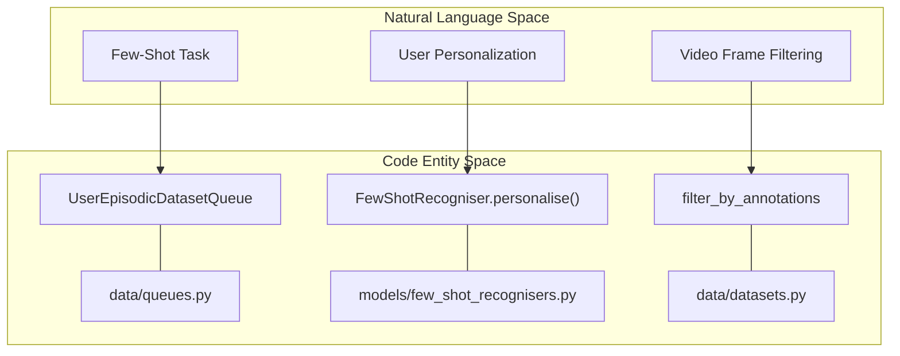
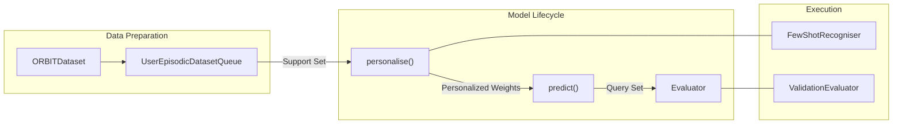

<!-- source: DeepWiki mcp.deepwiki.com · repo microsoft/ORBIT-Dataset · page 1 ORBIT Dataset & Few-Shot Recognition — Overview · fetched 2026-10-26 -->

# ORBIT Dataset & Few-Shot Recognition — Overview

Relevant source files

The following files were used as context for generating this wiki page:

- [CODE_OF_CONDUCT.md](CODE_OF_CONDUCT.md)
- [LICENSE.md](LICENSE.md)
- [NOTICE.md](NOTICE.md)
- [README.md](README.md)
- [SECURITY.md](SECURITY.md)
- [data/__init__.py](data/__init__.py)
- [data/orbit_extra_annotations.zip](data/orbit_extra_annotations.zip)
- [orbit_challenge_getting_started.ipynb](orbit_challenge_getting_started.ipynb)

This page provides a high-level introduction to the **ORBIT (Object Recognition for Blind Image Training)** benchmark. The project provides a real-world dataset and a suite of few-shot learning models designed to recognize objects for blind and low-vision users. 

The framework supports both standard meta-learning and **LITE (Large Image and Task Episodic)** training, which enables processing high-resolution (224x224) frames on a single GPU [README.md:1-5]().

## System Architecture

The ORBIT codebase is structured to bridge high-level few-shot learning concepts (tasks, episodes, personalization) with concrete PyTorch implementations. The architecture is divided into three main layers: Data Pipeline, Model Stack, and Execution Learners.

### Logic to Code Mapping
The following diagram illustrates how conceptual entities in the ORBIT domain map to specific classes and files within the repository.

**Diagram: Entity Mapping**

Sources: [orbit_challenge_getting_started.ipynb:88-111](), [README.md:84-88]()

## Key Concepts

### 1. The ORBIT Dataset
The dataset consists of videos of objects collected by blind and low-vision users. It is organized by **Collector → Object → Video Type (Clean/Clutter) → Video → Frame** [README.md:22]().
*   **Clean Videos:** Used for the **Support Set** to personalize the model to a specific user's objects.
*   **Clutter Videos:** Used for the **Query Set** to evaluate the model's recognition performance in realistic, noisy environments.

For details on the hierarchy and metadata, see [Dataset Structure & Annotations](#2.1).

### 2. Few-Shot Learning Pipeline
The system follows a meta-learning paradigm where models are "personalized" to a specific user's objects using a small number of examples.

**Diagram: System Workflow**

Sources: [orbit_challenge_getting_started.ipynb:88-111](), [README.md:73-82]()

### 3. Personalization & Recognition Rules
The benchmark enforces strict protocols for evaluation:
*   **Personalization:** Models must use only clean videos and labels for the specific test user [README.md:87-88](). Extra annotations (like bounding boxes) cannot be used during this phase [README.md:91]().
*   **Recognition:** Models are evaluated on 200 randomly sampled frames per clutter video [README.md:78-79](). Frames where the object is not present (flagged by `object_not_present_issue`) are filtered out [README.md:80]().

## Core Components

| Component | Responsibility | Key Files |
| :--- | :--- | :--- |
| **Data Queues** | Manages episodic sampling of users and objects into tasks. | `data/queues.py` |
| **Recognisers** | Implements few-shot architectures (ProtoNets, CNAPs, etc.). | `models/few_shot_recognisers.py` |
| **Learners** | Orchestrates the training loops and optimization logic. | `single-step-learner.py`, `multi-step-learner.py` |
| **Evaluators** | Computes frame-level and video-level accuracy metrics. | `utils/eval_metrics.py` |

## Getting Started & Repository Map

To begin working with the ORBIT Dataset:
*   **Installation:** Use the provided `environment.yml` or `requirements.txt` to set up the dependencies (PyTorch 1.13.1, TorchVision 0.14.1) [README.md:7-38]().
*   **Setup Guide:** For a step-by-step walkthrough, see **[Getting Started](#1.1)**.
*   **Code Navigation:** To understand the directory structure and where specific logic resides, see **[Repository Structure](#1.2)**.

Sources: [README.md:1-38](), [orbit_challenge_getting_started.ipynb:1-12]()

---

