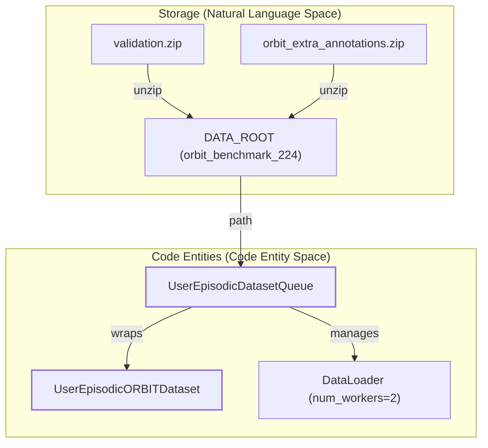
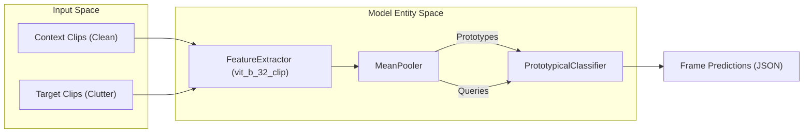

<!-- source: DeepWiki mcp.deepwiki.com · repo microsoft/ORBIT-Dataset · page 1.1 Getting Started · fetched 2026-10-26 -->

# Getting Started

<details>
<summary>Relevant source files</summary>

The following files were used as context for generating this wiki page:

- [environment.yml](environment.yml)
- [orbit_challenge_getting_started.ipynb](orbit_challenge_getting_started.ipynb)
- [requirements.txt](requirements.txt)
- [scripts/download_benchmark_dataset.sh](scripts/download_benchmark_dataset.sh)
- [scripts/download_unfiltered_dataset.sh](scripts/download_unfiltered_dataset.sh)

</details>


This page provides a step-by-step guide for setting up the ORBIT Dataset codebase, installing dependencies, downloading the required data, and running an initial benchmark experiment.

## Environment Setup

The repository supports environment configuration via Conda or Pip. The environment is centered around Python 3.7 and PyTorch 1.13.1 (or 2.6.0 for newer pip-based setups).

### Option 1: Conda (Recommended)
Use the `environment.yml` file to create a reproducible environment with all necessary channels (pytorch, plotly, nvidia) pre-configured.

```bash
conda env create -f environment.yml
conda activate orbit-dataset
```
Sources: [environment.yml:1-19]()

### Option 2: Pip
Alternatively, you can install dependencies using `requirements.txt`.

```bash
pip install -r requirements.txt
```
Sources: [requirements.txt:1-8]()

### Key Dependencies
| Package | Version | Purpose |
| :--- | :--- | :--- |
| `torch` | 1.13.1 / 2.6.0 | Core deep learning framework |
| `torchvision` | 0.14.1 | Image transformations and datasets |
| `timm` | 0.6.12 | Pre-trained vision backbones (EfficientNet, ViT) |
| `thop` | 0.1.1.post | MACs/Parameters profiling (OpsCounter) |
| `plotly` | 4.8.1 | Visualization of dataset statistics |

Sources: [environment.yml:10-18](), [requirements.txt:1-6]()

---

## Dataset Acquisition

The ORBIT dataset can be downloaded in several formats depending on your storage capacity and research needs.

### 1. Benchmark Dataset
The benchmark dataset is organized into `train`, `validation`, and `test` splits. You can download it at the original resolution (1080x1080) or pre-resized to 224x224.

*   **224x224 (Recommended):** ~54GB.
*   **1080x1080:** ~83GB.

Use the provided shell script to automate the download and unzipping process:
```bash
# Usage: bash scripts/download_benchmark_dataset.sh <destination_path> <frame_size>
bash scripts/download_benchmark_dataset.sh ./data 224
```
Sources: [scripts/download_benchmark_dataset.sh:5-18](), [orbit_challenge_getting_started.ipynb:24-24]()

### 2. Unfiltered Dataset
The unfiltered dataset contains additional users and videos not included in the benchmark splits.
```bash
bash scripts/download_unfiltered_dataset.sh ./data
```
Sources: [scripts/download_unfiltered_dataset.sh:10-22]()

### 3. Extra Annotations
The benchmark requires metadata (bounding boxes, quality issues) stored in a separate ZIP file.
```python
# From orbit_challenge_getting_started.ipynb
!wget -O orbit_extra_annotations.zip https://github.com/microsoft/ORBIT-Dataset/raw/dev/data/orbit_extra_annotations.zip
```
Sources: [orbit_challenge_getting_started.ipynb:61-61]()

---

## Data Flow: From Files to Episodes

The following diagram illustrates how the system transitions from raw files to the `UserEpisodicDatasetQueue` used in the getting started notebook.

**Data Loading Architecture**

Sources: [orbit_challenge_getting_started.ipynb:35-47](), [orbit_challenge_getting_started.ipynb:88-113]()

---

## Running the Getting Started Notebook

The `orbit_challenge_getting_started.ipynb` notebook provides a complete walkthrough for the ORBIT Few-Shot Object Recognition Challenge.

### Step 1: Initialize the Data Queue
The notebook uses `UserEpisodicDatasetQueue` to sample tasks. Key parameters include:
*   `way_method="max"`: Samples all objects available for a specific user.
*   `shot_method=["max", "max"]`: Uses all available context videos for personalization and all target videos for evaluation.
*   `filter_by_annotations`: Specifically filters for `no_object_not_present_issue` to ensure target frames contain the object.

Sources: [orbit_challenge_getting_started.ipynb:91-111]()

### Step 2: Model Initialization
The starter task uses a Prototypical Network with a CLIP Vision Transformer (`vit_b_32_clip`) backbone.

**Inference Pipeline**

Sources: [orbit_challenge_getting_started.ipynb:121-121]()

### Step 3: Generating Predictions
The notebook iterates through the `data_queue`, performs a personalization step (computing prototypes from context videos), and then predicts labels for target frames. The output is a JSON file compatible with the Challenge evaluation server.

Sources: [orbit_challenge_getting_started.ipynb:10-10]()

---

