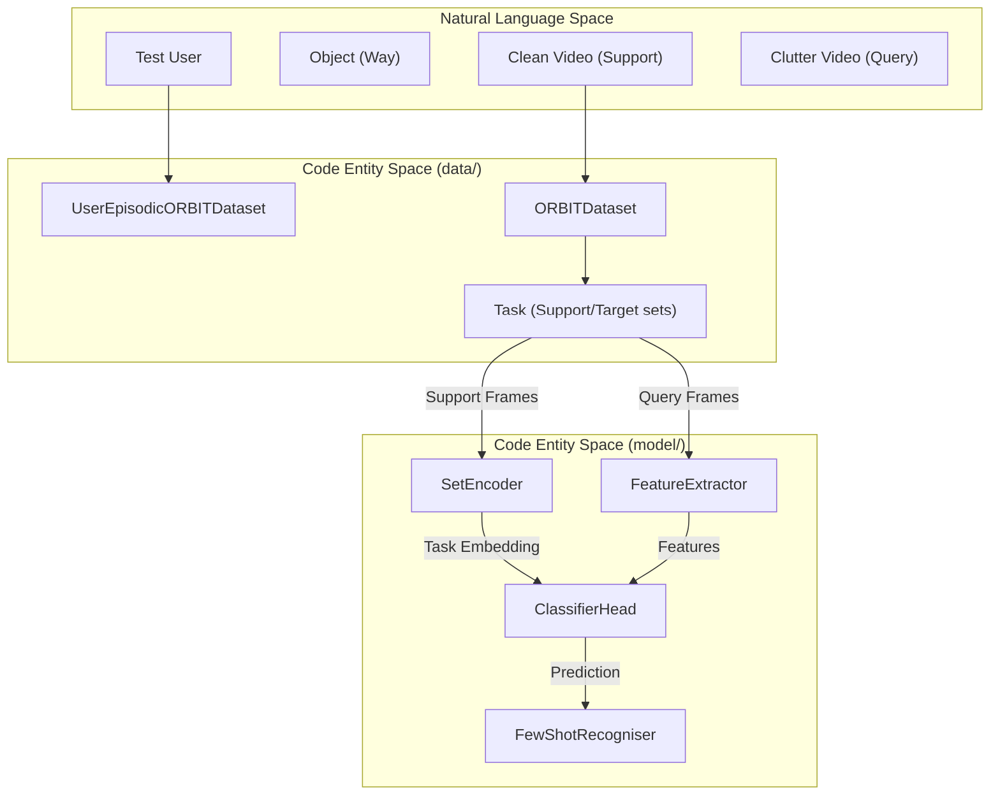
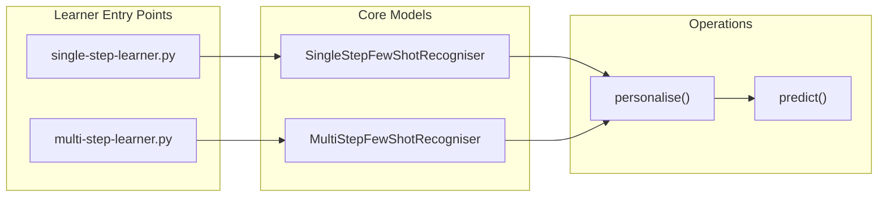

<!-- source: DeepWiki mcp.deepwiki.com · repo microsoft/ORBIT-Dataset · page 1.2 Repository Structure · fetched 2026-10-26 -->

# Repository Structure

Relevant source files

The following files were used as context for generating this wiki page:

- [.gitignore](.gitignore)
- [README.md](README.md)
- [__init__.py](__init__.py)
- [azure-pipelines.yml](azure-pipelines.yml)
- [data/orbit_extra_annotations.zip](data/orbit_extra_annotations.zip)

This page provides a technical map of the ORBIT Dataset repository. The codebase is designed to support high-resolution few-shot learning, specifically for the task of teachable object recognition using the ORBIT benchmark. It includes a modular architecture for dataset loading, model definition (supporting both single-step and multi-step meta-learners), and evaluation.

## Top-Level Layout

The repository is organized into functional modules that separate data handling, model logic, and execution scripts.

| Directory / File | Description |
| :--- | :--- |
| `model/` | Core neural network architectures, including backbones, set encoders, and classifier heads. |
| `data/` | Dataset loading logic, episodic sampling, and annotation processing. |
| `utils/` | Shared utilities for arguments, metrics, and computational profiling. |
| `scripts/` | Shell and Python scripts for data preparation (downloading, resizing, summarizing). |
| `single-step-learner.py` | Entry point for training/testing CNAPs and ProtoNets. |
| `multi-step-learner.py` | Entry point for training/testing FineTuner and MAML. |

**Sources:** `README.md` [1-57](), `__init__.py` [1-6]()

---

## Data Flow and System Architecture

The following diagram maps the relationship between the Natural Language concepts of the ORBIT benchmark and the specific Code Entities that implement them.

### System Entity Mapping: Data to Model

**Sources:** `README.md` [73-95](), `__init__.py` [4-5]()

---

## Directory Details

### 1. `model/`
This directory contains the modular components of the few-shot recognition pipeline.
*   **Backbones:** Logic for loading `EfficientNet`, `ViT`, and `ResNet` architectures.
*   **Adaptation:** Implements FiLM (Feature Wise Linear Modulation) for task-specific adaptation.
*   **Heads:** Pluggable classification layers such as `LinearClassifier`, `VersaClassifier`, and `PrototypicalClassifier`.
*   **Set Encoders:** Implements `DeepSets` via the `SetEncoder` class to process support sets into fixed-length embeddings.

### 2. `data/`
Responsible for transforming raw video frames into episodic tasks.
*   **`ORBITDataset`**: The base class that handles frame loading from the filesystem.
*   **`UserEpisodicORBITDataset`**: Orchestrates the sampling of users and their respective objects/videos to form few-shot episodes.
*   **`orbit_extra_annotations.zip`**: Contains JSON metadata for frame-level filtering (e.g., `object_not_present_issue`).

### 3. `utils/`
Contains infrastructure for experiment management.
*   **`args.py`**: Centralized configuration for all CLI arguments.
*   **`eval_metrics.py`**: Implementation of frame accuracy, video accuracy, and confidence intervals.
*   **`ops_counter.py`**: Integration with the `thop` library to measure MACs and parameters.

### 4. `scripts/`
Utility scripts for environment setup and data maintenance.
*   `download_benchmark_dataset.sh`: Automates dataset acquisition and resizing.
*   `summarize_dataset.py`: Computes statistics (users, objects, videos) across splits.

---

## Execution Pipeline

The repository distinguishes between "Single-Step" learners (which use parameter generation or metric learning) and "Multi-Step" learners (which use gradient-based optimization).

### Logic Flow: Single-Step vs Multi-Step

**Sources:** `__init__.py` [5](), `README.md` [57-85]()

## Infrastructure & CI/CD
The repository includes configuration for automated testing and security.
*   **`azure-pipelines.yml`**: Configures a Windows-based CI agent that runs `CredScan` for security and `ComponentGovernance` for open-source compliance on every push to `master` and a weekly schedule.
*   **Environment Management**: Dependencies are defined in both `environment.yml` (Conda) and `requirements.txt` (pip) to support various setup preferences.

**Sources:** `azure-pipelines.yml` [1-23](), `README.md` [25-38]()

---

