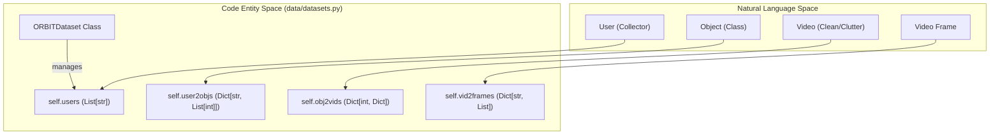
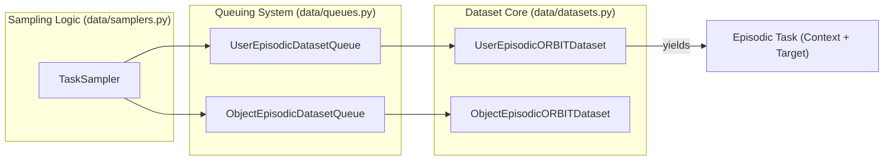

<!-- source: DeepWiki mcp.deepwiki.com · repo microsoft/ORBIT-Dataset · page 2 Dataset · fetched 2026-10-26 -->

# Dataset

Relevant source files

The following files were used as context for generating this wiki page:

- [data/dataloaders.py](data/dataloaders.py)
- [data/datasets.py](data/datasets.py)
- [data/queues.py](data/queues.py)
- [data/samplers.py](data/samplers.py)

The ORBIT benchmark is a large-scale dataset of high-resolution videos recorded by people who are blind or low-vision. It is designed for the task of few-shot object recognition in a real-world setting. The dataset is organized to support episodic meta-learning, where models are trained and evaluated on tasks consisting of a small set of "context" (support) videos and a set of "target" (query) videos.

### Dataset Overview

The dataset is categorized into three primary splits: `train`, `validation`, and `test` [data/datasets.py:45](). Each split contains a collection of users, and each user has recorded multiple objects. For each object, there are two types of videos: **clean** (the object is the primary focus) and **clutter** (the object is shown in a natural, cluttered environment) [data/datasets.py:30,94]().

The following diagram illustrates the relationship between the physical data storage and the code entities used to manage it:

**Data Organization and Code Entity Mapping**

Sources: [data/datasets.py:18-102]()

---

### Dataset Structure & Annotations
The dataset follows a strict hierarchy: **Collector → Object → Video Type → Video → Frame**. Metadata and ground-truth information are provided via JSON and ZIP files, including object cluster labels and bounding boxes.

*   **Hierarchy**: Data is stored on disk following the user-object-video structure.
*   **Annotations**: The system supports loading specific annotation types (e.g., `object_bounding_box`) [data/datasets.py:71]() and filtering frames based on the presence of these annotations [data/datasets.py:64]().
*   **Clustering**: For certain evaluation modes, objects can be grouped into clusters using `orbit_{mode}_object_cluster_labels.json` [data/datasets.py:108]().

For details, see [Dataset Structure & Annotations](#2.1).

---

### Dataset Loading Pipeline
The loading pipeline transforms raw files into episodic tasks. This process is managed by the `DataLoader` [data/dataloaders.py:8]() and specific queue classes that handle sampling logic.

**Loading Pipeline Architecture**

Sources: [data/samplers.py:8-12](), [data/queues.py:42-80](), [data/datasets.py:18-22]()

*   **Episodic Sampling**: Tasks are sampled either user-centrically (all objects for a single user) or object-centrically [data/dataloaders.py:16-17]().
*   **Frame Processing**: Frames are resized to `frame_size` [data/datasets.py:53](), normalized using specific stats (e.g., ImageNet or CLIP) [data/datasets.py:82-87](), and sampled into contiguous clips of `clip_length` [data/datasets.py:52]().
*   **Memory Management**: The pipeline implements caps on the number of objects per user (`object_cap`), videos per object (`context_shot_cap`), and frames per video (`frame_cap`) to ensure consistent memory usage [data/datasets.py:76-80]().

For details, see [Dataset Loading Pipeline](#2.2).

---

### Dataset Utilities & Scripts
A variety of helper scripts are provided in the `scripts/` directory to manage the dataset lifecycle. These include:
*   **Downloader**: Scripts to fetch the benchmark or unfiltered datasets.
*   **Preprocessing**: Tools for resizing frames offline to speed up training.
*   **Analysis**: Utilities to compute dataset statistics, visualize frame distributions, and generate average images per object class.

For details, see [Dataset Utilities & Scripts](#2.3).

Sources: [data/datasets.py:18-102](), [data/queues.py:8-41](), [data/dataloaders.py:8-15](), [data/samplers.py:8-12]()

---

