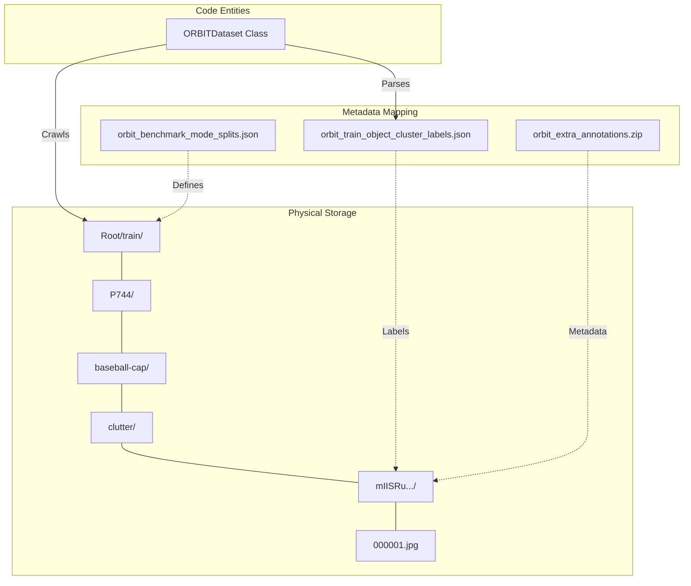
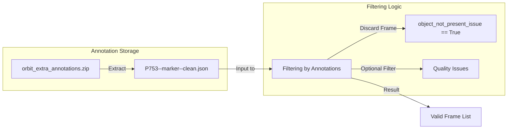

<!-- source: DeepWiki mcp.deepwiki.com · repo microsoft/ORBIT-Dataset · page 2.1 Dataset Structure & Annotations · fetched 2026-10-26 -->

# Dataset Structure & Annotations

Relevant source files

The following files were used as context for generating this wiki page:

- [README.md](README.md)
- [data/object_clusters_benchmark.txt](data/object_clusters_benchmark.txt)
- [data/object_clusters_full.txt](data/object_clusters_full.txt)
- [data/orbit_benchmark_mode_splits.json](data/orbit_benchmark_mode_splits.json)
- [data/orbit_benchmark_users_to_split.json](data/orbit_benchmark_users_to_split.json)
- [data/orbit_dataset_readme.txt](data/orbit_dataset_readme.txt)
- [data/orbit_extra_annotations.zip](data/orbit_extra_annotations.zip)
- [data/orbit_test_object_cluster_labels.json](data/orbit_test_object_cluster_labels.json)
- [data/orbit_train_object_cluster_labels.json](data/orbit_train_object_cluster_labels.json)
- [data/orbit_validation_object_cluster_labels.json](data/orbit_validation_object_cluster_labels.json)

The ORBIT dataset is a real-world few-shot recognition dataset containing videos of objects collected by people who are blind or have low vision [README.md:1-5](). It is designed to benchmark "teachable" object recognition systems where a model must learn to recognize a user's personal objects from just a few high-quality "clean" videos and then recognize them in high-clutter "target" videos [README.md:73-83]().

## File Hierarchy

The dataset is organized into two primary versions: the **Unfiltered Dataset** and the **Benchmark Dataset** [data/orbit_dataset_readme.txt:4-13](). Both follow a strict directory-based hierarchy.

### ORBIT Unfiltered Dataset
The unfiltered version contains 4,733 videos (approx. 3.1 million frames) across 588 objects from 97 collectors [data/orbit_dataset_readme.txt:5]().

| Level | Entity | Description |
| :--- | :--- | :--- |
| 1 | **Collector** | Folders named by User ID (e.g., `P999`) [data/orbit_dataset_readme.txt:6](). |
| 2 | **Object** | Folders for each object belonging to that collector [data/orbit_dataset_readme.txt:7](). |
| 3 | **Video Type** | `clean`, `clutter`, or `clutter-pan` [data/orbit_dataset_readme.txt:8](). |
| 4 | **Video** | Unique video instance folders [data/orbit_dataset_readme.txt:9](). |
| 5 | **Frame** | Individual `.jpg` files [data/orbit_dataset_readme.txt:10](). |

### ORBIT Benchmark Dataset
The benchmark version is a subset containing 3,822 videos of 386 objects from 67 collectors [data/orbit_dataset_readme.txt:14-22](). It adds a "Mode" level at the top of the hierarchy to separate splits.

**Hierarchy:** `Mode` → `Collector` → `Object` → `Video Type` → `Video` → `Frame` [data/orbit_dataset_readme.txt:15-20]().

### Data Entity Mapping
The following diagram bridges the natural language concepts of the dataset to the physical directory structure and the JSON metadata used by the loading pipeline.

**Data Space to Code Entity Mapping**

**Sources:** [data/orbit_dataset_readme.txt:13-20](), [data/orbit_benchmark_mode_splits.json:1](), [data/orbit_train_object_cluster_labels.json:1]().

---

## Dataset Splits

The benchmark dataset is split by **Collector (User)**. This ensures that a model evaluated on the `test` split must generalize to entirely new users and objects not seen during `train` or `validation`.

| Split | Number of Users | User IDs (Examples) |
| :--- | :---: | :--- |
| **Train** | 44 | `P613`, `P277`, `P332`, `P470`, `P744`, ... [data/orbit_benchmark_mode_splits.json:1]() |
| **Validation** | 6 | `P867`, `P579`, `P235`, `P778`, `P189`, `P194` [data/orbit_benchmark_mode_splits.json:1]() |
| **Test** | 17 | `P198`, `P953`, `P233`, `P204`, `P999`, ... [data/orbit_benchmark_mode_splits.json:1]() |

---

## Object Cluster Labels

Because users may name the same type of object differently (e.g., "keys" vs "house keys"), the dataset provides cluster labels to group synonymous objects.

*   **Mapping Files**:
    *   `orbit_train_object_cluster_labels.json` [data/orbit_train_object_cluster_labels.json:1]()
    *   `orbit_validation_object_cluster_labels.json` [data/orbit_validation_object_cluster_labels.json:1]()
    *   `orbit_test_object_cluster_labels.json` [data/orbit_test_object_cluster_labels.json:1]()
*   **Structure**: A dictionary where the key is the video folder name and the value is an integer cluster ID.
    *   *Example*: `P744--baseball-cap--clutter--...` maps to ID `45` [data/orbit_train_object_cluster_labels.json:1]().
*   **Cluster Definitions**: The text files `object_clusters_benchmark.txt` and `object_clusters_full.txt` provide the human-readable names for these IDs.
    *   *Example ID 1*: "keys, house keys, radar key, my keys..." [data/object_clusters_benchmark.txt:1]().
    *   *Example ID 11*: "remote, tv remote, apple tv remote..." [data/object_clusters_benchmark.txt:11]().

---

## Extra Annotations & Bounding Boxes

The `orbit_extra_annotations.zip` file contains per-video JSON files providing frame-level metadata [data/orbit_extra_annotations.zip:1-10]().

### Annotation Metadata
Each JSON file contains details for every frame in a video:
1.  **Object Presence**: `object_not_present_issue` (boolean). Used to filter frames where the object is out of view [README.md:80]().
2.  **Quality Issues**: Flags for blur, occlusion, or poor lighting.
3.  **Bounding Boxes**: `[x, y, width, height]` coordinates for the object in the frame.

**Annotation Data Flow**

**Sources:** [README.md:80-82](), [data/orbit_extra_annotations.zip:2-10]().

### Filtering Rules
During evaluation (CLU-VE), clutter videos are filtered to exclude frames where the ground-truth object is not present (`object_not_present_issue=True`) [README.md:80](). 
*   If a video has **< 50** valid frames after filtering, it is excluded from evaluation [README.md:80]().
*   If a video has **50-200** valid frames, all are used [README.md:80]().
*   If a video has **> 200** valid frames, 200 are randomly sampled [README.md:78-80]().

---

## Summary Statistics

The dataset can be summarized using `scripts/summarize_dataset.py` [README.md:50-52]().

| Metric | Benchmark (Combined) |
| :--- | :--- |
| **Total Videos** | 3,822 [data/orbit_dataset_readme.txt:14]() |
| **Total Frames** | 2,687,934 [data/orbit_dataset_readme.txt:14]() |
| **Mean Image (RGB)** | `[0.500, 0.436, 0.396]` [data/orbit_dataset_readme.txt:24]() |
| **Std Dev (RGB)** | `[0.145, 0.143, 0.138]` [data/orbit_dataset_readme.txt:24]() |

**Sources:** [README.md:40-55](), [data/orbit_dataset_readme.txt:1-27](), [data/orbit_benchmark_mode_splits.json:1](), [data/object_clusters_benchmark.txt:1-127]().

---

