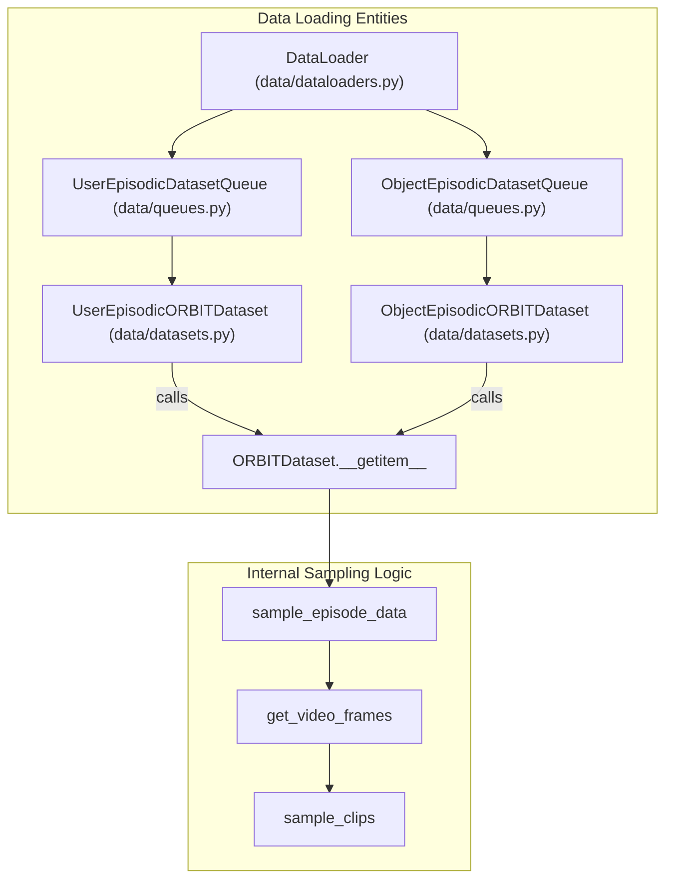
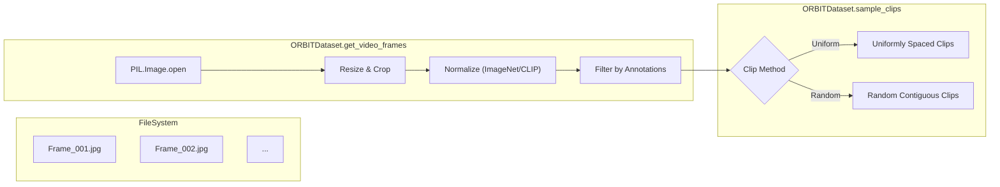

<!-- source: DeepWiki mcp.deepwiki.com · repo microsoft/ORBIT-Dataset · page 2.2 Dataset Loading Pipeline · fetched 2026-10-26 -->

# Dataset Loading Pipeline

Relevant source files

The following files were used as context for generating this wiki page:

- [data/dataloaders.py](data/dataloaders.py)
- [data/datasets.py](data/datasets.py)
- [data/queues.py](data/queues.py)
- [data/samplers.py](data/samplers.py)
- [data/utils.py](data/utils.py)

The ORBIT dataset loading pipeline is responsible for transforming raw video frames and metadata into episodic tasks suitable for few-shot learning. It handles complex requirements such as user-centric or object-centric sampling, frame-level filtering based on quality annotations, contiguous clip sampling, and memory management via hard caps on frames and videos.

## Pipeline Architecture

The pipeline is organized hierarchically, starting from high-level `DataLoader` configurations down to individual frame processing in the `ORBITDataset` base class.

### High-Level Data Flow
The `DataLoader` class in `data/dataloaders.py` initializes specialized queues (`UserEpisodicDatasetQueue` or `ObjectEpisodicDatasetQueue`) for training, validation, and testing. These queues wrap the underlying PyTorch `Dataset` and `Sampler` logic.

| Component | Responsibility |
| :--- | :--- |
| **DataLoader** | Orchestrates the creation of train/val/test queues based on configuration. [data/dataloaders.py:8-12]() |
| **DatasetQueue** | Manages a `DataLoader` instance and a `TaskSampler` to yield episodic tasks. [data/queues.py:8-13]() |
| **TaskSampler** | Determines the order of user/object indices to sample, ensuring a fixed number of tasks per item. [data/samplers.py:8-12]() |
| **ORBITDataset** | The core logic for scanning the filesystem, loading annotations, and sampling frames/clips. [data/datasets.py:18-21]() |

### Code Entity Space Mapping
The following diagram bridges the abstract concepts of "Tasks" and "Episodes" to the specific classes and functions in the codebase.

**Task Assembly Hierarchy**

Sources: [data/dataloaders.py:8-12](), [data/queues.py:42-47](), [data/datasets.py:18-22](), [data/datasets.py:171-175](), [data/datasets.py:240-245]()

---

## Core Dataset Classes

### ORBITDataset (Base Class)
The `ORBITDataset` class [data/datasets.py:18]() is the foundation for all loading operations. During initialization, it performs a recursive scan of the dataset root to map users to objects and objects to videos [data/datasets.py:102-132]().

**Key Configuration Parameters:**
- `way_method`: Determines how many objects are selected per task ('random' or 'max'). [data/datasets.py:46]()
- `shot_methods`: Strategy for selecting context and target videos (e.g., 'random', 'all'). [data/datasets.py:47]()
- `clip_methods`: Strategy for sampling contiguous frames (e.g., 'uniform', 'random', 'continuous'). [data/datasets.py:51]()
- `filter_by_annotations`: List of criteria (like `quality_issues`) used to exclude frames. [data/datasets.py:60-62]()

### UserEpisodicORBITDataset
This variant samples tasks at the **User** level. Each call to `__getitem__(user_idx)` generates a complete few-shot task where the context and target sets are drawn from the objects owned by that specific user.
Sources: [data/datasets.py:171-175]()

### ObjectEpisodicORBITDataset
This variant samples tasks at the **Object** level. It is primarily used for training scenarios where the model should see a wide variety of objects from different users in a single batch.
Sources: [data/datasets.py:215-219]()

---

## Frame Filtering and Annotation Loading

ORBIT provides fine-grained annotations that allow the pipeline to filter out "bad" frames (e.g., frames where the object is occluded or out of focus).

### Filtering Logic
If `filter_by_annotations` is enabled, the dataset loads JSON annotation files from `self.annotation_root` [data/datasets.py:72](). Frames are filtered in `get_video_frames` [data/datasets.py:328]() based on the `filter_params` criteria:
1. **Annotation Check**: Frames are checked against labels like `object_not_present_flag` or `occlusion_flag`. [data/datasets.py:349-355]()
2. **Minimum Frame Requirement**: If a video has fewer than `min_video_frames` after filtering, it may be discarded. [data/datasets.py:125-130]()

### Memory Management Caps
To prevent OOM (Out of Memory) errors and ensure stable training, the pipeline enforces several "caps":
- `clip_cap`: Limits the number of clips sampled from a single video (default: 200). [data/datasets.py:79]()
- `frame_cap`: Limits the total frames processed in a single video (default: 1000). [data/datasets.py:80]()
- `context_shot_cap` / `target_shot_cap`: Limits the number of videos per object (default: 15). [data/datasets.py:77-78]()

---

## Clip Sampling Methods

The pipeline supports multiple ways to sample frames from a video, defined by the `clip_methods` parameter.

| Method | Implementation Detail |
| :--- | :--- |
| **uniform** | Samples `clip_length` frames at equal intervals across the video. [data/datasets.py:421-424]() |
| **random** | Samples `clip_length` contiguous frames starting at a random offset. [data/datasets.py:417-420]() |
| **continuous** | Samples all possible contiguous clips of `clip_length` from the video. [data/datasets.py:425-428]() |

**Data Loading Flow (Frame to Clip)**

Sources: [data/datasets.py:328-360](), [data/datasets.py:401-415](), [data/datasets.py:440-455]()

---

## Episodic Task Assembly

A "Task" in ORBIT is a dictionary containing everything needed for a few-shot learning step. The `sample_episode_data` function [data/datasets.py:240]() performs the following:
1. **Object Selection**: Selects $N$ objects (the "way"). [data/datasets.py:255-263]()
2. **Video Selection**: For each object, selects context and target videos (the "shot"). [data/datasets.py:265-285]()
3. **Frame Processing**: Loads and processes frames for every selected video. [data/datasets.py:287-300]()
4. **Label Mapping**: Maps raw object IDs to local task labels (0 to $N-1$). [data/datasets.py:302-315]()

### Task Dictionary Structure
The assembled task contains:
- `context_clips`: Tensor of shape `(num_context_clips, clip_length, C, H, W)`.
- `target_clips`: Tensor of shape `(num_target_clips, clip_length, C, H, W)`.
- `context_labels` / `target_labels`: Local labels for the task.
- `context_annotations` / `target_annotations`: Bounding boxes or other metadata if requested.

Sources: [data/datasets.py:240-326](), [data/utils.py:30-47]()

---

