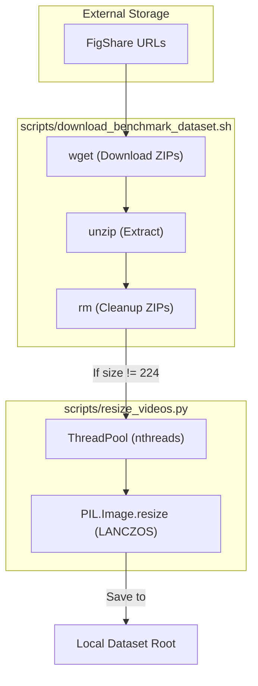
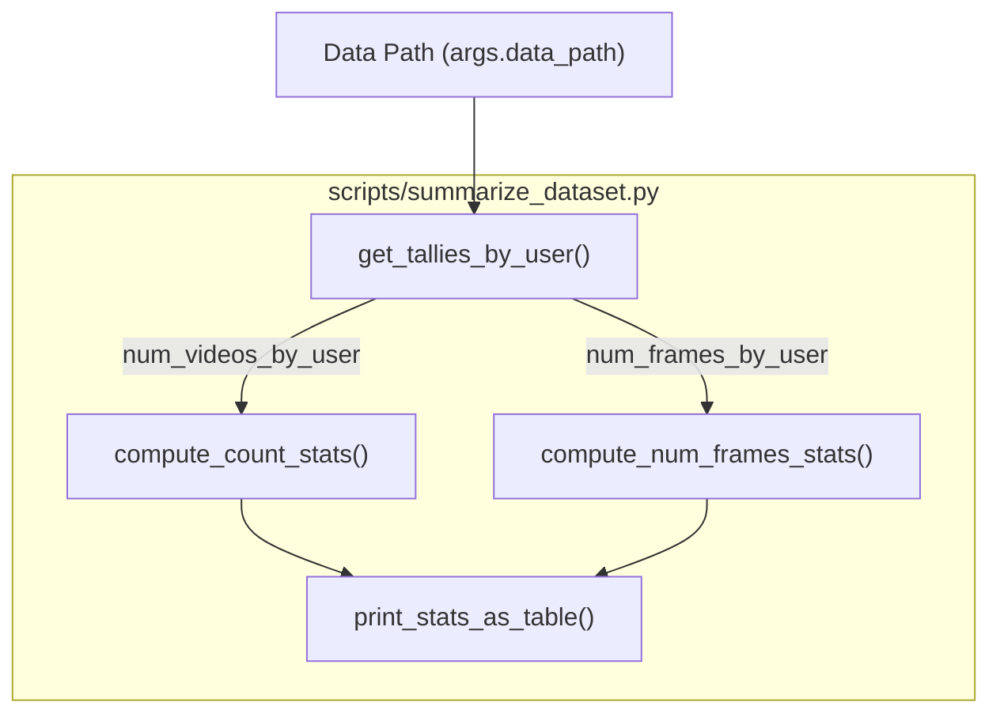

<!-- source: DeepWiki mcp.deepwiki.com · repo microsoft/ORBIT-Dataset · page 2.3 Dataset Utilities & Scripts · fetched 2026-10-26 -->

# Dataset Utilities & Scripts

Relevant source files

The following files were used as context for generating this wiki page:

- [scripts/compute_avg_image.py](scripts/compute_avg_image.py)
- [scripts/download_benchmark_dataset.sh](scripts/download_benchmark_dataset.sh)
- [scripts/download_unfiltered_dataset.sh](scripts/download_unfiltered_dataset.sh)
- [scripts/merge_and_split_benchmark_users.py](scripts/merge_and_split_benchmark_users.py)
- [scripts/resize_videos.py](scripts/resize_videos.py)
- [scripts/summarize_dataset.py](scripts/summarize_dataset.py)

This page details the helper scripts and utilities provided in the ORBIT repository for managing, processing, and analyzing the dataset. These tools handle the end-to-end data lifecycle, from initial download and resizing to statistical summarization and user split management.

## Dataset Acquisition and Preparation

The repository provides shell scripts to automate the download of the ORBIT dataset from FigShare. These scripts handle downloading ZIP files, unzipping them into the correct directory structure, and performing initial cleanup.

### Benchmark Dataset Download
The script `scripts/download_benchmark_dataset.sh` downloads the curated benchmark version of the dataset. It supports two frame sizes: the default raw size or a pre-resized 224x224 version [scripts/download_benchmark_dataset.sh:7-18](). If a custom frame size is requested (other than 224), it automatically invokes the `resize_videos.py` script after unzipping [scripts/download_benchmark_dataset.sh:45-51]().

### Unfiltered Dataset Download
The script `scripts/download_unfiltered_dataset.sh` downloads the full, unfiltered ORBIT dataset, including an "other" folder containing additional data [scripts/download_unfiltered_dataset.sh:8](). Post-download, it flattens the directory structure [scripts/download_unfiltered_dataset.sh:42-49]() and runs `scripts/merge_and_split_benchmark_users.py` to reconcile user folders that were merged or split during the benchmark creation process [scripts/download_unfiltered_dataset.sh:52]().

### Video Resizing Utility
The `scripts/resize_videos.py` script is a multi-threaded utility for resizing raw video frames to a target resolution (default 224x224). It uses a `ThreadPool` to process videos in parallel [scripts/resize_videos.py:23-28]().

**Key Functions:**
* `main()`: Initializes the thread pool and iterates through all video directories found via a 5-level glob pattern (`*/*/*/*/*`) [scripts/resize_videos.py:20-25]().
* `resize_video_frames()`: The worker function that opens frames using `PIL.Image`, converts them to RGB if necessary, and saves them with Lanczos resampling at 95% quality [scripts/resize_videos.py:43-48]().

**Data Flow: Acquisition to Storage**
The following diagram illustrates how raw data from FigShare is transformed into a local usable format.

**Title: Dataset Preparation Pipeline**

Sources: [scripts/download_benchmark_dataset.sh:1-52](), [scripts/resize_videos.py:11-51]()

---

## Dataset Summarization and Statistics

The `scripts/summarize_dataset.py` script provides a comprehensive analysis of the dataset's composition. It calculates statistics at the user, object, and video levels, broken down by video type (e.g., "clean" vs. "clutter").

### Implementation Details
The script iterates through the directory structure to tally videos and frames. It supports summarizing across standard splits (`train`, `validation`, `test`) or treating the root as a single pool [scripts/summarize_dataset.py:16-17]().

**Core Logic Entities:**
* `get_tallies_by_user()`: Traverses the file system to count frames per video and videos per object for every user in a given path.
* `compute_count_stats()`: Calculates means, standard deviations, percentiles (25th/75th), and min/max for video and object counts [scripts/summarize_dataset.py:86-147]().
* `compute_num_frames_stats()`: Computes statistics for frame counts per video and per user [scripts/summarize_dataset.py:41-84]().

**Code Entity Association**
The following diagram maps the statistical calculations to the dataset's hierarchical structure.

**Title: Statistics Aggregation Logic**

Sources: [scripts/summarize_dataset.py:9-149]()

---

## User Management Utilities

### Merging and Splitting Users
The script `scripts/merge_and_split_benchmark_users.py` is used to maintain consistency between the unfiltered ORBIT data and the benchmark splits. This is necessary because some users in the raw data were split into multiple "virtual" users for the benchmark to ensure distinct object sets for training and testing.

* `merge_users()`: Moves videos from the "other" folder into the main user directories, merging contents if the user already exists [scripts/merge_and_split_benchmark_users.py:22-51]().
* `split_users()`: Reads a JSON mapping (`orbit_benchmark_users_to_split.json`) and redistributes objects and videos from a single benchmark user into multiple new user directories [scripts/merge_and_split_benchmark_users.py:53-81](). It also renames individual frame files to match the new user IDs [scripts/merge_and_split_benchmark_users.py:78]().

### Computing Average Image
The `scripts/compute_avg_image.py` script calculates the mean and standard deviation of pixel values across the entire training set. This is used for data normalization during model training.

* It processes all `train` video directories [scripts/compute_avg_image.py:16]().
* For every frame, it converts the image to a NumPy array and computes the mean per RGB channel [scripts/compute_avg_image.py:26-27]().
* The final output is the global average and standard deviation normalized to the `[0, 1]` range [scripts/compute_avg_image.py:31-33]().

Sources: [scripts/merge_and_split_benchmark_users.py:10-84](), [scripts/compute_avg_image.py:10-37]()

## Summary of Script Capabilities

| Script | Purpose | Key Dependencies |
| :--- | :--- | :--- |
| `download_benchmark_dataset.sh` | Downloads/unzips benchmark ZIPs from FigShare. | `wget`, `unzip` |
| `download_unfiltered_dataset.sh` | Downloads/unzips unfiltered ZIPs and flattens structure. | `wget`, `unzip`, `merge_and_split_benchmark_users.py` |
| `resize_videos.py` | Multi-threaded resizing of frames to target resolution. | `PIL`, `multiprocessing` |
| `summarize_dataset.py` | Generates tabular statistics (videos/frames per user/object). | `numpy`, `glob` |
| `merge_and_split_benchmark_users.py` | Reconciles raw users with benchmark user splits. | `shutil`, `json` |
| `compute_avg_image.py` | Computes global RGB mean/std for normalization. | `PIL`, `numpy` |

Sources: [scripts/download_benchmark_dataset.sh:1-52](), [scripts/download_unfiltered_dataset.sh:1-53](), [scripts/resize_videos.py:1-51](), [scripts/summarize_dataset.py:1-149](), [scripts/merge_and_split_benchmark_users.py:1-85](), [scripts/compute_avg_image.py:1-37]()

---

