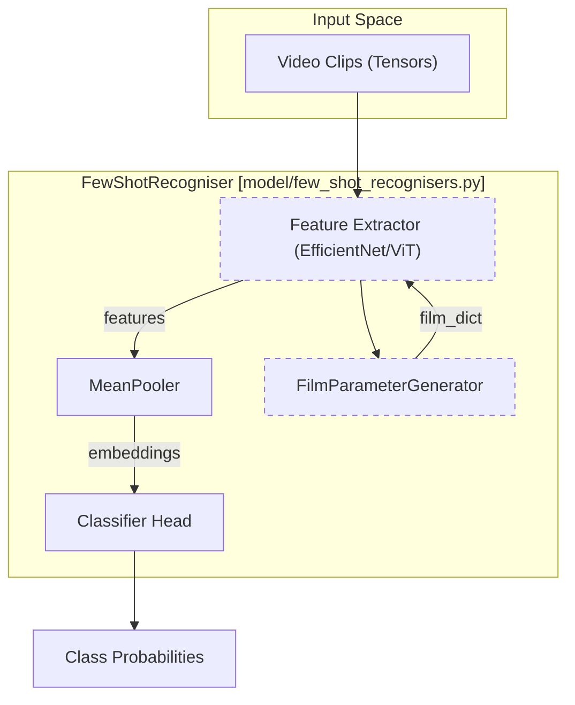
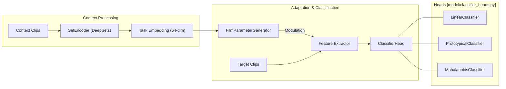

<!-- source: DeepWiki mcp.deepwiki.com · repo microsoft/ORBIT-Dataset · page 3 Model Architecture · fetched 2026-10-26 -->

# Model Architecture

Relevant source files

The following files were used as context for generating this wiki page:

- [model/feature_adapters.py](model/feature_adapters.py)
- [model/feature_extractors.py](model/feature_extractors.py)
- [model/few_shot_recognisers.py](model/few_shot_recognisers.py)
- [model/film.py](model/film.py)
- [model/set_encoders.py](model/set_encoders.py)

The ORBIT model architecture is designed for few-shot video recognition, specifically addressing the challenge of personalizing a recognizer to a user's objects with very few examples. The system is composed of a modular stack including a feature extractor backbone, a task-specific adaptation layer (FiLM), and pluggable classifier heads.

### High-Level System Overview

The core of the architecture is the `FewShotRecogniser` [model/few_shot_recognisers.py:46-49](), which manages the lifecycle of a few-shot task: receiving context (support) examples to "personalise" the model, and then "predicting" labels for target (query) examples.

#### Code Entity Map: Recognition Pipeline
The following diagram illustrates how high-level concepts map to specific classes and functions within the codebase.

**Sources:** [model/few_shot_recognisers.py:46-88](), [model/feature_extractors.py:37-79](), [model/poolers.py:34-37]()

---

### 1. Few-Shot Recogniser Variants
The framework supports different learning paradigms through specialized subclasses of `FewShotRecogniser`.

*   **SingleStepFewShotRecogniser**: Implements "amortized" few-shot learning where a task-encoding network (SetEncoder) generates parameters in a single forward pass. This is used for models like **CNAPs** and **ProtoNets** [model/few_shot_recognisers.py:171-174]().
*   **MultiStepFewShotRecogniser**: Implements gradient-based personalization. The model's parameters (or a subset of them) are updated over multiple optimization steps using the context set. This is used for **FineTuner** and **MAML** [model/few_shot_recognisers.py:383-386]().

For details on the lifecycle and memory optimizations like LITE, see [FewShotRecogniser Base & Variants](#3.1).

**Sources:** [model/few_shot_recognisers.py:171-174](), [model/few_shot_recognisers.py:383-386]()

---

### 2. Feature Extractors & FiLM Adaptation
The system uses standard backbones (backbones) from the `timm` library, which are modified to support **FiLM (Feature-wise Linear Modulation)**.

*   **Backbones**: Supports `efficientnet_b0`, `efficientnet_v2_s`, `vit_s_32`, `vit_b_32`, and `vit_b_32_clip` [model/feature_extractors.py:39-64]().
*   **FiLM Tagging**: Layers (typically BatchNorm or LayerNorm) are "tagged" so their parameters can be modulated by a generator [model/film.py:38-67]().
*   **Parameter Generation**: The `FilmParameterGenerator` [model/feature_adapters.py:36-38]() produces scale and shift values based on a task embedding, allowing the backbone to adapt its feature extraction to the specific objects in a task.

For details on backbone configuration and dynamic parameter generation, see [Feature Extractors & FiLM Adaptation](#3.2).

**Sources:** [model/feature_extractors.py:37-79](), [model/film.py:38-67](), [model/feature_adapters.py:36-79]()

---

### 3. Classifier Heads & Set Encoders
The architecture separates the logic of "how to compare features" into pluggable classifier heads and "how to represent a task" into set encoders.

#### Code Entity Map: Component Interaction
This diagram shows the relationship between the `SetEncoder` (which processes the context set) and the `Classifier` (which processes the target set).

**Sources:** [model/set_encoders.py:34-37](), [model/classifier_heads.py:41-44](), [model/few_shot_recognisers.py:72-84]()

*   **Set Encoders**: Uses a `SimplePrePoolNet` (DeepSets architecture) to encode a set of context images into a single 64-dimensional task embedding [model/set_encoders.py:34-44]().
*   **Classifier Heads**: Includes `PrototypicalClassifier` (distance-based), `LinearClassifier` (softmax-based), and `MahalanobisClassifier` (distribution-based) [model/classifier_heads.py:41-44]().
*   **Poolers**: The `MeanPooler` aggregates frame-level features into clip-level features by averaging across the temporal dimension [model/poolers.py:34-45]().

For details on the mathematical implementations of these heads and encoders, see [Classifier Heads & Set Encoders](#3.3).

**Sources:** [model/set_encoders.py:34-44](), [model/classifier_heads.py:41-44](), [model/poolers.py:34-45]()

---

