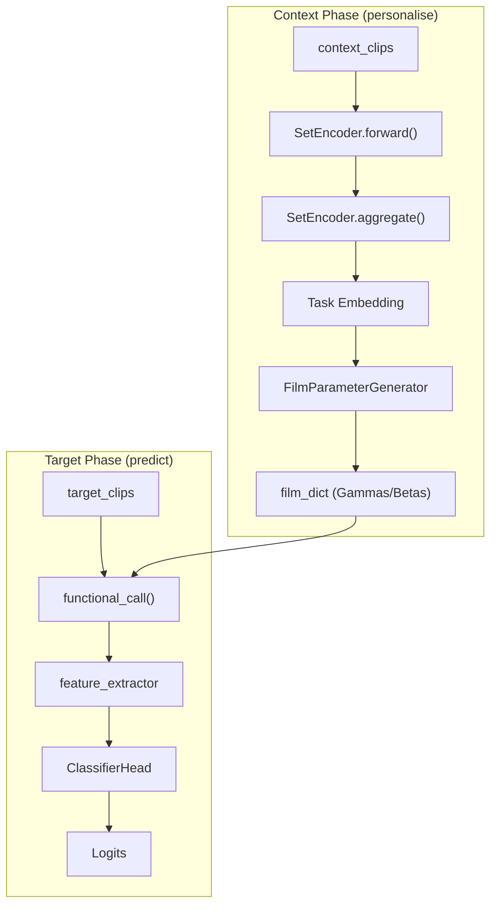
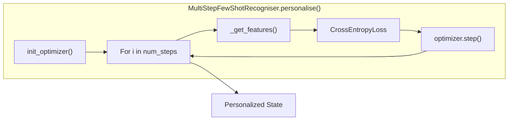

<!-- source: DeepWiki mcp.deepwiki.com · repo microsoft/ORBIT-Dataset · page 3.1 FewShotRecogniser Base & Variants · fetched 2026-10-26 -->

# FewShotRecogniser Base & Variants

Relevant source files

The following files were used as context for generating this wiki page:

- [model/few_shot_recognisers.py](model/few_shot_recognisers.py)
- [model/set_encoders.py](model/set_encoders.py)

This page provides a detailed technical overview of the `FewShotRecogniser` class hierarchy. These classes define the lifecycle of a few-shot recognition task, including how a model is personalized to a specific user's context (support) set and how it subsequently predicts labels for target (query) videos.

## The FewShotRecogniser Base Class

The `FewShotRecogniser` [model/few_shot_recognisers.py:46-50]() is an abstract base class inheriting from `nn.Module`. It establishes the shared infrastructure for all few-shot models in the repository, including the feature extractor, the pooling logic, and the classifier head.

### Key Components
*   **Feature Extractor**: Initialized via `create_feature_extractor` [model/few_shot_recognisers.py:63-68](). It supports various backbones (EfficientNet, ViT, ResNet) and can be configured to use FiLM (Feature Wise Linear Modulation) layers.
*   **Classifier Head**: A pluggable module (e.g., `LinearClassifier`, `VersaClassifier`, `PrototypicalClassifier`) that maps features to class logits [model/few_shot_recognisers.py:71-84]().
*   **Frame Pooler**: A `MeanPooler` [model/few_shot_recognisers.py:87]() that aggregates frame-level features into clip-level or video-level representations.

### The Lifecycle Methods
Every variant must implement or utilize three primary lifecycle stages:
1.  **`personalise`**: Adapts the model to a specific task using a context set of labeled videos.
2.  **`predict`**: Performs inference on unlabeled target videos using the personalized state.
3.  **`_reset`**: Clears task-specific parameters (e.g., FiLM parameters or classifier weights) to prepare for the next task [model/few_shot_recognisers.py:166-174]().

**Sources:** [model/few_shot_recognisers.py:46-174](), [model/poolers.py:31-40]()

---

## SingleStepFewShotRecogniser (CNAPs / ProtoNets)

The `SingleStepFewShotRecogniser` [model/few_shot_recognisers.py:176-180]() is designed for "amortized" meta-learning. Instead of using gradient descent during personalization, it uses an external "task encoder" to generate model parameters in a single forward pass.

### Architecture & Data Flow
This variant introduces a `SetEncoder` [model/few_shot_recognisers.py:192-194]() and a `FilmParameterGenerator` [model/few_shot_recognisers.py:196-200]().

*   **Task Embedding**: The `SetEncoder` (DeepSets) processes context frames to produce a global task representation [model/set_encoders.py:34-45]().
*   **Parameter Generation**: The `FilmParameterGenerator` takes this task embedding and produces FiLM coefficients (gammas and betas) for every adapted layer in the backbone [model/few_shot_recognisers.py:214-218]().
*   **Stateless Inference**: To apply these generated parameters without modifying the backbone's global state, the model uses `torch.nn.utils.stateless.functional_call` [model/few_shot_recognisers.py:114-115]().

### Single-Step Personalization Logic
| Method | Description |
| :--- | :--- |
| `personalise` | Encodes context clips through `SetEncoder`, generates FiLM parameters, and initializes the classifier head (e.g., computing prototypes for ProtoNets) [model/few_shot_recognisers.py:204-225](). |
| `predict` | Passes target clips through the backbone using the generated FiLM dictionary via `functional_call` [model/few_shot_recognisers.py:236-241](). |

**Code Entity Mapping: Single-Step Inference**

**Sources:** [model/few_shot_recognisers.py:176-261](), [model/set_encoders.py:34-80](), [model/feature_adapters.py:34-60]()

---

## MultiStepFewShotRecogniser (FineTuner / MAML)

The `MultiStepFewShotRecogniser` [model/few_shot_recognisers.py:263-267]() implements gradient-based personalization. It does not use a task encoder; instead, it updates parameters (or generated parameters) via optimization steps on the context set.

### FineTuner vs. MAML
1.  **FineTuner**: Typically freezes the backbone and only trains a task-specific `LinearClassifier` or unfreezes specific FiLM layers [model/few_shot_recognisers.py:328-335]().
2.  **MAML**: Performs a bi-level optimization where the `personalise` step involves a small number of inner-loop gradient updates to the model weights before the outer-loop update.

### Implementation Details
*   **Optimization**: The `personalise` method initializes a per-task optimizer (e.g., SGD or Adam) [model/few_shot_recognisers.py:313-323]().
*   **LITE (Learned Intermediate Training Embeddings)**: To save memory during multi-step optimization, the model can pre-extract and cache backbone features if the backbone is frozen, only backpropagating through the head [model/few_shot_recognisers.py:339-346]().

**Code Entity Mapping: Multi-Step Personalization**

**Sources:** [model/few_shot_recognisers.py:263-365](), [utils/optim.py:32-55]()

---

## Memory Optimization: LITE

The **LITE** (Learned Intermediate Training Embeddings) optimization is critical for handling the high memory demands of video tasks.

1.  **Feature Caching**: If `self.learn_extractor` is `False`, LITE extracts features for the entire context set once [model/few_shot_recognisers.py:342-344]().
2.  **Stateless Heads**: During the personalization loop, only the classifier head is updated.
3.  **Reduced Overhead**: This prevents the need to store activation tensors for the deep backbone during the multiple gradient steps of the `FineTuner` [model/few_shot_recognisers.py:348-353]().

**Sources:** [model/few_shot_recognisers.py:339-365](), [model/feature_extractors.py:55-70]()

---

## Classifier Heads

The `FewShotRecogniser` delegates the final classification logic to specialized head modules.

| Class | Logic | Reference |
| :--- | :--- | :--- |
| `LinearClassifier` | Standard FC layer; weights often initialized from context prototypes. | [model/classifier_heads.py:36-50]() |
| `PrototypicalClassifier` | Computes squared Euclidean or Cosine distance to class means (prototypes). | [model/classifier_heads.py:108-125]() |
| `VersaClassifier` | Probabilistic head using a distribution over weights. | [model/classifier_heads.py:76-106]() |
| `MahalanobisClassifier` | Uses class-specific covariances for distance metrics. | [model/classifier_heads.py:159-180]() |

**Sources:** [model/classifier_heads.py:36-180](), [model/few_shot_recognisers.py:71-84]()

---

