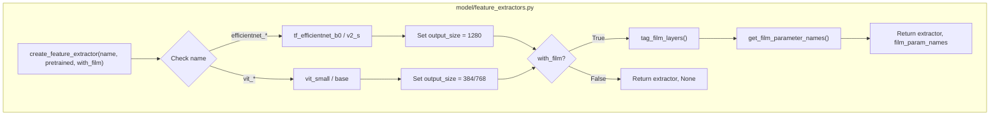

<!-- source: DeepWiki mcp.deepwiki.com · repo microsoft/ORBIT-Dataset · page 3.2 Feature Extractors & FiLM Adaptation · fetched 2026-10-26 -->

# Feature Extractors & FiLM Adaptation

<details>
<summary>Relevant source files</summary>

The following files were used as context for generating this wiki page:

- [model/feature_adapters.py](model/feature_adapters.py)
- [model/feature_extractors.py](model/feature_extractors.py)
- [model/film.py](model/film.py)

</details>


This page details the implementation of the backbone networks used for feature extraction and the Feature Linear Modulation (FiLM) adaptation mechanism. The ORBIT framework supports a variety of architectures (EfficientNet, ViT) and provides a dynamic system for adapting these backbones to specific tasks using a parameter generation network.

## Feature Extractor Configuration

The framework utilizes the `timm` (PyTorch Image Models) library to load pre-trained backbones. Supported architectures include EfficientNet variants and Vision Transformers (ViT). Each backbone is configured with a specific `output_size` which determines the input dimensionality for subsequent classifier heads.

### Supported Backbones
| Feature Extractor Name | Implementation | Pre-trained Source | Output Size |
|:---|:---|:---|:---|
| `efficientnet_b0` | `tf_efficientnet_b0` | GitHub (rwightman) | 1280 |
| `efficientnet_v2_s` | `tf_efficientnetv2_s_in21k` | GitHub (rwightman) | 1280 |
| `vit_s_32` | `vit_small_patch32_224_in21k` | Google Storage | 384 |
| `vit_b_32` | `vit_base_patch32_224_in21k` | Google Storage | 768 |
| `vit_b_32_clip` | `vit_base_patch32_224_clip_laion2b` | HuggingFace (LAION-2B) | 768 |

The function `create_feature_extractor` in `model/feature_extractors.py` handles the initialization of these models [model/feature_extractors.py:37-66](). It also manages freezing the backbone if `learn_extractor` is set to `False` [model/feature_extractors.py:68-69]().

### Backbone Initialization Flow
The following diagram illustrates how the system transitions from configuration strings to instantiated `timm` modules.

**Backbone Creation Logic**

Sources: [model/feature_extractors.py:37-79](), [model/film.py:38-74]()

---

## FiLM Adaptation System

FiLM (Feature Linear Modulation) is used to adapt the feature extractor to a specific task by applying an affine transformation to intermediate feature maps (normalization layers).

### Layer Tagging and Identification
To support FiLM, specific layers within the backbone must be identified and "tagged". This is performed by `tag_film_layers` [model/film.py:38]().

- **EfficientNet**: Tags the Batch Normalization layers (`bn1`, `bn2`) within `EdgeResidual`, `ConvBnAct`, `InvertedResidual`, and `CondConvResidual` blocks [model/film.py:41-46]().
- **Vision Transformer (ViT)**: Tags Layer Normalization (`norm`, `norm1`, `norm2`) or Group Normalization layers [model/film.py:62]().

Tagged layers are assigned a `.film = True` attribute [model/film.py:53](), which is later used by `get_film_parameter_names` to extract the full parameter paths (e.g., `blocks.0.0.bn1.weight`) [model/film.py:68-74]().

### FilmParameterGenerator
The `FilmParameterGenerator` class is responsible for dynamically generating the $\gamma$ (scaling) and $\beta$ (shifting) parameters for the tagged layers based on a task embedding [model/feature_adapters.py:36]().

1.  **Initialization**: It stores the `initial_film_parameters` (the pre-trained weights/biases of the tagged layers) [model/feature_adapters.py:42]().
2.  **Generators**: For every tagged parameter, it creates a `DenseBlock` (MLP) that maps the task embedding (from a `SetEncoder`) to the required parameter size [model/feature_adapters.py:48-49]().
3.  **Regularizers**: It maintains a `ParameterList` of learnable weights used to scale the generated parameters, initialized with a small standard deviation (0.001) [model/feature_adapters.py:50-51]().

### Parameter Generation Logic
The `forward` pass of the generator computes the adapted parameters [model/feature_adapters.py:66-78]():
- **Weights ($\gamma$)**: $W_{adapted} = W_{initial} \times (G(x) \times R + 1)$
- **Biases ($\beta$)**: $B_{adapted} = B_{initial} + (G(x) \times R)$
Where $G(x)$ is the output of the generator MLP and $R$ is the learnable regularizer.

### Entity Relationship: FiLM Components
This diagram maps the logical FiLM concepts to their implementation entities.

**FiLM Implementation Mapping**
```mermaid
classDiagram
    class FeatureExtractor {
        <<timm module>>
        +tag_film_layers()
        +film_param_names
    }
    class FilmParameterGenerator {
        +generators: ModuleList(DenseBlock)
        +regularizers: ParameterList
        +initial_film_parameters: dict
        +forward(task_embedding)
    }
    class NullGenerator {
        +forward(x) : returns {}
    }
    class DenseBlock {
        <<model/mlps.py>>
        +forward(x)
    }

    FeatureExtractor ..> FilmParameterGenerator : "Provides target layer names"
    FilmParameterGenerator *-- DenseBlock : "Uses to generate shifts"
    FilmParameterGenerator ..> FeatureExtractor : "Modulates layers during forward"
```
Sources: [model/film.py:38-74](), [model/feature_adapters.py:36-96](), [model/feature_extractors.py:71-77]()

---

## Dynamic Adaptation Flow

The data flow for feature adaptation occurs during the `personalise` step of the model.

1.  **Task Embedding**: The context set is processed by a `SetEncoder` to produce a task-specific embedding $x$.
2.  **Parameter Generation**: $x$ is passed to `FilmParameterGenerator.forward(x)`, which returns a dictionary of adapted weights and biases [model/feature_adapters.py:66-78]().
3.  **Application**: These generated parameters are passed into the feature extractor using `torch.func.functional_call` (in the `FewShotRecogniser` subclasses), allowing the backbone to use task-specific weights without permanent state modification.
4.  **Regularization**: The generator tracks an `l2_term` based on the `regularizers` [model/feature_adapters.py:76](), which is added to the training loss to encourage the model to stay close to the pre-trained weights [model/feature_adapters.py:63-64]().

If feature adaptation is disabled (`--adapt_features False`), a `NullGenerator` is used, which returns an empty dictionary and zero regularization [model/feature_adapters.py:80-96]().

Sources: [model/feature_adapters.py:36-96](), [model/film.py:68-95](), [model/feature_extractors.py:37-79]()

---

