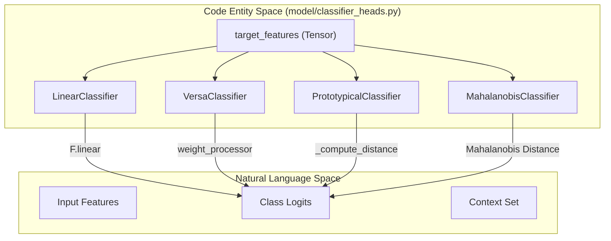
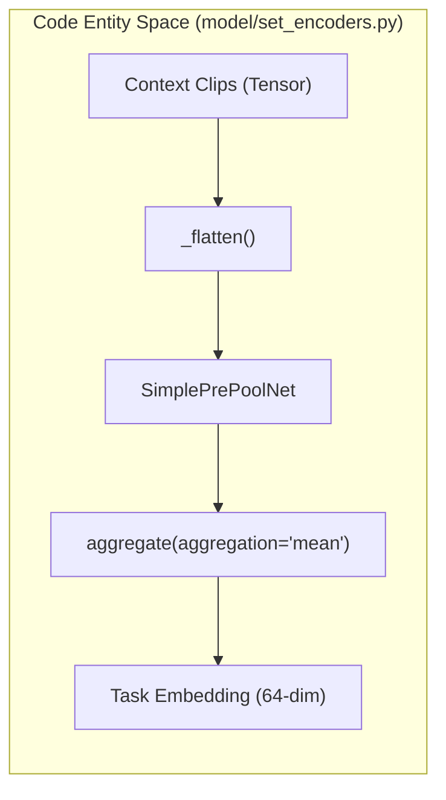

<!-- source: DeepWiki mcp.deepwiki.com · repo microsoft/ORBIT-Dataset · page 3.3 Classifier Heads & Set Encoders · fetched 2026-10-26 -->

# Classifier Heads & Set Encoders

Relevant source files

The following files were used as context for generating this wiki page:

- [model/__init__.py](model/__init__.py)
- [model/classifier_heads.py](model/classifier_heads.py)
- [model/few_shot_recognisers.py](model/few_shot_recognisers.py)
- [model/mlps.py](model/mlps.py)
- [model/poolers.py](model/poolers.py)
- [model/set_encoders.py](model/set_encoders.py)

This section describes the modular components used by the `FewShotRecogniser` to process features and perform classification. It covers the pluggable classifier heads that map features to class probabilities, the `SetEncoder` used for task-level embeddings, and the pooling mechanisms for temporal aggregation.

### Overview of Components

The architecture separates feature extraction from classification and task adaptation. The `FewShotRecogniser` coordinates these components based on the configuration provided during initialization [model/few_shot_recognisers.py:50-88]().

| Component | Class / Entity | Purpose |
| :--- | :--- | :--- |
| **Classifier Head** | `LinearClassifier`, `VersaClassifier`, `PrototypicalClassifier`, `MahalanobisClassifier` | Maps extracted features to class logits using various few-shot strategies. |
| **Set Encoder** | `SetEncoder` (DeepSets) | Generates a permutation-invariant task embedding from a context set. |
| **Pooler** | `MeanPooler` | Aggregates frame-level features into clip-level representations. |
| **MLP Blocks** | `DenseResidualBlock`, `DenseBlock` | Supporting neural layers for hyper-networks and adapters. |

**Sources:** [model/few_shot_recognisers.py:46-88](), [model/set_encoders.py:34-37](), [model/poolers.py:7-16]()

---

### Classifier Heads

The repository implements several classifier variants, ranging from standard linear layers to metric-learning heads and hyper-networks.

#### 1. LinearClassifier
A standard linear layer (`nn.Linear`) that is typically initialized per-task. It is used in gradient-based personalization methods like the `FineTuner` [model/classifier_heads.py:38-42]().
* **Initialization**: The `init` method creates weight and bias parameters based on the number of classes in the current task [model/classifier_heads.py:53-60]().
* **Prediction**: Computes logits as `logit_scale * (W * x + b)` [model/classifier_heads.py:70]().

#### 2. VersaClassifier
Based on the Versa architecture, this head uses hyper-networks to generate class weights and biases from context features [model/classifier_heads.py:121-125]().
* **Hyper-networks**: Employs `weight_processor` and `bias_processor`, which are `DenseResidualBlock` instances [model/classifier_heads.py:133-134]().
* **Mechanism**: It computes mean class representations from the context set and passes them through the processors to generate the linear layer parameters [model/classifier_heads.py:153-174]().

#### 3. PrototypicalClassifier
Implements Prototypical Networks. It computes a "prototype" (mean vector) for each class in the context set and classifies target features based on distance to these prototypes [model/classifier_heads.py:192-196]().
* **Distances**: Supports `euclidean` (default) or `cosine` distance functions [model/classifier_heads.py:198-202]().

#### 4. MahalanobisClassifier
An extension of prototypical networks that accounts for class covariance. It computes per-class means and a precision matrix (inverse covariance) to calculate Mahalanobis distances [model/classifier_heads.py:255-259]().

**Classifier Data Flow and Entity Mapping**

**Sources:** [model/classifier_heads.py:38-80](), [model/classifier_heads.py:121-180](), [model/classifier_heads.py:192-253](), [model/classifier_heads.py:255-325]()

---

### Set Encoders (DeepSets)

The `SetEncoder` is used to generate a task-level embedding from the context set, which is often required by FiLM parameter generators to adapt the feature extractor to a specific task [model/set_encoders.py:34-37]().

* **Implementation**: It implements the DeepSets architecture, which ensures the resulting embedding is invariant to the order of elements in the set [model/set_encoders.py:36]().
* **SimplePrePoolNet**: This internal component consists of five convolutional layers that reduce input frames to 64-dimensional embeddings [model/set_encoders.py:81-120]().
* **Aggregation**: The `aggregate` function typically performs a `mean` operation across all encoded elements in the set to produce a single task vector [model/set_encoders.py:61-75]().

**Task Embedding Pipeline**

**Sources:** [model/set_encoders.py:34-80](), [model/set_encoders.py:81-120]()

---

### Pooling & Supporting Blocks

#### MeanPooler
The `MeanPooler` is responsible for temporal aggregation. In the ORBIT pipeline, models often process "clips" (sequences of frames). The `MeanPooler` takes frame-level features and averages them over the temporal dimension `T` to create a single clip-level feature vector [model/poolers.py:7-16]().

#### MLP Blocks
Located in `model/mlps.py`, these blocks provide the foundation for hyper-networks like those in `VersaClassifier` or FiLM generators.
* **DenseResidualBlock**: A linear layer followed by two internal linear layers with ELU activations and a residual skip connection [model/mlps.py:33-50]().
* **DenseBlock**: A simpler sequential block containing `Linear -> LayerNorm -> ReLU -> Linear` [model/mlps.py:52-63]().

**Sources:** [model/poolers.py:7-16](), [model/mlps.py:33-63]()

---

