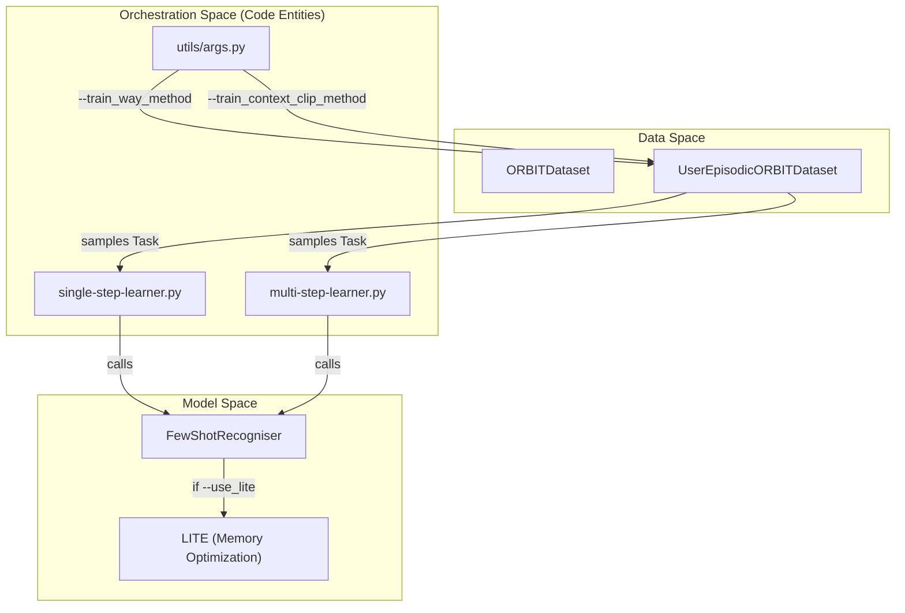

<!-- source: DeepWiki mcp.deepwiki.com · repo microsoft/ORBIT-Dataset · page 4 Training & Personalization · fetched 2026-10-26 -->

# Training & Personalization

<details>
<summary>Relevant source files</summary>

The following files were used as context for generating this wiki page:

- [README.md](README.md)
- [data/orbit_extra_annotations.zip](data/orbit_extra_annotations.zip)
- [utils/args.py](utils/args.py)

</details>


The ORBIT framework supports a variety of learning paradigms to address the challenge of few-shot video recognition. Training is primarily orchestrated through two main learner scripts, which handle different optimization strategies: single-step meta-learning (e.g., CNAPs, ProtoNets) and multi-step gradient-based personalization (e.g., FineTuner, MAML).

## Learning Paradigms

The framework categorizes models based on how they adapt to a new user's objects. This distinction is reflected in the high-level orchestration scripts and the underlying model classes.

### 1. Single-Step Learning
Single-step learners use a feed-forward approach to adaptation. A set encoder processes the context (support) set to produce a task embedding, which is then used to generate parameters (via FiLM) or prototypes for classification. This is orchestrated by `single-step-learner.py` [single-step-learner.py:1-10]().
*   **Models:** CNAPs, Simple CNAPs, ProtoNets.
*   **Key Logic:** Uses the `Learner` class to manage meta-training loops [single-step-learner.py:30-35]().
*   **Details:** See [Single-Step Learner (CNAPs & ProtoNets)](#4.1).

### 2. Multi-Step Learning (Fine-Tuning)
The FineTuner approach initializes a model and performs multiple steps of gradient descent on the context set of a specific task to "personalize" the weights before performing inference on the target set.
*   **Models:** FineTuner (Standard SGD/Adam adaptation).
*   **Key Logic:** Orchestrated by `multi-step-learner.py` [multi-step-learner.py:1-10]().
*   **Details:** See [Multi-Step Learner (FineTuner)](#4.2).

### 3. Optimization-Based Meta-Learning (MAML)
MAML performs bi-level optimization. It learns a model initialization that can be adapted to a new task in a few gradient steps. While it uses multiple steps for personalization, the training objective optimizes for the post-adaptation performance.
*   **Models:** MAML.
*   **Key Logic:** Implemented within the `MultiStepFewShotRecogniser` logic and orchestrated by `multi-step-learner.py` [multi-step-learner.py:12-20]().
*   **Details:** See [MAML Learner](#4.3).

---

## Training Orchestration

Training is driven by command-line arguments defined in `utils/args.py` [utils/args.py:12-15](). These arguments control the sampling of "tasks" (episodes), which are the fundamental unit of training in ORBIT.

### Task Sampling & Data Flow
The `Learner` classes interact with the `UserEpisodicORBITDataset` to sample tasks consisting of a **Context Set** (clean videos for personalization) and a **Target Set** (clutter or clean videos for evaluation) [data/dataset.py:343-350]().

**Code Entity Association: Training Data Flow**

**Sources:** [utils/args.py:39-75](), [data/dataset.py:343-380](), [single-step-learner.py:110-120]()

### LITE Training
To support large images (224x224) on consumer GPUs, the framework implements **LITE (Large Image and Task Episodic)** training. LITE reduces memory consumption by avoiding the storage of intermediate activations for the entire task, instead processing clips in a memory-efficient manner during the meta-training step [README.md:5-6]().
*   **Activation:** Triggered by the `--use_lite` flag in `utils/args.py` [utils/args.py:122-123]().
*   **Function:** `train_task_with_lite` in the Single-Step Learner [single-step-learner.py:228-230]().

---

## Learning Paradigm Comparison

| Feature | Single-Step (CNAPs/Proto) | Multi-Step (FineTuner) | MAML |
| :--- | :--- | :--- | :--- |
| **Adaptation Method** | Parameter Generation / Prototypes | Gradient Descent (SGD/Adam) | Bi-level Gradient Optimization |
| **Script** | `single-step-learner.py` | `multi-step-learner.py` | `multi-step-learner.py` |
| **Personalization Speed** | Very Fast (Feed-forward) | Slow (Iterative) | Slow (Iterative) |
| **Memory Efficiency** | High (with LITE) | Moderate | Low (Higher grad requirements) |

**Code Entity Association: Learner Hierarchy**
```mermaid
graph TD
    subgraph "Base Classes"
        FSR["FewShotRecogniser (model/few_shot_recogniser.py)"]
    end

    subgraph "Implementation Classes"
        SSFSR["SingleStepFewShotRecogniser"]
        MSFSR["MultiStepFewShotRecogniser"]
    end

    subgraph "Execution Scripts"
        SSL_SCRIPT["single-step-learner.py"]
        MSL_SCRIPT["multi-step-learner.py"]
    end

    FSR <|-- SSFSR
    FSR <|-- MSFSR
    SSL_SCRIPT --> SSFSR
    MSL_SCRIPT --> MSFSR
```
**Sources:** [model/few_shot_recogniser.py:12-25](), [single-step-learner.py:1-20](), [multi-step-learner.py:1-20]()

---

## Child Pages
*   **[Single-Step Learner (CNAPs & ProtoNets)](#4.1)**: Details on the `Learner` class, `train_task` logic, and FiLM regularization.
*   **[Multi-Step Learner (FineTuner)](#4.2)**: Details on per-task gradient updates and computational profiling during personalization.
*   **[MAML Learner](#4.3)**: Details on the MAML implementation and bi-level optimization logic.
*   **[Configuration & Hyperparameters](#4.4)**: Exhaustive reference for all CLI arguments in `utils/args.py`.

**Sources:** [README.md:57-85](), [utils/args.py:12-130](), [single-step-learner.py:1-50](), [multi-step-learner.py:1-50]()

---

