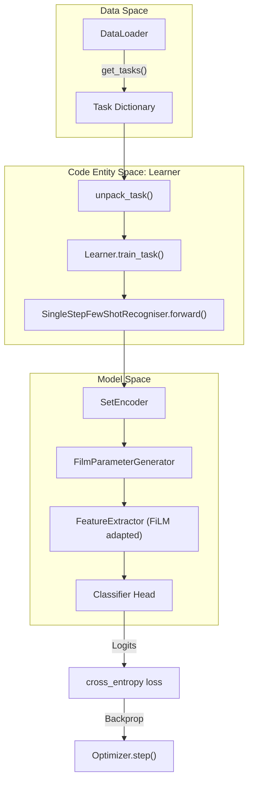

<!-- source: DeepWiki mcp.deepwiki.com · repo microsoft/ORBIT-Dataset · page 4.1 Single-Step Learner (CNAPs & ProtoNets) · fetched 2026-10-26 -->

# Single-Step Learner (CNAPs & ProtoNets)

<details>
<summary>Relevant source files</summary>

The following files were used as context for generating this wiki page:

- [single-step-learner.py](single-step-learner.py)
- [utils/args.py](utils/args.py)
- [utils/optim.py](utils/optim.py)

</details>


The single-step learner paradigm in the ORBIT codebase refers to meta-learning approaches where personalization to a new user occurs in a single forward pass without gradient-based updates. This is primarily used for **CNAPs** (Conditional Neural Adaptive Processes) and **ProtoNets** (Prototypical Networks). The orchestration of training and evaluation for these models is handled by `single-step-learner.py` [single-step-learner.py:1-45]().

## The Learner Class

The `Learner` class is the central controller for the single-step training pipeline. It initializes the dataset loaders, the model architecture, and the evaluators, and manages the training loop across epochs [single-step-learner.py:53-78]().

### Initialization and Data Flow
During initialization, the `Learner` configures the `SingleStepFewShotRecogniser` based on command-line arguments, including the choice of feature extractor (e.g., EfficientNet, ViT) and classifier head (e.g., Prototypical, Mahalanobis, or Linear) [single-step-learner.py:121-127]().

### System Data Flow: Single-Step Meta-Training
The following diagram illustrates how data moves from the `DataLoader` through the `Learner` and into the `SingleStepFewShotRecogniser`.

**Data Flow: Task-Based Learning**

**Sources:** [single-step-learner.py:116-127](), [single-step-learner.py:149-160](), [data/utils.py:39-39]()

## Task Training Mechanisms

The `Learner` supports two primary methods for processing a training task, depending on memory constraints: `train_task` and `train_task_with_lite`.

### Standard Training (`train_task`)
In the standard `train_task` method, the entire task (context and target sets) is passed to the model.
1.  **Unpacking**: The task dictionary is decomposed into context/target images and labels [single-step-learner.py:175-177]().
2.  **Forward Pass**: The model computes logits for the target images based on the context images [single-step-learner.py:179-179]().
3.  **Loss Calculation**: The `cross_entropy` loss is calculated. If `adapt_features` is enabled (CNAPs mode), a **FiLM regularization loss** is added to prevent the generated FiLM parameters from deviating too far from identity [single-step-learner.py:180-182]().

### LITE Training (`train_task_with_lite`)
When `args.with_lite` is enabled, the learner uses the **LITE** (Learned Intermediate Token Estimation) optimization to handle large tasks that would otherwise exceed GPU memory [single-step-learner.py:192-212]().
-   The target set is broken into smaller batches using `get_batch_indices` [single-step-learner.py:202-202]().
-   The model processes the context set once to generate task-specific parameters (or prototypes) and then iterates through target batches [single-step-learner.py:203-207]().
-   Gradients are accumulated across batches before the optimizer update [single-step-learner.py:211-212]().

**Sources:** [single-step-learner.py:173-190](), [single-step-learner.py:192-212](), [utils/optim.py:8-9]()

## Optimization and Scheduling

The training lifecycle is governed by a standard PyTorch optimizer and a scheduler from the `timm` library [utils/optim.py:6-6]().

| Component | Logic | Code Reference |
| :--- | :--- | :--- |
| **Optimizer** | Supports `Adam` and `SGD`. Uses a separate `extractor_lr_scale` for the backbone. | [utils/optim.py:11-32]() |
| **Scheduler** | Supports `multistep` and `cosine` decay patterns via `timm.scheduler`. | [utils/optim.py:34-43]() |
| **FiLM Regularization** | L2 penalty on FiLM parameters, weighted by `film_reg_coeff`. | [single-step-learner.py:182-182]() |

### System Architecture: Optimization Lifecycle
The diagram below shows the relationship between the `Learner` and the optimization utilities.

**Optimization Entity Mapping**
```mermaid
graph LR
    subgraph "Natural Language Space"
        "Learning Rate Control"
        "Weight Updates"
        "Backbone Scaling"
    end

    subgraph "Code Entity Space"
        L["Learner.run()"] --> IO["init_optimizer()"]
        L --> IS["init_scheduler()"]
        IO --> PE["Param Groups: base_params"]
        IO --> FE["Param Groups: feature_extractor.parameters()"]
        FE -- "Applied Scale" --> LR["extractor_lr_scale"]
    end
```
**Sources:** [single-step-learner.py:139-140](), [utils/optim.py:11-30]()

## Evaluation Integration

The `Learner` integrates three specialized evaluator classes to track performance [single-step-learner.py:128-134]():
1.  **TrainEvaluator**: Logs `frame_acc` during the training loop [single-step-learner.py:132-132]().
2.  **ValidationEvaluator**: Used at the end of each epoch to determine the "best" model checkpoint [single-step-learner.py:133-133]().
3.  **TestEvaluator**: Executed after training (or in `test` mode) to provide final benchmark metrics, including `video_acc` and `frames_to_recognition`. It also includes an `OpsCounter` to profile computational cost [single-step-learner.py:134-134]().

**Sources:** [single-step-learner.py:128-135](), [single-step-learner.py:161-171]()

---

