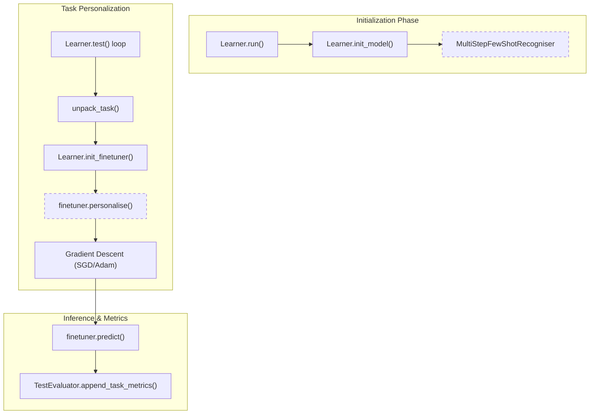
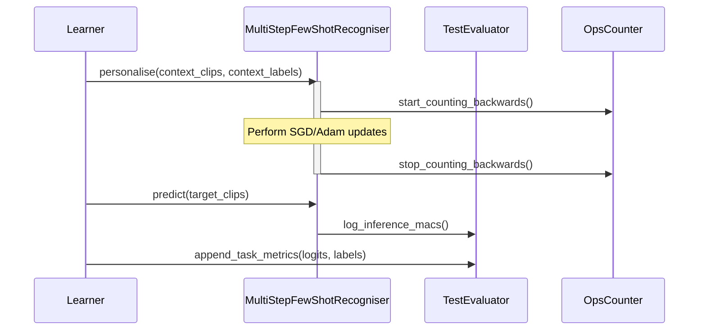

<!-- source: DeepWiki mcp.deepwiki.com · repo microsoft/ORBIT-Dataset · page 4.2 Multi-Step Learner (FineTuner) · fetched 2026-10-26 -->

# Multi-Step Learner (FineTuner)

Relevant source files

The following files were used as context for generating this wiki page:

- [multi-step-learner.py](multi-step-learner.py)
- [utils/args.py](utils/args.py)

The Multi-Step Learner (FineTuner) provides a framework for gradient-based personalization. Unlike single-step learners that use a set encoder to generate task-specific parameters in a single forward pass, the FineTuner initializes a model and performs multiple steps of gradient descent (e.g., SGD or Adam) on the context set of a specific task before performing inference on target videos.

## Overview and Execution Flow

The entry point for this learning paradigm is `multi-step-learner.py` [multi-step-learner.py:1-48](). The execution is managed by the `Learner` class [multi-step-learner.py:52-81](), which orchestrates model initialization, data loading via `DataLoader`, and the evaluation loop. 

The FineTuner operates exclusively in a "test-time adaptation" mode within this repository. It loads a pre-trained backbone (and optionally FiLM layers) and adapts to a new user's objects by fine-tuning the classifier head and/or the feature extractor on the provided context clips [multi-step-learner.py:154-162]().

### System Entity Mapping: Learner Logic
The following diagram maps the logical personalization steps to the specific classes and methods implemented in the codebase.

**FineTuner Personalization Lifecycle**

**Sources:** [multi-step-learner.py:49-50](), [multi-step-learner.py:108-115](), [multi-step-learner.py:146-162](), [multi-step-learner.py:117-122]().

## MultiStepFewShotRecogniser

The core model class is `MultiStepFewShotRecogniser`, defined in `model/few_shot_recognisers.py` [model/few_shot_recognisers.py:40](). It inherits from the base `FewShotRecogniser` and implements the gradient-based personalization logic.

### Key Components
*   **Feature Extractor:** Backbones such as EfficientNet or ViT, configured via `self.args.feature_extractor` [multi-step-learner.py:109]().
*   **Classifier Head:** Pluggable heads (Linear, Proto, etc.) defined in `self.args.classifier` [multi-step-learner.py:109]().
*   **Personalization Method:** The `personalise()` method resets the classifier (and optionally the feature extractor) and performs optimization steps [multi-step-learner.py:162]().

### Data Flow and Profiling
The FineTuner is integrated with `OpsCounter` to profile the computational cost of personalization (backwards pass) and inference (forward pass) [multi-step-learner.py:126]().

**Data Flow: Task Processing**
| Step | Function/Method | Description |
| :--- | :--- | :--- |
| 1 | `unpack_task` | Extracts `context_clips` and `target_frames_by_video` from the task dictionary [multi-step-learner.py:147](). |
| 2 | `init_finetuner` | Creates a fresh copy of the model for the current task [multi-step-learner.py:154](). |
| 3 | `personalise` | Updates model weights using the context set and the specified optimizer (SGD/Adam) [multi-step-learner.py:162](). |
| 4 | `predict` | Generates object predictions for target video frames [multi-step-learner.py:175](). |

**Sources:** [multi-step-learner.py:142-180](), [model/few_shot_recognisers.py:40]().

## Personalization and Inference

The personalization process is highly configurable via CLI arguments defined in `utils/args.py`.

### Optimization Parameters
*   **Optimizer:** Choice between `sgd` and `adam` via `--personalize_optimizer` [utils/args.py:113]().
*   **Learning Rate:** Set via `--personalize_lr` [utils/args.py:115]().
*   **Steps:** Number of gradient steps performed per task via `--personalize_num_steps` [utils/args.py:117]().
*   **Batch Size:** Size of context clip batches used during personalization via `--batch_size` [utils/args.py:107]().

### Computational Profiling
The `TestEvaluator` is initialized with `with_ops_counter=True` and `count_backwards=True` [multi-step-learner.py:126](). This ensures that the Multiply-Accumulate operations (MACs) for the gradient updates during personalization are captured alongside the standard inference MACs. The `test()` method calls `self.test_evaluator.set_base_params(self.model)` to establish a baseline for parameter counting before task-specific adaptation begins [multi-step-learner.py:140]().

**Entity Interaction: Personalization & Profiling**

**Sources:** [multi-step-learner.py:126](), [multi-step-learner.py:140-141](), [multi-step-learner.py:162-175](), [utils/args.py:113-117]().

## Summary of Configuration Options

The following arguments from `utils/args.py` specifically impact the Multi-Step Learner:

| Argument | Purpose |
| :--- | :--- |
| `--learn_extractor` | If True, gradients are propagated through the entire backbone during personalization [utils/args.py:29-30](). |
| `--adapt_features` | If True, only FiLM parameters are updated during personalization [utils/args.py:31-32](). |
| `--personalize_optimizer` | Selects the optimizer for the multi-step update [utils/args.py:113](). |
| `--personalize_num_steps` | Defines the number of optimization iterations per task [utils/args.py:117](). |

**Sources:** [utils/args.py:27-36](), [utils/args.py:113-118]().

---

