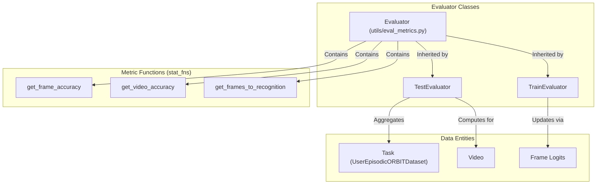
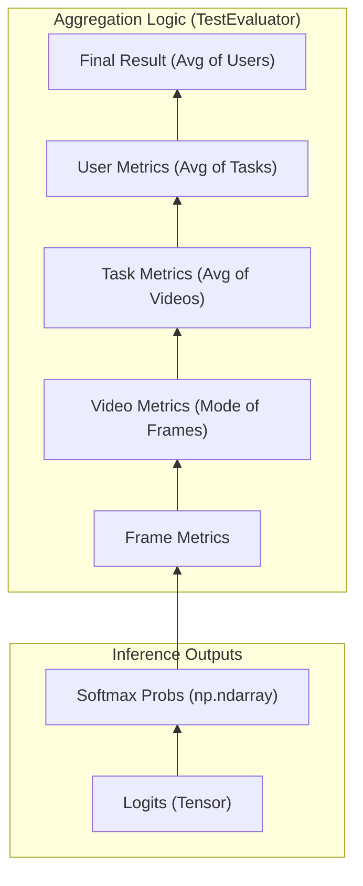

<!-- source: DeepWiki mcp.deepwiki.com · repo microsoft/ORBIT-Dataset · page 5.1 Evaluator Classes & Metric Hierarchy · fetched 2026-10-26 -->

# Evaluator Classes & Metric Hierarchy

Relevant source files

The following files were used as context for generating this wiki page:

- [utils/eval_metrics.py](utils/eval_metrics.py)
- [utils/logging.py](utils/logging.py)
- [utils/ops_counter.py](utils/ops_counter.py)

The evaluation framework in the ORBIT codebase is designed to handle the multi-level nature of few-shot video recognition. It provides mechanisms to track performance from individual frames up to user-level aggregations, while also accounting for computational efficiency through integrated profiling.

## Evaluator Hierarchy and Implementation

The evaluation logic is centered around the `Evaluator` base class and its specialized descendants. These classes manage the calculation of core metrics and the aggregation of results across different evaluation stages (training, validation, and testing).

### Base Evaluator
The `Evaluator` class [utils/eval_metrics.py:14-15]() defines the core metric functions used across the repository. It maps metric names to implementation functions via the `self.stat_fns` dictionary [utils/eval_metrics.py:18-22]().

### Specialized Evaluators
*   **`TrainEvaluator`**: Used during meta-training to track batch-level statistics. It maintains `current_stats` for the latest batch and `running_stats` to compute mean performance across an epoch [utils/eval_metrics.py:71-76]().
*   **`TestEvaluator`**: A complex evaluator used for validation and testing. It handles hierarchical data storage (User → Task → Object → Video → Frame) and manages the `OpsCounter` for tracking computational MACs and parameters [utils/eval_metrics.py:101-110]().

### Evaluator Class Relationship
The following diagram illustrates the relationship between the evaluator classes and the data entities they process.

**Evaluator to Code Entity Mapping**

**Sources:** [utils/eval_metrics.py:14-110](), [utils/ops_counter.py:10-14]()

---

## Core Metrics

The framework computes three primary recognition metrics, all derived from frame-level probability distributions.

| Metric | Code Function | Definition |
| :--- | :--- | :--- |
| **Frame Accuracy** | `get_frame_accuracy` | The percentage of frames where the predicted class (highest probability) matches the ground truth label [utils/eval_metrics.py:27-36](). |
| **Video Accuracy** | `get_video_accuracy` | A binary score (1.0 or 0.0) per video. A video is "correct" if the most frequent frame-level prediction matches the video label [utils/eval_metrics.py:38-46](). |
| **Frames-to-Recognition** | `get_frames_to_recognition` | The index of the first correctly predicted frame, normalized by the total number of frames in the video. If no frame is correct, it returns 1.0 [utils/eval_metrics.py:48-60](). |

### Confidence Intervals
For all mean statistics, the `Evaluator` computes a 95% confidence interval using the formula:
$(1.96 \times \text{std}(\text{scores})) / \sqrt{\text{len}(\text{scores})}$ [utils/eval_metrics.py:24-25]().

**Sources:** [utils/eval_metrics.py:18-70]()

---

## Hierarchical Aggregation

The `TestEvaluator` performs a bottom-up aggregation to produce final benchmark results. This is critical because the ORBIT dataset is organized by users, each having multiple tasks and objects.

### Data Flow for Results
The `TestEvaluator.get_mean_stats()` function [utils/eval_metrics.py:155]() processes scores in the following order:
1.  **Video Level**: Frame-level probabilities are reduced to video-level metrics (Accuracy, FTR).
2.  **Task Level**: Metrics are averaged across all target videos within a single task.
3.  **Object Level**: Metrics are grouped and averaged by the specific object being recognized.
4.  **User Level**: Task-level scores are averaged for each user.
5.  **Final Average**: The final benchmark score is the mean of the user-level averages, ensuring each user contributes equally regardless of their number of videos.

**Hierarchical Aggregation Flow**

**Sources:** [utils/eval_metrics.py:113-148](), [utils/eval_metrics.py:155-159]()

---

## Computational Profiling (OpsCounter)

The `TestEvaluator` optionally integrates with `OpsCounter` to measure the cost of personalization and inference.

*   **Parameter Counting**: `set_base_params` calculates the total parameters in the feature extractor, classifier, FiLM generator, and set encoder [utils/ops_counter.py:20-46]().
*   **MACs Tracking**: Uses the `thop` library to profile specific modules. The `compute_macs` function [utils/ops_counter.py:79-86]() applies a multiplier (typically 2) to account for both forward and backward passes during gradient-based personalization (e.g., in FineTuner or MAML) [utils/ops_counter.py:13]().
*   **Custom Ops**: Supports specialized layers (like `Conv2dSame` from `timm`) that are not handled by default profiling hooks [utils/ops_counter.py:71-77]().

**Sources:** [utils/ops_counter.py:10-95](), [utils/eval_metrics.py:106-109]()

---

## Serialization and Model Selection

### results.json
The `TestEvaluator.save()` method [utils/eval_metrics.py:112]() serializes the complete evaluation trace to a `results.json` file. This file contains:
*   User IDs and their corresponding tasks [utils/eval_metrics.py:124-125]().
*   Task-level object lists [utils/eval_metrics.py:132]().
*   MAC counts for personalization [utils/eval_metrics.py:134]().
*   Frame-level predictions for every video, indexed by their original frame ID [utils/eval_metrics.py:144-146]().

### Model Selection Logic
During training, the `ValidationEvaluator` (an instance of `TestEvaluator`) is used to determine the "best" model. The system typically monitors `video_acc` to decide when to save `checkpoint_path_best` [utils/logging.py:25-33]().

**Sources:** [utils/eval_metrics.py:112-154](), [utils/logging.py:13-33]()

---

