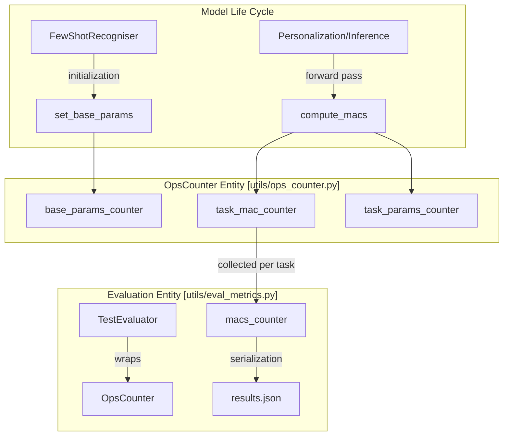
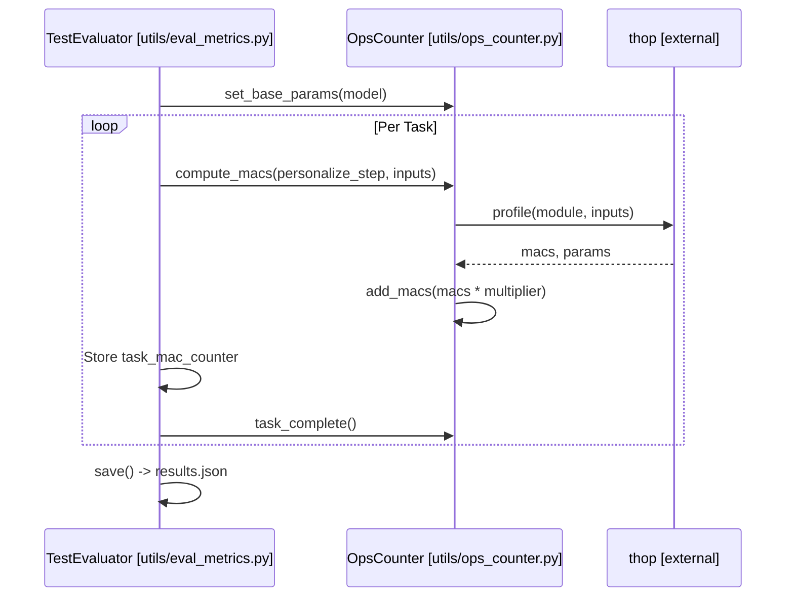

<!-- source: DeepWiki mcp.deepwiki.com · repo microsoft/ORBIT-Dataset · page 5.2 Computational Profiling (OpsCounter) · fetched 2026-10-26 -->

# Computational Profiling (OpsCounter)

Relevant source files

The following files were used as context for generating this wiki page:

- [environment.yml](environment.yml)
- [requirements.txt](requirements.txt)
- [utils/eval_metrics.py](utils/eval_metrics.py)
- [utils/ops_counter.py](utils/ops_counter.py)

The ORBIT framework provides integrated tools for measuring the computational cost of few-shot personalization and inference. This is primarily handled by the `OpsCounter` class, which tracks Multiply-Accumulate operations (MACs) and parameter counts using the `thop` library. Profiling is essential for evaluating the efficiency of different adaptation strategies (e.g., FiLM vs. Fine-Tuning) in resource-constrained environments.

### System Overview and Dependency Integration

Computational profiling is orchestrated through the `OpsCounter` class, which serves as a wrapper around the `thop` (Torch-OpCounter) library. It is integrated directly into the evaluation lifecycle via the `TestEvaluator`.

| Component | Responsibility |
| :--- | :--- |
| `thop` | Core library for profiling PyTorch models [requirements.txt:3](). |
| `OpsCounter` | Manages stateful tracking of MACs and parameters per task [utils/ops_counter.py:10-15](). |
| `TestEvaluator` | Optionally initializes `OpsCounter` and logs results to `results.json` [utils/eval_metrics.py:102-109](). |

**Profiling Data Flow**
The following diagram illustrates how profiling data flows from the model operations into the final evaluation metrics.

Title: Profiling Data Flow Architecture

Sources: [utils/ops_counter.py:10-95](), [utils/eval_metrics.py:101-154]()

### OpsCounter Implementation Details

The `OpsCounter` class maintains counters for MACs and parameters that are updated during a task's lifecycle.

#### Parameter Tracking
Upon initialization of a test task, `set_base_params` is called to calculate the static footprint of the model. This includes:
*   **Feature Extractor**: Backbone parameters [utils/ops_counter.py:23-25]().
*   **Classifier**: Parameters of the classification head [utils/ops_counter.py:28-31]().
*   **Adaptation Modules**: Parameters for the `film_generator`, `set_encoder`, and the generated `film_params` [utils/ops_counter.py:34-44]().

#### MACs Calculation
MACs are tracked using the `compute_macs` function, which utilizes `thop.profile` [utils/ops_counter.py:79-83](). 
*   **Forward/Backward Multiplier**: If `count_backward` is enabled, the MAC count is multiplied by 2 to approximate the cost of a full training step [utils/ops_counter.py:13]().
*   **Custom Ops**: Standard `thop` does not support all layer types. `OpsCounter` defines `custom_ops` to handle specific layers like `timm.models.layers.Conv2dSame` [utils/ops_counter.py:71-77]().

#### Function Reference
| Function | Description |
| :--- | :--- |
| `set_base_params(base_model)` | Sums parameters across all sub-modules to establish a baseline [utils/ops_counter.py:20](). |
| `compute_macs(module, *inputs)` | Wraps `thop.profile` to count operations for a specific module and input [utils/ops_counter.py:79](). |
| `get_uncounted_modules(model)` | Utility to identify leaf modules that `thop` currently ignores [utils/ops_counter.py:56](). |
| `task_complete()` | Resets task-specific counters for the next episode [utils/ops_counter.py:87](). |

Sources: [utils/ops_counter.py:10-95]()

### Integration with TestEvaluator

The `TestEvaluator` manages the `OpsCounter` during the evaluation of the test set.

1.  **Initialization**: If `with_ops_counter` is passed to the `TestEvaluator` constructor, an `OpsCounter` instance is created [utils/eval_metrics.py:106-107]().
2.  **Per-Task Logging**: During the evaluation loop, the MACs required to personalize the model for a specific user/task are stored in `self.macs_counter` [utils/eval_metrics.py:134]().
3.  **Serialization**: When `save()` is called, the MAC counts are included in the `results.json` file under the key `task_macs_to_personalise` [utils/eval_metrics.py:134, 153]().

**Entity Relationship: Evaluator and Profiler**
This diagram shows how the `TestEvaluator` interacts with the `OpsCounter` methods to capture metrics.

Title: TestEvaluator and OpsCounter Interaction

Sources: [utils/eval_metrics.py:101-154](), [utils/ops_counter.py:79-95]()

### Summary of Metrics Tracked
The system outputs a breakdown of the model's computational footprint:
*   **Total Parameters**: The sum of `base_params_counter` and any task-specific parameters [utils/ops_counter.py:94-95]().
*   **Parameter Breakdown**: A formatted string detailing the contribution of the feature extractor, classifier, and FiLM components [utils/ops_counter.py:48]().
*   **MACs per Task**: The cumulative operations performed during the personalization phase of a few-shot task [utils/eval_metrics.py:134]().

Sources: [utils/ops_counter.py:46-48](), [utils/eval_metrics.py:133-134]()

---

