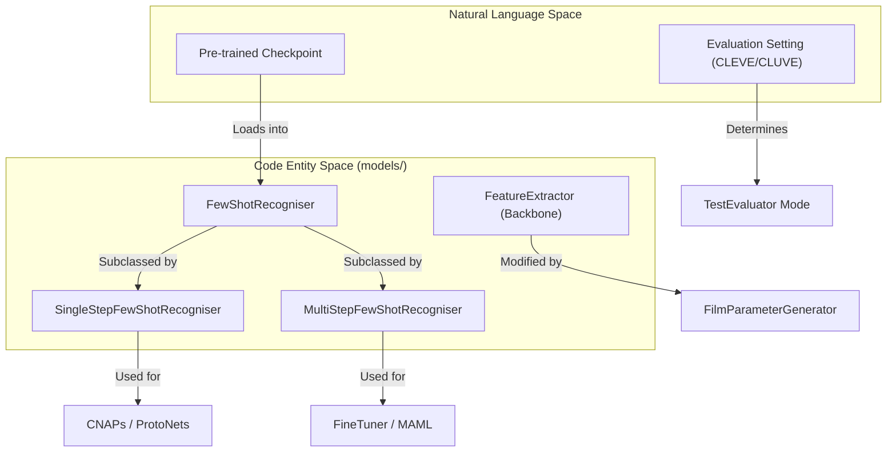
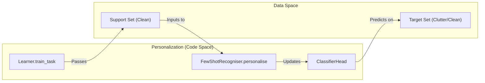

<!-- source: DeepWiki mcp.deepwiki.com · repo microsoft/ORBIT-Dataset · page 6 Pre-trained Checkpoints · fetched 2026-10-26 -->

# Pre-trained Checkpoints

Relevant source files

The following files were used as context for generating this wiki page:

- [README.md](README.md)
- [data/orbit_extra_annotations.zip](data/orbit_extra_annotations.zip)
- [scripts/resize_videos.py](scripts/resize_videos.py)

This page provides a high-level catalogue of available pre-trained model checkpoints for the ORBIT dataset. These checkpoints represent the baseline models evaluated in the ORBIT benchmark and the LITE (Large Image and Task Episodic) training framework.

The checkpoints are categorized by their evaluation setting: **CLEVE** (Clean-video Evaluation) and **CLUVE** (Clutter-video Evaluation). Both settings utilize the same underlying model architectures but are validated and tested against different video types within the ORBIT dataset structure [README.md:73-82]().

### Available Architectures and Backbones
The repository supports several few-shot learning architectures, defined primarily in the `models/` directory. These models utilize various backbones (feature extractors) adapted via FiLM (Feature Instruction Linear Modulation) [models/few_shot_recogniser.py:11-30]().

*   **Architectures**: ProtoNets, CNAPs, SimpleCNAPs, MAML, and FineTuner.
*   **Backbones**: ResNet-18, EfficientNet-B0, and ViT-B-32-CLIP.
*   **Optimization**: Standard training and LITE (Memory Efficient) training for large 224x224 frames [README.md:5-7]().

### Model Configuration Mapping
The following diagram illustrates how the pre-trained checkpoints relate to the core code entities used for personalization and inference.

**Checkpoint to Code Entity Mapping**

Sources: [models/few_shot_recogniser.py:11-30](), [utils/args.py:20-50](), [README.md:73-82]()

---

### Evaluation Settings

The ORBIT benchmark distinguishes between two primary evaluation modes based on the nature of the query (target) videos.

#### CLEVE Checkpoints
The **Clean-video Evaluation (CLEVE)** setting involves tasks where both the support (context) and query (target) videos are "clean" (i.e., the object is centered and clearly visible against a non-distracting background). This setting is typically used to establish a performance ceiling for the models.

For a detailed list of available CLEVE checkpoints, including frame sizes and LITE status, see **[CLEVE Checkpoints](#6.1)**.

#### CLUVE Checkpoints
The **Clutter-video Evaluation (CLUVE)** setting is the primary benchmark for the ORBIT dataset [README.md:77-78](). In this setting, models are personalized using clean support videos but must recognize objects in "clutter" query videos, which contain significant background noise, occlusions, and varied lighting typical of real-world environments.

For a detailed list of available CLUVE checkpoints, including backbone types and frame sizes, see **[CLUVE Checkpoints](#6.2)**.

---

### Checkpoint Lifecycle and Loading
Checkpoints are saved as `.pth` files and contain the state dictionaries for the feature extractor, FiLM generators, and classifier heads. The loading process is handled by the `Learner` classes which initialize the `FewShotRecogniser` based on the arguments passed via `utils/args.py`.

**Personalization Logic Flow**

Sources: [single_step_learner.py:50-80](), [models/few_shot_recogniser.py:100-120](), [README.md:84-88]()

### Summary Table of Baseline Models

| Model | Architecture Type | Backbones Supported | Training Mode |
| :--- | :--- | :--- | :--- |
| **ProtoNets** | Metric-based | ResNet-18, EfficientNet-B0 | Standard / LITE |
| **CNAPs** | Parameter Generation | ResNet-18, EfficientNet-B0 | Standard / LITE |
| **SimpleCNAPs** | Parameter Generation | ResNet-18, EfficientNet-B0 | Standard / LITE |
| **FineTuner** | Gradient-based | ViT-B-32-CLIP | Standard |
| **MAML** | Gradient-based | ResNet-18 | Standard |

Sources: [README.md:4-5](), [utils/args.py:102-140]()

---

