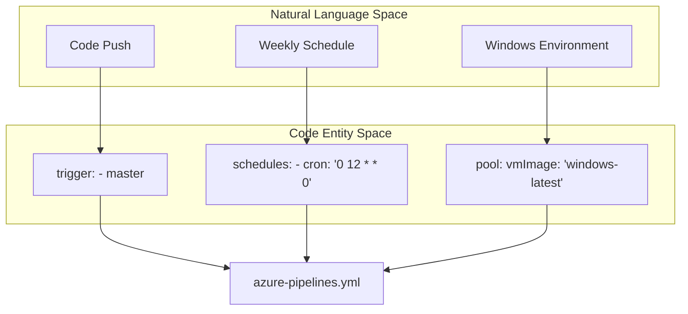
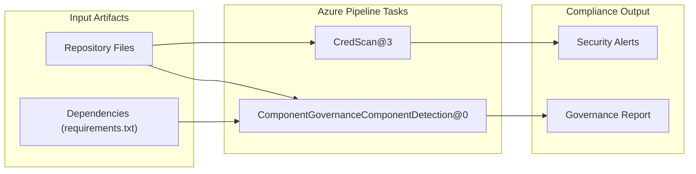

<!-- source: DeepWiki mcp.deepwiki.com · repo microsoft/ORBIT-Dataset · page 7.1 Azure Pipelines Configuration · fetched 2026-10-26 -->

# Azure Pipelines Configuration

Relevant source files

The following files were used as context for generating this wiki page:

- [azure-pipelines.yml](azure-pipelines.yml)

The ORBIT Dataset repository utilizes Azure Pipelines to maintain code security and open-source compliance. The configuration is defined in a single YAML file, focusing on automated security scanning and dependency auditing rather than functional unit testing.

### Pipeline Orchestration

The pipeline is designed to run automatically under two specific conditions: continuous integration on the main branch and a recurring weekly schedule.

| Feature | Configuration |
| :--- | :--- |
| **Trigger** | Pushes to the `master` branch [azure-pipelines.yml:1-2](). |
| **Scheduled Run** | Every Sunday at 12:00 UTC (labeled as "Weekly Monday build") [azure-pipelines.yml:7-13](). |
| **Agent Pool** | Microsoft-hosted `windows-latest` VM image [azure-pipelines.yml:4-5](). |

#### Logic Flow: Trigger to Execution
The following diagram illustrates the transition from a repository event to the execution of the pipeline tasks.

**Trigger and Environment Mapping**

Sources: [azure-pipelines.yml:1-13]()

---

### Security and Compliance Tasks

The pipeline execution consists of two primary tasks focused on repository integrity and legal compliance.

#### 1. Credential Scanning (`CredScan@3`)
The `CredScan@3` task is integrated to search the codebase for exposed secrets, such as API keys, passwords, or certificates, before they are permanently committed to the repository history [azure-pipelines.yml:16]().

#### 2. Component Governance (`ComponentGovernanceComponentDetection@0`)
This task performs a deep scan of the project's dependencies (e.g., those defined in `requirements.txt` or `environment.yml`) to ensure compliance with open-source licensing and to detect known vulnerabilities in third-party libraries [azure-pipelines.yml:18-23]().

**Task Implementation Details**
*   **scanType**: Set to `Register`, ensuring all detected components are logged in the organization's governance portal [azure-pipelines.yml:20]().
*   **verbosity**: Set to `Verbose` to provide detailed logs of the detection process [azure-pipelines.yml:21]().
*   **alertWarningLevel**: Set to `High`, ensuring that significant compliance risks or vulnerabilities trigger immediate alerts [azure-pipelines.yml:22]().

**Compliance Task Data Flow**

Sources: [azure-pipelines.yml:15-23]()

---

### Execution Environment
The pipeline utilizes the `windows-latest` virtual machine pool [azure-pipelines.yml:5](). While the core ORBIT training and evaluation logic is platform-agnostic, the choice of a Windows agent for these specific security tasks is standard for Microsoft-internal compliance workflows. These tasks do not execute the Python training scripts (e.g., `single-step-learner.py`) but rather analyze the static files and configuration within the repository.

Sources: [azure-pipelines.yml:4-5]()

---

