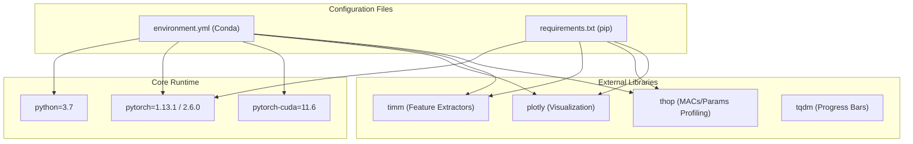

<!-- source: DeepWiki mcp.deepwiki.com · repo microsoft/ORBIT-Dataset · page 7.2 Environment & Dependencies · fetched 2026-10-26 -->

# Environment & Dependencies

<details>
<summary>Relevant source files</summary>

The following files were used as context for generating this wiki page:

- [environment.yml](environment.yml)
- [requirements.txt](requirements.txt)

</details>


This page details the software environment and external dependencies required to run the ORBIT Dataset codebase. The project supports environment reproduction via both Conda (`environment.yml`) and pip (`requirements.txt`). It utilizes PyTorch for model implementation, `timm` for feature extractor backbones, and `thop` for computational profiling.

## Environment Specification Overview

The ORBIT codebase is designed to run in a Python environment with specific versions of PyTorch and CUDA to ensure compatibility with the provided pre-trained checkpoints and evaluation scripts.

### Dependency Management Diagram
The following diagram illustrates how the two configuration files map to the system's software stack.

**Software Stack Mapping**

Sources: [environment.yml:1-19](), [requirements.txt:1-8]()

## Core Dependencies

### PyTorch and CUDA
The repository relies on PyTorch for its core few-shot learning logic. There is a version discrepancy between the two environment files:
*   **Conda (`environment.yml`)**: Pins `pytorch=1.13.1` and `torchvision=0.14.1` with `pytorch-cuda=11.6` [environment.yml:10-12](). This is the recommended configuration for stability with the CUDA 11.6 toolkit.
*   **Pip (`requirements.txt`)**: Specifies `torch==2.6.0` [requirements.txt:1](). Users utilizing this file should ensure their local CUDA drivers are compatible with the newer 2.x runtime.

### Feature Extractors (`timm`)
The `timm` (PyTorch Image Models) library is critical for loading backbone architectures such as EfficientNet and Vision Transformers (ViT). Both environment files pin this to version `0.6.12` [environment.yml:18](), [requirements.txt:6](). This specific version is required to ensure that the layer names match the FiLM (Feature Instrumental Layer Modulation) tagging logic used in the model adaptation layers.

### Computational Profiling (`thop`)
To support the metrics described in [5.2. Computational Profiling (OpsCounter)], the repository uses `thop` (PyTorch-OpCounter). It is pinned to `0.1.1.post2209072238` [environment.yml:17](), [requirements.txt:3](). This library is used to calculate Multiply-Accumulate Operations (MACs) and parameter counts during the personalization phase of few-shot tasks.

## Dependency Discrepancies

The following table highlights the differences between the two environment definitions. It is recommended to use the Conda environment for GPU-accelerated training and evaluation to ensure CUDA toolkit alignment.

| Dependency | Conda (`environment.yml`) | Pip (`requirements.txt`) | Notes |
| :--- | :--- | :--- | :--- |
| **Python** | `3.7` [environment.yml:7]() | Not specified | Conda enforces the runtime version. |
| **PyTorch** | `1.13.1` [environment.yml:10]() | `2.6.0` [requirements.txt:1]() | Significant version gap; use 1.13.1 for exact reproduction. |
| **CUDA** | `11.6` [environment.yml:11]() | Not specified | Handled by system drivers in pip. |
| **tqdm** | `4.62.3` [environment.yml:13]() | `4.66.3` [requirements.txt:5]() | Used for progress tracking in episodic loops. |
| **Plotly** | `4.8.1` [environment.yml:9]() | `4.8.1` [requirements.txt:4]() | Used for generating performance visualizations. |

Sources: [environment.yml:1-19](), [requirements.txt:1-9]()

## Installation Procedures

### Using Conda (Recommended)
The Conda configuration creates an environment named `orbit-dataset` [environment.yml:1](). It pulls from the `pytorch`, `plotly`, and `nvidia` channels to resolve hardware-optimized binaries [environment.yml:2-5]().

```bash
conda env create -f environment.yml
conda activate orbit-dataset
```

### Using Pip
The pip configuration is intended for lightweight environments or CI/CD runners where Conda is unavailable.

```bash
pip install -r requirements.txt
```

### Interactive Environments
Both files include dependencies for Jupyter notebook support to facilitate the "Getting Started" tutorials:
*   `ipykernel==6.15.2` [environment.yml:14](), [requirements.txt:7]()
*   `jupyter==1.0.0` [environment.yml:15](), [requirements.txt:8]()

Sources: [environment.yml:1-19](), [requirements.txt:1-9]()

---

