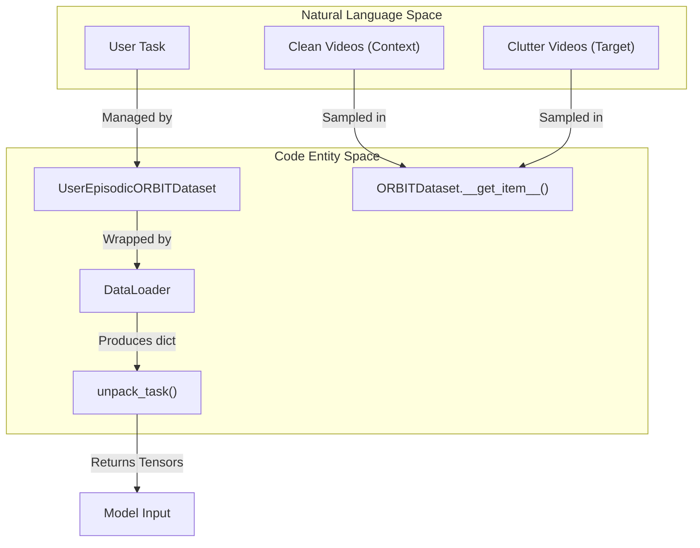
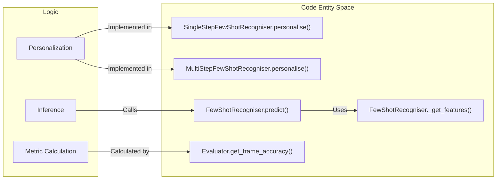

<!-- source: DeepWiki mcp.deepwiki.com · repo microsoft/ORBIT-Dataset · page 8 Glossary · fetched 2026-10-26 -->

# Glossary

Relevant source files

The following files were used as context for generating this wiki page:

- [README.md](README.md)
- [data/datasets.py](data/datasets.py)
- [data/orbit_extra_annotations.zip](data/orbit_extra_annotations.zip)
- [model/feature_adapters.py](model/feature_adapters.py)
- [model/feature_extractors.py](model/feature_extractors.py)
- [model/few_shot_recognisers.py](model/few_shot_recognisers.py)
- [model/film.py](model/film.py)
- [model/set_encoders.py](model/set_encoders.py)
- [orbit_challenge_getting_started.ipynb](orbit_challenge_getting_started.ipynb)
- [single-step-learner.py](single-step-learner.py)
- [utils/args.py](utils/args.py)
- [utils/eval_metrics.py](utils/eval_metrics.py)
- [utils/ops_counter.py](utils/ops_counter.py)

This glossary defines the technical terms, acronyms, and domain-specific concepts used throughout the ORBIT codebase. It provides mapping between high-level recognition concepts and their specific implementations in the Python source code.

## Core Concepts & Domain Terms

### Task (Episodic Task)
In the ORBIT benchmark, a **Task** represents a single few-shot learning problem. It is defined by a specific **User**, a set of **Objects** (the "way"), a **Support Set** (context videos), and a **Query Set** (target videos) [README.md:73-82](). In the code, tasks are generated as dictionaries by the `DataLoader` [data/dataloaders.py:38]() and unpacked using `unpack_task` [data/utils.py:39]().

### Support Set (Context Set)
The set of labeled data used to personalize a model to a new user's objects. In ORBIT, these are always **Clean Videos** where the object is clearly visible and centered [README.md:87-89]().
* **Implementation:** Referred to as `context` throughout the data pipeline [data/datasets.py:47-51]().

### Query Set (Target Set)
The set of unlabeled data (during inference) used to evaluate the personalized model. In the standard **CLUVE** (Clutter Video Evaluation) setting, these are **Clutter Videos** where the object is in a real-world environment [README.md:77-78]().
* **Implementation:** Referred to as `target` throughout the data pipeline [data/datasets.py:47-51]().

### Way and Shot
*   **Way:** The number of unique objects (classes) in a task. In ORBIT, the "way" typically includes *all* objects belonging to a specific user [README.md:75]().
*   **Shot:** The number of videos provided per object. ORBIT distinguishes between **Context Shot** (number of clean videos for personalization) and **Target Shot** (number of clutter videos for evaluation) [utils/args.py:55-58]().

---

## Code Entity Mapping: Data Flow

The following diagram bridges the natural language concepts of the ORBIT dataset to the specific classes and functions that handle them.

**Data Pipeline: Concept to Code Entity**

**Sources:** [data/datasets.py:18-22](), [data/dataloaders.py:38](), [data/utils.py:39](), [single-step-learner.py:116-119]()

---

## Architectural Components

### Feature Extractor (Backbone)
The neural network that converts raw image frames into high-dimensional feature vectors. Supported backbones include `efficientnet_b0`, `vit_s_32`, and `vit_b_32_clip` [utils/args.py:27-28]().
*   **Implementation:** Created via `create_feature_extractor` [model/feature_extractors.py:37]().

### FiLM (Feature Linear Modulation)
A method for adapting a global feature extractor to a specific task by applying per-channel scale ($\gamma$) and shift ($\beta$) parameters to the network's normalization layers [model/film.py:38-40]().
*   **Implementation:** `FilmParameterGenerator` [model/feature_adapters.py:36]() produces these parameters, which are then applied via `torch.nn.utils.stateless.functional_call` [model/few_shot_recognisers.py:35, 115]().

### Set Encoder
A network (DeepSets) used to encode the entire context set into a single task-level embedding. This embedding is then used by the `FilmParameterGenerator` to produce the FiLM parameters [model/set_encoders.py:34-36]().
*   **Implementation:** `SimplePrePoolNet` [model/set_encoders.py:81]().

### Classifier Head
The final layer of the model that produces class probabilities. ORBIT supports multiple heads:
*   **PrototypicalClassifier:** Uses Euclidean or Cosine distance to class centroids [model/few_shot_recognisers.py:77-80]().
*   **VersaClassifier:** A probabilistic linear head [model/few_shot_recognisers.py:75-76]().
*   **MahalanobisClassifier:** Uses Mahalanobis distance for metric learning [model/few_shot_recognisers.py:81-82]().

---

## Code Entity Mapping: Recognition Lifecycle

The following diagram maps the logical steps of "Learning" and "Recognizing" to the specific class methods in the `FewShotRecogniser` hierarchy.

**Model Lifecycle: Logic to Code Entity**

**Sources:** [model/few_shot_recognisers.py:46-50, 99, 192](), [utils/eval_metrics.py:14-19, 27-36]()

---

## Technical Acronyms & Metadata

| Term | Definition | Code Pointer |
| :--- | :--- | :--- |
| **LITE** | **L**arge **I**mage and **T**ask **E**pisodic training. A memory-optimization technique for high-res frames. | [single-step-learner.py:78](), [model/few_shot_recognisers.py:228]() |
| **CLEVE** | **Cle**an-video **E**valuation. Both context and target videos are clean. | [utils/args.py:61-64]() |
| **CLUVE** | **Clu**tter-video **E**valuation. Context is clean, target is clutter. | [README.md:77](), [utils/args.py:61-64]() |
| **MACs** | Multiply-Accumulate Operations. Used to measure computational cost. | [utils/ops_counter.py:10, 50]() |
| **FiLM Tagging** | The process of identifying layers in a backbone (e.g., `bn1`, `norm1`) to be modulated. | [model/film.py:38-40]() |
| **Object Cap** | A limit on the number of objects sampled per user to ensure consistent task size. | [data/datasets.py:76](), [utils/args.py:43-46]() |

---

## Evaluation Metrics

### Frame Accuracy (`frame_acc`)
The percentage of frames in a video where the model's top prediction matches the ground truth label [utils/eval_metrics.py:27-36]().

### Video Accuracy (`video_acc`)
A video is considered correctly recognized if the most frequent frame prediction across the entire video matches the ground truth [utils/eval_metrics.py:38-46]().

### Frames-to-Recognition
The index of the first correct frame prediction in a video, normalized by the total number of frames in that video [utils/eval_metrics.py:48-60]().

### OpsCounter
A utility class that uses the `thop` library to track MACs and parameter counts during the `personalise` and `predict` phases [utils/ops_counter.py:10-14](). It registers custom hooks for non-standard layers like `Conv2dSame` in EfficientNet [utils/ops_counter.py:71-77]().

**Sources:** [utils/eval_metrics.py:18-22](), [utils/ops_counter.py:10-18](), [README.md:79-82]()