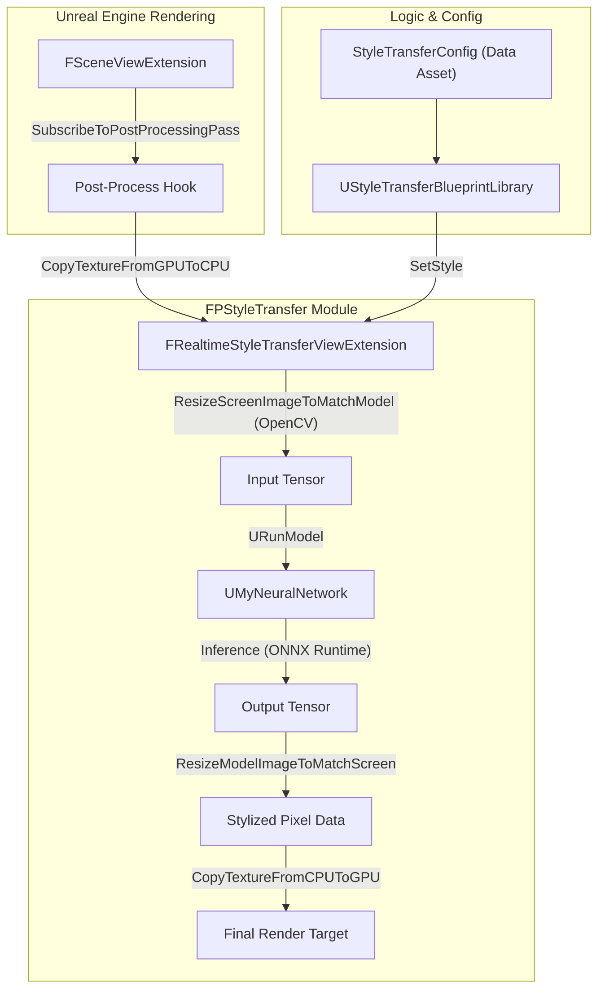

<!-- source: DeepWiki mcp.deepwiki.com · repo microsoft/OnnxRuntime-UnrealEngine · page 1 Project Overview · fetched 2026-10-26 -->

# Project Overview

<details>
<summary>Relevant source files</summary>

The following files were used as context for generating this wiki page:

- [.gitignore](.gitignore)
- [CODE_OF_CONDUCT.md](CODE_OF_CONDUCT.md)
- [FPStyleTransfer/Config/DefaultEngine.ini](FPStyleTransfer/Config/DefaultEngine.ini)
- [FPStyleTransfer/Config/DefaultGame.ini](FPStyleTransfer/Config/DefaultGame.ini)

</details>


The **FPStyleTransfer** project is a technical demonstration of real-time neural style transfer within **Unreal Engine 5**. It leverages the **ONNX Runtime (NNI)** to execute pre-trained deep learning models on the GPU, transforming the visual aesthetic of a first-person shooter environment into various artistic styles (e.g., Mosaic, Candy, Rain Princess) in real-time.

The project serves as a bridge between high-performance game rendering and machine learning inference, utilizing **OpenCV** for image preprocessing and the Unreal Engine **FSceneViewExtension** API to hook directly into the post-processing pipeline.

## Key Technologies

| Technology | Role in Project |
| :--- | :--- |
| **Unreal Engine 5** | Core game engine, rendering pipeline, and gameplay framework. |
| **ONNX Runtime (NNI)** | High-performance inference engine for executing `.onnx` models on the GPU. |
| **OpenCV** | Used for efficient CPU-side image resizing and format conversion. |
| **DirectX 12** | The targeted Graphics Rendering Hardware Interface (RHI) for Windows. |

For setup instructions and platform requirements, see [Getting Started & Build Configuration](#1.2).

## System Relationships

The system is divided into two primary domains: the **Style Transfer Core**, which handles the machine learning lifecycle and rendering hooks, and the **First-Person Gameplay Framework**, which provides the interactive environment.

The following diagram illustrates how the C++ entities interact to facilitate the flow from the rendering buffer to the neural network and back to the screen.

### Rendering & Inference Pipeline

**Sources:** [FPStyleTransfer/Config/DefaultEngine.ini:36-38](), [FPStyleTransfer/Config/DefaultEngine.ini:22-28]()

## Project Structure

The codebase is organized into a primary game module and several configuration layers that define how the engine handles ML workloads and gameplay.

### System Mapping: Code Entities
The following diagram maps high-level system responsibilities to specific classes and configuration files found in the repository.

```mermaid
graph LR
    subgraph "Core Inference System"
        "UMyNeuralNetwork"["UMyNeuralNetwork"]
        "UStyleTransferBlueprintLibrary"["UStyleTransferBlueprintLibrary"]
    end

    subgraph "Rendering Integration"
        "FRealtimeStyleTransferViewExtension"["FRealtimeStyleTransferViewExtension"]
    end

    subgraph "Gameplay Framework"
        "AFPStyleTransferCharacter"["AFPStyleTransferCharacter"]
        "AFPStyleTransferProjectile"["AFPStyleTransferProjectile"]
        "UTP_WeaponComponent"["UTP_WeaponComponent"]
    end

    subgraph "Configuration"
        "DefaultEngine.ini"["DefaultEngine.ini"]
        "DefaultInput.ini"["DefaultInput.ini"]
    end

    "FRealtimeStyleTransferViewExtension" --> "UMyNeuralNetwork"
    "UStyleTransferBlueprintLibrary" --> "FRealtimeStyleTransferViewExtension"
    "DefaultEngine.ini" --> "AFPStyleTransferCharacter"
```

### Major Subsystems

*   **Style Transfer Core**: Manages the `FRealtimeStyleTransferViewExtension`, which intercepts the frame after the Tonemapper pass. It utilizes `UMyNeuralNetwork` (a wrapper for ONNX Runtime) to process the scene. For details, see [Architecture Overview](#1.1).
*   **Gameplay Framework**: Based on the Unreal First Person template, including the character `AFPStyleTransferCharacter` and weapon logic in `UTP_WeaponComponent`.
*   **Configuration**: Defines the rendering RHI (DirectX 12), collision profiles for projectiles, and class redirects to ensure the project identifies as `FPStyleTransfer` rather than the default template name.

**Sources:** [FPStyleTransfer/Config/DefaultEngine.ini:1-4](), [FPStyleTransfer/Config/DefaultEngine.ini:16-17](), [FPStyleTransfer/Config/DefaultEngine.ini:39-44]()

## Child Pages
*   **[Architecture Overview](#1.1)**: Deep dive into the module structure, the rendering pipeline interception, and the integration of NNI and OpenCV.
*   **[Getting Started & Build Configuration](#1.2)**: Prerequisites, installation steps, and platform-specific configuration (Desktop, HoloLens, Mobile).

---

