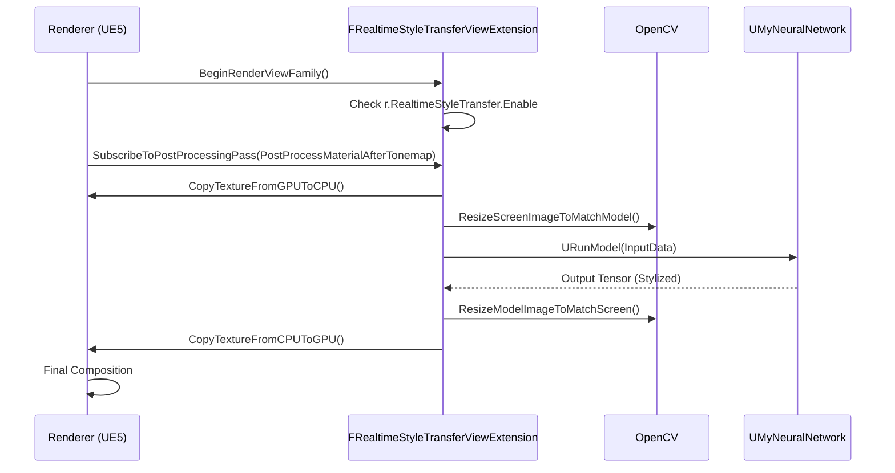

<!-- source: DeepWiki mcp.deepwiki.com · repo microsoft/OnnxRuntime-UnrealEngine · page 1.1 Architecture Overview · fetched 2026-10-26 -->

# Architecture Overview

<details>
<summary>Relevant source files</summary>

The following files were used as context for generating this wiki page:

- [.gitignore](.gitignore)
- [FPStyleTransfer/Config/DefaultEngine.ini](FPStyleTransfer/Config/DefaultEngine.ini)
- [FPStyleTransfer/Config/DefaultGame.ini](FPStyleTransfer/Config/DefaultGame.ini)

</details>


The **FPStyleTransfer** project is a high-performance Unreal Engine 5 integration of real-time neural style transfer. It leverages the **ONNX Runtime (NNI)** plugin for GPU-accelerated inference and **OpenCV** for image preprocessing, seamlessly injecting stylized frames into the Unreal Engine rendering pipeline via a custom `FSceneViewExtension`.

## System Module Structure

The system is organized into a primary C++ module that coordinates between the Unreal Engine renderer, the ONNX inference engine, and the gameplay logic.

### Module Dependencies
The project relies on three key pillars:
1.  **FPStyleTransfer (Source Module):** The core C++ logic containing the style transfer subsystem and gameplay framework.
2.  **NNI (ONNX Runtime Plugin):** Provides the `UNeuralNetwork` class and the underlying ONNX Runtime execution provider for Win64 (DirectX 12), Android, and iOS.
3.  **OpenCV Plugin:** Utilized for high-performance CPU-side image manipulation, specifically for resizing textures to match the input dimensions required by the ONNX models.

### System Components Diagram
The following diagram illustrates the relationship between the Unreal Engine Editor, the C++ source module, and the external plugins.

**System Component Relationship**
```mermaid
graph TD
    subgraph "Unreal Engine Editor"
        [Editor_UI] --> [Content_Browser]
        [Content_Browser] --> [StyleTransferConfig_Asset]
    end

    subgraph "FPStyleTransfer Module"
        [AFPStyleTransferCharacter] -- "Uses" --> [UStyleTransferBlueprintLibrary]
        [UStyleTransferBlueprintLibrary] -- "Configures" --> [FRealtimeStyleTransferViewExtension]
        [FRealtimeStyleTransferViewExtension] -- "Owns" --> [UMyNeuralNetwork]
    end

    subgraph "Plugins"
        [UMyNeuralNetwork] -- "Inherits From" --> [UNeuralNetwork_NNI_Plugin]
        [FRealtimeStyleTransferViewExtension] -- "Uses" --> [OpenCV_Library]
    end

    [StyleTransferConfig_Asset] -- "References" --> [ONNX_Models]
    [UNeuralNetwork_NNI_Plugin] -- "Loads" --> [ONNX_Models]
```
**Sources:**
- `FPStyleTransfer/Source/FPStyleTransfer/FPStyleTransfer.Build.cs` (Module dependencies)
- `FPStyleTransfer/Source/FPStyleTransfer/RealtimeStyleTransferViewExtension.h`
- `FPStyleTransfer/Source/FPStyleTransfer/MyNeuralNetwork.h`

---

## Rendering Pipeline Integration

The core of the style transfer occurs within the `FRealtimeStyleTransferViewExtension`. This class hooks into the Unreal Engine post-processing pipeline, allowing the system to intercept the rendered frame after the Tonemapping pass.

### Data Flow: Frame Interception and Inference
The data flow follows a "Pull-Process-Push" pattern:
1.  **Intercept:** The `SubscribeToPostProcessingPass` function identifies the `PostProcessMaterialAfterTonemap` location.
2.  **Copy (GPU to CPU):** The rendered scene texture is copied from GPU memory to a CPU-accessible buffer.
3.  **Pre-process:** `OpenCV` is used to resize the buffer to the specific input resolution of the active ONNX model (e.g., 224x224 or 512x512).
4.  **Inference:** `UMyNeuralNetwork::URunModel` executes the forward pass using the ONNX Runtime.
5.  **Post-process:** The output tensor is converted back into a pixel array.
6.  **Copy (CPU to GPU):** The stylized image is written back to a GPU texture and injected into the final display output.

**Execution Flow: FRealtimeStyleTransferViewExtension**

**Sources:**
- `FPStyleTransfer/Source/FPStyleTransfer/RealtimeStyleTransferViewExtension.cpp`
- `FPStyleTransfer/Source/FPStyleTransfer/MyNeuralNetwork.cpp`

---

## Game Logic and Subsystem Relationship

The style transfer is not just a static post-process; it is integrated into the gameplay via the **Blueprint API**. This allows designers to swap styles dynamically based on game events.

### Key Classes
| Class | Role |
| :--- | :--- |
| `AFPStyleTransferCharacter` | The player character that triggers style changes or interacts with the environment. |
| `UStyleTransferBlueprintLibrary` | A static library providing the `SetStyle` function to Blueprints. |
| `UMyNeuralNetwork` | A wrapper around the NNI `UNeuralNetwork` that handles the specifics of the Style Transfer models. |
| `AFPStyleTransferGameMode` | Defines the default classes for the session, ensuring the stylized character is spawned. |

### Configuration and Redirects
The project uses `DefaultEngine.ini` to handle class redirects, ensuring that the legacy First Person template classes are correctly mapped to the new `FPStyleTransfer` namespace.

**Configuration Sources:**
- `FPStyleTransfer/Config/DefaultEngine.ini:40-44` (Class redirects from `TP_FirstPerson` to `FPStyleTransfer`)
- `FPStyleTransfer/Config/DefaultEngine.ini:16-16` (Setting `GlobalDefaultGameMode`)
- `FPStyleTransfer/Config/DefaultGame.ini:8-11` (Enabling `StarterContent` packs)

**Blueprint to C++ Bridge**
```mermaid
graph LR
    [BP_FirstPersonCharacter] -- "Calls" --> [UStyleTransferBlueprintLibrary::SetStyle]
    [UStyleTransferBlueprintLibrary::SetStyle] -- "Updates" --> [FRealtimeStyleTransferViewExtension::ActiveModel]
    [FRealtimeStyleTransferViewExtension::ActiveModel] -- "Points To" --> [UMyNeuralNetwork_Instance]
    [UMyNeuralNetwork_Instance] -- "Runs" --> [ONNX_Runtime_Inference]
```
**Sources:**
- `FPStyleTransfer/Source/FPStyleTransfer/StyleTransferBlueprintLibrary.h`
- `FPStyleTransfer/Source/FPStyleTransfer/FPStyleTransferCharacter.h`

## Platform and Hardware Targets

The architecture is designed for cross-platform compatibility, specifically targeting high-end desktop and mobile/XR platforms.

*   **Desktop:** Uses DirectX 12 (`DefaultGraphicsRHI_DX12`) as the default RHI for Windows to support ONNX Runtime's DirectML execution provider.
*   **Mobile:** Supports iOS (Minimum version 14) and Android via the NNI plugin's mobile-optimized backends.
*   **Rendering Settings:** The project enables Virtual Shadow Maps and Global Illumination (Lumen) by default to provide a high-fidelity base for the style transfer to process.

**Sources:**
- `FPStyleTransfer/Config/DefaultEngine.ini:20-20` (iOS Version)
- `FPStyleTransfer/Config/DefaultEngine.ini:37-37` (DX12 Requirement)
- `FPStyleTransfer/Config/DefaultEngine.ini:23-28` (Renderer settings: Lumen and Virtual Shadows)

---

