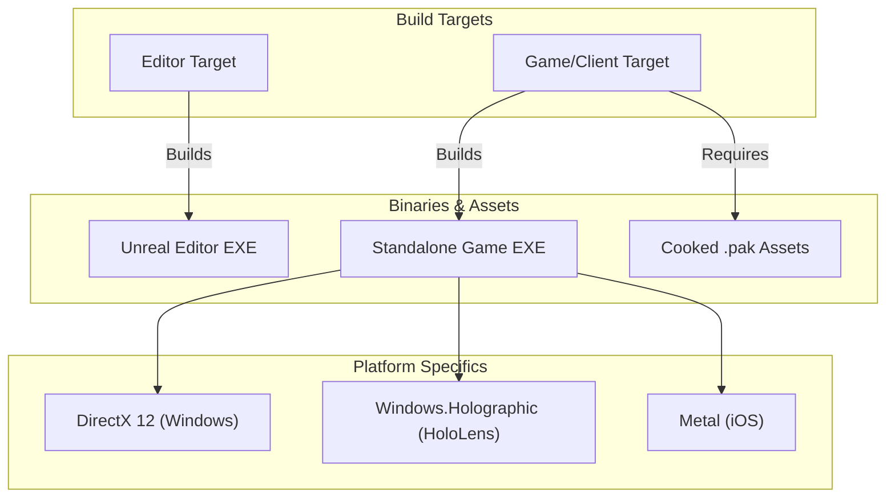

<!-- source: DeepWiki mcp.deepwiki.com · repo microsoft/OnnxRuntime-UnrealEngine · page 1.2 Getting Started & Build Configuration · fetched 2026-10-26 -->

# Getting Started & Build Configuration

<details>
<summary>Relevant source files</summary>

The following files were used as context for generating this wiki page:

- [FPStyleTransfer/Config/DefaultEditor.ini](FPStyleTransfer/Config/DefaultEditor.ini)
- [FPStyleTransfer/Config/DefaultEditorPerProjectUserSettings.ini](FPStyleTransfer/Config/DefaultEditorPerProjectUserSettings.ini)
- [FPStyleTransfer/Config/DefaultEngine.ini](FPStyleTransfer/Config/DefaultEngine.ini)
- [FPStyleTransfer/Config/HoloLens/HoloLensEngine.ini](FPStyleTransfer/Config/HoloLens/HoloLensEngine.ini)

</details>


This page provides a comprehensive technical guide for setting up, configuring, and building the **FPStyleTransfer** project. It details the hardware and software requirements, platform-specific configurations, and the build targets necessary to run neural style transfer within Unreal Engine 5.

## Prerequisites & Environment Setup

To build and run the project, the following environment configuration is required:

### 1. Unreal Engine 5 (UE5)
The project is built on the Unreal Engine 5 framework, utilizing modern rendering features such as Lumen and Virtual Shadow Maps.
*   **Targeted Hardware**: Desktop-class hardware with "Maximum" graphics performance settings [FPStyleTransfer/Config/DefaultEngine.ini:31-34]().
*   **Rendering API**: DirectX 12 (DX12) is the default Graphics RHI [FPStyleTransfer/Config/DefaultEngine.ini:37]().

### 2. Required Plugins
The core functionality relies on two primary external integrations:
*   **ONNX Runtime (NNI) Plugin**: Provides the `UNeuralNetwork` class and the inference engine for executing `.onnx` models on the GPU.
*   **OpenCV Plugin**: Used for high-performance image manipulation, specifically for resizing textures between the screen resolution and the model's required input dimensions.

### 3. Project Redirection
The project was migrated from the standard `TP_FirstPerson` template. Global redirects are configured in `DefaultEngine.ini` to map legacy class names to the current module structure:
*   `TP_FirstPersonProjectile` -> `FPStyleTransferProjectile` [FPStyleTransfer/Config/DefaultEngine.ini:42]().
*   `TP_FirstPersonGameMode` -> `FPStyleTransferGameMode` [FPStyleTransfer/Config/DefaultEngine.ini:43]().
*   `TP_FirstPersonCharacter` -> `FPStyleTransferCharacter` [FPStyleTransfer/Config/DefaultEngine.ini:44]().

---

## Build Targets & Platform Support

The project supports multiple deployment targets, ranging from high-end desktop environments to mobile and XR devices.

### Platform Configuration Table

| Platform | Graphics RHI / SDK | Key Configuration |
| :--- | :--- | :--- |
| **Windows** | DX12 | Default platform; uses Lumen and Mesh Distance Fields [FPStyleTransfer/Config/DefaultEngine.ini:24-37](). |
| **HoloLens** | Windows 10 SDK (10.0.18362.0) | Supports `spatialPerception` and `internetClientServer` capabilities [FPStyleTransfer/Config/HoloLens/HoloLensEngine.ini:18-25](). |
| **iOS** | Metal | Minimum version: iOS 14 [FPStyleTransfer/Config/DefaultEngine.ini:20](). |
| **Android** | Vulkan / OpenGL ES | Includes `AndroidFileServer` for debugging over USB [FPStyleTransfer/Config/DefaultEngine.ini:46-56](). |

### Build Configuration Logic
The following diagram illustrates the relationship between the Unreal Build Tool (UBT) targets and the resulting binaries.

**Target Architecture Flow**

**Sources:** [FPStyleTransfer/Config/DefaultEngine.ini:31-37](), [FPStyleTransfer/Config/HoloLens/HoloLensEngine.ini:3-16]()

---

## Engine & Editor Configuration

The project utilizes several `.ini` files to ensure the development environment and the runtime behavior are synchronized.

### Startup Maps and Game Modes
*   **Editor Startup**: The editor opens `FirstPersonMap.FirstPersonMap` by default [FPStyleTransfer/Config/DefaultEngine.ini:7]().
*   **Game Default**: The standalone game also defaults to `FirstPersonMap` [FPStyleTransfer/Config/DefaultEngine.ini:14]().
*   **Game Mode**: The default logic is handled by `AFPStyleTransferGameMode` [FPStyleTransfer/Config/DefaultEngine.ini:16]().

### Editor Preferences
The `DefaultEditor.ini` and `DefaultEditorPerProjectUserSettings.ini` files streamline the developer workflow:
*   **Blueprint Matching**: Allows class and blueprint pin matching for easier node connection [FPStyleTransfer/Config/DefaultEditor.ini:5]().
*   **Content Browser**: Automatically selects `/Game/FirstPerson` upon opening the project [FPStyleTransfer/Config/DefaultEditorPerProjectUserSettings.ini:2]().

### Collision Profiles
A custom collision profile for projectiles is defined to ensure proper physics interaction:
*   **Name**: `Projectile` [FPStyleTransfer/Config/DefaultEngine.ini:2]().
*   **Object Type**: `Projectile` [FPStyleTransfer/Config/DefaultEngine.ini:2]().
*   **Interaction**: Configured to ignore `Trigger` channels while blocking other static/dynamic objects [FPStyleTransfer/Config/DefaultEngine.ini:3-4]().

---

## HoloLens Specific Settings

Deployment to HoloLens requires specific UWP (Universal Windows Platform) configurations found in `HoloLensEngine.ini`.

### Spatial Mapping & Performance
To support Mixed Reality features, the following parameters are tuned:
*   **Spatial Meshing**: Volume size set to `20.0` with a max triangle density of `500.0` per cubic meter [FPStyleTransfer/Config/HoloLens/HoloLensEngine.ini:19-20]().
*   **Capabilities**: Specifically enables `spatialPerception` for environment tracking [FPStyleTransfer/Config/HoloLens/HoloLensEngine.ini:25]().
*   **Device Targeting**: Explicitly configured for `Windows.Holographic` device family [FPStyleTransfer/Config/HoloLens/HoloLensEngine.ini:16]().

**HoloLens Configuration Mapping**
```mermaid
classDiagram
    class HoloLensTargetSettings {
        +String TargetDeviceFamily: "Windows.Holographic"
        +String Windows10SDKVersion: "10.0.18362.0"
        +Float MaxTrianglesPerCubicMeter: 500.0
        +Float SpatialMeshingVolumeSize: 20.0
        +Array CapabilityList
    }
    
    HoloLensTargetSettings --|> "HoloLensEngine.ini" : "Configures"
    "HoloLensEngine.ini" ..> "UWP Build Process" : "Informs"
```
**Sources:** [FPStyleTransfer/Config/HoloLens/HoloLensEngine.ini:16-25]()

---

## How to Run the Project

1.  **Clone the Repository**: Ensure you have the ONNX models located in the appropriate content directories.
2.  **Generate Project Files**: Right-click the `.uproject` file and select "Generate Visual Studio project files".
3.  **Build**: Open the `.sln` file and build the project in **Development Editor** configuration for your platform (Win64).
4.  **Open Editor**: Launch the project. The editor will automatically load `FirstPersonMap` [FPStyleTransfer/Config/DefaultEngine.ini:7]().
5.  **PIE (Play In Editor)**: Press **Play**. The system will initialize the `FRealtimeStyleTransferViewExtension` and begin applying the neural style transfer to the viewport.

**Sources:**
*   `FPStyleTransfer/Config/DefaultEngine.ini` [1-60]()
*   `FPStyleTransfer/Config/DefaultEditor.ini` [1-8]()
*   `FPStyleTransfer/Config/DefaultEditorPerProjectUserSettings.ini` [1-2]()
*   `FPStyleTransfer/Config/HoloLens/HoloLensEngine.ini` [1-32]()

---

