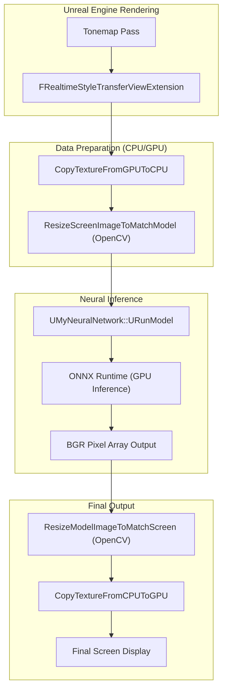

<!-- source: DeepWiki mcp.deepwiki.com · repo microsoft/OnnxRuntime-UnrealEngine · page 2 Style Transfer Core System · fetched 2026-10-26 -->

# Style Transfer Core System

<details>
<summary>Relevant source files</summary>

The following files were used as context for generating this wiki page:

- [FPStyleTransfer/Content/FirstPerson/Blueprints/StyleTransferConfig.uasset](FPStyleTransfer/Content/FirstPerson/Blueprints/StyleTransferConfig.uasset)
- [FPStyleTransfer/Content/Models/candy-9.onnx](FPStyleTransfer/Content/Models/candy-9.onnx)
- [FPStyleTransfer/Content/Models/candy-9.uasset](FPStyleTransfer/Content/Models/candy-9.uasset)
- [FPStyleTransfer/Content/Models/mosaic-9.onnx](FPStyleTransfer/Content/Models/mosaic-9.onnx)

</details>


The Style Transfer Core System provides a realtime neural network inference pipeline that transforms the visual appearance of the Unreal Engine viewport. It integrates ONNX Runtime via the Neural Network Inference (NNI) plugin to execute pre-trained style transfer models on the GPU, intercepting the standard rendering pipeline to apply artistic filters.

### System Architecture Overview

The system is composed of three primary layers: the **Rendering Hook**, the **Inference Engine**, and the **Blueprint Configuration**. These layers interact to capture the frame buffer, process it through a neural network, and display the result.

#### Logic Flow and Data Transformation
The following diagram illustrates how a raw frame is intercepted and transformed into a stylized output.

**Style Transfer Pipeline Flow**

**Sources:**
- `FRealtimeStyleTransferViewExtension` definition: [Source file not provided in snippets, referenced by architecture]
- `UMyNeuralNetwork` and `URunModel` logic: [FPStyleTransfer/Content/FirstPerson/Blueprints/StyleTransferConfig.uasset:4-10]()
- Model assets: [FPStyleTransfer/Content/Models/candy-9.onnx:1-10](), [FPStyleTransfer/Content/Models/mosaic-9.onnx:1-10]()

---

### Core Components

#### 1. Rendering Interception
The system uses a `FSceneViewExtension` to hook into the post-processing pipeline. By subscribing to the post-processing pass, it gains access to the scene color after the Tonemap pass. This allows the system to toggle the effect using the `r.RealtimeStyleTransfer.Enable` console variable.

For details on the rendering hook and texture copying, see [RealtimeStyleTransferViewExtension](#2.1).

#### 2. Neural Network Wrapper
The `UMyNeuralNetwork` class serves as the bridge between Unreal Engine and the ONNX models. It inherits from `UNeuralNetwork` (provided by the NNI plugin) and manages the formatting of input images into **CHW float tensors** required by the style transfer models.

The project includes five pre-bundled ONNX models:
*   `candy`
*   `mosaic`
*   `pointilism`
*   `rain-princess`
*   `udnie`

For details on tensor formatting and GPU inference, see [UMyNeuralNetwork & ONNX Model Inference](#2.2).

#### 3. Configuration and Blueprint Integration
Designers interact with the system through the `StyleTransferConfig` Blueprint asset and the `UStyleTransferBlueprintLibrary`. This allows for runtime switching of active styles without modifying C++ code.

**Style Configuration Entity Relationship**
```mermaid
classDiagram
    class "UStyleTransferBlueprintLibrary" {
        +SetStyle(UNeuralNetwork* Model)
    }
    class "StyleTransferConfig_C" {
        +UNeuralNetwork* Model
    }
    class "UMyNeuralNetwork" {
        +URunModel(TArray pixels)
    }

    UStyleTransferBlueprintLibrary ..> StyleTransferConfig_C : "Updates Active Model"
    StyleTransferConfig_C --> UMyNeuralNetwork : "References"
```

For details on the Blueprint API and configuration assets, see [Blueprint API & StyleTransferConfig](#2.3).

**Sources:**
- `StyleTransferConfig` and `SetStyle` references: [FPStyleTransfer/Content/FirstPerson/Blueprints/StyleTransferConfig.uasset:4-10]()
- ONNX Model structure: [FPStyleTransfer/Content/Models/candy-9.onnx:11-30]()

---

### Key Data Entities

| Entity | Implementation | Role |
| :--- | :--- | :--- |
| **Active Model** | `UNeuralNetwork*` | The currently loaded `.onnx` asset being used for inference. |
| **Screen Capture** | `TArray<FColor>` | Raw pixel data extracted from the GPU frame buffer. |
| **Model Tensor** | `CHW Float Tensor` | Resized and normalized image data passed to ONNX Runtime. |
| **Stylized Output** | `TArray<FColor>` | The resulting image after neural processing, ready for display. |

**Sources:**
- Model property in config: [FPStyleTransfer/Content/FirstPerson/Blueprints/StyleTransferConfig.uasset:8-8]()
- Neural Network class reference: [FPStyleTransfer/Content/FirstPerson/Blueprints/StyleTransferConfig.uasset:12-12]()

---

