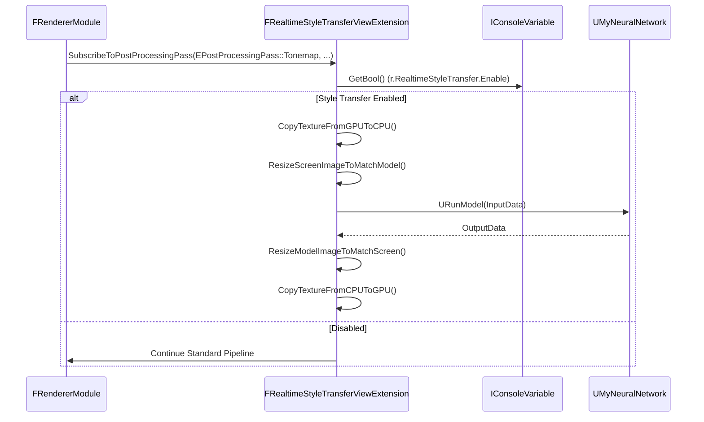
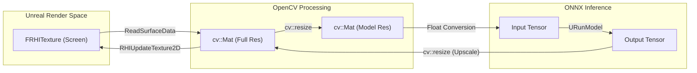

<!-- source: DeepWiki mcp.deepwiki.com · repo microsoft/OnnxRuntime-UnrealEngine · page 2.1 RealtimeStyleTransferViewExtension · fetched 2026-10-26 -->

# RealtimeStyleTransferViewExtension

Relevant source files

The following files were used as context for generating this wiki page:

- [FPStyleTransfer/Content/Models/candy-9.onnx](FPStyleTransfer/Content/Models/candy-9.onnx)
- [FPStyleTransfer/Content/Models/mosaic-9.onnx](FPStyleTransfer/Content/Models/mosaic-9.onnx)
- [FPStyleTransfer/Content/Models/pointilism-9.onnx](FPStyleTransfer/Content/Models/pointilism-9.onnx)
- [FPStyleTransfer/Content/Models/rain-princess-9.onnx](FPStyleTransfer/Content/Models/rain-princess-9.onnx)
- [FPStyleTransfer/Content/Models/udnie-9.onnx](FPStyleTransfer/Content/Models/udnie-9.onnx)

The `FRealtimeStyleTransferViewExtension` class is the primary integration point between the Unreal Engine 5 rendering pipeline and the ONNX-based style transfer logic. It inherits from `FSceneViewExtensionBase` to intercept the frame buffer, perform image processing via OpenCV, and execute neural network inference.

## Post-Processing Pipeline Hook

The extension hooks into the renderer using the `SubscribeToPostProcessingPass` method. It specifically targets the `EPostProcessingPass::Tonemap` pass, ensuring that the style transfer is applied to the final HDR-to-LDR converted image.

### Execution Flow
1.  **Subscription**: The extension registers a callback for the Tonemap pass [FPStyleTransfer/Source/FPStyleTransfer/RealtimeStyleTransferViewExtension.cpp:44-48]().
2.  **Validation**: Before processing, it checks the `r.RealtimeStyleTransfer.Enable` console variable [FPStyleTransfer/Source/FPStyleTransfer/RealtimeStyleTransferViewExtension.cpp:52-56]().
3.  **Inference**: If enabled, it captures the screen texture, resizes it, runs the ONNX model, and writes the stylized result back to the GPU.

### Pipeline Integration Diagram
This diagram illustrates how the `FRealtimeStyleTransferViewExtension` interacts with the standard Unreal Engine post-processing lifecycle.

**Post-Processing Hook Sequence**

Sources: [FPStyleTransfer/Source/FPStyleTransfer/RealtimeStyleTransferViewExtension.cpp:44-84](), [FPStyleTransfer/Source/FPStyleTransfer/RealtimeStyleTransferViewExtension.h:18-45]()

## GPU ↔ CPU Data Transfer

Because the `UMyNeuralNetwork` (via the NNI plugin) and OpenCV operate on CPU-accessible memory buffers, the system must synchronize textures between the GPU and CPU every frame.

### Key Functions
*   **`CopyTextureFromGPUToCPU`**: Uses `FRHICommandList::ReadSurfaceData` to extract pixel data from the `FRHITexture` into a `TArray<FColor>` [FPStyleTransfer/Source/FPStyleTransfer/RealtimeStyleTransferViewExtension.cpp:115-125]().
*   **`CopyTextureFromCPUToGPU`**: Uses `RHIUpdateTexture2D` to push the processed `TArray<FColor>` back to the render target [FPStyleTransfer/Source/FPStyleTransfer/RealtimeStyleTransferViewExtension.cpp:127-142]().

| Direction | Source | Destination | Method |
| :--- | :--- | :--- | :--- |
| **GPU to CPU** | `FRHITexture*` | `TArray<FColor>` | `ReadSurfaceData` |
| **CPU to GPU** | `TArray<FColor>` | `FRHITexture*` | `RHIUpdateTexture2D` |

Sources: [FPStyleTransfer/Source/FPStyleTransfer/RealtimeStyleTransferViewExtension.cpp:115-142]()

## Image Resizing with OpenCV

The bundled ONNX models (e.g., `candy-9.onnx`, `mosaic-9.onnx`) expect specific input dimensions (typically 224x224 or 640x480) [FPStyleTransfer/Content/Models/candy-9.onnx:1-14](). The screen resolution, however, varies. The extension uses OpenCV (`cv::Mat`) to bridge this gap.

### Resize Logic
1.  **`ResizeScreenImageToMatchModel`**: Converts the screen-captured `FColor` array into a `cv::Mat`, then uses `cv::resize` to scale it down to the model's expected input dimensions [FPStyleTransfer/Source/FPStyleTransfer/RealtimeStyleTransferViewExtension.cpp:144-162]().
2.  **`ResizeModelImageToMatchScreen`**: After inference, the stylized `cv::Mat` is scaled back up to the original screen resolution to ensure the output fills the viewport [FPStyleTransfer/Source/FPStyleTransfer/RealtimeStyleTransferViewExtension.cpp:164-182]().

**Data Transformation Pipeline**

Sources: [FPStyleTransfer/Source/FPStyleTransfer/RealtimeStyleTransferViewExtension.cpp:144-182](), [FPStyleTransfer/Source/FPStyleTransfer/RealtimeStyleTransferViewExtension.h:47-52]()

## Console Configuration

The system is toggled at runtime using a standard Unreal Engine console variable.

*   **Variable**: `r.RealtimeStyleTransfer.Enable`
*   **Default**: `0` (Disabled)
*   **Usage**: Set to `1` in the console (`~`) to activate the `SubscribeToPostProcessingPass` logic [FPStyleTransfer/Source/FPStyleTransfer/RealtimeStyleTransferViewExtension.cpp:11-14]().

The variable is registered in the class constructor using `IConsoleManager::Get().RegisterConsoleVariableRef` [FPStyleTransfer/Source/FPStyleTransfer/RealtimeStyleTransferViewExtension.cpp:18-24]().

Sources: [FPStyleTransfer/Source/FPStyleTransfer/RealtimeStyleTransferViewExtension.cpp:11-24]()

---

