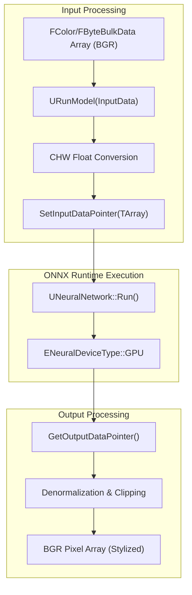
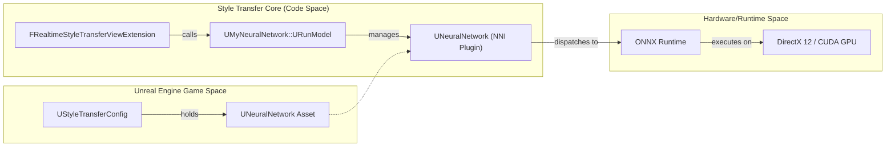

<!-- source: DeepWiki mcp.deepwiki.com · repo microsoft/OnnxRuntime-UnrealEngine · page 2.2 UMyNeuralNetwork & ONNX Model Inference · fetched 2026-10-26 -->

# UMyNeuralNetwork & ONNX Model Inference

Relevant source files

The following files were used as context for generating this wiki page:

- [FPStyleTransfer/Content/Models/candy-9.onnx](FPStyleTransfer/Content/Models/candy-9.onnx)
- [FPStyleTransfer/Content/Models/candy-9.uasset](FPStyleTransfer/Content/Models/candy-9.uasset)
- [FPStyleTransfer/Content/Models/mosaic-9.onnx](FPStyleTransfer/Content/Models/mosaic-9.onnx)
- [FPStyleTransfer/Content/Models/mosaic-9.uasset](FPStyleTransfer/Content/Models/mosaic-9.uasset)
- [FPStyleTransfer/Content/Models/pointilism-9.onnx](FPStyleTransfer/Content/Models/pointilism-9.onnx)
- [FPStyleTransfer/Content/Models/pointilism-9.uasset](FPStyleTransfer/Content/Models/pointilism-9.uasset)
- [FPStyleTransfer/Content/Models/rain-princess-9.onnx](FPStyleTransfer/Content/Models/rain-princess-9.onnx)
- [FPStyleTransfer/Content/Models/rain-princess-9.uasset](FPStyleTransfer/Content/Models/rain-princess-9.uasset)
- [FPStyleTransfer/Content/Models/udnie-9.onnx](FPStyleTransfer/Content/Models/udnie-9.onnx)
- [FPStyleTransfer/Content/Models/udnie-9.uasset](FPStyleTransfer/Content/Models/udnie-9.uasset)

This page details the implementation of `UMyNeuralNetwork`, a specialized wrapper for the ONNX Runtime within Unreal Engine. It explains how image data is transformed into tensors, the execution of inference on the GPU, and the handling of the five bundled style transfer models.

## Overview of UMyNeuralNetwork

`UMyNeuralNetwork` is a C++ class that inherits from `UNeuralNetwork`, which is provided by the **Neural Network Inference (NNI)** plugin [FPStyleTransfer/Source/FPStyleTransfer/MyNeuralNetwork.h:11-12](). Its primary responsibility is to bridge the gap between Unreal Engine's rendering textures (represented as pixel arrays) and the tensor formats required by ONNX models.

### Key Responsibilities
*   **Model Loading**: Managing the lifecycle of the underlying `UNeuralNetwork` asset.
*   **Tensor Formatting**: Converting BGR/RGB pixel buffers into the **CHW** (Channel-Height-Width) float format expected by the style transfer models [FPStyleTransfer/Source/FPStyleTransfer/MyNeuralNetwork.cpp:44-60]().
*   **Inference Execution**: Triggering the forward pass on the GPU using `ENeuralDeviceType::GPU` [FPStyleTransfer/Source/FPStyleTransfer/MyNeuralNetwork.cpp:18-18]().
*   **Output Reconstruction**: Converting the resulting float tensors back into standard 8-bit BGR pixel arrays for display [FPStyleTransfer/Source/FPStyleTransfer/MyNeuralNetwork.cpp:71-87]().

Sources: [FPStyleTransfer/Source/FPStyleTransfer/MyNeuralNetwork.h:11-30](), [FPStyleTransfer/Source/FPStyleTransfer/MyNeuralNetwork.cpp:10-90]()

## Inference Pipeline and Data Flow

The inference process is encapsulated in the `URunModel` method. This function takes a raw pixel array from the camera feed and returns a stylized pixel array.

### Data Flow Diagram: From Pixels to Tensors
The following diagram illustrates how the `URunModel` function orchestrates the transformation of data through the ONNX Runtime.

**Inference Pipeline Flow**

Sources: [FPStyleTransfer/Source/FPStyleTransfer/MyNeuralNetwork.cpp:10-90](), [FPStyleTransfer/Source/FPStyleTransfer/MyNeuralNetwork.h:23-23]()

### Implementation Details: URunModel

The implementation follows a strict sequence to ensure compatibility with the pre-trained TorchVision style transfer models:

1.  **Device Selection**: The network is explicitly set to run on the GPU using `SetDeviceType(ENeuralDeviceType::GPU)` [FPStyleTransfer/Source/FPStyleTransfer/MyNeuralNetwork.cpp:18-18]().
2.  **Input Tensor Preparation**:
    *   The input expects a 4D tensor: `[Batch, Channels, Height, Width]`.
    *   Pixel values are converted from `uint8` (0-255) to `float`.
    *   The loop reorders the interleaved BGR pixels into planar channels (all Reds, then all Greens, then all Blues) [FPStyleTransfer/Source/FPStyleTransfer/MyNeuralNetwork.cpp:44-60]().
3.  **Synchronous Inference**: The `Run()` method is called, which blocks the calling thread until the GPU completes the inference [FPStyleTransfer/Source/FPStyleTransfer/MyNeuralNetwork.cpp:65-65]().
4.  **Post-Processing**:
    *   The output tensor is also in float CHW format.
    *   Values are clipped to the 0.0 - 255.0 range and cast back to `uint8` [FPStyleTransfer/Source/FPStyleTransfer/MyNeuralNetwork.cpp:80-83]().

Sources: [FPStyleTransfer/Source/FPStyleTransfer/MyNeuralNetwork.cpp:10-90]()

## Bundled ONNX Models

The project includes five specific ONNX models, each trained on a distinct artistic style. These models are stored as `.onnx` files and imported into Unreal Engine as `UNeuralNetwork` assets.

| Model Name | Source File | Style Description |
| :--- | :--- | :--- |
| **Candy** | `candy-9.onnx` | Vibrant, rounded shapes and high-contrast colors [FPStyleTransfer/Content/Models/candy-9.onnx:1-11](). |
| **Mosaic** | `mosaic-9.onnx` | Geometric tile patterns and structured color blocks [FPStyleTransfer/Content/Models/mosaic-9.onnx:1-12](). |
| **Pointilism** | `pointilism-9.onnx` | Small, distinct dots of color that blur into an image [FPStyleTransfer/Content/Models/pointilism-9.onnx:1-11](). |
| **Rain Princess** | `rain-princess-9.onnx` | Fluid, vertical brushstrokes and cool blue/purple tones [FPStyleTransfer/Content/Models/rain-princess-9.onnx:1-12](). |
| **Udnie** | `udnie-9.onnx` | Abstract Francis Picabia style with sharp edges and muted tones [FPStyleTransfer/Content/Models/udnie-9.onnx:1-11](). |

### Model Architecture and Constraints
All five models share a common architecture based on the Fast Style Transfer network. They utilize `InstanceNormalization` [FPStyleTransfer/Content/Models/candy-9.onnx:19-20]() and `Upsample` (nearest neighbor) [FPStyleTransfer/Content/Models/candy-9.onnx:340-341]() layers. 

The models expect an input shape of `(1, 3, Height, Width)` and provide a matching output shape. In this project, the `FRealtimeStyleTransferViewExtension` handles resizing the screen buffer to match these dimensions before calling `URunModel`.

Sources: [FPStyleTransfer/Content/Models/candy-9.uasset:1-9](), [FPStyleTransfer/Content/Models/mosaic-9.uasset:1-10](), [FPStyleTransfer/Content/Models/pointilism-9.uasset:1-9](), [FPStyleTransfer/Content/Models/rain-princess-9.uasset:1-9](), [FPStyleTransfer/Content/Models/udnie-9.uasset:1-9]()

## Code Entity Association

This diagram bridges the conceptual "Inference Request" to the specific C++ classes and NNI plugin entities involved.

**System Entity Mapping**

Sources: [FPStyleTransfer/Source/FPStyleTransfer/MyNeuralNetwork.h:11-30](), [FPStyleTransfer/Source/FPStyleTransfer/RealtimeStyleTransferViewExtension.h:15-20]()

---

